# AWS foundations

The rules every AWS resource in MiniTickets obeys. Read this before the infra story: almost every
AWS problem is one of the three questions in chapter 3.

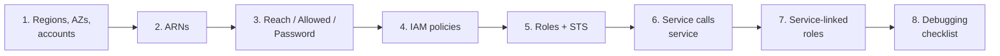

Every chapter uses the same headings as the concept cards. A heading is left out only when it
truly does not apply. Example account ids are AWS's documentation placeholder `123456789012`,
never our real one.

---

## 1. Regions, availability zones and accounts

### 1. In one line

An **account** is our private space in AWS, a **region** is a group of data centres in one area
of the world, and an **availability zone (AZ)** is one isolated part of a region.

### 2. Real-life comparison

The account is our company's lease with a global chain of business parks. A region is one city
the chain operates in. An AZ is one building in that city, with its own power and network, far
enough from the others that one fire does not reach the next. Some services are not in any city:
they are the chain's head office (IAM, CloudFront, Budgets).

### 3. Picture it

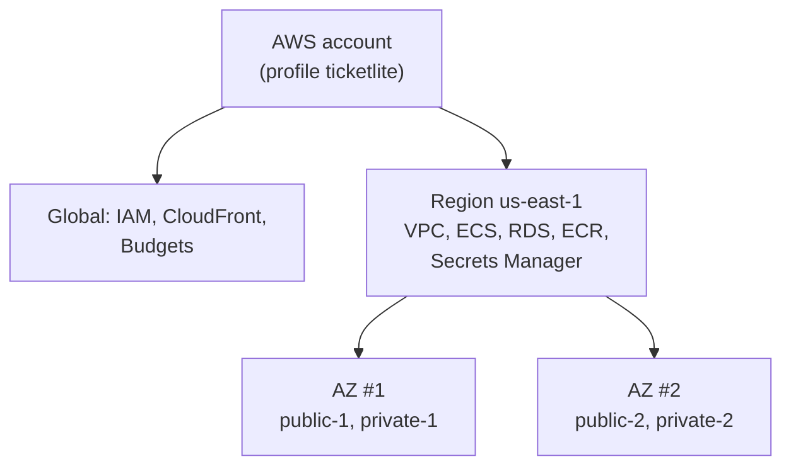

Three scopes: **global** services exist once per account, **regional** ones live in one region,
and **zonal** ones (a subnet, an RDS instance, a running task) live in one AZ.

### 4. Where in our code

- `infra/Pulumi.dev.yaml` → `aws:region: us-east-1` and `aws:profile: ticketlite`. Every Pulumi
  resource goes to this region, created with this CLI profile's account.
- `infra/src/network.ts` → `azs` and `azNames`:
  1. `aws.getAvailabilityZonesOutput({ state: "available" })` asks AWS which AZs this region has.
  2. `names.slice(0, 2)` keeps the first two.
  3. Each subnet gets `availabilityZone: azNames.apply((names) => names[i])`, so `public-1` and
     `private-1` share AZ #1, and `public-2` and `private-2` share AZ #2.
- `infra/src/data/postgres.ts` → `subnetGroup`: RDS demands subnets in at least 2 AZs, even for a
  single-AZ database.
- `infra/src/entry/alb.ts` → `subnets: inputs.publicSubnetIds`: an ALB needs at least 2 AZs.
- `infra/src/compute/iam.ts` → `accountId = aws.getCallerIdentityOutput().accountId`: the account
  id is looked up, never typed into the code.

### 5. See it yourself

```bash
# Who am I, and in which account? (Prints your account id: fine on your screen, don't paste it publicly.)
aws sts get-caller-identity --profile ticketlite

# The AZs of our region: the name (us-east-1a) and the real, account-independent id (use1-az…).
aws ec2 describe-availability-zones --region us-east-1 --profile ticketlite \
  --query "AvailabilityZones[].[ZoneName,ZoneId]" --output table
```

**Break it on purpose (safe):** in the AWS console, switch the region selector from N. Virginia
(us-east-1) to Oregon (us-west-2) and open VPC. Our `minitickets-dev-vpc` is "gone". Nothing was
deleted: regional resources are only visible in their own region.

### 6. How it connects

- **Uses ←** nothing. This is the ground floor.
- **Gives →** every regional resource (VPC, ECS, RDS, ECR) its home, and every zonal one (subnets,
  RDS instance, tasks) its building. The ALB and RDS need the 2 AZs. See
  [docs/12](../12-infra-network.md).

### 7. Our settings and WHY

| Setting | Value | Why |
| ------- | ----- | --- |
| Region | `us-east-1` | Set once in `Pulumi.dev.yaml`. The step docs don't record why. Not sure, but common reasons are: it gets new features first and is among the cheapest regions. A custom CloudFront domain would also need its certificate there (comment in `infra/src/entry/cdn.ts`). |
| AZs | first 2 available | 2 is the minimum the ALB and the RDS subnet group accept. A third adds subnets and cost with little gain in dev. |
| Accounts | 1 (dev only) | A learning project. There is no prod stack. |

### 8. Trade-offs

- **Pros:** one region keeps latency between our parts tiny and the setup simple. 2 AZs is the
  cheapest shape that the ALB and RDS accept.
- **Cons:** the whole app lives in one region, so a regional outage takes it down. And in dev we
  use the second AZ for subnets only: 1 task per service, single-AZ RDS and one Valkey node.

### 9. Alternatives and when to choose them

- **3 AZs:** production with a quorum-based system (3 copies survive one AZ loss with a majority).
- **Several accounts** (AWS Organizations: dev, staging, prod, security): any real company. An
  account is the strongest wall AWS has; a mistake in dev cannot touch prod.
- **Multi-region:** when users are worldwide or the business cannot survive a regional outage.
  Costly and hard (data replication).

### 10. What breaks, and how we'd notice

- **Wrong region in a command:** the CLI says a resource does not exist although it does. Notice:
  "not found" errors right after a successful `pulumi up`. Fix: `--region us-east-1`.
- **An AZ fails:** in dev, single-AZ RDS and the one Valkey node may be down until AWS recovers
  them. Notice: `/ready` turns 503, logins fail with a generic 500.
- **AZ names differ per account:** `us-east-1a` in our account may be a different building than
  `us-east-1a` in yours. Use the `ZoneId` when comparing across accounts.

### 11. Reach / Allowed / Password

Not a connection, but it sets **reach**: inside one VPC, subnets in different AZs reach each
other through the built-in `local` route.

### 12. Cost

Accounts, regions and AZs cost nothing by themselves. Prices of the same service differ a little
between regions. Data that crosses between AZs is billed per GB; for us that is tiny and not
measured.

### 13. Interview answers at 3 levels

- **Simple:** A region is a geographic area with several isolated data centre groups called AZs.
  We run in us-east-1 across two AZs.
- **Senior:** Resources are global (IAM, CloudFront), regional (VPC, ECS, RDS) or zonal (subnets,
  instances). In our Pulumi code the network takes the first two available AZs and creates a public
  and a private subnet in each; the ALB and the RDS subnet group require two AZs. In dev only the
  shape is multi-AZ: we run one task per service, a single-AZ RDS and one cache node.
- **Lead:** AZ redundancy only helps if every stateful tier is redundant too, so for production
  I would pay for RDS Multi-AZ, a cache replica with failover and at least two tasks per service
  spread across AZs. I would separate prod into its own account. Multi-region I would only do with a
  clear business case, because the hard part is data replication, not compute.

### 14. Follow-up questions interviewers ask

- *Is an AZ one data centre?* One or more data centres, isolated from the other AZs.
- *Why can `us-east-1a` differ between accounts?* AWS maps AZ names to physical AZs per account,
  to spread load. The `ZoneId` is the same everywhere.
- *Which services are global?* For us: IAM, CloudFront and Budgets.
- *Why at least two AZs for an ALB?* So the load balancer itself survives the loss of one AZ.

### 15. Say it in 30 seconds

"We run in one AWS account, in us-east-1, across two availability zones. Each AZ has a public and
a private subnet. The ALB and the RDS subnet group span both AZs, but in dev we run one copy of
each stateful part, so the multi-AZ shape is ready while the redundancy is not paid for yet."

### 16. Status

✅ built: one account, one region, two AZs. **To make it production-grade:** a separate prod
account, and redundancy in every tier across both AZs (see `high-availability` in the
[concept map](concept-map.md)).

---

## 2. ARNs: the full address of a resource

### 1. In one line

An **ARN** (Amazon Resource Name) is the unique name of one AWS resource, used wherever a policy
or another resource must point at it exactly.

### 2. Real-life comparison

A full postal address: country, city, building, apartment. "Apartment 4" alone is ambiguous;
the full address is not.

### 3. Picture it

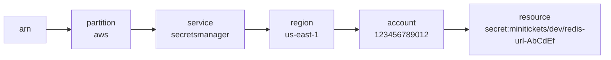

The parts are separated by `:`. Read left to right: which AWS (partition), which service, where,
whose, what.

### 4. Where in our code

ARNs are passed between layers, never typed by hand (except one AWS-owned policy):

- `infra/src/compute/iam.ts` → `executionSecrets`: `Resource: [inputs.dbMasterSecretArn, inputs.redisUrlSecretArn]`.
  The policy names exactly two secrets.
- `infra/src/compute/iam.ts` → `executionManaged`:
  `policyArn: "arn:aws:iam::aws:policy/service-role/AmazonECSTaskExecutionRolePolicy"`.
- `infra/src/compute/task.ts` → `secrets`: `` valueFrom: `${dbMasterSecretArn}:username::` ``.
  ECS reads extra parts after a secret ARN: `:<json key>:<version stage>:<version id>`. Here: the
  `username` key, current version.
- `infra/src/data/postgres.ts` → `masterSecretArn`; `infra/src/data/secrets.ts` → `redisUrlSecretArn`.
- `infra/index.ts` → outputs `dbMasterSecretArn`, `redisUrlSecretArn`, `apiTaskDefinitionArn`:
  addresses only, never the secret values.

Real shapes from our stack (example account id):

| Resource | ARN shape | Note |
| -------- | --------- | ---- |
| AWS-managed policy | `arn:aws:iam::aws:policy/service-role/AmazonECSTaskExecutionRolePolicy` | IAM is global: region empty. Account `aws` = owned by AWS. |
| Our execution role | `arn:aws:iam::123456789012:role/minitickets-dev-api-execution-role` | Global, so no region. |
| redis-url secret | `arn:aws:secretsmanager:us-east-1:123456789012:secret:minitickets/dev/redis-url-AbCdEf` | Secrets Manager adds a `-` and 6 random characters. |
| api task definition | `arn:aws:ecs:us-east-1:123456789012:task-definition/minitickets-dev-api:7` | `:7` is the revision. |
| api log group | `arn:aws:logs:us-east-1:123456789012:log-group:/minitickets/dev/api` | The name itself contains `/`. |
| CloudFront distribution | `arn:aws:cloudfront::123456789012:distribution/E2EXAMPLE` | Global: region empty. |

### 5. See it yourself

```bash
cd infra
pulumi stack output dbMasterSecretArn      # null while the data layer is off
aws iam get-role --role-name minitickets-dev-api-execution-role --profile ticketlite --query Role.Arn
```

**Break it on purpose (in a scratch branch, owner runs `pulumi up`, undo afterwards):** change
`:username::` to `:user::` in `infra/src/compute/task.ts`. The secret has no `user` key, so the
next api task cannot start. The task's stopped reason names a secrets error (exact wording not
verified).

### 6. How it connects

- **Uses ←** the resources that own the ARNs (RDS, the secret, the roles).
- **Gives →** the vocabulary of IAM (chapter 4): a policy's `Resource` is a list of ARNs.

### 7. Our settings and WHY

- Exact ARNs, no wildcards, in our own policies: least privilege.
- ARNs flow as Pulumi outputs, so they are always current. When the data layer is switched off and
  on, the redis-url secret is created again, its random suffix changes, and the policy follows
  automatically.

### 8. Trade-offs

- **Exact ARNs:** smallest possible permission; must be updated when resources change (Pulumi does it).
- **Wildcards** (`secret:minitickets/dev/*`): survive renames and new secrets, but grant more
  than needed.

### 9. Alternatives and when to choose them

- **Name-prefix wildcards:** when one role really must read a family of secrets.
- **Tag-based conditions (ABAC):** "allowed if the resource has tag `Project=minitickets`". Good for
  large teams with many resources; harder to read.

### 10. What breaks, and how we'd notice

- A typo in a hand-written ARN: AWS does not complain when you save the policy; the access simply
  fails later with AccessDenied.
- A secret recreated with a new suffix while an old ARN is hard-coded somewhere: same AccessDenied.

### 11. Reach / Allowed / Password

ARNs are the language of **Allowed**: every IAM decision is "may this principal do this action on
this ARN?".

### 12. Cost

Free.

### 13. Interview answers at 3 levels

- **Simple:** An ARN is the unique id of an AWS resource: partition, service, region, account, resource.
- **Senior:** Global services like IAM and CloudFront leave the region empty; AWS-managed policies
  use `aws` as the account. Our execution role's policy lists the two exact secret ARNs, and ECS
  task definitions can append `:jsonKey::` to pick one field of a JSON secret, which is how we
  get the RDS username and password as two env vars.
- **Lead:** I pass ARNs as infrastructure outputs instead of hard-coding them, so least-privilege
  policies stay correct when resources are recreated. For large estates I would add tag-based
  conditions so policies scale without listing every ARN.

### 14. Follow-up questions interviewers ask

- *Why is the region empty in an IAM ARN?* IAM is global.
- *What is the random suffix on a secret ARN?* Secrets Manager adds it so a deleted and recreated
  secret with the same name gets a different ARN.
- *Can a policy use a partial ARN?* Yes, with `*` wildcards.

### 15. Say it in 30 seconds

"An ARN is the full address of a resource: partition, service, region, account and resource id.
Our IAM policies list exact ARNs, for example the two secrets the api's execution role may read,
and Pulumi passes those ARNs between layers so they are never typed by hand."

### 16. Status

✅ built.

---

## 3. The three questions: Reach, Allowed, Password

### 1. In one line

Every connection in AWS must pass three **separate** checks: can the packets get there
(**Reach**), does IAM permit it (**Allowed**), and does the target accept the credentials
(**Password**).

### 2. Real-life comparison

Visiting a friend in an office tower. **Reach:** there is a road, and the security doors on the
way let you through. **Allowed:** your name is on reception's guest list. **Password:** you know
the PIN for your friend's flat. Each check is done by someone different, and each can stop you
on its own.

### 3. Picture it

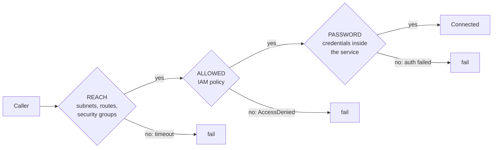

Not every connection uses all three. A Postgres connection is never checked by IAM in our setup;
a call to Secrets Manager has no service password, only IAM.

### 4. Where in our code

**API → RDS, answering all three:**

| Question | Answer for api task → RDS Postgres :5432 | Where |
| -------- | ---------------------------------------- | ----- |
| **Reach** | Both are in the same VPC, so the built-in `local` route connects them. The db security group allows TCP 5432 only from the api security group. RDS has no public address. | `infra/src/security.ts` → rule `minitickets-dev-db-in-5432`; `infra/src/data/postgres.ts` → `publiclyAccessible: false`, `dbSubnetGroupName` |
| **Allowed** | IAM is **not** asked when the api opens the SQL connection (we don't use IAM database authentication). IAM was asked earlier: when the task started, the execution role read the password secret. | `infra/src/compute/iam.ts` → `executionSecrets` |
| **Password** | Postgres user `minitickets` with the RDS-managed password, delivered as `DB_USER` and `DB_PASSWORD`. TLS with a verified certificate, so we know we talk to the real RDS. | `infra/src/compute/task.ts` → `secrets`; `apps/api/src/config/database.ts` → `ssl: { rejectUnauthorized: true }` |

**The other connections:**

| Connection | Reach | Allowed | Password |
| ---------- | ----- | ------- | -------- |
| Browser → CloudFront | public internet, HTTPS | none | the `sid` cookie, for protected procedures only |
| CloudFront → ALB :80 | alb security group allows port 80 only from the CloudFront prefix list (`security.ts` → `cloudFrontPrefixList`) | none (no IAM) | the `X-Origin-Verify` header (`entry/listener.ts` → `hasSecretHeader`) |
| ALB → api task :4000 | api security group allows 4000 only from the alb group | none | none |
| api task → Valkey :6379 | redis security group allows 6379 only from the api group | none (no IAM auth for the cache) | the auth token inside the `rediss://` URL, over TLS (`data/cache.ts` → `authToken`) |
| ECS (starting the task) → Secrets Manager, ECR, CloudWatch Logs | the task has a public IP; public route table → internet gateway → AWS public endpoints (`compute/service.ts` → `assignPublicIp: true`) | execution role: `read-secrets` + `AmazonECSTaskExecutionRolePolicy` | none of its own: each request is signed with the role's temporary credentials |

### 5. See it yourself

```bash
cd infra
# REACH: the db group's inbound rules. Expect one rule: 5432 from the api group id.
aws ec2 describe-security-group-rules --profile ticketlite \
  --filters Name=group-id,Values=$(pulumi stack output dbSgId) \
  --query 'SecurityGroupRules[?!IsEgress].[FromPort,ReferencedGroupInfo.GroupId]'

# ALLOWED: ask IAM's policy simulator, without calling Secrets Manager (data layer must be on).
aws iam simulate-principal-policy --profile ticketlite \
  --policy-source-arn $(aws iam get-role --profile ticketlite --role-name minitickets-dev-api-execution-role --query Role.Arn --output text) \
  --action-names secretsmanager:GetSecretValue \
  --resource-arns $(pulumi stack output dbMasterSecretArn) \
  --query "EvaluationResults[].EvalDecision"     # expect "allowed"

# PASSWORD (and reach) end to end: ask the running api's /ready from inside the task (ECS Exec,
# same commands as docs/17 and docs/20).
TASK=$(aws ecs list-tasks --profile ticketlite --cluster minitickets-dev --service-name minitickets-dev-api --query 'taskArns[0]' --output text)
aws ecs execute-command --profile ticketlite --cluster minitickets-dev --task "$TASK" \
  --container api --interactive --command "sh"
#    inside the container shell:
node -e "fetch('http://localhost:4000/ready').then(async (r) => console.log(r.status, await r.text()))"
#    expect: 200 {"status":"ready"}. A 503 means Postgres or Valkey did not answer.
exit
```

`/ready` is not routed through the ALB (only `/trpc/*` goes to the api), which is why we ask it
from inside the task.

**Break it on purpose (scratch branch, owner runs `pulumi up`, undo afterwards):** delete the
`db-in-5432` rule in `infra/src/security.ts`. Allowed and Password are still fine, but Reach is
gone: new database connections hang until they time out and `/ready` answers 503.

### 6. How it connects

- **Uses ←** subnets and route tables ([docs/12](../12-infra-network.md)), security groups
  ([docs/13](../13-infra-security-groups.md)), IAM roles (chapters 4 and 5), the secrets
  ([docs/14](../14-infra-data.md)).
- **Gives →** the debugging checklist (chapter 8), and the "Reach / Allowed / Password" heading of
  every AWS card.

### 7. Our settings and WHY

- **Three independent locks (defense in depth):** a leaked database password is useless without
  reach into the VPC; a wrong security group cannot leak the password.
- **Security group references, not IP ranges:** "from the api group" stays correct when tasks get
  new IPs on every restart.
- **Secrets read by the execution role at start**, so the running code (task role) has no IAM
  permission to read secrets at all.

### 8. Trade-offs

- **Pros:** each layer catches different mistakes; one misconfiguration rarely exposes data.
- **Cons:** three places to check when something fails, owned by different tools (VPC, IAM, the
  service itself). That is exactly why the checklist exists.

### 9. Alternatives and when to choose them

- **IAM database authentication:** the api gets a short-lived token from IAM and uses it as the
  Postgres password. Merges Allowed and Password; no long-lived password to rotate. Worth it for
  production.
- **VPC endpoints / PrivateLink:** reach AWS services without the internet, so tasks can live in
  private subnets without a NAT gateway.

### 10. What breaks, and how we'd notice

| Broken question | Typical sign |
| --------------- | ------------ |
| Reach | Hangs, then a timeout. Nothing in the target's logs, because nothing arrived. |
| Allowed | An immediate `AccessDenied…` error naming the action and the ARN. |
| Password | An immediate, specific refusal: "password authentication failed", `WRONGPASS`, 403 from our listener. |

Chapter 8 turns this into a checklist.

### 11. Reach / Allowed / Password

This chapter is the definition. Every AWS card in the handbook answers these three for its own
resource.

### 12. Cost

Security groups, routes and IAM are free. Secrets Manager costs about $0.40 per secret per month
(2 secrets ≈ $0.80 a month, see [docs/14](../14-infra-data.md)).

### 13. Interview answers at 3 levels

- **Simple:** A connection needs network reachability, IAM permission and valid credentials.
- **Senior:** For our api to use RDS: the db security group must allow 5432 from the api security
  group (reach); the execution role must be allowed `GetSecretValue` on the RDS master secret so
  ECS can inject `DB_USER` and `DB_PASSWORD` (allowed); and Postgres must accept that user and
  password over verified TLS (password). The SQL connection itself never touches IAM.
- **Lead:** I teach the team to debug in that order because each layer fails in a recognisable way:
  timeouts mean reach, AccessDenied means IAM, explicit refusals mean credentials. For production I
  would collapse Allowed and Password for the database with IAM auth and move tasks to private
  subnets with VPC endpoints, which shrinks the reach surface.

### 14. Follow-up questions interviewers ask

- *A connection times out. Is it IAM?* Almost never: IAM answers fast with a denial. A timeout is
  reach.
- *Does a security group need an outbound rule for the reply?* No. Security groups are stateful;
  replies to allowed traffic are allowed. That is why our db group has no outbound rules at all.
- *Where does IAM sit in a Postgres connection?* Nowhere, unless you turn on IAM database auth.

### 15. Say it in 30 seconds

"I check every AWS connection with three questions: can it reach, is it allowed, does it have the
password. For our api and RDS: the db security group allows 5432 from the api group, the
execution role may read the RDS-managed secret so ECS injects the credentials, and Postgres checks
that password over verified TLS."

### 16. Status

✅ built, and answered for every connection above.

---

## 4. IAM policies: who may do what

### 1. In one line

An **IAM policy** is a JSON document of statements; each statement says which **principal** may do
which **action** on which **resource**, under which **condition**, with effect Allow or Deny.

### 2. Real-life comparison

The building's access list. Who (badge holder), what (open, lock), which door, when (weekdays
only). Reception starts from "no". A "yes" on the list lets you in. A "no entry" sign from
security beats every "yes".

### 3. Picture it

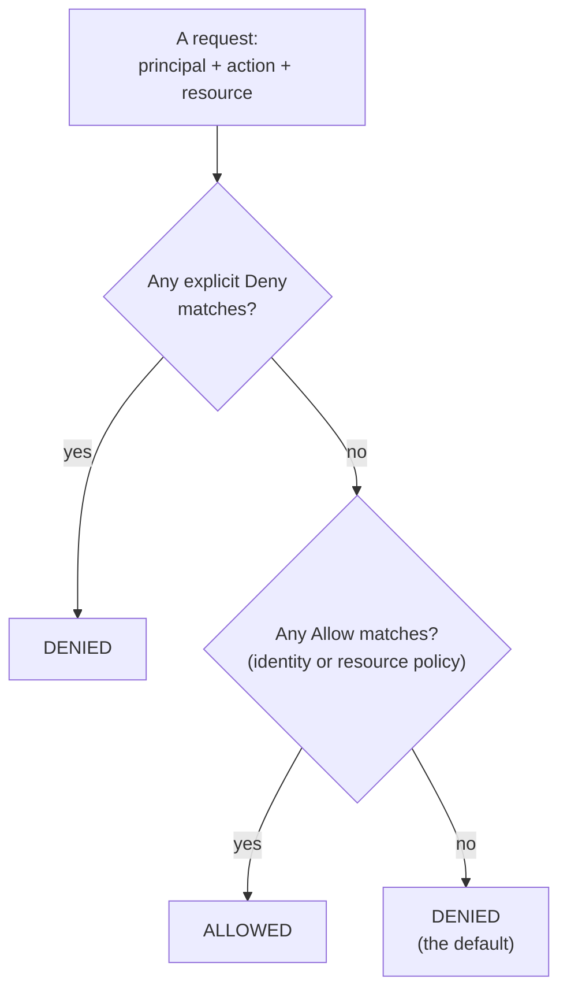

This is the simplified rule for one account. Organization guardrails (SCPs), permission boundaries
and session policies can only take permissions away, never add them; we use none of them. Across
two accounts, both sides must allow.

### 4. Where in our code

All in `infra/src/compute/iam.ts` and `infra/src/compute/web-iam.ts`:

1. **Identity-based policy, inline** → `executionSecrets` (policy name `read-secrets`):
   `Effect: Allow`, `Action: secretsmanager:GetSecretValue`, `Resource: [db master secret ARN,
   redis-url secret ARN]`. It is attached to the execution role, so the principal is "whoever wears
   this role". That is why identity-based policies have no `Principal` field.
2. **Identity-based policy, AWS-managed** → `executionManaged`: attaches
   `AmazonECSTaskExecutionRolePolicy` (ECR pull + CloudWatch Logs write). AWS writes and updates it.
3. **Resource-based policy** → `ecsTasksTrustPolicy`: the role's **trust policy**. It sits on the
   resource (the role), so it **does** name a principal: `Principal: { Service: "ecs-tasks.amazonaws.com" }`,
   `Action: sts:AssumeRole`, `Condition: { StringEquals: { "aws:SourceAccount": accountId } }`.
4. **`Resource: "*"` when AWS offers no choice** → `taskExec` (policy `ecs-exec`): the four
   `ssmmessages:*Channel` actions cannot be limited to one resource.

| Policy kind | Attached to | Names a principal? | Ours |
| ----------- | ----------- | ------------------ | ---- |
| Identity-based | a role, user or group | no (the holder is the principal) | `read-secrets`, `ecs-exec`, the managed policy |
| Resource-based | a resource (role, secret, bucket…) | yes | the trust policies of our 3 roles |

### 5. See it yourself

```bash
aws iam get-role-policy --profile ticketlite \
  --role-name minitickets-dev-api-execution-role --policy-name read-secrets
aws iam list-attached-role-policies --profile ticketlite \
  --role-name minitickets-dev-api-execution-role
```

**Break it on purpose (read-only):** run the `simulate-principal-policy` command from chapter 3,
but give `--resource-arns` any other secret ARN, e.g.
`arn:aws:secretsmanager:us-east-1:123456789012:secret:other-AbCdEf`. The answer is `implicitDeny`:
no statement allows it, so the default "no" wins.

### 6. How it connects

- **Uses ←** ARNs (chapter 2).
- **Gives →** roles (chapter 5) carry these policies; the **Allowed** column of chapter 3.

### 7. Our settings and WHY

- **Exact resources** in `read-secrets`: if the role were misused, it still could not read any other
  secret in the account.
- **Inline** for our own one-off rules (they live and die with the role); **AWS-managed** for the
  standard ECS execution permissions.
- **No `kms:Decrypt`:** both secrets use the AWS-managed key `aws/secretsmanager`, which Secrets
  Manager uses for any caller that may read the secret (comment at `executionSecrets`).

### 8. Trade-offs

- **Inline:** clear ownership, cannot be reused by accident; cannot be shared either.
- **AWS-managed:** zero upkeep, but AWS can change it, and it may grant a bit more than you need.

### 9. Alternatives and when to choose them

- **Customer-managed policies:** reusable policies we own; good when several roles need the same rule.
- **Permission boundaries:** a maximum for roles that others create (e.g. developer self-service).
- **SCPs (AWS Organizations):** account-wide guardrails, e.g. "nobody may leave us-east-1".
- **ABAC:** tag-based conditions, when listing ARNs no longer scales.

### 10. What breaks, and how we'd notice

- **Missing permission:** the action fails with `AccessDenied` naming the action and ARN. For the
  execution role this happens at task start, so the task never runs; the reason shows in the
  task's stopped reason.
- **Too broad a permission:** nothing visibly breaks. The damage shows only after a compromise. We
  would notice only by reviewing policies (or with tools like IAM Access Analyzer).

### 11. Reach / Allowed / Password

This chapter is the **Allowed** column.

### 12. Cost

IAM is free.

### 13. Interview answers at 3 levels

- **Simple:** A policy lists allowed or denied actions on resources. Everything not allowed is denied.
- **Senior:** Evaluation is default-deny, explicit allow, and an explicit deny always wins.
  Identity-based policies sit on the principal and have no Principal field; resource-based ones sit
  on the resource and name the principal. In our stack the execution role's `read-secrets` inline
  policy allows `GetSecretValue` on exactly two ARNs, and the role's trust policy is the
  resource-based side that lets ECS assume it.
- **Lead:** I keep policies scoped to exact resources, generated from infrastructure outputs, and
  reviewed in code review like any other code. Across accounts both sides must allow, which is the
  basis for clean multi-account designs. Guardrails like SCPs belong at the organization level, so a
  single bad policy cannot widen access.

### 14. Follow-up questions interviewers ask

- *Allow in one policy, Deny in another?* Deny wins.
- *Why does our ECS Exec policy use `Resource: "*"`?* Those `ssmmessages` actions do not support
  resource-level permissions.
- *Is a trust policy an identity policy?* No, it is a resource-based policy on the role.

### 15. Say it in 30 seconds

"IAM starts from deny; a matching allow permits, and any explicit deny beats every allow. Our
execution role has an inline policy that allows `GetSecretValue` on exactly two secret ARNs, plus
AWS's managed policy for pulling images and writing logs; its trust policy is the resource-based
side that says only ECS, for our account, may use it."

### 16. Status

✅ built.

---

## 5. Roles, STS and the confused deputy

### 1. In one line

A **role** is a set of permissions with no password of its own; a trusted principal **assumes** it
and gets short-lived credentials from **STS** (Security Token Service).

### 2. Real-life comparison

A visitor badge at reception. The **guest list** says who may pick up the badge (trust policy).
The **badge** opens certain doors (permission policy). It is **handed to** one particular visitor
(the resource it is attached to). It **expires** at the end of the day (temporary credentials).

### 3. Picture it

Our three roles, each in three parts:

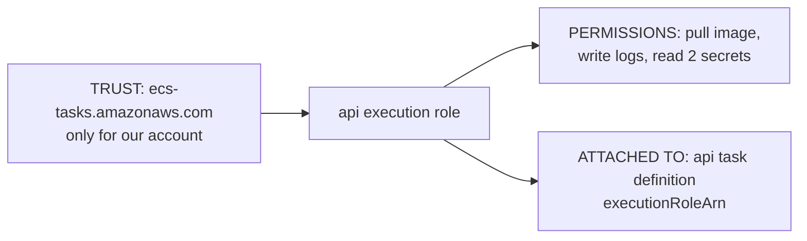

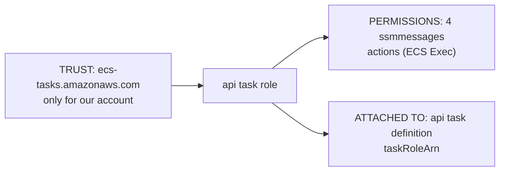

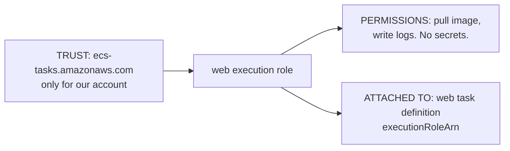

The web task has **no task role**: its code calls no AWS API, so it gets no AWS permissions at all.

The confused deputy, and the line that stops it:

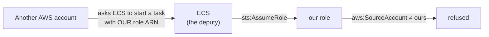

### 4. Where in our code

`infra/src/compute/iam.ts`, step by step:

1. `accountId` – our account id, looked up.
2. `ecsTasksTrustPolicy` – one trust policy for both api roles: only `ecs-tasks.amazonaws.com`, and
   only when `aws:SourceAccount` is our account.
3. `executionRole` + `executionManaged` + `executionSecrets` – the role ECS wears **before** our
   code runs: pull the image, read the two secrets, write logs.
4. `taskRole` + `taskExec` – the role **our running container** wears: only ECS Exec.
5. The return value uses `pulumi.all([role.arn, attachment.id, policy.id])`, so the ARN is handed
   on only after its policies exist. Otherwise ECS could start a task with a role that cannot yet
   read the secrets.

`infra/src/compute/task.ts` → `executionRoleArn`, `taskRoleArn` attach them.
`infra/src/compute/web-iam.ts` → `createWebIamRole` creates the web execution role only.

**How a running task gets the task role's credentials** (AWS mechanism, not our code): ECS gives
the container an environment variable, `AWS_CONTAINER_CREDENTIALS_RELATIVE_URI`. AWS SDKs and the
ECS Exec agent use it to fetch temporary credentials from a local endpoint (`169.254.170.2`).
Those credentials come from STS, expire, and are refreshed by AWS. Our api code never uses them:
it calls no AWS API.

### 5. See it yourself

```bash
# The trust policy (who may wear the badge):
aws iam get-role --profile ticketlite --role-name minitickets-dev-api-task-role \
  --query Role.AssumeRolePolicyDocument
# The permission policy (what the badge opens):
aws iam get-role-policy --profile ticketlite --role-name minitickets-dev-api-task-role --policy-name ecs-exec
```

**Break it on purpose (scratch branch, owner runs `pulumi up`, undo afterwards):** in
`executionSecrets`, list only the db master secret. The next api task cannot read `REDIS_URL`
and never starts. This also shows why the execution role, not the task role, needs the secret
permission.

### 6. How it connects

- **Uses ←** IAM policies (chapter 4), the secret ARNs ([docs/14](../14-infra-data.md)).
- **Gives →** the api and web task definitions ([docs/17](../17-infra-ecs-api.md),
  [docs/18](../18-infra-alb-web.md)), and the flow in chapter 6.

### 7. Our settings and WHY

| Choice | Why |
| ------ | --- |
| Two api roles, not one | The code that runs all day (task role) cannot read secrets. Only ECS can, for a moment, at start. |
| Web gets its own execution role | Least privilege: web needs no secrets, so its role cannot read any, whatever its task definition says. |
| No web task role | Web code calls no AWS API, and ECS Exec is not enabled for web. |
| `aws:SourceAccount` condition | Stops the confused deputy problem. |
| ARN returned only after policies attach | Avoids a race at first deploy. |

### 8. Trade-offs

- **Pros:** short-lived credentials that nobody stores; small blast radius per role.
- **Cons:** more roles to read and review; a missing permission shows up only at runtime.

### 9. Alternatives and when to choose them

- **IAM users with access keys:** only for things outside AWS that cannot assume roles (and even
  then, prefer OIDC federation, e.g. GitHub Actions → role, for our future CD).
- **EC2 instance profiles:** the same idea when containers run on our own EC2 machines.
- **EKS Pod Identity / IRSA:** the same idea for Kubernetes pods.

### 10. What breaks, and how we'd notice

- **Trust policy names the wrong service:** ECS cannot assume the role; tasks fail at start.
- **Permission missing on the execution role:** task never starts; the stopped reason names
  secrets or image pull.
- **Condition missing:** nothing breaks today; the risk is invisible until abused.

### 11. Reach / Allowed / Password

Roles are the **Allowed** column. Their STS credentials also act as the "password" for AWS API
calls: every request is signed with them (Signature Version 4).

### 12. Cost

IAM roles and STS are free.

### 13. Interview answers at 3 levels

- **Simple:** A role is a set of permissions that a service or person assumes temporarily instead
  of having permanent keys.
- **Senior:** Every role has a trust policy (who may assume it), permission policies (what it may
  do) and a place where it is used. Our api has an execution role that ECS assumes to pull the image,
  inject two secrets and ship logs, and a task role that the running container uses, which only
  allows ECS Exec. The trust policy has an `aws:SourceAccount` condition against the confused
  deputy problem.
- **Lead:** Splitting execution and task roles means a compromised app process cannot read
  secrets through IAM; it only has what was injected. I'd standardise this split across services,
  give each service its own roles, use OIDC federation for CI instead of access keys, and review
  trust policies as carefully as permissions, because trust is where cross-account mistakes happen.

### 14. Follow-up questions interviewers ask

- *What does STS return?* An access key id, a secret access key, a session token and an expiry.
- *What is the confused deputy problem?* A trusted service is tricked into using its power for the
  wrong customer. A source-account (or source-ARN) condition prevents it.
- *Why does the web task have no task role?* Its code calls no AWS API, so least privilege means none.

### 15. Say it in 30 seconds

"A role has a trust policy, permissions and a place it is attached. Our api's execution role is
assumed by ECS, only for our account, to pull the image, read two secrets and write logs before
our code starts. The running code gets a separate task role that only allows ECS Exec, and the web
task has no task role at all."

### 16. Status

✅ built.

---

## 6. How one AWS service calls another

### 1. In one line

An AWS service calls another the same way our own scripts do: it assumes a role, gets temporary
credentials from STS, signs each request, and the target service checks IAM.

### 2. Real-life comparison

A courier collects a parcel for you. You gave them a signed, dated authorisation letter (the role's
temporary credentials). The warehouse (Secrets Manager) checks the letter against its rules (IAM)
before handing over the parcel.

### 3. Picture it

What happens when ECS starts an api task (the logical flow from AWS's documentation; the internal
calls inside Fargate are not visible to us):

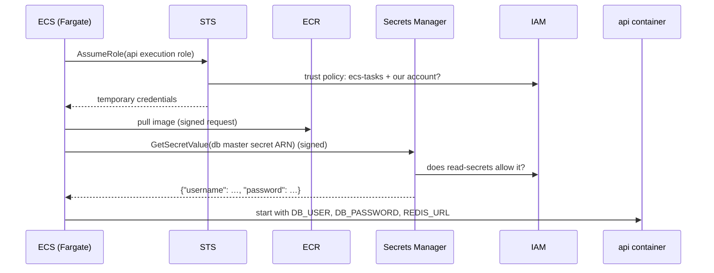

After the start, the `awslogs` driver ships every line the container prints to CloudWatch Logs,
also with the execution role.

### 4. Where in our code

- `infra/src/compute/task.ts` → `secrets`: the three env vars and the ARNs (plus JSON keys) they
  come from. The task definition holds only **where** the secrets are, never the values.
- `infra/src/compute/task.ts` → `executionRoleArn`, `logConfiguration` (`awslogs` driver).
- `infra/src/compute/iam.ts` → `executionSecrets` (the IAM check in the diagram) and
  `executionManaged` (ECR pull, CloudWatch Logs).
- `scripts/run-migrations.sh`: the one-off migration task goes through the same flow, because it
  uses the same task definition.

### 5. See it yourself

```bash
# Who read our secrets recently? CloudTrail records GetSecretValue calls (management events).
aws cloudtrail lookup-events --profile ticketlite --region us-east-1 --max-results 5 \
  --lookup-attributes AttributeKey=EventName,AttributeValue=GetSecretValue \
  --query "Events[].[EventTime,Username]"
```

I have not run this against our account. I expect entries from around each api task start; the
exact `Username` shown may vary.

**Break it on purpose:** the "break it" in chapter 5 (remove one secret ARN) breaks this flow at
the `SM->>IAM` step.

### 6. How it connects

- **Uses ←** roles (chapter 5), the secrets ([docs/14](../14-infra-data.md)), ECR
  ([docs/16](../16-infra-ecr.md)), the network path to AWS endpoints ([docs/17](../17-infra-ecs-api.md)).
- **Gives →** a running api with its credentials, ready for chapter 3's connections.

### 7. Our settings and WHY

- **Secrets injected at start, not fetched by our code:** the app needs no AWS SDK and no secret
  permissions; config stays plain env vars, like locally.
- **Public IP for the task:** without a NAT gateway, that is the task's only way to reach ECR,
  Secrets Manager and CloudWatch (`compute/service.ts` → `assignPublicIp: true`).

### 8. Trade-offs

- **Pros:** simple app code; secrets never in the image, the code, or Pulumi state.
- **Cons:** the value is read only once, at start. When RDS rotates the password (every 7 days by
  default), a running task keeps the old one and new connections fail until a restart (known
  limitation, [docs/17 §3.17](../17-infra-ecs-api.md)). Env vars are also visible to anything that
  runs inside the container.

### 9. Alternatives and when to choose them

- **App reads Secrets Manager at runtime** (SDK + task role, cached, re-read when login fails):
  production, because it survives rotation.
- **SSM Parameter Store SecureString:** cheaper for many simple values; fewer rotation features.
- **IAM database authentication:** no database password to inject at all.

### 10. What breaks, and how we'd notice

- **No network path to the AWS endpoints** (e.g. a task in a private subnet without NAT or VPC
  endpoints): the task fails at start while trying to pull the image or secrets.
- **Execution role lacks a secret:** the task fails at start; the stopped reason names secrets.
- **Rotation:** `/ready` turns 503 and logins fail with a generic error, days after a deploy.

Notice all three with `aws ecs describe-tasks … --query "tasks[0].stoppedReason"` and the api log
group `/minitickets/dev/api`.

### 11. Reach / Allowed / Password

ECS → Secrets Manager: **Reach** = public IP + internet gateway to the regional endpoint.
**Allowed** = the execution role's `read-secrets`. **Password** = none of its own; requests are
signed with the role's STS credentials.

### 12. Cost

STS is free. Secrets Manager: about $0.40 per secret per month plus a small per-request fee
($0.05 per 10,000 requests); for us under $1 a month while the data layer is on.

### 13. Interview answers at 3 levels

- **Simple:** AWS services use roles and temporary credentials to call each other, and IAM checks
  every call.
- **Senior:** When ECS starts our api task it assumes the execution role, pulls the image from ECR,
  reads the RDS master secret and the redis-url secret from Secrets Manager, and injects them as
  `DB_USER`, `DB_PASSWORD` and `REDIS_URL`. Each call is signed with STS credentials and checked
  against the role's policies.
- **Lead:** Injection at start is simple but rotation-unfriendly, so in production I would have
  the app fetch and cache the secret with its task role, or move to IAM database auth, and move tasks
  into private subnets with VPC endpoints so these calls never cross the internet.

### 14. Follow-up questions interviewers ask

- *Can our running code read the secrets through IAM?* No. Only the execution role may, and only
  ECS uses it.
- *Where would you see these calls?* CloudTrail.
- *What happens on rotation?* Running tasks keep the old password; a new deployment fixes it.

### 15. Say it in 30 seconds

"ECS assumes the api's execution role, gets temporary credentials from STS, pulls the image, reads
two secrets that IAM allows, and starts our container with them as env vars. Our code never talks
to AWS. The catch is rotation: the value is read once, so production should fetch secrets at
runtime or use IAM database auth."

### 16. Status

✅ built. **To make it production-grade:** rotation-safe secret reading, private subnets with VPC
endpoints.

---

## 7. Service-linked roles

### 1. In one line

A **service-linked role** is a role that AWS creates and owns, so one AWS service can manage
resources in our account on our behalf.

### 2. Real-life comparison

The landlord's maintenance key. The building staff need it to fix the lifts in our office. We did
not cut the key and cannot decide which doors it opens; we can see that it exists.

### 3. Picture it

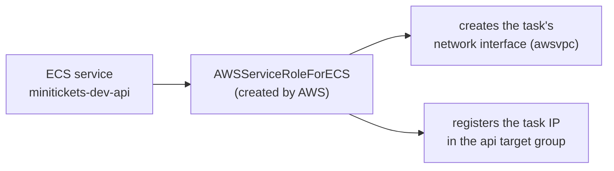

### 4. Where in our code

**Nowhere, on purpose.** AWS creates a service-linked role the first time an account uses a
service that needs one. That is why `infra/src/compute/service.ts` passes no role to the ECS
service: ECS uses its service-linked role to create each task's network interface and to register
tasks with the ALB.

The ones I expect for the services we use (not verified in our account; check with the command
below): `AWSServiceRoleForECS`, `AWSServiceRoleForElasticLoadBalancing`, `AWSServiceRoleForRDS`,
`AWSServiceRoleForElastiCache`.

### 5. See it yourself

```bash
aws iam list-roles --profile ticketlite --path-prefix /aws-service-role/ --query "Roles[].RoleName"
```

Every service-linked role lives under the path `/aws-service-role/`.

### 6. How it connects

- **Uses ←** nothing we build.
- **Gives →** ECS the power to wire tasks into the VPC and the ALB
  ([docs/17](../17-infra-ecs-api.md), [docs/18](../18-infra-alb-web.md)); RDS and ElastiCache the
  power to manage their network interfaces in our subnets.

### 7. Our settings and WHY

None. We let AWS manage them: their permissions are defined by AWS and fit the service exactly.

### 8. Trade-offs

- **Pros:** zero work, always the right permissions for the service.
- **Cons:** we cannot narrow them, and they are easy to forget when auditing "who can do what".

### 9. Alternatives and when to choose them

Some services accept a custom service role instead. Choose that only when an auditor requires a
role that you define yourself.

### 10. What breaks, and how we'd notice

- **First use by a user who may not create it:** creating the first ECS service (or ALB, RDS…)
  fails with an error about creating the service-linked role. It needs
  `iam:CreateServiceLinkedRole`.
- **Deleting one in use:** AWS refuses to delete a service-linked role while resources still
  depend on it.

### 11. Reach / Allowed / Password

**Allowed**, for AWS's own work in our account.

### 12. Cost

Free.

### 13. Interview answers at 3 levels

- **Simple:** A role AWS creates so its service can act in your account.
- **Senior:** ECS uses `AWSServiceRoleForECS` to create the network interface of each `awsvpc` task
  and to register targets with the load balancer. That is why our ECS service definition has no
  role argument.
- **Lead:** I treat service-linked roles as part of the account baseline: the deploying identity
  needs `iam:CreateServiceLinkedRole` on day one, and audits should list them, but there is nothing
  to design or tune.

### 14. Follow-up questions interviewers ask

- *Service-linked role vs execution role?* The service-linked role is AWS managing infrastructure
  for the service; the execution role is ECS starting one of our tasks with permissions we chose.
- *Can you edit one?* No, AWS defines the permissions.

### 15. Say it in 30 seconds

"Service-linked roles are AWS-owned roles that let a service act in our account, like ECS creating
each task's network interface and registering it with the load balancer. We never create them in
code; AWS does on first use."

### 16. Status

✅ in use (created by AWS, not by our code).

---

## 8. Debugging checklist: reach → allowed → password

### 1. In one line

When something cannot connect, check **Reach**, then **Allowed**, then **Password**, in that
order, because each fails with its own kind of signal.

### 2. Real-life comparison

A letter that never arrived: first check the address and the roads (reach), then whether the
receiver refused it (allowed), then whether they could not open the lock on the box (password).

### 3. Picture it

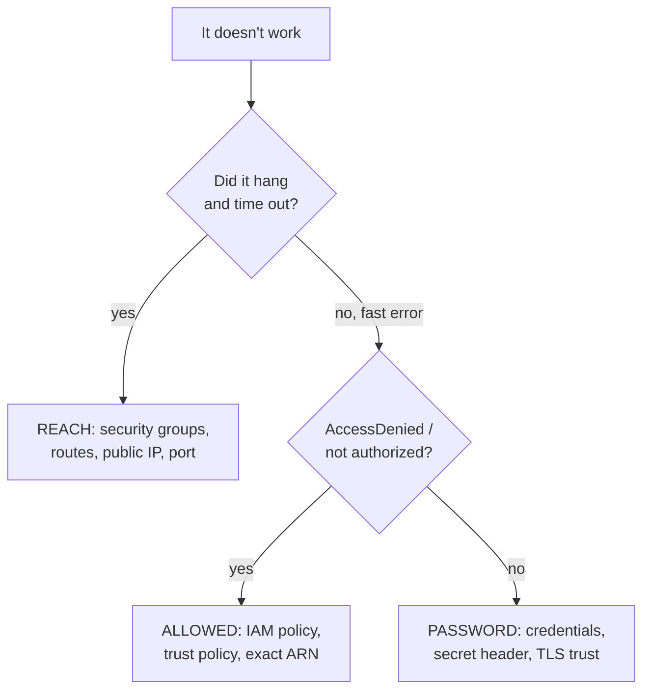

### 4. Where in our code

| Question | Look here first |
| -------- | --------------- |
| Reach | `infra/src/security.ts` (the 5 ingress rules), `infra/src/network.ts` (route tables), `assignPublicIp` in `infra/src/compute/service.ts` and `web-service.ts`, `HOST` / `PORT` in `infra/src/compute/task.ts` |
| Allowed | `infra/src/compute/iam.ts`, `infra/src/compute/web-iam.ts` |
| Password | `infra/src/compute/task.ts` → `secrets`; `apps/api/src/config/database.ts` (TLS); `apps/api/Dockerfile` → `NODE_EXTRA_CA_CERTS`; `infra/src/entry/listener.ts` → `hasSecretHeader` |

### 5. See it yourself

```bash
cd infra
# Why did a task stop?
aws ecs describe-tasks --profile ticketlite --cluster minitickets-dev --tasks <task-arn> \
  --query "tasks[0].[stoppedReason,containers[0].reason,containers[0].exitCode]"
# Is the ALB's target healthy? (target group ARN from the console or `aws elbv2 describe-target-groups`)
aws elbv2 describe-target-health --profile ticketlite --target-group-arn <api-tg-arn>
# The api's own log lines:
aws logs tail /minitickets/dev/api --profile ticketlite --since 15m
```

### 10. What breaks: symptom → question

| Symptom | Question | Where to look / fix |
| ------- | -------- | ------------------- |
| Hangs, then times out | Reach | a missing security group rule, a route, a missing public IP |
| "Connection refused" at once | Reach (the host answered, but nothing listens on that port) | `HOST` must be `0.0.0.0` in a container; `PORT` and `containerPort` must match |
| ALB 503 | Reach | the target group has no registered (or no healthy) targets: `describe-target-health` |
| ALB 504 | Reach | the target did not answer in time; often a security group blocks ALB → task |
| ALB 403, body "Forbidden" | Password | the listener's default action: the `X-Origin-Verify` header is missing. Are you calling the ALB directly instead of CloudFront? |
| Task stops before our code runs; stopped reason mentions secrets or registry auth | Reach (no path to the AWS endpoints) or Allowed (execution role) | the public IP and route table first; then `read-secrets` / the managed policy |
| `AccessDenied…` naming an action and an ARN | Allowed | the policy's `Action` and `Resource`; a typo'd or stale ARN |
| `password authentication failed for user "minitickets"` | Password | `DB_USER` / `DB_PASSWORD`; the rotation limit ([docs/17 §3.17](../17-infra-ecs-api.md)) |
| `self-signed certificate in certificate chain` | Password (which certificate authorities we trust) | `NODE_EXTRA_CA_CERTS` in `apps/api/Dockerfile`. Never turn verification off. |
| Redis `WRONGPASS` or `NOAUTH` | Password | the token in the redis-url secret |
| Redis connection fails or hangs with `redis://` on AWS | Password / TLS | the cache requires TLS: the URL must be `rediss://` |
| 401 from `/trpc/...` with a cookie set | App-level password | the session expired or does not exist in Valkey; log in again |
| Browser console says CORS error (laptop) | Allowed, by the browser | `WEB_ORIGIN` in `apps/api/.env` must equal the page's origin exactly |

### 13. Interview answers at 3 levels

- **Simple:** I check network first, then permissions, then credentials.
- **Senior:** The signals are different: a timeout means reach (security groups, routes), a fast
  AccessDenied means IAM, an explicit refusal means credentials or TLS trust. In our stack, an ALB
  403 "Forbidden" is our own listener default and means the origin secret header is missing.
- **Lead:** I'd put this checklist in the runbook, add synthetic checks so the team sees which
  layer failed before users do, and design error messages (like our listener's fixed 403) so each
  layer fails in a recognisable way.

### 15. Say it in 30 seconds

"Timeouts are reach, AccessDenied is IAM, explicit refusals are credentials. I check them in that
order, with the ECS stopped reason, the target health and the CloudWatch logs as my three windows
into the system."

### 16. Status

✅ usable today. Deploy-day troubleshooting for the whole stack is in
[docs/20-deploy-day.md](../20-deploy-day.md).

---

## How this connects

- **Uses:** the AWS step docs [12](../12-infra-network.md) to [20](../20-deploy-day.md), and the
  infra code in `infra/`.
- **Gives:** the infra story (Phase 2) builds on every chapter here; every AWS card has a
  "Reach / Allowed / Password" section from chapter 3; the [glossary](glossary.md) defines the words.
