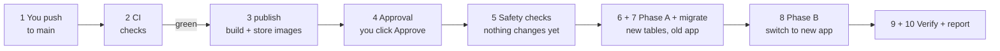
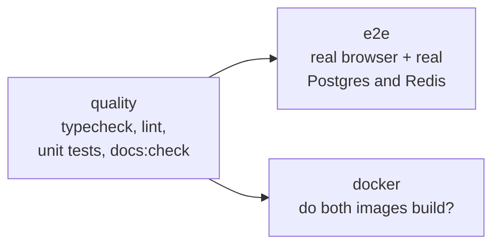
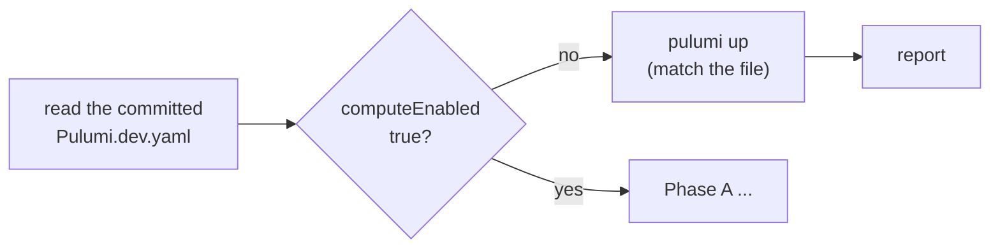
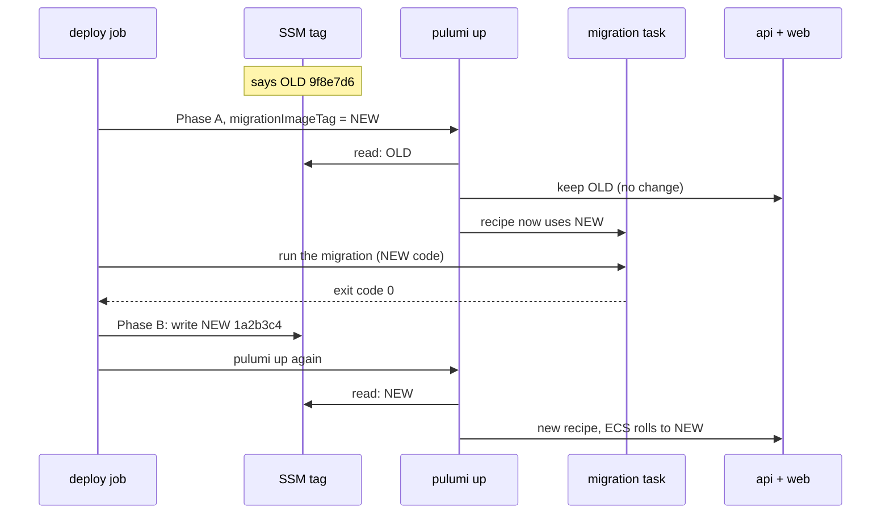
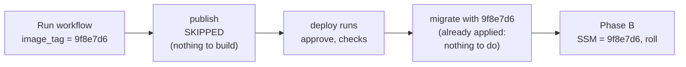
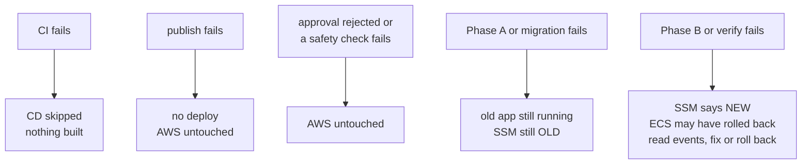
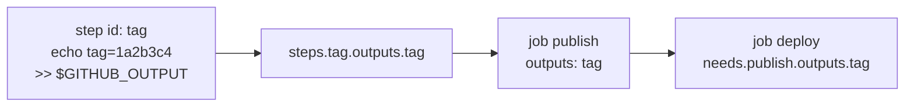
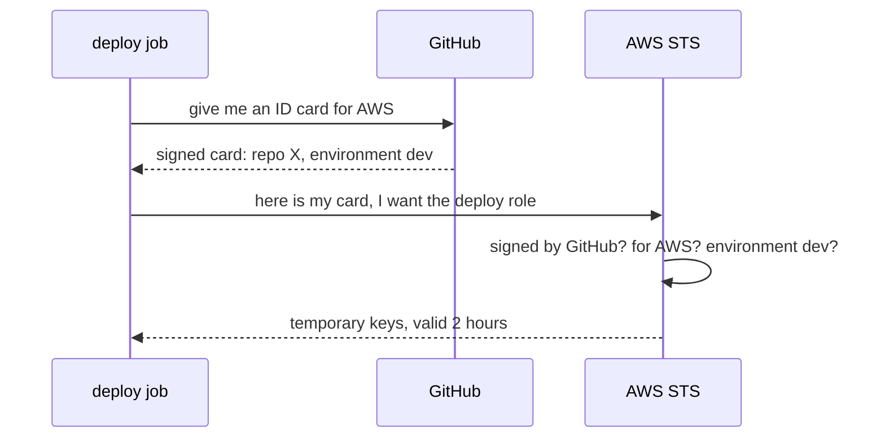

# The CI/CD story

History: see [CHANGELOG.md](CHANGELOG.md) or run `pnpm docs:history`

**In one line:** what happens, step by step, between `git push` and the new version of MiniTickets
answering on AWS, and how to read the two files that make it happen:
[`.github/workflows/ci.yml`](../../.github/workflows/ci.yml) and
[`.github/workflows/cd.yml`](../../.github/workflows/cd.yml).

**Who this page is for:** someone who has never seen GitHub Actions, bash or Pulumi. Every
technical word is explained the first time it shows up. Every example is copied from our two files.

**How to read it:**

- [Part 1](#part-1-the-story) is the story: what happens, and why. Read it first.
- [Part 2](#part-2-how-to-read-a-workflow-file) teaches the workflow file syntax.
- [Part 3](#part-3-the-bash-youll-see) teaches the bash used in our files (and nothing more).
- [Part 4](#part-4-the-aws-and-pulumi-commands) lists every AWS and Pulumi command, one line each.
- [Part 5](#part-5-walk-throughs) explains four real steps, line by line.
- [Part 6](#part-6-common-confusions-faq) answers the questions people usually get stuck on.
- [Part 7](#part-7-interview) is for interviews.

Open `cd.yml` next to this page. Its `# CHAPTER N` lines match the chapter numbers below.

---

## Words you need before you start

You only need these few words to read Part 1. Everything else is explained when it shows up.

| Word | What it means here |
| ---- | ------------------ |
| **repo** (repository) | Our project's folder on GitHub, with its full history. |
| **git** | The tool that saves versions of the code (commits) and sends them to GitHub (push). |
| **commit** | One saved change to the code. Every commit has an ID called a **SHA**: 40 letters and digits, like `1a2b3c4d5e…`. The first 7 (`1a2b3c4`) are enough to name it. |
| **push** | Sending your new commits from your laptop to GitHub. |
| **branch** | A separate line of commits, so work can happen side by side. |
| **main** | The main branch. What is on main is what we ship. |
| **GitHub Actions** | GitHub's built-in robot: it runs commands for us on GitHub's computers when something happens (like a push). |
| **workflow** | One instruction file for that robot, in the folder `.github/workflows/`. We have two: `ci.yml` and `cd.yml`. |
| **api** and **web** | The two parts of our app. The **api** is the server program that holds the rules and talks to the database. The **web** app builds the pages you see in the browser. |
| **image** | A packed, ready-to-run copy of one part of our app (the api or the web app), with everything it needs inside. Like a sealed lunch box: open it anywhere and the meal is the same. |
| **container** | An image that is running. One image can run as many containers. |
| **AWS** | Amazon Web Services: the rented computers and services our app runs on. |
| **infrastructure** | All the AWS pieces the app needs to run: network, database, the computers for the containers, the front door for visitors. |
| **deploy** | Putting a version of the app live, so visitors use it. |
| **pipeline** | A chain of automatic steps. Ours goes from "code pushed" to "code live". |
| **CI / CD** | **C**ontinuous **I**ntegration: check every change automatically. **C**ontinuous **D**eployment: put checked changes live automatically (ours waits for one human click). |

---

## Part 1: The story

### The characters

| Character | What it is, in one plain line | Real-life comparison |
| --------- | ----------------------------- | -------------------- |
| **CI** (`ci.yml`) | The robot that checks every push: types, code style, tests, a real browser test, and that the images can be built. | The quality inspector at the factory door. Nothing broken leaves. |
| **publish** (a job in `cd.yml`) | Builds the api and web images ONE time and stores them in ECR. | The packing line that seals each box and prints a label with the batch number. |
| **ECR** (Elastic Container Registry) | Amazon's private storage for our images. | The warehouse where the sealed boxes wait. |
| **deploy** (a job in `cd.yml`) | Takes images that are already in ECR and makes them run on AWS. It starts only after a human approves. | The delivery driver who needs your signature before driving off. |
| **Pulumi** | A program that reads our infrastructure code in `infra/` and creates or changes the real AWS resources to match it. `pulumi up` = "make AWS look like the code". | A building contractor who follows the blueprints exactly. |
| **SSM tag** | One small note stored in AWS (in a service called SSM Parameter Store), named `/minitickets/dev/image-tag`. It says which app version should run, e.g. `1a2b3c4`. | The sticky note on the fridge: "this week's menu is 1a2b3c4". Everyone reads the same note. |
| **ECS** (Elastic Container Service) | The AWS service that runs our containers and swaps old ones for new ones without the app going offline. | The shift manager who brings in the new team before sending the old team home. |
| **OIDC** (OpenID Connect) | A way for a GitHub job to log in to AWS with a short-lived ID card instead of a stored password. | A visitor badge from reception: it has your name on it and stops working after an hour. |
| **GitHub environment** (`dev`) | A named place to deploy to, with rules. Ours has one rule: a human must click "Approve" first. | A door that only opens with the manager's key card. |

Two more words show up everywhere:

- **job**: a group of steps that runs on its own fresh computer. `publish` and `deploy` are jobs.
- **runner**: that fresh computer. GitHub lends it to us for one job, then throws it away.

### The whole flow



Chapter 11 (rollback) is the same flow started by hand, with an older image and without
chapters 2 and 3.

Which numbered comments in the files belong to which chapter:

| Chapter | File | Numbered comments |
| ------- | ---- | ----------------- |
| 1 Push, 2 CI | `ci.yml`; `cd.yml` `on:` | `cd.yml` 1 |
| 3 Publish | `cd.yml`, job `publish` | 7 to 18 |
| 4 Approval | `cd.yml`, job `deploy` | 19 to 22 |
| 5 Safety checks | `cd.yml`, job `deploy` | 23 to 31 (32 is the "switched off" side path) |
| 6 Phase A | `cd.yml` | 33 |
| 7 Migrate | `cd.yml` + `scripts/run-migrations.sh` | 34 |
| 8 Phase B | `cd.yml` | 35, 36 |
| 9 Verify | `cd.yml` | 37, 38 |
| 10 Report | `cd.yml` | 39, 40 |
| 11 Rollback | `cd.yml` | 2, 7, 19, 24, 25 |

---

### Chapter 1: You push to main

**What happens.** You run `git push`. GitHub receives your new commit, say `1a2b3c4`. GitHub then
looks in the folder `.github/workflows/` for files that say "start me on a push". `ci.yml` says so:

```yaml
on:
  push:
  pull_request:
```

So CI starts. (A **pull request** is a request to merge a branch into main. CI checks those too.)

**Why.** Nobody has to remember to run the checks. Every push is checked the same way.

**If it fails.** A push itself rarely fails. If you push to a branch that is not main, CI still
runs, but CD will never deploy it (Chapter 2 explains why).

---

### Chapter 2: CI checks the code

**What happens.** CI runs three jobs:



- `quality`: are the types right (`pnpm typecheck`: does every value have the shape the code
  expects, e.g. a number where a number belongs?), does the code follow our style rules
  (`pnpm lint`), do the small tests pass (`pnpm test`), do the handbook and code agree
  (`pnpm docs:check`)?
- `e2e` ("end to end"): start the whole app with a real database (Postgres) and a real cache
  (Redis, a fast short-term memory), open a real browser, and click through it like a user.
- `docker`: build both images, but throw them away. This only proves they CAN be built.
  (**Docker** is the tool that builds and runs images.)

When CI is done, GitHub tells `cd.yml`, because `cd.yml` listens for that:

```yaml
  workflow_run:
    workflows: [CI]
    types: [completed]
    branches: [main]
```

In plain words: "start CD when the workflow called CI has completed on the main branch".

**Why CD waits for CI.** CD must only ship code CI approved. If CD started on the push itself, it
would run at the same time as CI, before anyone knows whether the code works.

**If it fails.** CI shows a red ✗. CD still starts, because "completed" includes "completed with a
failure". But both CD jobs check the result first and are **skipped**. Nothing is built, nothing is
deployed.

One more rule in `ci.yml`: if you push again to the same branch while CI is still running, the
older CI run is cancelled. It is checking code that is already out of date.

```yaml
concurrency:
  group: ci-${{ github.ref }}
  cancel-in-progress: true
```

---

### Chapter 3: Publish builds the images once

**What happens.** The `publish` job runs on a fresh ARM computer (ARM is a type of processor, like
the one in a modern Mac or phone). Its steps:

1. **Check setup.** Is `AWS_PUBLISH_ROLE_ARN` set? It is a **repo variable** (a named value saved
   in the repo's GitHub settings) that holds the address of the AWS role used in step 4. If it is
   missing, stop with a clear message.
2. **Check out the exact commit CI tested.** "Check out" = download the code onto the runner.
   It uses CI's commit (`workflow_run.head_sha`), not "whatever main is now". Someone may have
   pushed again in the meantime, and that newer commit has not been checked yet.
3. **Compute the image tag.** The tag (the label on the image) is the commit's short SHA, e.g.
   `1a2b3c4`. Never `latest`.
4. **Log in to AWS with OIDC**, as the **publish role**. (A **role** is a set of AWS permissions
   that someone can borrow for a while. This one may only upload ("push") images to our two ECR
   repositories.)
5. **Log in to ECR**, so Docker may upload to it.
6. **Check which images already exist** in ECR with this tag.
7. **Build and push** the api image and the web image, but only the ones that are missing.
8. **Write a summary** on the run's page: tag, digest (a fingerprint of the image's content) and
   "pushed now" or "already in ECR (skipped)".

**Why build once.** The image that will run on AWS is exactly the image built here. The deploy job
never builds anything. So what you approve is what runs, byte for byte. People call this
"build once, promote".

**Why ARM.** Our containers on AWS run on ARM processors (they are cheaper). An image only runs on
the processor type it was built for. Building on an ARM runner is fast; building ARM on a normal
(x86) runner would mean simulating the processor in software, which is several times slower.

**Why "skip if it exists".** Our ECR repositories are **immutable**: a tag can be uploaded only
once and can never point at different content later. So if you re-run the job, it must notice
"already there" and succeed without uploading again.

**If it fails.** The job turns red, and the `deploy` job does not run. Nothing on AWS changed.

---

### Chapter 4: A human approves

**What happens.** The `deploy` job says:

```yaml
    environment: ${{ inputs.environment || 'dev' }}
```

That links it to the GitHub environment `dev`. In the repo settings, `dev` has a **required
reviewer**: you. So GitHub pauses the job and shows "Waiting for review". You open the run in the
**Actions** tab (the GitHub page that lists all runs), click **Review deployments**, tick `dev`,
and click **Approve and deploy**.

**Why.** Two reasons.

1. A person decides when a change goes live, and sees which commit it is.
2. It is also the security lock. Only a job in the `dev` environment gets an ID card (OIDC token)
   that says "environment: dev". The deploy role in AWS accepts ONLY that card. So: no approval →
   no card → no AWS access. (Details in [Part 5](#walk-through-1-log-in-to-aws-with-oidc).)

**Only one deploy at a time.** The job also has:

```yaml
    concurrency:
      group: cd-deploy-${{ inputs.environment || 'dev' }}
      cancel-in-progress: false
```

A second deploy waits until the first one has finished. A running deploy is never cancelled,
because a deploy stopped halfway leaves AWS half-changed.

**If it fails.** If you click **Reject**, the job fails and nothing changes. If nobody answers,
GitHub fails the job after 30 days. Nothing changes either.

---

### Chapter 5: Safety checks (nothing changes yet)

**What happens.** Before touching anything, the deploy job checks everything it can:

1. **Check setup.** Is the variable `AWS_DEPLOY_ROLE_ARN` set? Is the secret `PULUMI_ACCESS_TOKEN`
   set? (A **secret** is a hidden value, like a password. More in [Part 2](#secrets-vs-vars).)
2. **Choose the image tag.** For a normal deploy: the tag publish just made. For a rollback: the tag
   you typed. Then check it looks like a SHA (7 to 40 characters, only `0-9` and `a-f`).
3. **Check out the code** (the infrastructure code and its settings file).
4. **Install Node, pnpm and the infra package's libraries.** (Node runs our JavaScript and
   TypeScript programs, including the Pulumi program. pnpm downloads **libraries**: code written by
   other people that we reuse.) This happens BEFORE any login, on purpose: installing libraries runs
   other people's code, and that code must not see our AWS keys.
5. **Install Pulumi**, the exact version we use on the laptop (`3.267.0`).
6. **Log in to AWS with OIDC**, as the **deploy role**, for up to 2 hours.
7. **Log in to Pulumi Cloud** (the online service where Pulumi keeps its records of what it built)
   and pick the stack `dev`. (A **stack** is one copy of our infrastructure. We have one: `dev`.)
8. **Check the image exists in ECR**, in both repositories. A typo in a rollback tag fails here,
   in seconds, instead of later as containers that cannot start.
9. **Read the current state:**
   - the on/off switches in the committed `infra/Pulumi.dev.yaml` (`computeEnabled`,
     `entryEnabled`; see the side path below);
   - the version running now, from the SSM tag (`none` = never deployed);
   - did the web service exist before this run?
   - and it **refuses** to go on if someone committed an image-tag override in `Pulumi.dev.yaml`
     (`apiImageTag`, `webImageTag`, `migrationImageTag`: settings that would force one fixed
     version and ignore the SSM tag; for emergencies on the laptop only).

**Why.** Every check here fails in seconds and changes nothing. Later failures are slower and
leave more to clean up.

**If it fails.** The job stops with a red error note on the run's page (written by `::error::`)
that says what to fix. AWS is untouched.

#### Side path: the environment is switched off

The settings file `infra/Pulumi.dev.yaml` has on/off **switches**. They decide what exists on AWS:

- `dataEnabled`: the database and the cache;
- `computeEnabled`: the containers (api, and the migration recipe). When it is off, there is
  nothing to deploy an app to;
- `entryEnabled`: the public front door (the load balancer) and the web app;
- `cdnEnabled`: CloudFront, a network of servers close to visitors, in front of everything.



If `computeEnabled` is false, the job runs one plain `pulumi up` so AWS matches the file, then
jumps to the report. **This is how you turn the environment off (and on again):** change the
switches, commit, push, approve. The SSM tag is not touched, so the next "on" starts the same
version again.

---

### Chapter 6: Phase A (prepare everything except the new app)

First, two more words.

- A **task definition** is the recipe ECS uses to start a container: which image, how much
  memory, which settings. We have three recipes: api, web, and migration (the migration recipe
  runs the database update, see Chapter 7).
- A **service** is ECS's rule "always keep N containers of this recipe running". We have two
  services: api and web. When a recipe changes, the service replaces its containers.

**What happens.**

```yaml
pulumi up --yes --non-interactive --config migrationImageTag="$TAG"
```

`pulumi up` makes AWS match the code. `--config migrationImageTag=1a2b3c4` adds one setting for
this run only: "the **migration** recipe uses the NEW image". The api and web recipes are built from
the SSM tag, which still says the OLD version (say `9f8e7d6`). So:

- the running app is not touched;
- the migration recipe now points at the new image;
- anything new in this commit's infrastructure is created or changed (a new database, a new
  setting, after "everything on": the whole environment).

**First deploy.** If the SSM tag says `none` (never deployed), or the old image is gone from ECR,
there is no old version to keep. Then the new tag is written to SSM first, and the services start
with the new image right away. For a few seconds they may see a database without tables. That is
fine: those requests fail, but the **health check** stays green (a small page, `/health`, that AWS
calls to ask "are you alive?"; it does not use the database), and Chapter 7 creates the tables.

**Why.** Infrastructure changes and app changes are separated. If the infrastructure part fails,
the app has not changed yet.

**If it fails.** `pulumi up` stops. Some of this commit's infrastructure changes may already be
applied (Pulumi applies changes one by one), but the app still runs the old version. Fix the
problem, push, deploy again.

---

### Chapter 7: Migrate (new tables, old app still running)

**What happens.** A **migration** is a small file of SQL (the language databases understand) that
changes the database's shape, for example "add a column `venue` to the events table". Our app ships its migrations inside the api image.

```yaml
        run: bash scripts/run-migrations.sh
```

This script is the same one you run by hand (`pnpm infra:migrate`). It:

1. starts ONE short-lived container on ECS from the migration recipe (so: the NEW image), which
   runs `node dist/migrate.js`;
2. waits until it stops;
3. prints its last log lines;
4. ends with the container's **exit code** (the number a program returns when it ends: `0` =
   success, anything else = failure).

**Why before the switch.** The new code expects the new database shape. If the new code started
first, its requests could fail until the migration ran. So: change the database first, then the
code. (The old code keeps running during the migration, so the new shape must still work for the
old code. See [the FAQ](#why-migrate-before-switching-versions).)

**If it fails.** The deploy stops here. The SSM tag still says the old version, and the app still
runs the old version, untouched. The summary says "The migration failed, so phase B never ran".
Fix the migration, push, deploy again.

---

### Chapter 8: Phase B (switch the app to the new version)

**What happens.** Three things, in this order:

1. **Write the new tag to SSM:** `/minitickets/dev/image-tag = 1a2b3c4`. From now on, every
   `pulumi up` (from CD or from your laptop) runs this version.
2. **Mark the images as deployed in ECR.** Each image gets a second tag, `deployed-1a2b3c4`. It is
   the same image with a second label (same content, same digest). ECR deletes old images
   automatically, but keeps the last 10 `deployed-` images longer: those are your rollback
   targets.
3. **`pulumi up` again.** Pulumi reads the SSM tag, now `1a2b3c4`, so the api and web recipes get a
   new version (a new **revision**) with the new image. ECS then does a **rolling update**: it
   starts new containers, waits until they are healthy, and only then stops the old ones.



**Why SSM, and not the settings file.** The deployed version changes on every deploy. If it lived
in `Pulumi.dev.yaml`, CD would have to commit to main on every deploy, or the value would exist
only on one machine. In SSM it is ONE value in AWS that CD and your laptop both read. So a
`pulumi up` from your laptop never rolls the app back by accident.

**If it fails.** If step 1 worked but a later step failed, SSM already says the new version, so the
next `pulumi up` (any deploy) will try the new version again. Read the error, fix it, and deploy
again, or roll back (Chapter 11).

---

### Chapter 9: Verify (is the new version really running?)

**What happens.**

1. **Wait until the services are stable.** `aws ecs wait services-stable` asks ECS every 15
   seconds, for up to 10 minutes: "does each service have the right number of containers, all from
   one recipe version?"
2. **First time only: restart the api once.** If the web service did not exist before this run,
   the api's containers started before the internal name `web` existed. (Our services find each
   other through **Service Connect**, an internal phone book. A container only learns the names that
   existed when it started.) Without the restart, the api cannot call the web app to refresh its
   cached pages.
3. **Check they run the NEW recipe.** "Stable" is not the same as "deployed". If the new containers
   keep crashing, ECS's **circuit breaker** (an automatic "this is not working, go back" switch)
   returns to the previous recipe. That is stable too! So the job compares the recipe each service
   runs with the one Pulumi just made. Different = ECS rolled back = fail.
4. **Smoke test.** Ask the app from the outside, like a visitor would. (`GET` = "give me this
   page"; `200` = the web's code for "OK".)
   - `GET /` must answer `200` (the home page renders, and web can reach the api);
   - `GET /trpc/events.list` (the api's "list the events" address) must answer `200` (the api
     answers, with the database and cache behind it).

   Up to 12 tries, 10 seconds apart: a new container needs a few health checks before it gets
   traffic. (A "smoke test" is a quick "does it switch on without smoke?" check, not a full test.)

**Why.** A deploy that "finished" is not the same as an app that works. This chapter checks that
the new version runs AND answers.

**If it fails.** The job turns red. Chapter 10 then prints ECS's own explanation.

---

### Chapter 10: Report

**What happens.**

- **Only if something failed:** print the latest ECS service events. ECS writes short messages like
  "CannotPullContainerError" (could not download the image) or "failed health checks" there, which
  usually say exactly why.
- **Always:** write a **job summary**, a small report shown on the run's page in the Actions tab:
  the tag, the tag before, a table with the result of phase A, migration, phase B, "stable" and the
  smoke test, the app's address, how to roll back, and a DNS hint. (**DNS** is the internet's phone
  book: it turns our domain name into the address of our load balancer, the front door that spreads
  visitors over our containers. If that entry is out of date, the summary tells you.)

**Why.** When something breaks, the answer should be on the run's page, not hidden in 2,000 lines
of log.

---

### Chapter 11: Rollback (go back to an older version)

**What happens.** In GitHub: **Actions → CD → Run workflow**, branch `main`, and in `image_tag` type
an older tag, e.g. `9f8e7d6`. Then:



- `publish` is skipped: the image already exists.
- `deploy` runs the same chapters 4 to 10 with the old tag.
- The old image's migrations are all already in the database, so the migration does nothing.
- It uses TODAY's infrastructure code and switches, with the OLD app image. That is what "roll back
  the app" should mean.

**Why it is safe.** Only because our migrations are **backward compatible** ("expand, then
contract"): first ADD things (a new column that may be empty, or has a default), and ship code that
works with both the old and the new shape. Only in a LATER deploy remove what the old code still
needs. Then old code always works with the newer database.

**If it fails.** The same as a normal deploy: each chapter's "if it fails" applies. A tag that is
not in ECR fails in Chapter 5 within seconds.

### What happens on failure, at a glance



---

## Part 2: How to read a workflow file

Our workflow files are written in **YAML**, a format for settings. These rules are enough:

- `key: value` sets one thing. Indentation (spaces at the start of a line) shows what belongs to
  what.
- A line starting with `- ` is one item in a list.
- `|` after a key means "the next indented lines are one block of text" (we use it for scripts).
  `>-` means "join the next lines into one long line" (we use it for long conditions).
- `#` starts a comment. GitHub ignores it.

### Workflow

A **workflow** is one YAML file in `.github/workflows/`. We have two: `ci.yml` and `cd.yml`. Each
one runs on its own when its trigger fires.

```yaml
name: CD
```

- `name: CD`: the name shown in the Actions tab. Other workflows use this name to refer to it:
  `cd.yml` refers to `ci.yml` as `CI`.

### Trigger (`on:`)

The **trigger** says when the workflow starts.

```yaml
on:
  push:
  pull_request:
```

- `on:`: "start this workflow when …"
- `push:`: … someone pushes to any branch.
- `pull_request:`: … someone opens or updates a pull request.

`cd.yml` has two triggers, explained in [workflow_run vs workflow_dispatch](#workflow_run-vs-workflow_dispatch-and-inputs).

### Job

A **job** is a group of steps that runs on its own fresh computer. Jobs run at the same time unless
you say otherwise (see [`needs:`](#needs-job-order)).

```yaml
jobs:
  publish:
    # ...
  deploy:
    needs: publish
```

- `jobs:`: the list of jobs in this workflow.
- `publish:` and `deploy:`: two jobs. The name is ours to choose.

### Step

A **step** is one action inside a job. Steps run one after the other, top to bottom. If a step
fails, the next steps are skipped (unless their `if:` says otherwise).

```yaml
    steps:
      - name: Compute the image tag
        id: tag
        run: echo "tag=$(git rev-parse --short=7 HEAD)" >> "$GITHUB_OUTPUT"
```

- `steps:`: the list of steps.
- `- name:`: a new step, with the title shown in the log.
- `id: tag`: a short name, so later steps can read this step's results as `steps.tag.…`.
- `run:`: the command to run (see [uses vs run](#uses-vs-run)).

### Runner (`runs-on:`)

The **runner** is the computer GitHub lends us for one job. It starts empty and is thrown away
after the job.

```yaml
    runs-on: ubuntu-24.04-arm
    timeout-minutes: 20
```

- `runs-on: ubuntu-24.04-arm`: a computer running Linux (an operating system, like Windows or
  macOS; Ubuntu 24.04 is one version of it) with an ARM processor. The publish
  job uses it to build ARM images at full speed. The deploy job uses `ubuntu-24.04` (a normal x86
  processor), because it builds nothing.
- `timeout-minutes: 20`: stop the job if it takes longer than 20 minutes. The deploy job allows 110,
  because turning on a database and CloudFront (a network of servers close to visitors) can take
  half an hour or more.

### `uses:` vs `run:`

A step does ONE of two things:

- `uses:` runs a ready-made **action**: a small program someone published on GitHub, so we don't
  write it ourselves.
- `run:` runs our own shell commands (bash, see [Part 3](#part-3-the-bash-youll-see)).

```yaml
      - name: Check out the commit CI tested
        uses: actions/checkout@v4
        with:
          ref: ${{ github.event.workflow_run.head_sha || github.sha }}
```

- `uses: actions/checkout@v4`: the action `checkout`, made by GitHub (`actions`), version 4. It
  downloads our code onto the runner.
- `with:` … `ref:`: which commit to download (see [`with:` vs `env:`](#with-vs-env)).

```yaml
      - name: Install the infra dependencies
        run: pnpm install --frozen-lockfile --filter @minitickets/infra
```

- `run:`: one shell command. `pnpm install` downloads the libraries the infra code needs.
  `--frozen-lockfile` = fail if the list of exact versions (`pnpm-lock.yaml`) is out of date.
  `--filter @minitickets/infra` = only for the infra package.

Actions we use: `actions/checkout` (download code), `actions/setup-node` (install Node),
`pnpm/action-setup` (install pnpm), `aws-actions/configure-aws-credentials` (AWS login with
OIDC), `aws-actions/amazon-ecr-login` (Docker login to ECR), `docker/setup-buildx-action` and
`docker/build-push-action` (build and upload images), `actions/cache` and
`actions/upload-artifact` (in CI: keep files between runs, keep the test report).

### `with:` vs `env:`

- `with:` gives **inputs to an action** (a `uses:` step). Each action documents which inputs it
  takes.
- `env:` sets **environment variables** for a step (or a whole job or workflow). An environment
  variable is a named value that the commands in the step can read, like `$TAG`.

```yaml
      - name: Configure AWS credentials (OIDC, deploy role)
        uses: aws-actions/configure-aws-credentials@v4
        with:
          role-to-assume: ${{ vars.AWS_DEPLOY_ROLE_ARN }}
          aws-region: ${{ env.AWS_REGION }}
```

- `with:`: the AWS login action takes the role to use and the region (the AWS data-centre area,
  ours is `us-east-1`).

```yaml
      - name: Check the image exists in ECR
        env:
          TAG: ${{ steps.tag.outputs.tag }}
        run: |
          for REPO in "$API_REPO_NAME" "$WEB_REPO_NAME"; do
```

- `env: TAG: …`: inside this step's script, `$TAG` holds the tag.
- `$API_REPO_NAME` comes from the `env:` at the top of `cd.yml`, which every job and step sees:

```yaml
env:
  AWS_REGION: us-east-1
  API_REPO_NAME: minitickets-dev-api
  WEB_REPO_NAME: minitickets-dev-web
  IMAGE_TAG_PARAMETER: /minitickets/dev/image-tag
```

### `${{ … }}` expressions

`${{ … }}` is a placeholder that **GitHub** fills in. It is not bash. GitHub replaces it with a
value just before the step (or job) starts, so it can use results of earlier steps.

```yaml
          TAG: ${{ inputs.image_tag || needs.publish.outputs.tag }}
```

- `inputs.image_tag`: what you typed in the "Run workflow" form (empty for a normal deploy).
- `||` here means "or, if that is empty, use": so `TAG` = your typed tag, or else the tag publish
  made.
- Other things you can read: `github.sha` (the commit), `github.run_id` (this run's number),
  `steps.<id>.outputs.<name>`, `needs.<job>.outputs.<name>`, `vars.<NAME>`, `secrets.<NAME>`,
  `env.<NAME>`.

A trick you will see in the publish summary:

```yaml
          API_STATUS: ${{ steps.check.outputs.api_exists == 'true' && 'already in ECR (skipped)' || 'pushed now' }}
```

Read it as: "if `api_exists` is `true`, then `already in ECR (skipped)`, else `pushed now`".

#### Why we pass `${{ }}` through `env:` and never write it inside `run:`

GitHub pastes the value into the script as plain text **before bash reads the script**. So the
value can become code. This is called **script injection**.

A bad example (NOT in our files):

```yaml
        run: echo "Deploying ${{ inputs.image_tag }}"
```

Someone types this as `image_tag`: `x"; rm -rf ~; "`. GitHub pastes it in, and bash receives:

```bash
echo "Deploying x"; rm -rf ~; ""
```

That is three commands. The second one deletes the runner's home folder. With real AWS keys on
the runner, it could do much worse.

What we do instead (step 24 in `cd.yml`):

```yaml
        env:
          TAG: ${{ inputs.image_tag || needs.publish.outputs.tag }}
        run: |
          if ! [[ "$TAG" =~ ^[0-9a-f]{7,40}$ ]]; then
```

GitHub puts the value into the variable `TAG`. Bash reads `$TAG` as **data**, never as code. And
the pattern check refuses anything that is not a SHA anyway.

`${{ }}` is fine in `with:`, `if:`, `env:` and the other keys: there it is handed over as a value,
not pasted into a script.

### `if:` conditions

`if:` decides whether a job or a step runs at all.

On a step:

```yaml
      - name: Build and push api
        if: steps.check.outputs.api_exists == 'false'
```

"Build the api image only if the check step said it is not in ECR yet."

On a job (publish):

```yaml
    if: >-
      (github.event_name == 'workflow_dispatch' && github.ref == 'refs/heads/main' &&
       inputs.image_tag == '') ||
      (github.event.workflow_run.conclusion == 'success' &&
       github.event.workflow_run.event == 'push')
```

`&&` = "and", `||` = "or". `refs/heads/main` is git's full name for the branch main. In words: run
publish if (someone pressed "Run workflow" on main without a tag) OR (CI finished successfully,
and that CI run was started by a push).

By default, a step only runs if every step before it succeeded. Four **status functions** change
that:

| Function | The step runs when … | Where we use it |
| -------- | -------------------- | --------------- |
| `success()` (the default) | nothing before it failed | almost everywhere |
| `failure()` | something before it failed | "Print the latest ECS service events" |
| `always()` | always, even after a failure or a Cancel | the deploy job summary |
| `!cancelled()` | always, except when someone pressed Cancel | the deploy job's `if:` |

### `needs:` (job order)

```yaml
  deploy:
    needs: publish
```

`deploy` waits until `publish` has finished. Without `needs:`, both would start at the same time.
It also lets `deploy` read `needs.publish.result` (`success`, `failure`, `cancelled` or `skipped`)
and `needs.publish.outputs.tag`.

In `ci.yml`, `e2e` and `docker` both have `needs: quality`: no slow browser test if the fast checks
already failed.

### Outputs and `"$GITHUB_OUTPUT"` (passing a value from one step to another)

Each step runs in its own fresh bash (the command runner, see Part 3). A variable set in one step
is gone in the next. To pass a value on, a step writes `name=value` into a special file. GitHub
gives the file's location in `$GITHUB_OUTPUT`.



The step writes it:

```yaml
      - name: Compute the image tag
        id: tag
        run: echo "tag=$(git rev-parse --short=7 HEAD)" >> "$GITHUB_OUTPUT"
```

Later steps in the same job read it as `steps.tag.outputs.tag`. To hand it to another JOB, the job
lists it under `outputs:`:

```yaml
    outputs:
      tag: ${{ steps.tag.outputs.tag }}
```

And the deploy job reads `needs.publish.outputs.tag`.

Every step also gets an **outcome** for free: `steps.<id>.outcome` is `success`, `failure`,
`cancelled` or `skipped`. The deploy summary uses these, e.g. `PHASE_A: ${{ steps.phase_a.outcome }}`.

### `"$GITHUB_STEP_SUMMARY"`

Another special file. Whatever a step writes into it is shown as a formatted page at the top of
the run in the Actions tab. It is written in Markdown, the simple text format this handbook uses
(`## ` = a heading, `| a | b |` = a table row).

```yaml
          {
            echo "## Published images"
            echo
            echo "| Image | Tag | Digest | Status |"
          } >> "$GITHUB_STEP_SUMMARY"
```

Two more special things you will see:

- `"$GITHUB_PATH"`: a file of folders where the runner looks for programs. "Install Pulumi" adds
  `$HOME/.pulumi/bin` to it, so later steps can type `pulumi`.
- `echo "::error::…"` and `echo "::warning::…"`: GitHub reads these lines from the output and shows
  them as red or yellow notes on the run's page.

### `secrets.` vs `vars.`

Both are values you set in the repo settings (Settings → Secrets and variables → Actions).

```yaml
          ROLE_ARN: ${{ vars.AWS_DEPLOY_ROLE_ARN }}
          HAS_PULUMI_TOKEN: ${{ secrets.PULUMI_ACCESS_TOKEN != '' }}
```

- `vars.` = a **variable**: not secret, visible in logs.
- `secrets.` = a **secret**: hidden. GitHub replaces it with `***` if it ever shows up in a log.

`PULUMI_ACCESS_TOKEN` is a secret, because whoever has it can use our Pulumi account.

**Why the role ARN is a variable, not a secret.** An **ARN** (Amazon Resource Name) is the full
address of something in AWS, like `arn:aws:iam::<account>:role/minitickets-dev-gh-deploy`. Knowing
the address does not let you use the role: the role's **trust policy** (its "who may use me" rule)
decides that, and it only accepts our approved GitHub job. Like a building's street address: anyone
may know it, only key holders get in. As a variable it shows in the logs, which helps when you
look for a mistake.

Note the trick in `HAS_PULUMI_TOKEN`: the script only learns `true` or `false`, never the secret
itself.

### `permissions:`

Each run gets a GitHub key called `GITHUB_TOKEN`. `permissions:` says what that key may do.
Anything not listed is "none".

```yaml
permissions:
  id-token: write
  contents: read
```

- `id-token: write`: the job may ask GitHub for an OIDC ID card. Without it, the AWS login fails.
  "write" only means "may create an ID card"; it does NOT allow changing the repo.
- `contents: read`: the job may read (download) the code. Nothing in our workflows writes to the
  repo.

`ci.yml` only has `contents: read`: CI never talks to AWS.

### `concurrency:`

A **concurrency group** is a name. Only one run (or job) with the same group name runs at a time.

```yaml
# ci.yml
concurrency:
  group: ci-${{ github.ref }}
  cancel-in-progress: true
```

```yaml
# cd.yml, job publish
    concurrency:
      group: cd-publish-${{ github.event.workflow_run.head_sha || github.sha }}
      cancel-in-progress: false
```

```yaml
# cd.yml, job deploy
    concurrency:
      group: cd-deploy-${{ inputs.environment || 'dev' }}
      cancel-in-progress: false
```

| Group | Example name | `cancel-in-progress` | Why |
| ----- | ------------ | -------------------- | --- |
| CI | `ci-refs/heads/main` (one per branch) | `true`: a new push cancels the old run | the old run checks outdated code |
| publish | `cd-publish-1a2b3c4…` (one per commit) | `false`: the second one waits | two runs for one commit would both try to upload the same tag |
| deploy | `cd-deploy-dev` (one per environment) | `false`: the second one waits | a deploy stopped halfway leaves AWS half-changed |

While one run is running, GitHub keeps at most ONE run waiting in the same group. If a third
arrives, the older waiting one is cancelled (never the running one).

### `environment:`

```yaml
    environment: ${{ inputs.environment || 'dev' }}
```

Links the job to the GitHub environment `dev` (Settings → Environments). That gives two things:

1. the job waits for the required reviewer's approval;
2. the job's OIDC ID card says `environment:dev`, which is the only card the deploy role accepts.

### `workflow_run` vs `workflow_dispatch`, and `inputs`

`cd.yml` can start in two ways:

```yaml
on:
  workflow_run:
    workflows: [CI]
    types: [completed]
    branches: [main]
  workflow_dispatch:
    inputs:
      environment:
        description: Where to deploy
        type: choice
        options: [dev]
        default: dev
      image_tag:
        description: "Existing image tag (git SHA) to deploy: rollback / redeploy. Empty = build main and deploy it."
        type: string
        required: false
        default: ""
```

| | `workflow_run` | `workflow_dispatch` |
| - | -------------- | ------------------- |
| Starts when | another workflow (CI) has finished | you click **Run workflow** in the Actions tab |
| Used for | every normal deploy | rollback, redeploy, or "deploy main now" |
| Has `inputs` | no (so `inputs.environment` is empty and `'dev'` is used) | yes: the form fields below |
| `github.event_name` | `workflow_run` | `workflow_dispatch` |
| Which commit | `github.event.workflow_run.head_sha` (the commit CI tested) | `github.sha` (the newest commit of the branch you picked) |

`inputs:` are the fields of the "Run workflow" form:

- `environment`: a drop-down (`type: choice`) with one option, `dev`. A list, so nobody can type a
  wrong name.
- `image_tag`: a text box. Empty = build main's newest commit and deploy it. A SHA = skip the
  build and deploy that existing image (rollback or redeploy).

Facts about the CI run that `workflow_run` gives us:

- `github.event.workflow_run.conclusion`: how CI ended (`success`, `failure`, …).
- `github.event.workflow_run.event`: what started CI (`push` or `pull_request`).
- `github.event.workflow_run.head_sha`: the commit CI tested.

One surprise: GitHub reads a `workflow_run` workflow from the **main** branch. A change to `cd.yml`
on another branch has no effect until it is on main.

### Other keys you will see

| Key | Example | What it does |
| --- | ------- | ------------ |
| `working-directory:` | `working-directory: infra` | run this step's commands inside the `infra/` folder |
| `timeout-minutes:` | `timeout-minutes: 110` | stop the job after this many minutes |
| `services:` (CI only) | `postgres:` with `image: postgres:17.6` | start helper containers (a database, Redis) next to the job |

---

## Part 3: The bash you'll see

**Bash** is a **shell**: a program that reads commands (typed in a terminal, or written in a file)
and runs them, on Linux and Mac. Every `run:` block is a small bash **script** (a list of commands
run top to bottom). GitHub runs it with `bash -e`: the script **stops at the first command that
fails**, except for a command used as an `if` condition or followed by `||`.

A command is a program name followed by **arguments** (the separate words after it). In
`aws ecs wait services-stable --cluster minitickets-dev`, the program is `aws` and the rest are
arguments. Words starting with `--` are **options** (named settings, like `--cluster`).

Every command ends with an **exit code**: `0` means it worked, anything else means it failed. Most
of the bash below is about checking those.

`echo` prints text: `echo "hello"` prints `hello`.

### `$VAR` (reading a variable)

```bash
echo "Deploying image tag $TAG"
```

`$TAG` is replaced by the variable's value, e.g. `Deploying image tag 1a2b3c4`. Write `${TAG}` when
letters follow right after, so bash knows where the name ends:

```bash
echo "${SERVICE}_exists=true" >> "$GITHUB_OUTPUT"
```

With `SERVICE=api` this writes `api_exists=true`. (`$SERVICE_exists` would look for a variable
called `SERVICE_exists`.)

Two shortcuts from our summary step:

- `${CURRENT:-unknown}`: the value of `CURRENT`, or `unknown` if it is empty.
- `${APP_URL#https://}`: the value of `APP_URL` with `https://` cut off the front.
  `https://minitickets.theversehub.in` → `minitickets.theversehub.in`.

### `"quotes"`

```bash
if [ -z "$ROLE_ARN" ]; then
```

- **Double quotes** `"…"`: `$VAR` inside is replaced, and the result stays ONE piece, even if it is
  empty or has spaces. Always quote variables. Without quotes, an empty `$ROLE_ARN` would vanish,
  and the check would break.
- **Single quotes** `'…'`: nothing inside is replaced. Used for text that must reach a command
  unchanged, like `--query 'imageDetails[0].imageDigest'` or `-w '%{http_code}'`.
- `` \` `` inside double quotes: a literal backtick. `` echo "Commit: \`$COMMIT\`" `` prints
  `` Commit: `1a2b3c4…` ``, which the summary shows as code.

One place on purpose WITHOUT quotes:

```bash
          # shellcheck disable=SC2086  # SERVICES is a space-separated list on purpose
          aws ecs wait services-stable --cluster "$CLUSTER" --services $SERVICES
```

`SERVICES` is `"minitickets-dev-api minitickets-dev-web"`. Unquoted, bash splits it at the space
into two arguments, which is what `--services` wants. The comment tells a checking tool
(ShellCheck) that this is intended.

### `if [ … ]; then … fi`

```bash
if [ -z "$ROLE_ARN" ]; then
  echo "::error::Repo variable AWS_DEPLOY_ROLE_ARN is not set. ..."
  exit 1
fi
```

- `[ … ]` is a test. `-z "$X"` = "is X empty?" `-n "$X"` = "is X not empty?" `"$A" = "$B"` = "are
  they equal?" `"$A" != "$B"` = "are they different?"
- `then` … `fi`: the commands to run if the test passed. `fi` is `if` backwards: the end.
- `elif` = "else if", `else` = "otherwise".

`if` can also test a whole command: "did it succeed?"

```bash
if OUT="$(docker buildx imagetools inspect "$REF" --format '{{.Manifest.Digest}}' 2>&1)"; then
```

"Run the inspect command and keep its output in `OUT`. If it succeeded (exit code 0), then …"

`!` turns a test around:

```bash
if ! [[ "$TAG" =~ ^[0-9a-f]{7,40}$ ]]; then
```

`[[ … =~ … ]]` checks a **regex** (a text pattern). `!` = "if it does NOT match". The pattern is
explained in [walk-through 2](#walk-through-2-choose-the-image-tag).

Several tests together: `[ -z "$CURRENT" ] || [ "$CURRENT" = "none" ]` = "empty OR none".
`[ "$ENTRY" = "true" ] && [ "$WEB_EXISTED" != "true" ]` = "both are true".

### `for … do … done`

```bash
for REPO in "$API_REPO_NAME" "$WEB_REPO_NAME"; do
  aws ecr describe-images --repository-name "$REPO" ...
done
```

Run the commands between `do` and `done` once per item: first with `REPO=minitickets-dev-api`, then
with `REPO=minitickets-dev-web`.

```bash
for TRY in $(seq 1 12); do
```

`seq 1 12` prints the numbers 1 to 12, so this repeats up to 12 times. Inside a loop, `break` =
"stop the loop now", `continue` = "skip to the next item".

### Functions

```bash
check() {
  SERVICE="$1"
  REF="$REGISTRY/$2:$TAG"
  ...
}
check api "$API_REPO_NAME"
check web "$WEB_REPO_NAME"
```

`check() { … }` defines a small reusable command. `check api minitickets-dev-api` runs it with
`$1 = api` and `$2 = minitickets-dev-api`. So the same code checks both images.

### `exit 1`

```bash
  echo "::error::Image tag '$TAG' is not a git SHA (7-40 lowercase hex characters)."
  exit 1
```

Stop the script now, with exit code 1 (= failure). GitHub marks the step red, and the next steps
are skipped. `exit 0` stops with success. ("hex characters" in the message = the digits `0-9` and
the letters `a-f`, the only characters a SHA uses.)

### `|| true` (and `|| something`)

`A || B` means "run A; only if A failed, run B".

```bash
CLUSTER="$(pulumi stack output clusterName 2>/dev/null || true)"
```

If `pulumi stack output` fails (no cluster yet), run `true`, a command that does nothing and
always succeeds. Because of `bash -e`, a failure would otherwise stop the script, and we want to
reach our own clear message instead.

```bash
COMPUTE="$(pulumi config get computeEnabled 2>/dev/null || echo false)"
```

Same idea with a default: if the setting is missing, use `false`.

### `>` and `>>`

- `>` sends a command's output into a file, replacing what was there.
- `>>` adds the output to the END of a file.

```bash
echo "tag=$TAG" >> "$GITHUB_OUTPUT"
aws ssm put-parameter --name "$IMAGE_TAG_PARAMETER" --value "$TAG" --overwrite > /dev/null
```

- `>> "$GITHUB_OUTPUT"`: add one line to the outputs file (`>` would wipe earlier outputs).
- `> /dev/null`: throw the output away. `/dev/null` is a "bin" that swallows everything.

`{ … } >> file` sends the output of several commands at once:

```bash
{
  echo "compute_enabled=$COMPUTE"
  echo "entry_enabled=$ENTRY"
} >> "$GITHUB_OUTPUT"
```

### `2>&1` (and `2>/dev/null`)

A command has two output channels: normal output (number 1) and error messages (number 2).

```bash
OUT="$(docker buildx imagetools inspect "$REF" --format '{{.Manifest.Digest}}' 2>&1)"
```

`2>&1` = "send the error messages to the same place as the normal output". So `OUT` also holds
the error text, and the next line can check it for `not found`.

```bash
if pulumi config get "$KEY" > /dev/null 2>&1; then
```

`> /dev/null 2>&1` = throw away both channels; we only care about the exit code.
`2>/dev/null` = throw away only the error messages.

### `$(command)`

Run a command and use its output as text.

```bash
echo "tag=$(git rev-parse --short=7 HEAD)" >> "$GITHUB_OUTPUT"
```

`git rev-parse --short=7 HEAD` prints the current commit's short SHA, e.g. `1a2b3c4`. So the line
writes `tag=1a2b3c4`.

### Arrays: `CONNECT_TO=( … )`

An **array** is a list of separate pieces in one variable.

```bash
CONNECT_TO=()
if [ "$(pulumi stack output appDnsRecord --json)" != "null" ]; then
  ALB="$(pulumi stack output albDnsName)"
  CONNECT_TO=(--connect-to "$HOST:443:$ALB:443")
fi
...
CODE="$(curl -sS -o /dev/null -m 10 -w '%{http_code}' "${CONNECT_TO[@]}" "$APP_URL$URL_PATH" || true)"
```

- `CONNECT_TO=()`: an empty list.
- `CONNECT_TO=(--connect-to "…")`: a list of TWO pieces.
- `"${CONNECT_TO[@]}"`: "all pieces, each as its own argument". Empty list → nothing at all.
  Two pieces → exactly two arguments.

Why not a normal text variable? `"$CONNECT_TO"` with empty text would pass ONE empty argument to
`curl`, which curl would treat as a (broken) address. Without quotes, bash might split it in the
wrong places. The array gives exactly zero or two arguments.

### Line continuation: `\`

```bash
aws ecr put-image --repository-name "$REPO" --image-tag "deployed-$TAG" \
  --image-manifest "$MANIFEST" --image-manifest-media-type "$MEDIA_TYPE" \
```

A `\` at the very end of a line means "the command goes on in the next line".

---

## Part 4: The AWS and Pulumi commands

`aws …` is the AWS command line tool. Two options appear on most of its commands:
`--query '…'` picks one field out of AWS's answer (the answer is JSON, a nested list of names and
values), and `--output text` prints that field as plain text instead of JSON.

| Command | What it does | Why we need it |
| ------- | ------------ | -------------- |
| `pulumi login` | Connects to Pulumi Cloud with `PULUMI_ACCESS_TOKEN`. | Pulumi keeps its records (the "state") and its lock there. |
| `pulumi stack select dev` | Picks the `dev` stack. | All later `pulumi` commands then work on dev. |
| `pulumi config get computeEnabled` | Reads one setting from `Pulumi.dev.yaml`. | To read the switches, and to refuse committed image-tag overrides. |
| `pulumi up --yes --non-interactive` | Makes AWS match the code: creates, changes, deletes resources. | It is the deploy. `--yes` = don't ask "are you sure?"; `--non-interactive` = never wait for typing (nobody is there to type). |
| `--config migrationImageTag="$TAG"` | Sets one setting for this run only. | Phase A: the migration recipe gets the new image while the app keeps the old one. It also writes into the runner's copy of `Pulumi.dev.yaml`, which is thrown away with the runner (never committed). |
| `pulumi stack output clusterName` | Prints one value the stack exported (a name, an address, an ARN). Add `--json` to get JSON (e.g. `null`). | So nothing is typed by hand: names come from Pulumi, the single source of truth. |
| `aws ssm get-parameter --name …` | Reads the SSM tag. | To know which version runs now. |
| `aws ssm put-parameter --name … --value "$TAG" --overwrite` | Writes the SSM tag. | Phase B (and the first deploy): "from now on, run this version". `--overwrite` = replace the old value. |
| `aws ecr describe-images --repository-name … --image-ids imageTag=…` | Asks ECR about one image by tag; fails if it does not exist. | "Does this tag exist?" before anything changes, and to get its digest. |
| `aws ecr batch-get-image` | Downloads an image's **manifest** (its table of contents). An image is stored as a stack of **layers** (one per build step); the manifest lists them. | Step 1 of adding the `deployed-` tag. |
| `aws ecr put-image --image-tag deployed-…` | Uploads that same manifest under a new tag. | Adds the second name `deployed-<tag>` without building anything. Same manifest = same digest, which the step checks. |
| `docker buildx imagetools inspect` | Reads an image's manifest from ECR (publish job). | "Is this image already in ECR?" |
| `bash scripts/run-migrations.sh` → `aws ecs run-task` | Starts one short-lived container from a recipe. | Runs the migration. |
| `aws ecs wait tasks-stopped` | Waits (checks every 6 s, up to 10 min) until that container has stopped. | The migration must finish before phase B. |
| `aws ecs wait services-stable` | Waits (checks every 15 s, up to 10 min) until each service has the right number of containers, all from one recipe version. | Don't call it done while old and new are still mixed. |
| `aws ecs update-service --force-new-deployment` | Replaces all of a service's containers with fresh ones, same recipe. | First deploy of web only: the api must restart to learn the name `web`. |
| `aws ecs describe-services` | Reads a service's details: its current recipe, its recent events. | "Is it running the NEW recipe?" and "why did it fail?" |
| `curl --connect-to "$HOST:443:$ALB:443" https://$HOST/` | `curl` fetches a web address from the command line. This asks for `https://our-domain/`, but connects to the load balancer (ALB) directly. | Tests the new deploy through the real front door even before DNS points at it. The HTTPS certificate check and the request look exactly like a visitor's. (Only used when there is no CloudFront in front.) |
| `dig +short CNAME "$HOST"` | Asks DNS where our domain name points. | Only for the summary: "update the DNS record" or "already right". |

---

## Part 5: Walk-throughs

### Walk-through 1: Log in to AWS with OIDC

```yaml
      - name: Configure AWS credentials (OIDC, deploy role)
        uses: aws-actions/configure-aws-credentials@v4
        with:
          role-to-assume: ${{ vars.AWS_DEPLOY_ROLE_ARN }}
          role-session-name: gh-deploy-${{ github.run_id }}
          role-duration-seconds: 7200
          aws-region: ${{ env.AWS_REGION }}
```

| Line | What it means |
| ---- | ------------- |
| `- name: Configure AWS credentials (OIDC, deploy role)` | A new step, with its title in the log. |
| `uses: aws-actions/configure-aws-credentials@v4` | Run AWS's ready-made login action, version 4. |
| `with:` | The inputs for that action follow. |
| `role-to-assume: ${{ vars.AWS_DEPLOY_ROLE_ARN }}` | Which role to borrow: the deploy role. Its ARN comes from a repo variable. |
| `role-session-name: gh-deploy-${{ github.run_id }}` | A label for this login, e.g. `gh-deploy-1234567890`. AWS's activity log (CloudTrail) shows it next to every action, so you can trace each AWS change back to one GitHub run. |
| `role-duration-seconds: 7200` | The borrowed keys work for 2 hours (the role's maximum). Turning on a database and a CDN can take that long. |
| `aws-region: ${{ env.AWS_REGION }}` | Use `us-east-1`, from the `env:` at the top of the file. |

What happens behind the scenes:



**STS** (Security Token Service) is the AWS service that hands out temporary keys. The ID card
(the **OIDC token**) has a line called `sub` (subject: "who am I"). For this job it reads
`repo:maheshnd@…/minitickets@…:environment:dev`. The deploy role's trust policy accepts only that
exact value (see `infra/src/cicd.ts`, step 8). GitHub only writes it for a job in the `dev`
environment, and only after the approval.

**Why no stored password?** A stored AWS key in GitHub could leak and would work forever. These keys
die after 2 hours, and nothing secret is ever stored.

### Walk-through 2: Choose the image tag

```yaml
      - name: Choose the image tag
        id: tag
        env:
          TAG: ${{ inputs.image_tag || needs.publish.outputs.tag }}
        run: |
          if ! [[ "$TAG" =~ ^[0-9a-f]{7,40}$ ]]; then
            echo "::error::Image tag '$TAG' is not a git SHA (7-40 lowercase hex characters)."
            exit 1
          fi
          echo "tag=$TAG" >> "$GITHUB_OUTPUT"
          echo "Deploying image tag $TAG"
```

| Line | What it means |
| ---- | ------------- |
| `id: tag` | Later steps read the result as `steps.tag.outputs.tag`. |
| `env:` `TAG: ${{ inputs.image_tag \|\| needs.publish.outputs.tag }}` | `TAG` = the tag you typed (rollback), or else the tag publish made. Passed through `env:`, never pasted into the script (script injection, see Part 2). |
| `run: \|` | A bash script follows. |
| `if ! [[ "$TAG" =~ ^[0-9a-f]{7,40}$ ]]; then` | "If TAG does NOT look like a SHA, then …". The pattern: `^` = start, `[0-9a-f]` = one character that is a digit or a to f, `{7,40}` = 7 to 40 of those, `$` = end. Nothing else is allowed. |
| `echo "::error::Image tag '$TAG' is not a git SHA …"` | A red error note on the run's page. |
| `exit 1` | Stop. The step fails, the deploy stops. Nothing changed. |
| `fi` | End of the `if`. |
| `echo "tag=$TAG" >> "$GITHUB_OUTPUT"` | Save the tag as this step's output `tag`. |
| `echo "Deploying image tag $TAG"` | A line in the log, for humans. |

`1a2b3c4` passes. `latest`, `1A2B3C4` (capitals), `abc` (too short) and `x"; rm -rf ~; "` fail.

### Walk-through 3: Phase A

```yaml
      - name: "Phase A: pulumi up (migration image = new, services unchanged)"
        id: phase_a
        if: steps.state.outputs.compute_enabled == 'true'
        working-directory: infra
        env:
          TAG: ${{ steps.tag.outputs.tag }}
          CURRENT: ${{ steps.state.outputs.current_tag }}
        run: |
          if [ -z "$CURRENT" ] || [ "$CURRENT" = "none" ]; then
            echo "No running version to keep: services start with $TAG directly."
            aws ssm put-parameter --name "$IMAGE_TAG_PARAMETER" --value "$TAG" --overwrite > /dev/null
          fi
          pulumi up --yes --non-interactive --config migrationImageTag="$TAG"
```

| Line | What it means |
| ---- | ------------- |
| `- name: "Phase A: …"` | Quoted because the title contains `: `, which YAML would misread. |
| `id: phase_a` | The summary later reads `steps.phase_a.outcome`. |
| `if: steps.state.outputs.compute_enabled == 'true'` | Only when the containers are switched on (else the "switched off" side path ran). |
| `working-directory: infra` | Run inside `infra/`, where the Pulumi program lives. |
| `TAG: ${{ steps.tag.outputs.tag }}` | The new version, e.g. `1a2b3c4` (walk-through 2). |
| `CURRENT: ${{ steps.state.outputs.current_tag }}` | The version running now, e.g. `9f8e7d6`; `none` if never deployed; empty if its image is gone. |
| `if [ -z "$CURRENT" ] \|\| [ "$CURRENT" = "none" ]; then` | "If there is no running version to keep …" |
| `echo "No running version to keep: …"` | Say so in the log. |
| `aws ssm put-parameter … --value "$TAG" --overwrite > /dev/null` | … write the NEW tag to SSM now, so the services start with it. Throw away the command's output. |
| `fi` | End of the `if`. |
| `pulumi up --yes --non-interactive --config migrationImageTag="$TAG"` | Make AWS match the code, with the migration recipe on the new image. The services read SSM: normally still the OLD tag, so they don't change. |

### Walk-through 4: Wait for the services

```yaml
      - name: Wait for the services to be stable
        id: wait
        if: steps.state.outputs.compute_enabled == 'true'
        working-directory: infra
        env:
          ENTRY: ${{ steps.state.outputs.entry_enabled }}
          WEB_EXISTED: ${{ steps.state.outputs.web_existed }}
        run: |
          CLUSTER="$(pulumi stack output clusterName)"
          API_SERVICE="$(pulumi stack output apiServiceName)"
          WEB_SERVICE="$(pulumi stack output webServiceName)"
          SERVICES="$API_SERVICE"
          if [ "$ENTRY" = "true" ]; then SERVICES="$API_SERVICE $WEB_SERVICE"; fi

          echo "Waiting for: $SERVICES"
          # shellcheck disable=SC2086  # SERVICES is a space-separated list on purpose
          aws ecs wait services-stable --cluster "$CLUSTER" --services $SERVICES

          if [ "$ENTRY" = "true" ] && [ "$WEB_EXISTED" != "true" ]; then
            echo "The web service is new: restarting the api once so it learns the name 'web' (Step 11h)."
            aws ecs update-service --cluster "$CLUSTER" --service "$API_SERVICE" --force-new-deployment > /dev/null
            aws ecs wait services-stable --cluster "$CLUSTER" --services "$API_SERVICE"
          fi

          # check_revision <service> <stack output with the expected task definition ARN>
          check_revision() {
            EXPECTED="$(pulumi stack output "$2")"
            RUNNING="$(aws ecs describe-services --cluster "$CLUSTER" --services "$1" --query 'services[0].taskDefinition' --output text)"
            if [ "$RUNNING" != "$EXPECTED" ]; then
              echo "::error::$1 runs $RUNNING, but this deploy registered $EXPECTED. ..."
              exit 1
            fi
            echo "$1 runs $RUNNING"
          }
          check_revision "$API_SERVICE" apiTaskDefinitionArn
          if [ "$ENTRY" = "true" ]; then check_revision "$WEB_SERVICE" webTaskDefinitionArn; fi
```

(The long error text is shortened to `...` here.)

| Line(s) | What it means |
| ------- | ------------- |
| `ENTRY`, `WEB_EXISTED` | From Chapter 5: is the public entry (load balancer + web app) on? Did web exist before this run? |
| `CLUSTER="$(pulumi stack output clusterName)"` | The cluster's name (a **cluster** = the group our services run in), e.g. `minitickets-dev`. |
| `API_SERVICE=…`, `WEB_SERVICE=…` | The two service names, e.g. `minitickets-dev-api`. (A **service** = "keep N containers of this recipe running".) |
| `SERVICES="$API_SERVICE"` then `if [ "$ENTRY" = "true" ]; then …; fi` | Wait for the api; also for web if entry is on (otherwise web does not exist). Written on one line: `;` separates commands. |
| `aws ecs wait services-stable … --services $SERVICES` | Wait up to 10 minutes until every listed service is stable. Unquoted `$SERVICES` on purpose (Part 3). If it never gets stable, this fails and the step stops. |
| `if [ "$ENTRY" = "true" ] && [ "$WEB_EXISTED" != "true" ]; then` | "If web is on AND it is new in this run …" |
| `aws ecs update-service … --force-new-deployment > /dev/null` | … restart the api's containers, so they learn the internal name `web`. |
| `aws ecs wait services-stable … --services "$API_SERVICE"` | … and wait again, for the api only. |
| `check_revision() { … }` | A function: `$1` = a service name, `$2` = the name of a Pulumi output that holds the recipe version this deploy made. |
| `EXPECTED="$(pulumi stack output "$2")"` | The recipe (task definition) ARN Pulumi just registered, ending in e.g. `:42`. |
| `RUNNING="$(aws ecs describe-services … --query 'services[0].taskDefinition' --output text)"` | The recipe the service runs right now. |
| `if [ "$RUNNING" != "$EXPECTED" ]; then … exit 1` | Different = ECS's circuit breaker went back to the old recipe = the new version did not start. Fail. |
| `echo "$1 runs $RUNNING"` | Same = good. Say so. |
| `check_revision "$API_SERVICE" apiTaskDefinitionArn` | Check the api. |
| `if [ "$ENTRY" = "true" ]; then check_revision "$WEB_SERVICE" webTaskDefinitionArn; fi` | And web, if it exists. |

---

## Part 6: Common confusions (FAQ)

### Why two roles?

The **publish role** may only upload images to our two ECR repositories. It runs on every push to
main with no human involved, and it runs `pnpm install` and `docker build`: lots of code written by
strangers. The **deploy role** can change almost everything in our AWS account (`pulumi up` creates
and deletes networks, databases, roles). It is only handed to a job a human approved.

If a bad library ever ran inside publish, the worst it could do is upload an image. That image
would still need your approval to run. Giving each job only the power it needs is called
**least privilege** ([card](concepts/least-privilege.md)).

### Why does deploy run when publish is skipped?

For a rollback, publish is skipped **on purpose** (the image already exists). By default, GitHub
skips a job when a job it `needs` was skipped. So the deploy job's `if:` starts with `!cancelled()`,
which turns that default off, and then lists the results that are fine:

```yaml
      !cancelled() &&
      (needs.publish.result == 'success' || needs.publish.result == 'skipped') &&
```

But publish is ALSO skipped when CI failed. That is why the same "is it safe to ship?" check as
publish's comes after it: CI succeeded on a push, or someone ran it by hand on main.

### Why `!cancelled()` and not `always()`?

`always()` runs even after someone pressed **Cancel workflow**. `!cancelled()` runs in every case
EXCEPT that one. If you cancel, you mean "stop", so the deploy must not start.

### Why is "stable" not the same as "deployed"?

If the new containers keep failing their health checks, ECS's circuit breaker gives up and goes
back to the previous recipe. After that, the service is stable again, on the OLD version.
`aws ecs wait services-stable` is happy, but your deploy did not happen. So the job also compares
the recipe each service runs with the one this deploy made.

Note: SSM already says the new version at that point (phase B wrote it). Fix the problem and push,
or roll back (Chapter 11), which writes the old tag back to SSM.

### Why migrate before switching versions?

The new code expects the new database shape. Change the database first, then the code. During the
migration, and for a minute during the rolling update, the OLD code runs against the NEW database
shape. That is why migrations must be **backward compatible**: add things first, remove them only in
a later deploy (expand, then contract). The same rule makes rollbacks safe. See the
[migrations card](concepts/migrations.md).

### Why can't we just use `latest`?

- `latest` is a moving label. You could never say which code is running.
- Rollback needs a name for "the version before". `latest` has no history.
- Pulumi would see the same text (`:latest`) every time, so it would see no change and not roll
  the services at all.
- Our ECR repositories are immutable: a tag can be uploaded only once, so `latest` could not even
  be updated.

A SHA names exactly one commit, forever. See the
[immutable image tags card](concepts/immutable-image-tags.md).

### What happens if I push during a deploy?

1. CI runs on your new commit. (If an older CI run on main is still busy, it is cancelled.)
2. When CI is green, publish builds the new images. It does not wait for the running deploy.
3. The new deploy job waits: only one deploy per environment at a time, and it needs your approval.
4. The running deploy is never cancelled. It finishes first.
5. If yet another push arrives while one deploy is waiting, the older WAITING one is cancelled.
   Fine: you want the newest commit anyway.

### Why does CD start at all when CI failed?

`types: [completed]` fires for every ending: success, failure, cancelled. GitHub has no "only on
success" option for `workflow_run`. So both jobs check `conclusion == 'success'` and are skipped
otherwise. The run shows up in the Actions tab with both jobs "skipped".

### Can I run `pulumi up` on my laptop during a CD deploy?

It fails at once with "the stack is currently locked", without changing anything: Pulumi Cloud
lets only one update run at a time. Outside a deploy it is allowed, and it runs the SSM version,
so it never rolls the app back. But never run it with UNCOMMITTED changes to `Pulumi.dev.yaml`:
the next CD deploy applies the committed file and undoes them.

### Why are the libraries installed before the AWS login?

`pnpm install` runs code written by strangers: "install scripts", small programs a library may run
when it is installed. At that moment the runner holds
no AWS keys and no Pulumi token, so that code has nothing to steal.

### What does "Re-run" of a failed deploy do?

It starts the same run again, with the same tag. publish (if re-run too) finds the images already
in ECR and skips. Migrations that already ran do nothing. An existing `deployed-` tag is skipped.
So re-running is safe.

---

## Part 7: Interview

### The 60-second answer

"Every push runs CI: types, lint, unit tests, browser tests against a real Postgres and Redis,
and a Docker build. When CI is green on main, a second workflow, CD, starts. Its publish job builds
ARM images for the api and web once, tagged with the commit SHA, and pushes them to immutable ECR
repositories. It logs in to AWS with OIDC, so there are no stored keys, using a role that can only
push images.

The deploy job then waits for my approval in a GitHub environment. Only that approved job gets an
OIDC token the deploy role accepts. The deploy has two phases. Phase A runs `pulumi up` with the
migration task on the new image while the services stay on the current version, which lives in an
SSM parameter. Then it runs the migration as a one-off ECS task. Only if that succeeds, phase B
writes the new tag to SSM and runs `pulumi up` again, and ECS does a rolling update. Finally it
waits for the services, checks they really run the new revision and not a circuit-breaker
rollback, and smoke-tests the public URL. Rollback is the same workflow started by hand with an
older tag."

### Likely questions

1. **What is the difference between CI and CD here?** CI checks every push and pull request and
   never publishes. CD runs only after CI succeeded on main, builds the images once, and deploys
   them after an approval.
2. **How does GitHub get into AWS without keys?** OIDC: GitHub signs a short-lived token saying
   which repo and environment the job is from; AWS STS checks the signature and the role's trust
   policy, and returns temporary keys (1 hour for publish, 2 for deploy).
3. **What stops a pull request or a fork from deploying?** The workflow checks
   `workflow_run.event == 'push'`; the publish role only trusts `ref:refs/heads/main` of our repo;
   the deploy role only trusts `environment:dev`, which needs a human approval.
4. **Why tag images with the git SHA?** One tag = one commit, forever (immutable repos). You can
   trace any running container to its code, and roll back by naming an older SHA.
5. **What is "build once, promote"?** The image is built once in publish; deploy runs that exact
   image (same digest) and never rebuilds, so what was tested is what runs.
6. **Why a two-phase deploy?** So the migration runs with the new code BEFORE any new app
   container starts, and a failed migration leaves the running app untouched.
7. **Where is "which version is deployed" stored, and why there?** In an SSM parameter. Pulumi
   reads it on every `up`, CD writes it after a successful migration. It is one shared value, so a
   local `pulumi up` cannot roll back by accident, and CD never has to commit to main.
8. **How do you know a deploy really worked?** Wait for services-stable, compare the running task
   definition with the one this deploy registered (catches circuit-breaker rollbacks), then smoke
   test `/` and `/trpc/events.list` through the real load balancer.
9. **How do you roll back, and when is it unsafe?** Run the workflow with an older tag: no build,
   same checks, SSM back to the old tag. Unsafe if a migration was not backward compatible (old
   code cannot work with the new database shape), which is why we use expand/contract.
10. **What happens with two deploys at once?** A concurrency group allows one deploy per
    environment; the next one waits, a running one is never cancelled, and Pulumi Cloud's stack
    lock blocks any other `pulumi up` meanwhile.

### Check yourself

1. Your rollback tag has a typo. In which chapter does the deploy stop, and what has changed on
   AWS by then?
2. The migration fails. Which version do the services run, and what does the SSM tag say?
3. Why would `run: echo "${{ inputs.image_tag }}"` be dangerous, and how does our file avoid it?

---

## Where to read more

- Cards: [CI pipeline](concepts/ci-pipeline.md), [immutable image tags](concepts/immutable-image-tags.md),
  [ECR](concepts/ecr.md), [migrations](concepts/migrations.md),
  [zero-downtime deploys](concepts/zero-downtime-deploys.md),
  [circuit breaker](concepts/circuit-breaker.md), [least privilege](concepts/least-privilege.md),
  [infrastructure as code](concepts/infrastructure-as-code.md), [cost switches](concepts/cost-switches.md),
  [Service Connect](concepts/service-connect.md).
- The code: [`cd.yml`](../../.github/workflows/cd.yml), [`ci.yml`](../../.github/workflows/ci.yml),
  [`scripts/run-migrations.sh`](../../scripts/run-migrations.sh), `infra/src/cicd.ts` (the two
  roles), `infra/src/release.ts` (the SSM tag), `infra/src/registry.ts` (ECR and its cleanup rules).
- The AWS basics (roles, ARNs, trust policies): [aws-foundations.md](aws-foundations.md).
