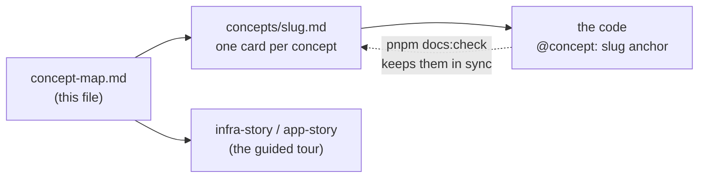

# Concept map (the hub)

History: see [CHANGELOG.md](CHANGELOG.md) or run `pnpm docs:history`

Every concept an interview can touch, grouped by area. For each one: is it in our code, where,
and which card explains it.

## How to read the table

**Status**

| Mark | Meaning |
| ---- | ------- |
| ✅ built | It is in our code. The card points at the exact file and symbol. |
| 🟡 partial | Some of it is in our code. The card says what is missing for production. |
| 📋 planned | Not in our app yet, but the step docs say we will build it. |
| 📖 explain-only | Not in our app and not planned. We can explain it, and say where it would go. |

**Where in our code** names a file and a symbol (a function, a variable or a setting). Never a line
number, because line numbers move. Paths are short: `api/` means `apps/api/src/`, `web/` means
`apps/web/src/`, `infra/` means `infra/src/` (unless the path starts with `infra/index.ts` or
`infra/Pulumi`).

**Card** is the card's name (its "slug"). The card will live at `concepts/<slug>.md`. A card
becomes a link here when it is written. `P2`, `P3`, `P5` say in which phase of the
[handbook spec](HANDBOOK_SPEC.md) it gets written:

- **P2** = ✅ and 🟡 AWS / infra concepts (with `infra-story.md`)
- **P3** = ✅ and 🟡 app concepts (with `app-story.md`)
- **P5** = 📋 planned and 📖 explain-only concepts

`pnpm docs:check` fails if a card exists but this map does not link to it.

## Frontend

| Concept | Status | Where in our code | Card |
| ------- | ------ | ----------------- | ---- |
| App Router: file-based routing, `app/` is routing only | ✅ | `web/app/page.tsx` → `HomePage`; `web/app/login/page.tsx` → `LoginPage`; `web/app/dashboard/page.tsx` → `DashboardPage` | [`app-router`](concepts/app-router.md) |
| Server Components vs Client Components | ✅ | `web/app/layout.tsx` → `RootLayout` (server); `web/providers/query-provider.tsx` → `QueryProvider` (`"use client"`) | [`server-client-components`](concepts/server-client-components.md) |
| Route guard in the Next.js proxy (UX only, not security) | ✅ | `web/proxy.ts` → `proxy`, `config.matcher` | [`route-guard-proxy`](concepts/route-guard-proxy.md) |
| TanStack Query: the server-state cache | ✅ | `web/providers/query-provider.tsx` → `QueryProvider`; `web/features/auth/hooks/use-me.ts` → `useMe`; `web/features/events/hooks/use-events.ts` → `useEvents` | [`tanstack-query`](concepts/tanstack-query.md) |
| Cache invalidation after a mutation | ✅ | `web/features/auth/hooks/use-login.ts` → `useLogin` (`invalidateQueries`); `use-logout.ts` → `useLogout` (`queryClient.clear`) | [`query-invalidation`](concepts/query-invalidation.md) |
| tRPC client and request batching | ✅ | `web/lib/trpc/client.ts` → `makeTrpcClient` (`httpBatchLink`, `credentials: "include"`) | [`trpc-client`](concepts/trpc-client.md) |
| Feature folders: components use hooks, never tRPC | ✅ | `web/features/account/hooks/use-profile.ts` → `useProfile`; `web/features/account/components/profile-card.tsx` → `ProfileCard` | [`feature-folders`](concepts/feature-folders.md) |
| Client state vs server state | ✅ | `web/features/auth/components/signup-form.tsx` → `useState` (form state); `useSignup` (server state) | [`state-management`](concepts/state-management.md) |
| Forms: shared-schema validation, accessible errors, focus | ✅ | `web/features/auth/components/signup-form.tsx` → `validate`, `focusField`; `web/components/ui/input.tsx` → `Input` | [`accessible-forms`](concepts/accessible-forms.md) |
| Showing API errors in the UI (field errors, 401 redirect) | ✅ | `signup-form.tsx` → `handleSubmit` (`onError`); `web/features/account/hooks/use-profile.ts` → `useProfile` | [`ui-error-handling`](concepts/ui-error-handling.md) |
| Tailwind CSS (utility classes) | ✅ | `apps/web/postcss.config.mjs`; `web/app/globals.css` | [`tailwind`](concepts/tailwind.md) |
| Client-side vs server-side rendering | 🟡 | `web/features/events/hooks/use-events.ts` → `useEvents` (CSR built); SSR planned | [`csr-vs-ssr`](concepts/csr-vs-ssr.md) |
| Rendering strategies: SSR, SSG, ISR, streaming | 📖 | Explain-only | `rendering-strategies` · P5 |
| Optimistic updates | 📖 | Explain-only | `optimistic-updates` · P5 |
| Web performance: Core Web Vitals, bundle size, code splitting | 📖 | Explain-only | `web-vitals` · P5 |

## API

| Concept | Status | Where in our code | Card |
| ------- | ------ | ----------------- | ---- |
| Fastify app: "build" apart from "listen" | ✅ | `api/app.ts` → `buildApp`; `api/server.ts` (`app.listen`) | [`fastify-app`](concepts/fastify-app.md) |
| RPC vs REST (why tRPC) | ✅ | `api/trpc/router.ts` → `appRouter` | [`rpc-vs-rest`](concepts/rpc-vs-rest.md) |
| End-to-end types: web imports only `type AppRouter` | ✅ | `api/trpc/router.ts` → `AppRouter`; `web/lib/trpc/client.ts` (`import type`) | [`end-to-end-types`](concepts/end-to-end-types.md) |
| tRPC context, built once per request | ✅ | `api/trpc/context.ts` → `createContext`, `Context` | [`trpc-context`](concepts/trpc-context.md) |
| tRPC middleware chain | ✅ | `api/trpc/init.ts` → `errorMapper`, `publicProcedure`, `protectedProcedure` | [`trpc-middleware`](concepts/trpc-middleware.md) |
| Layered architecture: procedures → services → queries | ✅ | `api/procedures/auth.ts` → `authRouter`; `api/services/auth.ts` → `login`; `api/queries/users.ts` → `findByEmail` | [`layered-api`](concepts/layered-api.md) |
| Central error handling: business error → HTTP status | ✅ | `api/errors.ts` → `AppError`; `api/trpc/init.ts` → `codeByKind`, `errorFormatter`; `api/app.ts` → `setErrorHandler` | [`error-handling`](concepts/error-handling.md) |
| Validation at boundaries: input and output schemas | ✅ | `api/procedures/auth.ts` → `.input(SignupInput)`, `.output(PublicUserSchema)`; `packages/shared/src/schemas/auth.ts` | [`validation-at-boundaries`](concepts/validation-at-boundaries.md) |
| Config validation: fail fast at startup | ✅ | `api/config/env.ts` → `EnvSchema`; `api/config/database.ts` → `DatabaseEnvSchema` | [`config-validation`](concepts/config-validation.md) |
| HTTP methods and status codes | ✅ | `api/trpc/init.ts` → `codeByKind`; `api/app.ts` → `/ready` (503) | [`http-status-codes`](concepts/http-status-codes.md) |
| Idempotency | 🟡 | `api/services/auth.ts` → `logout` (idempotent). Signup has no idempotency key. | [`idempotency`](concepts/idempotency.md) |
| Stateless API servers | ✅ | `api/queries/sessions.ts` (sessions live in Redis, not in process memory) | [`stateless-servers`](concepts/stateless-servers.md) |
| CORS | ✅ | `api/app.ts` → `app.register(cors, …)` (`origin: env.WEB_ORIGIN`, `credentials: true`) | [`cors`](concepts/cors.md) |
| Reverse proxies and `X-Forwarded-For` (`trustProxy`) | ✅ | `api/config/trust-proxy.ts` → `trustProxyHops`; `api/app.ts` → `trustProxy` | [`trust-proxy`](concepts/trust-proxy.md) |
| HTTP/1.1 vs HTTP/2 vs HTTP/3 | 🟡 | `infra/entry/cdn.ts` → `httpVersion: "http2and3"` (browser to edge only) | [`http-versions`](concepts/http-versions.md) |
| GraphQL (over- and under-fetching) | 📖 | Explain-only | `graphql` · P5 |
| gRPC | 📖 | Explain-only | `grpc` · P5 |
| WebSockets, Server-Sent Events, long polling | 📖 | Explain-only | `realtime-transports` · P5 |
| API gateway | 📖 | Explain-only | `api-gateway` · P5 |
| API versioning | 📖 | Explain-only | `api-versioning` · P5 |
| Pagination (offset vs cursor) | 📖 | Explain-only | `pagination` · P5 |

## Data

| Concept | Status | Where in our code | Card |
| ------- | ------ | ----------------- | ---- |
| Postgres schema with Drizzle ORM (UUID keys) | ✅ | `api/db/schema/users.ts` → `users`; `api/db/schema/events.ts` → `events`; `api/db/client.ts` → `db` | [`drizzle-schema`](concepts/drizzle-schema.md) |
| SQL migrations: generate, apply, one-off runner | ✅ | `apps/api/drizzle/0000_first_northstar.sql`; `api/db/migrate.ts`; `scripts/run-migrations.sh` | [`migrations`](concepts/migrations.md) |
| CHECK constraints (the database refuses bad data) | ✅ | `api/db/schema/events.ts` → `events` (`check(...)` x3) | [`db-check-constraints`](concepts/db-check-constraints.md) |
| Seed data (safe to run twice) | ✅ | `api/db/seed.ts` → `rows`, `onConflictDoNothing()` | [`seed-data`](concepts/seed-data.md) |
| Connection pooling | ✅ | `api/db/client.ts` → `pool` (`max: 10`) | [`connection-pooling`](concepts/connection-pooling.md) |
| Unique constraint vs check-then-insert (race condition) | ✅ | `api/services/auth.ts` → `signup`; `api/queries/users.ts` → `create`, `isUniqueViolation` | [`unique-constraint-race`](concepts/unique-constraint-race.md) |
| Indexes (B-tree) | 🟡 | `api/db/schema/users.ts` → `email … .unique()` (Postgres backs it with an index). `events` has none yet. | [`indexing`](concepts/indexing.md) |
| SQL vs NoSQL | ✅ | `api/db/schema/users.ts` → `users` (SQL); `api/queries/sessions.ts` → `keyFor` (key-value) | [`sql-vs-nosql`](concepts/sql-vs-nosql.md) |
| Transactions and ACID | 📖 | Explain-only (every write today is one statement) | `acid-transactions` · P5 |
| Isolation levels | 📖 | Explain-only | `isolation-levels` · P5 |
| Locking: pessimistic vs optimistic | 📖 | Explain-only | `locking` · P5 |
| N+1 queries | 📖 | Explain-only | `n-plus-one` · P5 |
| Normalization vs denormalization | 📖 | Explain-only | `normalization` · P5 |
| Replication: primary and replicas | 📖 | Explain-only | `replication` · P5 |
| Sharding vs partitioning | 📖 | Explain-only | `sharding-partitioning` · P5 |
| Safe migrations: expand and contract | 📖 | Explain-only | `expand-contract-migrations` · P5 |
| CAP theorem and BASE | 📖 | Explain-only | `cap-theorem` · P5 |

## Auth & Security

| Concept | Status | Where in our code | Card |
| ------- | ------ | ----------------- | ---- |
| Password hashing with argon2id | ✅ | `api/services/auth.ts` → `signup` (`hash`), `login` (`verify`) | [`password-hashing`](concepts/password-hashing.md) |
| User enumeration: equal timing, one error message | 🟡 | `api/services/auth.ts` → `DUMMY_HASH`, `login`. Signup still says "Email already registered". | [`user-enumeration`](concepts/user-enumeration.md) |
| Server-side sessions in Redis vs JWT (and logout) | ✅ | `api/queries/sessions.ts` → `create`, `get`, `remove`, `keyFor`; `api/services/auth.ts` → `logout` | [`sessions-vs-jwt`](concepts/sessions-vs-jwt.md) |
| Session cookie flags: HttpOnly, SameSite, Secure | ✅ | `api/procedures/auth.ts` → `cookieOptions` | [`session-cookie`](concepts/session-cookie.md) |
| Authentication vs authorization | 🟡 | `api/trpc/init.ts` → `isAuthed`; `api/procedures/account.ts` → `profile` (only your own data; no roles) | [`authn-vs-authz`](concepts/authn-vs-authz.md) |
| Protected procedures: the real auth check | ✅ | `api/trpc/init.ts` → `isAuthed`, `protectedProcedure` | [`protected-procedure`](concepts/protected-procedure.md) |
| CSRF | 🟡 | `api/procedures/auth.ts` → `cookieOptions.sameSite`. Origin check: planned (Step 13, see [docs/19](../19-infra-cloudfront.md)). | [`csrf`](concepts/csrf.md) |
| XSS | 🟡 | `api/procedures/auth.ts` → `cookieOptions.httpOnly`; React escapes output. No Content-Security-Policy. | [`xss`](concepts/xss.md) |
| SQL injection: parameterized queries | ✅ | `api/queries/users.ts` → `findByEmail` (`eq(users.email, email)`) | [`sql-injection`](concepts/sql-injection.md) |
| Open redirect protection | ✅ | `web/features/auth/lib/safe-next.ts` → `getSafeNext` | [`open-redirect`](concepts/open-redirect.md) |
| Rate limiting: token bucket, leaky bucket, fixed / sliding window | 📋 | Not in our app yet (planned). `trustProxy` already gives the real visitor IP to key on. | `rate-limiting` · P5 |
| Secrets management: never in code, images or state | ✅ | `infra/data/secrets.ts` → `createSecrets`; `infra/compute/task.ts` → `secrets`; `.dockerignore` | [`secrets-management`](concepts/secrets-management.md) |
| Encryption in transit (TLS) | ✅ | `api/config/database.ts` → `ssl: { rejectUnauthorized: true }`; `apps/api/Dockerfile` → `NODE_EXTRA_CA_CERTS`; `infra/data/cache.ts` → `transitEncryptionEnabled` | [`tls-in-transit`](concepts/tls-in-transit.md) |
| Encryption at rest | ✅ | `infra/data/postgres.ts` → `storageEncrypted`; `infra/data/cache.ts` → `atRestEncryptionEnabled` | [`encryption-at-rest`](concepts/encryption-at-rest.md) |
| Log redaction: no passwords in logs | ✅ | `api/app.ts` → `logger.redact` | [`log-redaction`](concepts/log-redaction.md) |
| Least privilege | ✅ | `infra/compute/iam.ts` → `executionSecrets`; `infra/security.ts`; `.github/workflows/ci.yml` → `permissions` | [`least-privilege`](concepts/least-privilege.md) |
| Symmetric vs asymmetric encryption | 📖 | Explain-only | `symmetric-asymmetric` · P5 |
| OAuth 2.0: authorization code + PKCE | 📖 | Explain-only | `oauth2-pkce` · P5 |
| OpenID Connect (OIDC) | 📖 | Explain-only | `oidc` · P5 |
| RBAC and ABAC | 📖 | Explain-only | `rbac-abac` · P5 |
| Multi-factor authentication (MFA) | 📖 | Explain-only | `mfa` · P5 |

## Performance & Caching

| Concept | Status | Where in our code | Card |
| ------- | ------ | ----------------- | ---- |
| CDN caching: hashed static files cached, per-user answers never | ✅ | `infra/entry/cdn.ts` → `orderedCacheBehaviors` (`/_next/static/*` cached; `/trpc/*` not), `defaultCacheBehavior` | [`cdn-caching`](concepts/cdn-caching.md) |
| Compression at the edge (gzip / Brotli) | 🟡 | `infra/entry/cdn.ts` → `compress: true`. Works only on `/_next/static/*`: `CachingDisabled` (pages, `/trpc/*`) has compression off. | [`compression`](concepts/compression.md) |
| TTL (time to live) | ✅ | `api/queries/sessions.ts` → `SESSION_TTL_SECONDS`; `api/procedures/auth.ts` → `maxAge` | [`ttl`](concepts/ttl.md) |
| Cache-aside | 📖 | Explain-only (Redis holds sessions; it is not a cache in front of Postgres) | `cache-aside` · P5 |
| Read-through, write-through, write-behind | 📖 | Explain-only | `cache-write-strategies` · P5 |
| Eviction policies (LRU and others) | 📖 | Explain-only | `cache-eviction` · P5 |
| Server-side cache invalidation | 📖 | Explain-only | `cache-invalidation` · P5 |
| Cache stampede / thundering herd | 📖 | Explain-only | `cache-stampede` · P5 |
| Load testing and profiling | 📖 | Explain-only | `load-testing` · P5 |

## Async & Events

Nothing in this area is in our app yet. Every request is handled start to finish while the
browser waits.

| Concept | Status | Where in our code | Card |
| ------- | ------ | ----------------- | ---- |
| Message queues (e.g. SQS), idempotent consumers | 📖 | Explain-only | `message-queues` · P5 |
| Background jobs and workers | 📖 | Explain-only | `background-jobs` · P5 |
| Event-driven architecture | 📖 | Explain-only | `event-driven` · P5 |
| RabbitMQ vs Kafka | 📖 | Explain-only | `rabbitmq-vs-kafka` · P5 |
| Dead-letter queue (DLQ) | 📖 | Explain-only | `dead-letter-queue` · P5 |
| Event sourcing | 📖 | Explain-only | `event-sourcing` · P5 |
| CQRS | 📖 | Explain-only | `cqrs` · P5 |
| Saga pattern | 📖 | Explain-only | `saga` · P5 |
| Transactional outbox | 📖 | Explain-only | `outbox` · P5 |
| Eventual consistency | 📖 | Explain-only | `eventual-consistency` · P5 |

## Reliability

| Concept | Status | Where in our code | Card |
| ------- | ------ | ----------------- | ---- |
| Graceful shutdown (and PID 1 signals) | ✅ | `api/server.ts` → `shutdown`; `apps/api/Dockerfile` → `CMD` (exec form); `infra/entry/target-groups.ts` → `deregistrationDelay`. Planned: a short wait after SIGTERM before closing. | [`graceful-shutdown`](concepts/graceful-shutdown.md) |
| Health checks: liveness vs readiness | ✅ | `api/app.ts` → `/health`, `/ready`; `infra/compute/task.ts` → `healthCheck`; `infra/entry/target-groups.ts` → `healthCheck` | [`health-checks`](concepts/health-checks.md) |
| Retry policy: retry only what is safe | ✅ | `web/providers/query-provider.tsx` → `shouldRetry`, `mutations: { retry: 0 }` | [`retry-policy`](concepts/retry-policy.md) |
| Fail fast and timeouts when a dependency is down | 🟡 | `api/redis/client.ts` → `maxRetriesPerRequest`, `enableOfflineQueue`; `api/db/client.ts` → `pool.on("error")`. Postgres has no connection or statement timeout (corrected in Phase 3). | [`fail-fast`](concepts/fail-fast.md) |
| Circuit breaker | 🟡 | `infra/compute/service.ts` → `deploymentCircuitBreaker` (deploys only; no circuit breaker in app code) | [`circuit-breaker`](concepts/circuit-breaker.md) |
| Zero-downtime deploys: rolling update + draining | 🟡 | `infra/compute/service.ts` → `createApiService` (ECS rolling defaults); `infra/entry/target-groups.ts` → `deregistrationDelay` | [`zero-downtime-deploys`](concepts/zero-downtime-deploys.md) |
| Vertical vs horizontal scaling | 🟡 | `infra/compute/service.ts` → `desiredCount: 1`; the api is stateless, so it can scale out | [`scaling`](concepts/scaling.md) |
| Load balancing algorithms: round robin, least connections, IP hash | 🟡 | `infra/entry/target-groups.ts` (we keep the ALB default) | [`load-balancing-algorithms`](concepts/load-balancing-algorithms.md) |
| High availability across availability zones | 🟡 | `infra/network.ts` → `azNames` (2 AZs); `infra/data/postgres.ts` → `multiAz: false`; `infra/compute/service.ts` → `desiredCount: 1` | [`high-availability`](concepts/high-availability.md) |
| Monolith vs microservices | ✅ | `api/trpc/router.ts` → `appRouter` (one api, split by feature inside) | [`monolith-vs-microservices`](concepts/monolith-vs-microservices.md) |
| Backpressure and bulkheads | 📖 | Explain-only | `backpressure` · P5 |

## DevOps & CI/CD

| Concept | Status | Where in our code | Card |
| ------- | ------ | ----------------- | ---- |
| Monorepo with pnpm workspaces, shared package | ✅ | `pnpm-workspace.yaml`; `packages/shared/src/index.ts` | [`monorepo`](concepts/monorepo.md) |
| CI pipeline: quality, e2e and docker jobs | ✅ | `.github/workflows/ci.yml` → jobs `quality`, `e2e`, `docker` | [`ci-pipeline`](concepts/ci-pipeline.md) |
| Docker multi-stage builds (and Next.js standalone) | ✅ | `apps/api/Dockerfile` (stages `base` … `runtime`); `apps/web/Dockerfile`; `apps/web/next.config.ts` → `output: "standalone"` | [`docker-multi-stage`](concepts/docker-multi-stage.md) |
| Docker layer caching | ✅ | `apps/api/Dockerfile` (package files copied before source, cache mount); `ci.yml` → `cache-from: type=gha` | [`docker-layer-caching`](concepts/docker-layer-caching.md) |
| Container hardening: non-root, slim, production-only deps | ✅ | `apps/api/Dockerfile` → `USER node`, `pnpm … --prod deploy` | [`container-hardening`](concepts/container-hardening.md) |
| Config from the environment (12-factor), build time vs run time | ✅ | `api/config/env.ts`; `apps/web/Dockerfile` → `ARG NEXT_PUBLIC_API_URL`; `infra/compute/task.ts` → `environment` | [`twelve-factor-config`](concepts/twelve-factor-config.md) |
| Infrastructure as Code with Pulumi | ✅ | `infra/index.ts`; `infra/network.ts` → `createNetwork` | [`infrastructure-as-code`](concepts/infrastructure-as-code.md) |
| Immutable image tags (git SHA) | ✅ | `scripts/push-images.sh` → `TAG`; `infra/registry.ts` → `imageTagMutability: "IMMUTABLE"` | [`immutable-image-tags`](concepts/immutable-image-tags.md) |
| Cost on/off switches | ✅ | `infra/index.ts` → `dataEnabled`, `computeEnabled`, `entryEnabled` | [`cost-switches`](concepts/cost-switches.md) |
| Budget alerts | ✅ | `infra/budget.ts` → `createBudget` | [`budget-alerts`](concepts/budget-alerts.md) |
| Image vulnerability scanning | 🟡 | `infra/registry.ts` → `scanOnPush: true` (results are not read automatically) | [`image-scanning`](concepts/image-scanning.md) |
| Continuous deployment (CD) and branch protection | 📋 | Not in our app yet (planned, see [docs/10](../10-ci.md)) | `continuous-deployment` · P5 |
| Blue/green and canary deploys | 📖 | Explain-only | `blue-green-canary` · P5 |
| Feature flags | 📖 | Explain-only | `feature-flags` · P5 |

## AWS Network

| Concept | Status | Where in our code | Card |
| ------- | ------ | ----------------- | ---- |
| Regions and availability zones | ✅ | `infra/Pulumi.dev.yaml` → `aws:region`; `infra/network.ts` → `azNames` | [`regions-and-azs`](concepts/regions-and-azs.md) |
| VPC and CIDR blocks | ✅ | `infra/network.ts` → `vpc` (`10.0.0.0/16`) | [`vpc`](concepts/vpc.md) |
| Public vs private subnets | ✅ | `infra/network.ts` → `publicSubnets`, `privateSubnets` | [`subnets`](concepts/subnets.md) |
| Route tables and the internet gateway | ✅ | `infra/network.ts` → `publicRouteTable`, `privateRouteTable`, `internetGateway` | [`route-tables`](concepts/route-tables.md) |
| Security groups: stateful, group references | ✅ | `infra/security.ts` → `createSecurityGroups` | [`security-groups`](concepts/security-groups.md) |
| Application Load Balancer, listener, default 403 | ✅ | `infra/entry/alb.ts` → `createAlb`; `infra/entry/listener.ts` → `createListener` | [`alb`](concepts/alb.md) |
| Same-origin path routing: `/trpc/*` → api | ✅ | `infra/entry/listener.ts` → `trpcRule`, `webRule`; `web/lib/trpc/client.ts` → `API_URL` | [`same-origin-routing`](concepts/same-origin-routing.md) |
| Target groups and ALB health checks | ✅ | `infra/entry/target-groups.ts` → `createTargetGroups` | [`target-groups`](concepts/target-groups.md) |
| CloudFront: CDN and HTTPS | ✅ | `infra/entry/cdn.ts` → `createCdn` | [`cloudfront`](concepts/cloudfront.md) |
| TLS termination: where HTTPS ends | ✅ | `infra/entry/cdn.ts` → `originProtocolPolicy: "http-only"`; `infra/entry/listener.ts` (HTTP :80) | [`tls-termination`](concepts/tls-termination.md) |
| Origin protection: prefix list + secret header | ✅ | `infra/security.ts` → `cloudFrontPrefixList`; `infra/entry/origin-secret.ts` → `createOriginSecret`; `infra/entry/listener.ts` → `hasSecretHeader` | [`origin-protection`](concepts/origin-protection.md) |
| NAT gateway (chosen NOT to build) | 📖 | `infra/network.ts` → comment at `privateRouteTable`; `infra/compute/service.ts` → `assignPublicIp: true` | `nat-gateway` · P5 |
| VPC endpoints | 📖 | Explain-only | `vpc-endpoints` · P5 |
| Network ACLs | 📖 | Explain-only (we keep the default network ACL) | `network-acls` · P5 |
| DNS, Route 53, custom domains | 📖 | Explain-only (we use the `*.cloudfront.net` name) | `dns-route53` · P5 |
| ACM certificates | 📖 | Explain-only | `acm-certificates` · P5 |
| WAF and Shield | 📖 | Explain-only | `waf-shield` · P5 |
| ALB vs NLB (layer 7 vs layer 4) | 📖 | Explain-only | `alb-vs-nlb` · P5 |

## AWS Compute

| Concept | Status | Where in our code | Card |
| ------- | ------ | ----------------- | ---- |
| ECR: the image registry | ✅ | `infra/registry.ts` → `createRegistry` | [`ecr`](concepts/ecr.md) |
| ECS cluster and capacity providers | ✅ | `infra/compute/cluster.ts` → `createCluster` | [`ecs-cluster`](concepts/ecs-cluster.md) |
| Task definition: recipe, revisions, `awsvpc` | ✅ | `infra/compute/task.ts` → `createApiTask`; `infra/compute/web-task.ts` → `createWebTask` | [`task-definition`](concepts/task-definition.md) |
| ECS service: desired count, replacement | ✅ | `infra/compute/service.ts` → `createApiService`; `infra/compute/web-service.ts` → `createWebService` | [`ecs-service`](concepts/ecs-service.md) |
| Fargate: containers without managing servers | ✅ | `infra/compute/task.ts` → `requiresCompatibilities: ["FARGATE"]` | [`fargate`](concepts/fargate.md) |
| Fargate Spot | ✅ | `infra/compute/service.ts` → `capacityProviderStrategies`; `scripts/run-migrations.sh` → `--launch-type FARGATE` (not Spot) | [`fargate-spot`](concepts/fargate-spot.md) |
| Execution role vs task role | ✅ | `infra/compute/iam.ts` → `createIamRoles`; `infra/compute/web-iam.ts` → `createWebIamRole` | [`execution-vs-task-role`](concepts/execution-vs-task-role.md) |
| ECS Exec: a shell inside a running task | ✅ | `infra/compute/iam.ts` → `taskExec`; `infra/compute/service.ts` → `enableExecuteCommand` | [`ecs-exec`](concepts/ecs-exec.md) |
| ARM64 (Graviton) images and tasks | ✅ | `infra/compute/task.ts` → `runtimePlatform`; `scripts/push-images.sh` → `--platform linux/arm64`; `infra/data/postgres.ts`, `infra/data/cache.ts` → `t4g` classes | [`arm64-graviton`](concepts/arm64-graviton.md) |
| Auto scaling | 📖 | Explain-only | `autoscaling` · P5 |
| EC2 vs Fargate vs EKS vs Lambda | 📖 | Explain-only (we only built Fargate) | `compute-options` · P5 |

## AWS Data

| Concept | Status | Where in our code | Card |
| ------- | ------ | ----------------- | ---- |
| RDS Postgres: private, single-AZ, subnet group | ✅ | `infra/data/postgres.ts` → `createPostgres` | [`rds-postgres`](concepts/rds-postgres.md) |
| RDS-managed master password (and the rotation limit) | ✅ | `infra/data/postgres.ts` → `manageMasterUserPassword`, `masterSecretArn` | [`rds-managed-password`](concepts/rds-managed-password.md) |
| ElastiCache Valkey: TLS + auth token | ✅ | `infra/data/cache.ts` → `createCache` | [`elasticache-valkey`](concepts/elasticache-valkey.md) |
| Secrets Manager | ✅ | `infra/data/secrets.ts` → `createSecrets` | [`secrets-manager`](concepts/secrets-manager.md) |
| KMS keys (AWS-managed) | 🟡 | `infra/data/postgres.ts` → `storageEncrypted`; `infra/compute/iam.ts` → comment at `executionSecrets` | [`kms`](concepts/kms.md) |
| Backups, snapshots, disaster recovery | 🟡 | `infra/data/postgres.ts` → `backupRetentionPeriod: 1`, `skipFinalSnapshot: true`; `infra/data/cache.ts` → `snapshotRetentionLimit: 0` | [`backups-dr`](concepts/backups-dr.md) |
| Multi-AZ and read replicas | 📖 | `infra/data/postgres.ts` → `multiAz: false` (chosen off) | `multi-az-replicas` · P5 |
| RDS Proxy | 📖 | Explain-only | `rds-proxy` · P5 |
| IAM database authentication | 📖 | Explain-only | `iam-db-auth` · P5 |
| S3 | 📖 | Explain-only | `s3` · P5 |
| DynamoDB | 📖 | Explain-only | `dynamodb` · P5 |

## Observability

| Concept | Status | Where in our code | Card |
| ------- | ------ | ----------------- | ---- |
| Structured JSON logs (Fastify's logger, pino) | ✅ | `api/app.ts` → `Fastify({ logger })`, `onError` | [`structured-logging`](concepts/structured-logging.md) |
| Request IDs and correlation IDs | 🟡 | `api/app.ts` → `reqId: request.id` (per request; not passed between services) | [`correlation-ids`](concepts/correlation-ids.md) |
| CloudWatch Logs: log groups, streams, retention | ✅ | `infra/compute/logs.ts` → `createLogs`; `infra/compute/task.ts` → `logConfiguration` | [`cloudwatch-logs`](concepts/cloudwatch-logs.md) |
| Metrics | 🟡 | `infra/compute/cluster.ts` → `containerInsights: "disabled"` (only ECS basic metrics) | [`metrics`](concepts/metrics.md) |
| Alerting | 🟡 | `infra/budget.ts` → `createBudget` (cost only; no health alarms) | [`alerting`](concepts/alerting.md) |
| Distributed tracing | 📖 | Explain-only | `distributed-tracing` · P5 |
| OpenTelemetry | 📖 | Explain-only | `opentelemetry` · P5 |
| SLIs, SLOs and error budgets | 📖 | Explain-only | `slos` · P5 |
| Audit logs (CloudTrail) | 📖 | Explain-only | `cloudtrail` · P5 |

## Testing

| Concept | Status | Where in our code | Card |
| ------- | ------ | ----------------- | ---- |
| Unit tests (Vitest, next to the code) | ✅ | `vitest.config.mts`; `packages/shared/src/schemas/auth.test.ts`; `web/features/auth/lib/safe-next.test.ts` | [`unit-tests`](concepts/unit-tests.md) |
| In-process API tests (no real network) | ✅ | `api/trpc/init.test.ts` → `createCallerFactory`; `api/config/trust-proxy.test.ts` → `app.inject` | [`in-process-api-tests`](concepts/in-process-api-tests.md) |
| End-to-end tests with Playwright (and test data isolation) | ✅ | `apps/web/e2e/login.spec.ts` → `runId`; `apps/web/playwright.config.ts` → `webServer` | [`e2e-tests`](concepts/e2e-tests.md) |
| Static checks: strict TypeScript + lint | ✅ | `tsconfig.base.json` → `strict`; `eslint.config.mjs` | [`static-checks`](concepts/static-checks.md) |
| Testing pyramid | 🟡 | Unit + e2e. Few integration tests against a real database. | [`testing-pyramid`](concepts/testing-pyramid.md) |
| Mocks vs real dependencies | 📖 | Explain-only | `mocking` · P5 |
| Contract testing | 📖 | Explain-only | `contract-testing` · P5 |

## Topics added beyond reference-topics.md

[reference-topics.md](reference-topics.md) is the owner's checklist. These rows were added because
senior backend and cloud interviews often ask about them:

- **API:** API versioning, pagination, stateless servers, `trustProxy`.
- **Data:** connection pooling, migrations, unique constraint vs check-then-insert.
- **Auth & Security:** open redirect, XSS, MFA, log redaction, least privilege, secrets
  management, encryption at rest and in transit, user enumeration.
- **Async:** transactional outbox, background jobs.
- **Reliability:** health checks, retry policy, fail fast, zero-downtime deploys, high
  availability, backpressure.
- **DevOps:** Docker builds and hardening, immutable tags, IaC, cost switches, CD, blue/green,
  feature flags, image scanning.
- **AWS:** every row in the three AWS areas.
- **Observability:** CloudWatch Logs, alerting, SLOs, audit logs.
- **Testing:** the whole area.

## How this connects

- **Uses:** the code (every ✅ row was checked against it) and the step docs in [docs/](..).
- **Gives:** the list of cards to write in Phases 2, 3 and 5. [README.md](README.md) uses it for
  the reading paths. `pnpm docs:check` reads it.
