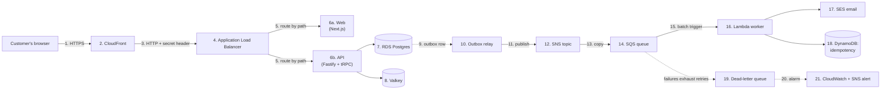
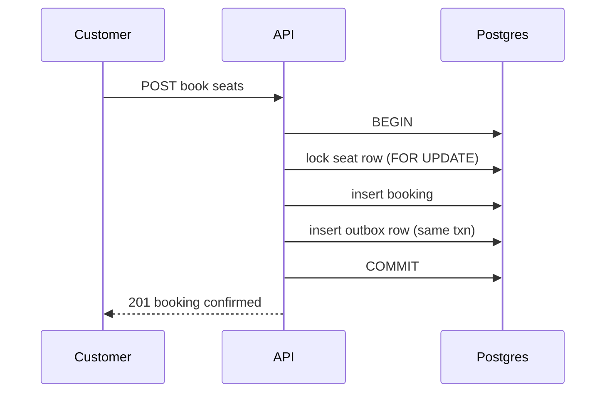
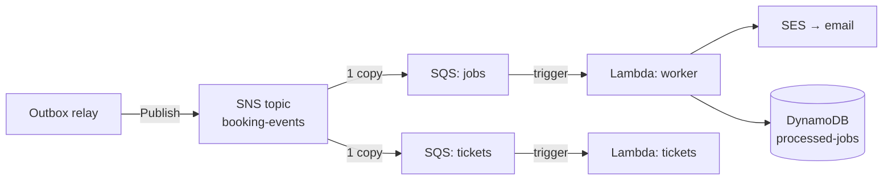

# The MiniTickets story: one booking, every AWS service

History: see [CHANGELOG.md](../CHANGELOG.md) or run `pnpm docs:history`

This is the narrative spine of the handbook. Read it once now for the big picture; return to it after
each part to see where the new service fits. Every section here has a full chapter later — the point
of this page is to show how the pieces connect, not to teach the details.

The honesty labels from the [README](README.md#2-four-honesty-labels-read-this-before-anything-else)
apply throughout. In short: MiniTickets is **built in the repository**; whether a given resource is
currently *deployed* depends on the switches in `infra/Pulumi.dev.yaml`. Nothing in this story claims a
live AWS account was inspected unless the chapter says so.

---

## The one-line version

A customer books a ticket on a Next.js site; the request travels through CloudFront and an Application
Load Balancer to a container on ECS/Fargate; the booking is committed to PostgreSQL; a background
worker (SQS → Lambda) then sends the email and renders the ticket — and if that worker keeps failing,
the message lands in a dead-letter queue for a human to repair.

Read that diagram one box at a time. The rest of this page is the story behind each arrow.

---

## Chapter 1 — The customer opens the website

A person types `https://<our-domain>` into a browser. Before any of our code runs, the browser must
turn that name into an address. That is **DNS**. The name resolves to a **CloudFront** distribution —
AWS's content delivery network. CloudFront gives us HTTPS (the padlock) and serves cached pages from a
location near the visitor.

*AWS concepts introduced here:* accounts and regions, DNS, CloudFront, TLS certificates.
*Chapters:* [01](01-what-is-aws.md), [08](08-tls-acm.md), [09](09-cloudfront.md).

**In MiniTickets:** `entry/cdn.ts` creates the distribution. There are two entry modes (CloudFront in
front, or the load balancer directly). The committed dev configuration uses the direct mode, so the
CloudFront path is *configured for deployment* but not necessarily active. See [09](09-cloudfront.md).

## Chapter 2 — The request reaches our application

CloudFront (or the browser directly) sends the request to an **Application Load Balancer (ALB)**. The
ALB is the receptionist at the front door: it reads the URL path and walks the visitor to the right
desk — `/trpc/*` goes to the **API**, everything else goes to the **web** app. The ALB only sends
traffic to containers that pass a **health check**.

*AWS concepts:* ALB, listeners, rules, target groups, health checks, security groups.
*Chapters:* [03](03-security-groups.md), [07](07-alb.md).

**In MiniTickets:** `entry/alb.ts`, `entry/listener.ts`, `entry/target-groups.ts`. The ALB also checks
a shared secret header (`X-Origin-Verify`) so that only CloudFront — not a random person hitting the
ALB's IP — can reach the desks. See `entry/origin-secret.ts`.

## Chapter 3 — The application runs in containers

Behind the ALB are **containers**, the packaged form of our web and API apps. They run on
**ECS with Fargate**: AWS finds a machine, starts the container, and we never manage a server. The
application images are stored in **ECR**, AWS's private container registry.

*AWS concepts:* container images, ECR, ECS clusters, task definitions, tasks, services, Fargate.
*Chapters:* [05](05-ecr.md), [06](06-ecs-fargate.md).

**In MiniTickets:** one ECS service keeps the API task running (`compute/service.ts`); the web task is
similar. The task definition (`compute/task.ts`) lists the environment variables and the secrets the
container needs. The cluster (`compute/cluster.ts`) uses the `FARGATE` and `FARGATE_SPOT` capacity
providers.

## Chapter 4 — The application reaches its data, privately

The containers connect to **PostgreSQL** (the main database, on **RDS**) and to **Valkey** (a Redis
compatible cache that holds sessions, on **ElastiCache**). Both live in **private subnets** — they have
no route to the internet — and are protected by **security groups** that only allow the app in.
Passwords come from **Secrets Manager**, encrypted with **KMS**.

*AWS concepts:* VPC, subnets, route tables, internet gateway, security groups, RDS, ElastiCache,
Secrets Manager, KMS, encryption.
*Chapters:* [02](02-vpc-and-networking.md), [10](10-rds-postgres.md), [11](11-elasticache.md),
[12](12-secrets-kms.md).

**In MiniTickets:** `network.ts` builds the VPC; `data/postgres.ts` and `data/cache.ts` build the
databases inside it; `data/secrets.ts` stores the Redis URL. The API task gets the database password
directly from the RDS-managed secret, so it is never written into code or an image.

## Chapter 5 — The hard part: two customers, the last ticket

A booking is a write that must not oversell. Two people clicking "book" on the last seat at the same
moment is a **concurrency** problem. MiniTickets solves it in the database with a transaction that
locks the seat row (`SELECT ... FOR UPDATE`), checks availability, inserts the booking, and — this is
the important bit — also writes a row into an **outbox** table *in the same transaction*.

*Concepts:* transactions, row locks, the transactional outbox pattern, idempotency keys.
*Chapters:* [10](10-rds-postgres.md), [15](15-transactional-outbox.md).

**In MiniTickets:** `apps/api/src/queries/bookings.ts` (the transaction) and
`apps/api/src/queries/outbox.ts` (the outbox). The chapter on the
[outbox](15-transactional-outbox.md) explains why writing the event *in the same transaction* is the
whole trick.

## Chapter 6 — Delivering the background work

The booking is now saved, but the customer still needs an **email** and a **ticket**. We must not make
the customer wait for those. So the API does *not* send them directly. Instead:

1. A **relay** reads committed outbox rows and **publishes** each one to an **SNS** topic
   (`apps/api/src/services/outbox.ts`).
2. SNS is a **fan-out** service: it copies the one message to every subscribed queue.
3. MiniTickets has two **SQS** queues — one for emails, one for tickets — so each consumer works at its
   own pace, independent of the other.
4. **Lambda** automatically wakes up when a queue has messages, takes a batch, and runs our worker
   code.

*AWS concepts:* SNS, SQS, Lambda, event source mappings, batches, at-least-once delivery.
*Chapters:* [16](16-sns.md), [17](17-sqs.md), [18](18-lambda.md).

## Chapter 7 — When the same message arrives twice

Queues promise **at-least-once** delivery, not exactly-once. A message can be delivered twice. If we
sent the email twice, the customer would be annoyed. So the worker is an **idempotent consumer**: before
sending, it checks a **DynamoDB** table for the job's business key; after sending, it records the key.
A duplicate finds the key and is skipped.

*AWS concepts:* at-least-once delivery, idempotency, DynamoDB, conditional writes, TTL.
*Chapters:* [13](13-dynamodb.md), [17](17-sqs.md).

**In MiniTickets:** `apps/worker/src/processed-jobs.ts` (the store) and
`apps/worker/src/handlers/booking-confirmed.ts` (the logic, with the honest "effectively once"
reasoning in its comments).

## Chapter 8 — When the worker keeps failing

Suppose SES rejects the email, or the mailer is down. The worker reports the message as failed. SQS
hides it for a growing backoff (10 s, 40 s, 120 s — `apps/worker/src/backoff.ts`), then offers it
again. After a bounded number of receives the queue stops retrying and moves the message to a
**dead-letter queue (DLQ)** — a repair tray where a human can investigate without losing the work.

*AWS concepts:* visibility timeout, retries, backoff, `maxReceiveCount`, dead-letter queues, alarms.
*Chapters:* [17](17-sqs.md), [19 — flagship](19-dead-letter-queue.md), [21](21-cloudwatch.md).

This is the **flagship chapter** of the handbook. It is written the deepest because the retry/DLQ
story is the single most valuable thing to be able to explain in a senior interview.

## Chapter 9 — Seeing what happened

None of the above is safe without **observability**. Every log line is structured JSON carrying a
`correlationId`, so one booking can be followed across API and worker. **CloudWatch** stores the logs,
watches key metrics (queue depth, oldest message age, worker errors, ALB 5xx), and fires **alarms**
that publish to an **SNS** topic that emails a human. **AWS Budgets** warns about spending.

*AWS concepts:* CloudWatch Logs, Logs Insights, metrics, alarms, dashboards, SNS notifications, Budgets.
*Chapters:* [21](21-cloudwatch.md), [23](23-budgets.md).

**In MiniTickets:** `observability/alarm-specs.ts` (the four alarms and why each exists),
`observability/alert-topic.ts` (the SNS alert topic), `observability/log-queries.ts` (saved searches).

## Chapter 10 — Getting new code into production

Deploying without storing long-lived AWS keys in GitHub is done with **OpenID Connect (OIDC)**: GitHub
proves its identity to AWS, AWS hands it a **temporary** credential scoped to one publish role or one
deploy role. The deployed image tag is recorded in **SSM Parameter Store**.

*AWS concepts:* OIDC identity providers, role assumption, least privilege, SSM Parameter Store.
*Chapters:* [04](04-iam.md), [22](22-ssm-release.md), [24](24-oidc-cicd.md).

**In MiniTickets:** `cicd.ts` (the OIDC provider and the two roles) and `release.ts` (the SSM
parameters). CI/CD never gets permanent keys.

---

## The whole journey in one table

| Step | What the customer sees | AWS service | Our code |
| --- | --- | --- | --- |
| 1 | Opens the site, padlock shows | CloudFront / ACM / DNS | `entry/cdn.ts`, `certificate.ts` |
| 2 | Request routed to the right app | ALB | `entry/listener.ts` |
| 3 | Pages and API answers | ECS + Fargate | `compute/service.ts` |
| 4 | Books a ticket | RDS Postgres | `queries/bookings.ts` |
| 5 | (invisible) event queued safely | Outbox pattern | `services/outbox.ts` |
| 6 | (invisible) event fanned out | SNS | `jobs/booking-events.ts` |
| 7 | (invisible) work buffered | SQS | `jobs/queues.ts` |
| 8 | Email arrives, ticket is ready | Lambda + SES + DynamoDB + S3 | `jobs/worker-lambda.ts`, `worker/*` |
| 9 | (invisible) failures wait safely | DLQ | `jobs/queues.ts` |
| 10 | (invisible) engineers get alerted | CloudWatch + SNS | `observability/*` |
| 11 | (invisible) new code ships | OIDC + SSM | `cicd.ts`, `release.ts` |

## What this story deliberately does *not* claim

- It does not claim CloudFront, the alarm emails, or a live DLQ redrive were exercised in a real AWS
  account. Those are **configured for deployment**.
- It does not claim any specific price or quota is current.
- It does not include services MiniTickets does not use (no Kubernetes/EKS, no API Gateway, no
  Aurora, no Step Functions, no Kinesis). When a chapter mentions them, it is only as an **alternative**
  you could compare against.

Next: [Chapter 01 — What is AWS?](01-what-is-aws.md).
