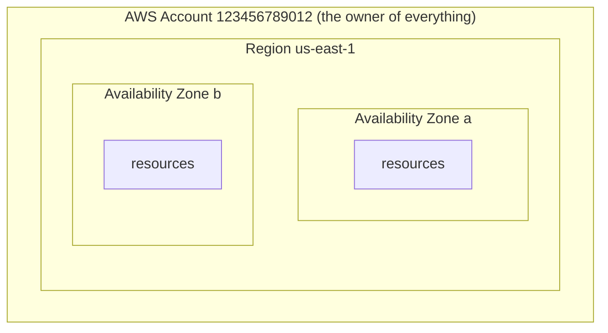
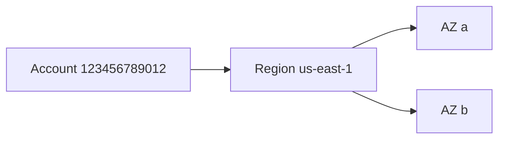

# 01. What is AWS? Accounts, regions, AZs and ARNs

History: see [CHANGELOG.md](../CHANGELOG.md) or run `pnpm docs:history`

> **Honesty label: ✅ Built in repository** for the parts MiniTickets configures (region, tags);
> otherwise this chapter is conceptual foundation. See the
> [labels](README.md#2-four-honesty-labels-read-this-before-anything-else).

**Prerequisites:** none. This is the first chapter.

---

## A. The problem first

Before AWS, if you wanted to run a website that could handle real traffic, you had to:

1. Buy physical servers and wait weeks for them to arrive.
2. Rent space in a data centre with power, cooling, and physical security.
3. Install an operating system, patch it, replace dead disks.
4. Guess how much capacity you needed months in advance — too little and you fall over during a
   launch; too much and you pay for idle machines forever.
5. Keep a spare data centre in case the first one flooded, burned, or lost power.

Every one of those steps is real work that has nothing to do with the product you actually want to
build. **AWS exists to remove that work.** The problem it solves is not "we need computers" — it is
"we want to run software without owning or babysitting the machines, and pay only for what we use."

MiniTickets is a small app. It could theoretically run on one laptop. Why does it use AWS at all? To
practise — and to use — the shape of a real production system: separate services, private networking,
managed databases, background queues, monitoring, and a repeatable deploy. That shape is what you are
here to learn.

---

## B. What it is

### Plain English

**AWS (Amazon Web Services)** is a collection of over two hundred services you rent by the second.
You create resources inside your **account**, they live in a geographic **region**, and you describe
them in files so they can be recreated exactly (**Infrastructure as Code**).

### The terms, one at a time

**Cloud computing** — using someone else's computers over a network, with elastic capacity and
usage-based billing. "Elastic" means you can add or remove capacity in minutes. "Usage-based" means
you are billed for what you actually consume (per second, per request, per GB), not for hardware.

**Account** — your private, isolated space in AWS. Resources in one account cannot see resources in
another unless you explicitly allow it. Every resource belongs to exactly one account. Throughout
this handbook, the example account id is AWS's documentation placeholder `123456789012`, never a real
one.

**Region** — a group of data centres in one part of the world, for example `us-east-1` (Northern
Virginia). Regions are isolated from one another: a resource in `us-east-1` does not automatically
exist in `eu-west-1`. MiniTickets' committed dev configuration uses `us-east-1`. You choose a region
for latency (be near your users), for compliance (data must stay in a country), or for cost.

**Availability Zone (AZ)** — one isolated data centre (or small cluster of them) inside a region, with
its own power, cooling, and network. A region has several AZs. If one AZ fails, others usually keep
working. MiniTickets deliberately spreads its subnets across **two** AZs so a single data-centre
failure does not take the whole app down.

**Shared responsibility model** — AWS secures **of** the cloud; you secure **in** the cloud. AWS
owns the physical buildings, the servers, the hypervisor, and the internals of managed services like
RDS. You own your data, your IAM permissions, your configuration, and the patching of anything you run
yourself. This sentence explains most security questions you will ever be asked about AWS.

**Amazon Resource Name (ARN)** — the globally unique full name of one AWS thing, for example:

```
arn:aws:sqs:us-east-1:123456789012:minitickets-dev-jobs
   │     │        │      │            │
service  │     region  account      resource name
      resource type
```

IAM policies refer to resources by ARN. When you see `arn:...` in code, that is "this exact
resource".

**Infrastructure as Code (IaC)** — describing your cloud in version-controlled files instead of
clicking in the console. MiniTickets uses **Pulumi** with TypeScript: `infra/index.ts` is the entry
point and each layer is a function. The alternative, clicking in the console, is called "ClickOps" and
is unreproducible and unauditable.

**Tag** — a key/value label on a resource (for example `project=minitickets`, `env=dev`). Tags make it
possible to see who owns a resource and what it is for. MiniTickets tags every resource via a helper,
`tagsFor(...)`.

**Cost model** — some services bill per request (SQS, SNS, Lambda), some per hour of running (RDS,
ElastiCache), some per GB stored or transferred (S3). "Idle cost" is money spent while doing no work.
This is why MiniTickets puts its always-on, hourly-billed layers behind on/off switches
(`dataEnabled`, `computeEnabled`, `entryEnabled`, `cdnEnabled`).

---

## C. How it works internally

You can think of AWS as three nested boxes.



- **Account** = isolation boundary. Billing, IAM, and resource ownership live here.
- **Region** = locality boundary. Latency and compliance are decided here.
- **AZ** = failure boundary. High availability is achieved by spreading across AZs.

### How a resource is actually created

When you run the Pulumi program, it does not "make a website". It calls AWS APIs, one resource at a
time, in dependency order. For each resource, AWS:

1. **Authenticates** the caller (who is making this API call?).
2. **Authorizes** it (is this caller allowed?).
3. **Creates** the resource and returns its identifier (usually an ARN or an id).
4. **Records** it in your account.

Pulumi keeps a **state file** mapping each resource in your code to the real resource in AWS. That
mapping is how a second `pulumi up` knows to *update* rather than *duplicate*. If the state and
reality disagree, that is **drift**.

### What AWS manages versus what you manage

| Layer | MiniTickets' provider |
| --- | --- |
| Buildings, power, cooling, physical security | AWS |
| Server hardware, hypervisor | AWS |
| RDS engine patching, ElastiCache patching | AWS |
| Your VPC layout, subnets, routes | **You** |
| Your security groups | **You** |
| Your IAM roles and policies | **You** |
| Your application code and data | **You** |

For a "serverless" line item like Lambda or DynamoDB, AWS manages almost everything and you supply
only code or a table definition. For a "self-managed between" line like ECS on Fargate, AWS runs the
host but you define the task. This spectrum — from fully managed to fully self-managed — is the
central trade-off of AWS: **more managed means less work and often more money and less control.**

---

## D. Our MiniTickets implementation

The foundation is invisible in a single file; it is the assumptions every layer makes.

- **The region** comes from configuration and is used by every AWS client. In infrastructure it is the
  Pulumi provider's region; in application code it is `AWS_REGION` (defaulting to `us-east-1` in
  `apps/worker/src/config.ts`).
- **Two AZs** are chosen in `infra/src/network.ts`, which creates two public and two private subnets —
  one pair per AZ.
- **Tagging** is centralised in `infra/src/tags.ts`; every `new aws.*.Resource(...)` call passes
  `tags: tagsFor(name)`.
- **The switches** live in `infra/index.ts` and are driven by the committed `infra/Pulumi.dev.yaml`:
  `dataEnabled`, `computeEnabled`, `entryEnabled`, `cdnEnabled`, and `domainName`. They exist purely
  to control cost. The code is the source of truth: reading `index.ts` top to bottom is reading the
  dependency order.
- **The two-owner rule.** Pulumi creates resources once; **CD** (the GitHub Actions pipeline) writes
  the *deployed image tag*. That separation is why the deployed tag lives in SSM Parameter Store
  ([22](22-ssm-release.md)) rather than in the Pulumi config.

A tiny but important habit from the repo: **never run `pulumi up` locally with uncommitted config.**
The next CD run would apply the committed file again and undo your change (config drift).
`pulumi preview` (read-only) is always safe.

---

## E. Security and permissions

**REACH.** "Reaching AWS" means making a signed HTTPS API call to a regional endpoint. There are no
open ports to the internet for the AWS *control plane*; you authenticate with credentials that AWS
signs onto each request.

**ALLOWED.** Every API call is authorized by IAM. Even the Pulumi program needs a principal with broad
permissions to create resources — which is exactly why the CI/CD chapter ([24](24-oidc-cicd.md)) is
careful about *which* role can do *what*.

**IDENTITY / CREDENTIALS.** Three common ways to authenticate:

1. A human in the console (a username/password plus, ideally, multi-factor authentication).
2. A program on your laptop using a local credential profile (fine for development).
3. A program *in* AWS using an **IAM role** that gives **temporary** credentials via STS (the
   production-safe way; MiniTickets uses roles everywhere in production).

**Encryption.** "At rest" means data on disk is encrypted; "in transit" means data moving is encrypted
(TLS/HTTPS). MiniTickets defaults to encryption at rest on RDS, ElastiCache, DynamoDB, S3 and SQS,
and every AWS API call is HTTPS in transit.

---

## F. The AWS console walkthrough

**Read-only first, always.** Useful starting points (labels change over time; find things by name):

1. **Top-right account menu → Account.** Note the account id. Compare it to the placeholder
   `123456789012` used in docs — never paste a real account id into public docs.
2. **Top-right region selector.** Switch to `us-east-1` (the committed dev region). Notice how
   resources "disappear" when you switch regions — that is region isolation in action.
3. **Resource Groups & Tag Editor → Tag Editor.** Search by `project = minitickets` to see the
   resources belonging to this project. This is why tagging matters.
4. **IAM → Roles.** Search `minitickets`. You will see the roles this handbook will explain:
   `minitickets-dev-worker-role`, `minitickets-dev-tickets-role`, the ECS execution/task roles, and
   `minitickets-dev-gh-publish` / `-deploy`.
5. **Billing and Cost Management → Budgets.** Confirm the `minitickets-dev` budget exists
   ([23](23-budgets.md)).

**Do not** change the region on a resource, delete a tag, or edit an IAM policy to "see what happens".
Those change live state and constitute drift.

---

## G. Real production scenarios

- **"A resource exists in one region but not another."** Expected: regions are isolated. If a service
  seems missing, check the region selector first — this is the single most common beginner confusion.
- **"Half our app survived an outage, half did not."** Likely one component was pinned to a single AZ.
  MiniTickets' two-AZ subnet design is the mitigation.
- **"Billing spiked overnight."** Look for an always-on resource left switched on (an RDS instance, a
  NAT gateway, a load balancer). Budgets ([23](23-budgets.md)) is the alarm for this.
- **"A deploy undid our manual change."** That is drift by design: the committed config wins.
- **"An ARN in a policy does not match the resource."** Cross-account or typo'd ARNs are a classic
  permissions bug; compare the region, account and name segments carefully.

---

## H. Decisions and alternatives

- **Managed over self-hosted.** MiniTickets uses RDS, ElastiCache, SQS, SNS and Lambda instead of
  running its own Postgres, Redis, Kafka and cron boxes. Trade-off: less control, potential lock-in,
  higher per-unit price — in exchange for far less operational burden.
- **Pulumi (TypeScript) over CloudFormation/Terraform.** The same language as the app, with real
  types across layers. Trade-off: state must be managed carefully; the tool is less ubiquitous than
  Terraform.
- **Region choice.** `us-east-1` is cheap and feature-rich; another region might be closer to users or
  legally required.
- **Two AZs, not three.** Two is enough to survive one AZ failure at MiniTickets' scale; three is the
  common production choice for higher availability at higher cost.
- **Cost switches.** A learning project must be able to stop spending; hence on/off flags. The
  trade-off is that "the code exists" and "it is running" can differ — which is why this handbook
  labels state so carefully.

---

## I. Interview preparation

### 30-second answer

> "AWS rents you compute, storage and managed services per second inside an account. Resources live in
> a region and are spread across isolated Availability Zones; IAM authorizes every API call, and
> infrastructure is defined as code with Pulumi. MiniTickets uses `us-east-1`, two AZs, and cost
> switches so a dev environment can be turned off."

### Follow-up questions

- **Beginner:** What is the difference between a region and an AZ? *(→ region = geographic locality;
  AZ = an isolated data centre inside a region, a failure boundary.)*
- **Beginner:** Why use Infrastructure as Code? *(→ reproducibility, review, no drift, no ClickOps.)*
- **Intermediate:** What is the shared responsibility model? *(→ AWS secures of the cloud; you secure
  in the cloud — data, IAM, config, your code.)*
- **Intermediate:** What is an ARN, and where does it show up? *(→ a unique resource identifier,
  referenced by IAM policies and the code.)*
- **Senior:** How do you decide which resources should be multi-AZ? *(→ anything on the critical
  request path or holding state; the cost of a second AZ vs the cost of downtime.)*
- **Senior:** How does having a region chosen in two places (infra and app config) become a bug?
  *(→ drift: infrastructure in one region, app clients calling another; the fix is one source of
  truth.)*

### Scenario questions

1. **"A service is 'missing' from the console."** → region selector.
2. **"An outage took down production but dev was fine."** → compare AZ placement and single points of
   failure.
3. **"Your bill doubled."** → look for idle hourly-billed resources; use Budgets.

---

## J. Quick revision

**Five things to remember**

1. **Account** = isolation; **region** = locality; **AZ** = failure boundary.
2. AWS secures *of* the cloud; you secure *in* the cloud.
3. Every resource has an **ARN**; IAM authorizes every API call.
4. MiniTickets is **Infrastructure as Code** (Pulumi), region `us-east-1`, two AZs, with **cost
   switches**.
5. "Code exists" ≠ "resource is running" — always check the switch.

**One diagram**



**Three common mistakes**

1. Forgetting to check the **region** when a resource "vanishes".
2. Confusing "infrastructure code exists" with "it is deployed".
3. Editing resources by hand (ClickOps) and creating **drift**.

**Where next:** [02. Networking and the VPC](02-vpc-and-networking.md) — how anything reaches anything.
