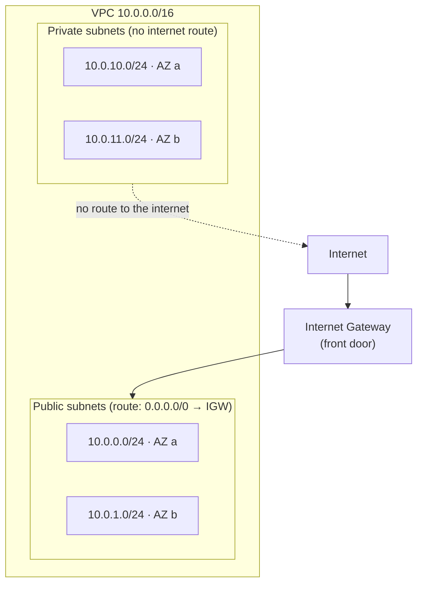
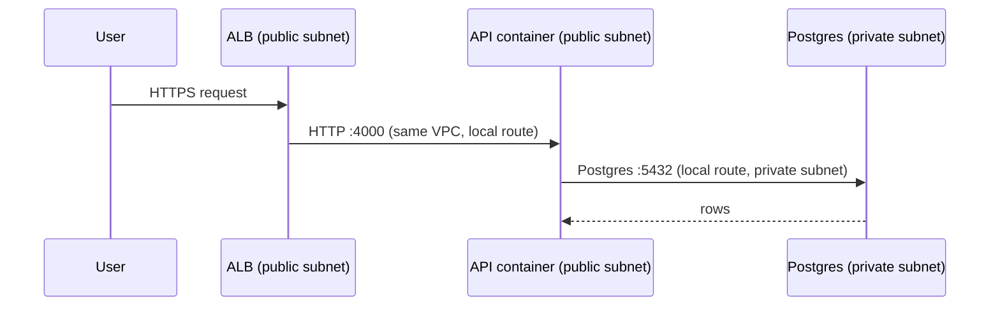
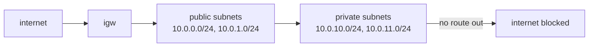

# 02. Networking and the VPC: how anything reaches anything

History: see [CHANGELOG.md](../CHANGELOG.md) or run `pnpm docs:history`

> **Honesty label: ✅ Built in repository** (`infra/src/network.ts`), **⚙️ configured for deployment**
> (exists when `computeEnabled`/`dataEnabled` are on and a deploy has run).

**Prerequisites:** [01. What is AWS?](01-what-is-aws.md). You should know what a region and an AZ are.

---

## A. The problem first

Every service in MiniTickets — the web app, the API, the database, the cache — is a separate thing
running on a separate machine (or container). For the app to work, these things must be able to talk
to each other. The **database must accept connections from the API**, but it must **not** accept
connections from the internet. The **web containers must accept traffic from the load balancer**, but
not directly from a stranger.

So there are two problems, and they pull in opposite directions:

1. **Reachability** — the right pieces must be able to find and reach each other by address.
2. **Isolation** — the wrong pieces (the internet, other customers, a curious visitor) must not.

If you just connect everything to everything, you get reachability with no isolation. If you firewall
everything shut, you get isolation with no reachability. A **VPC** is how AWS lets you design a
private network where you decide, address by address and door by door, who can reach whom.

Where does this appear in MiniTickets? Right at the start: `infra/src/network.ts` builds the network
before anything else, because the database, the cache, the containers and the load balancer all have
to live *somewhere*.

---

## B. What it is

### Plain English

A **VPC (Virtual Private Cloud)** is your own private network inside AWS — a private office building
where all your resources live, with your own address range, your own rooms (subnets), your own front
door (internet gateway), and your own signposts (route tables).

### The terms, one at a time

**CIDR block** — a range of IP addresses written like `10.0.0.0/16`. The number after the slash says
how many of the 32 bits of the address are *fixed*; the rest are free. `/16` leaves 16 bits free = 65,536
addresses. `/24` leaves 8 bits free = 256 addresses. Think of house numbers: the VPC owns `10.0.x.y`;
each subnet owns one street inside it (`10.0.0.x`, `10.0.1.x`, …). Subnets must never overlap, because
one address can belong to only one street. AWS reserves 5 addresses in every subnet for itself, so a
`/24` has 251 usable addresses.

**Subnet** — a slice of the VPC's address range that lives in **one** availability zone. You do not
choose subnets at random; you place them deliberately per AZ for high availability.

**Public subnet** — a subnet whose route table sends internet-bound traffic to an **internet gateway**.
The word "public" does nothing by itself; the *route* is what makes it public.

**Private subnet** — a subnet with no route to the internet. Databases and caches live here.

**Route table** — the signpost listing where traffic leaving a subnet should go. A route table does
nothing until subnets are **associated** with it.

**Internet Gateway (IGW)** — the front door connecting the VPC to the public internet.

**NAT Gateway** — a one-way door that lets private resources *start* outbound connections to the
internet without being reachable from it. **MiniTickets deliberately does not have one** — we will see
why, and it has a real consequence.

**Availability Zone spread** — placing subnets in two AZs so that one data-centre failure does not take
everything down.

---

## C. How it works internally

### The building analogy, then the diagram

- The **VPC** is the building at address range `10.0.0.0/16`.
- The **internet gateway** is the front door.
- **Public subnets** are ground-floor rooms with a corridor to the front door.
- **Private subnets** are basement rooms with no corridor to the front door (but they can still walk to
  other basement rooms).
- **Route tables** are the corridor signs in each room.
- **Route table associations** are the act of hanging the right sign in each room.



### Step by step, how a packet gets somewhere

1. A resource (say the API container) wants to reach `10.0.10.5` (the database).
2. The packet leaves the container and, based on its **subnet**, consults that subnet's **route
   table**.
3. The route table says: "`10.0.0.0/16` is local" (AWS always adds a **local** route for the VPC), so
   the packet stays inside the VPC and goes straight to the database.
4. If instead the destination were `1.1.1.1` (the internet):
   - In a **public** subnet, the route table says `0.0.0.0/0 → internet gateway`, so the packet leaves.
   - In a **private** subnet, there is no such route, so the packet is dropped. There is no path.

That is the entire difference between public and private: **a route, or the absence of one.**

### The NAT decision, and its consequence

A NAT gateway would let the *private* resources reach the internet outbound. It costs roughly
`$30+`/month (at the time of writing) plus data processing. MiniTickets' private resources are the
database and the cache — and those **never need to call the internet**. So MiniTickets skips the NAT
gateway and saves the money.

But that decision has a real, visible consequence: **the worker Lambdas run outside the VPC.** Why?
Because a Lambda inside a VPC with no NAT and no VPC endpoint cannot reach AWS APIs, and the worker
must write to DynamoDB and call SES. Rather than add a NAT gateway just for that, the design puts the
worker outside the VPC (see `infra/src/tickets/lambda.ts`, comment 1: "all facts travel in the event;
only AWS APIs are needed, no NAT or security-group rules"). Being outside the VPC means it uses AWS's
own network for AWS APIs and needs no security group. This is a genuinely instructive trade-off and a
great interview answer.

*💡 Conceptual alternative (not built):* add a NAT gateway **or** VPC **endpoints** (private shortcuts
to AWS services) if you ever needed a private resource to reach AWS services or the internet.

---

## D. Our MiniTickets implementation

One function: `createNetwork()` in `infra/src/network.ts`. It creates, in order:

| # | Resource | Value |
| --- | --- | --- |
| 1 | AZ lookup | first 2 available AZs |
| 2 | VPC | `minitickets-dev-vpc`, CIDR `10.0.0.0/16`, DNS support + hostnames on |
| 3 | Internet gateway | `minitickets-dev-igw` |
| 4 | Public subnets | `10.0.0.0/24` (AZ a), `10.0.1.0/24` (AZ b), `mapPublicIpOnLaunch: true` |
| 5 | Private subnets | `10.0.10.0/24` (AZ a), `10.0.11.0/24` (AZ b), no public IP |
| 6 | Public route table | route `0.0.0.0/0 → internet gateway` |
| 7 | Private route table | **no** internet route (only AWS's automatic local route) |
| 8 | Associations | 4 total: two public subnets, two private subnets |

It returns `vpcId`, `publicSubnetIds` and `privateSubnetIds`. Where each goes:

- `vpcId` → security groups and target groups.
- `publicSubnetIds` → the API service, the web service, and the ALB (all in public subnets here).
- `privateSubnetIds` → RDS and ElastiCache (the data layer).

Here is the actual routing code, the heart of the module:

```ts
const publicRouteTable = new aws.ec2.RouteTable(`${prefix}-public-rt`, {
  vpcId: vpc.id,
  routes: [{ cidrBlock: "0.0.0.0/0", gatewayId: internetGateway.id }],
  // ...
});
const privateRouteTable = new aws.ec2.RouteTable(`${prefix}-private-rt`, {
  vpcId: vpc.id,
  // NO routes: AWS adds the built-in "local" route by itself.
});
```

And the association that makes it real:

```ts
publicSubnets.forEach((subnet, i) => {
  new aws.ec2.RouteTableAssociation(`${prefix}-public-rta-${i + 1}`, {
    subnetId: subnet.id,
    routeTableId: publicRouteTable.id,
  });
});
```

Three details worth naming aloud in an interview:

- `enableDnsSupport` **and** `enableDnsHostnames` are both on, because later services (RDS) need to be
  reachable by name.
- `mapPublicIpOnLaunch: true` on public subnets means instances there get a public IP automatically.
- The four associations are deliberately explicit. The code comment warns: an unassociated subnet
  silently falls back to the VPC's default route table, which is easy to forget.

### Trace: two requests



Note that the API container is in a *public* subnet but is still firewalled to accept traffic only from
the load balancer — that is the security-group layer, [Chapter 03](03-security-groups.md). Networking
gives reachability; security groups give control.

---

## E. Security and permissions

**REACH.** A VPC is where network reachability is decided. Being *in* a subnet and having a *route* is
necessary but not sufficient — the security group is the door lock.

**ALLOWED.** Network access is not IAM. IAM controls AWS *API* calls (create a bucket, read a queue);
it does **not** control TCP traffic between your containers and your database. Those are two different
control planes. Confusing them is a classic mistake: "the database is in a private subnet" (network)
is separate from "this role may delete the database" (IAM).

**IDENTITY / CREDENTIALS.** Not applicable to packets themselves. But note that a resource *creating*
network resources needs IAM permission to do so — that is the Pulumi/CI principal.

**Why source security groups, not IP ranges.** Containers get a new IP on every restart. A rule like
`allow 10.0.10.0/24` would be too wide and break when things move. A rule that says "allow from the api
**group**" always means "whatever is wearing the api badge right now", regardless of IP. This is least
privilege applied to the network. (Chapter [03](03-security-groups.md) covers the rules themselves.)

**Encryption.** VPC flow logs can record traffic metadata (not built here). Data in transit is
protected by TLS where it crosses trust boundaries.

---

## F. The AWS console walkthrough

> Read-only inspection only. Do not change routes or subnets to "test".

1. **VPC → Your VPCs.** Find `minitickets-dev-vpc`. Note the CIDR `10.0.0.0/16`.
2. **VPC → Subnets.** Filter by the VPC. You should see four: two public, two private, each labelled
   with its AZ and CIDR.
3. **VPC → Route tables.** Open `minitickets-dev-public-rt` and confirm the `0.0.0.0/0 → igw-...` route.
   Open `minitickets-dev-private-rt` and confirm it has **only** the local route and no internet route.
4. **VPC → Internet gateways.** Confirm `minitickets-dev-igw` is attached to the VPC.
5. **VPC → NAT gateways.** Confirm there are **none** — this is a deliberate choice, not an oversight.
6. **VPC → Endpoints.** Confirm none (relevant to why Lambdas run outside the VPC).

Tip: the **Route table → Routes** tab is the fastest way to answer "is this subnet public?". If it has
a `0.0.0.0/0` route to an internet gateway, it is public.

**Each line maps to `infra/src/network.ts`.** If the console disagrees, that is drift.

---

## G. Real production scenarios

### Scenario 1 — "The API cannot reach the database."

- **Cause candidates:** the private subnet has no route to the DB's subnet (rare — the local route
  should cover it); the **security group** for the db does not allow the api group; the subnets are in
  different VPCs; or the container was launched in a subnet it should not be in.
- **Investigate:** test reachability from a container (the API logs a connection error), then check the
  db security group's ingress ([03](03-security-groups.md)). Distinguish "no route" from "route but
  blocked".
- **Note:** the RDS endpoint is a DNS name; if the VPC's DNS support were off, name resolution would
  fail. That is why `enableDnsSupport` is on.

### Scenario 2 — "A container can't pull its image or call AWS APIs."

- **Cause:** a private-subnet resource with no NAT gateway and no VPC endpoint cannot reach the
  internet or AWS APIs. MiniTickets' app containers are in **public** subnets (with open egress), so
  they are fine; but a resource you move to a private subnet would hit this immediately.
- **Recover:** add a NAT gateway or a VPC endpoint; or keep the resource in a public subnet with a
  restrictive security group (MiniTickets' choice for app containers).

### Scenario 3 — "One AZ outage and the app survived."

- This is the two-AZ subnet design plus ECS spreading tasks and RDS being multi-AZ-capable. Note the
  *limits*: MiniTickets' dev RDS may not be multi-AZ (cost), so a single-AZ database would still be a
  single point of failure. Check the RDS instance's configuration rather than assuming.

### Scenario 4 — "We ran out of IP addresses in a subnet."

- **Cause:** a `/24` gives 251 usable addresses; if many tasks launch in one subnet they can exhaust
  it. MiniTickets keeps task counts small, so this is unlikely, but it is the classic "we grew and the
  subnet was too small" problem. Fix by using larger CIDRs.

### Cost and performance

- The VPC and its routes cost **nothing**. The internet gateway costs nothing hourly. A **NAT gateway**
  costs hourly plus per GB — the reason MiniTickets avoids it.
- Latency inside a VPC, especially same-AZ, is very low. Cross-AZ traffic has a small cost and a small
  latency penalty — a reason to keep chatty components (API ↔ DB) aware of placement.

---

## H. Decisions and alternatives

- **Two AZs, not one or three.** Two survives a single-AZ failure; three costs more; one is a single
  point of failure. MiniTickets chose two.
- **No NAT gateway.** Chosen for cost, with the consequence that internet-needing private resources
  (the worker Lambdas) live *outside* the VPC. Alternative: NAT gateway (~$30+/month) or VPC endpoints
  (per-service, cheaper than NAT for AWS-only traffic).
- **App containers in public subnets, databases in private subnets.** A common pragmatic choice: the
  containers are firewalled tightly (only the ALB), while the data is unreachable from the internet
  entirely. Alternative: put app containers in private subnets too, which then *requires* a NAT gateway
  or endpoints for image pulls and API calls.
- **Source security groups over IP ranges.** Robust to container restarts; see [03](03-security-groups.md).
- **One VPC, not many.** A single VPC with public/private tiers is enough here. Larger orgs use
  separate VPCs per environment or account, peered together.

---

## I. Interview preparation

### 30-second answer

> "A VPC is an isolated virtual network with a CIDR range, split into subnets across Availability
> Zones. A subnet is public if its route table sends `0.0.0.0/0` to an internet gateway, and private
> otherwise. MiniTickets puts the load balancer and app containers in public subnets and the database
> and cache in private subnets with no internet route; there is no NAT gateway, which is why the
> background Lambdas run outside the VPC."

### Follow-up questions

- **Beginner:** What makes a subnet public? *(→ a route to an internet gateway, nothing else.)*
- **Beginner:** How many usable addresses in a `/24`? *(→ 256 minus 5 AWS-reserved = 251.)*
- **Intermediate:** What is a NAT gateway, and why doesn't MiniTickets have one? *(→ outbound-only
  internet for private resources; skipped for cost, so private resources cannot reach the internet.)*
- **Intermediate:** Why use two AZs? *(→ survive a single data-centre failure.)*
- **Senior:** Why does a Lambda that needs DynamoDB and SES live outside the VPC here? *(→ a
  VPC-attached Lambda without NAT/endpoints cannot reach AWS APIs; being outside avoids that entirely
  because no VPC networking is needed.)*
- **Senior:** How would you let a private resource reach AWS APIs without a NAT gateway? *(→ VPC
  endpoints, gateway for S3/DynamoDB and interface endpoints for others.)*
- **Senior:** Is network isolation the same as IAM? *(→ no; one governs packets, the other governs AWS
  API calls.)*

### Scenario questions

1. **"The API can't reach RDS."** → check security groups first, then subnet/route, then DNS support.
2. **"A new private service can't pull images."** → no NAT/endpoints in a private subnet.
3. **"We want to cut cost but keep isolation."** → endpoints vs NAT; keep data private, keep app tier
   tightly firewalled in public subnets.

---

## J. Quick revision

**Five things to remember**

1. A VPC is your private network; a subnet lives in one AZ.
2. **Public = a route to an internet gateway.** Nothing else.
3. Private subnets have no internet route; that is the isolation.
4. MiniTickets: `10.0.0.0/16`, two public + two private subnets, two AZs, **no NAT gateway**.
5. That missing NAT is *why* the worker Lambdas run outside the VPC.

**One diagram**



**Three common mistakes**

1. Thinking "public subnet" grants access by itself — the **security group** is the actual lock.
2. Confusing network access with **IAM** permissions.
3. Adding a private resource that needs AWS APIs without a NAT gateway or an endpoint (the Lambda
   lesson).

**Where next:** [03. Security groups](03-security-groups.md) — the firewalls between these subnets.
