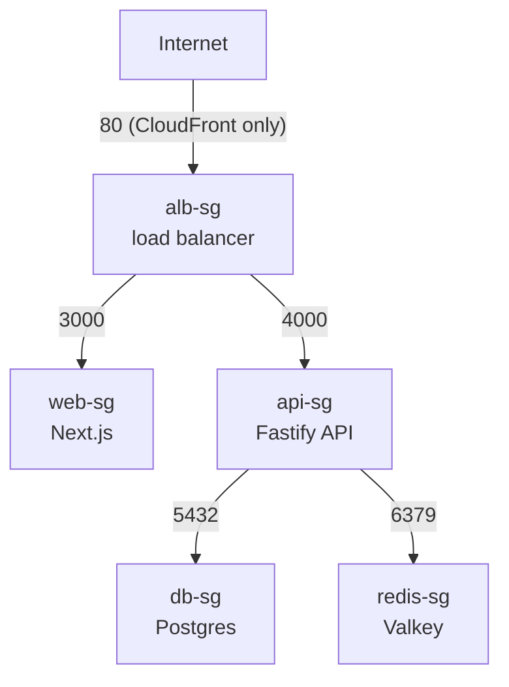
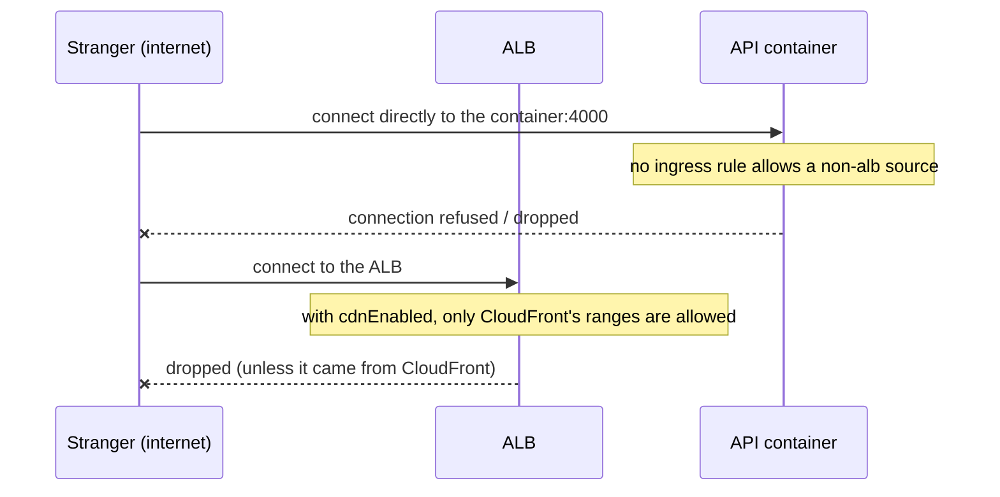
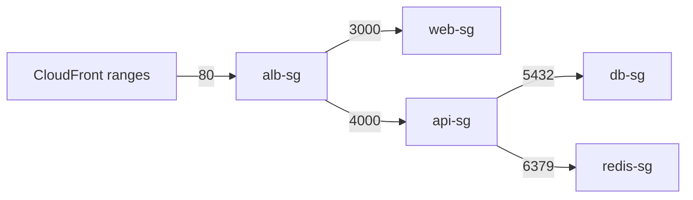

# 03. Security groups: the firewalls between resources

History: see [CHANGELOG.md](../CHANGELOG.md) or run `pnpm docs:history`

> **Honesty label: ✅ Built in repository** (`infra/src/security.ts`), **⚙️ configured for deployment**.

**Prerequisites:** [02. Networking and the VPC](02-vpc-and-networking.md).

---

## A. The problem first

Networking gives us *reachability*. Now we need *control*. The API container is in a public subnet; if
reachability were the only rule, the whole internet could connect straight to port 4000. The database is
in a private subnet; we still need a second lock so that even something *inside* the VPC cannot connect
to it unless we say so.

The problem is: **how do you express "only the load balancer may talk to the web containers, only the
load balancer may talk to the API, and only the API may talk to the database and the cache" — and keep
it correct when containers restart and change IP address?**

Where it shows up in MiniTickets: `infra/src/security.ts` builds five firewalls and the rules between
them, immediately after the network.

---

## B. What it is

### Plain English

A **security group** is a firewall attached to a resource (a load balancer, a container, a database).
It lists what is **allowed**. Everything not listed is blocked by default. If a request is allowed in,
its reply is allowed out automatically.

### The terms, one at a time

**Security group** — a stateful, default-deny virtual firewall attached to a network interface.

**Stateful** — if you allow a request *in*, the response is automatically allowed *out*. You do not
need a mirror rule. (A **network ACL** is the opposite: stateless, subnet-level, and you must allow both
directions.) MiniTickets relies on security groups plus the default NACLs.

**Ingress rule** — an incoming rule ("who may come **in** to this resource").

**Egress rule** — an outgoing rule ("where may this resource **go**").

**Default deny** — a new group allows nothing inbound until you add a rule. (AWS *does* add an
allow-all **outbound** rule to a new group by default; MiniTickets removes it for the database and
cache.)

**Referencing another security group** — a rule can name another *group* as its source instead of an
IP range. This means "allow from whatever is wearing that badge right now".

### Why group references, not IP ranges

Containers get a new IP address on every restart or scale event. A rule like `allow 10.0.10.0/24` would
be too wide (every machine in that range gets access) and would break the moment things move. A rule
saying "allow from the **api** group" is robust: it always means the current api containers, whatever
their IPs. It is also stricter — only the exact expected caller can reach each door.

---

## C. How it works internally

### The five doors

MiniTickets creates five groups, one per "kind of resource":



Each arrow is an **ingress** rule, and each rule's *source* is the group on the left of the arrow. So:

| Rule | Protects | Port | Allowed source |
| --- | --- | --- | --- |
| alb-in-80 | alb | 80 | CloudFront's IP ranges (only when `cdnEnabled`) |
| web-in-3000 | web | 3000 | the **alb** group |
| api-in-4000 | api | 4000 | the **alb** group |
| db-in-5432 | db | 5432 | the **api** group |
| redis-in-6379 | redis | 6379 | the **api** group |

Notice what is **absent**: nothing allows the internet to reach the web or api containers directly.
Nothing allows the web layer to reach the database. Nothing allows anything to reach Redis but the API.
That is least privilege expressed as a network diagram.

### Egress: who may call out

- **alb, web, api**: allow **all** outbound. The load balancer must reach web and api; the api must
  reach db, redis and AWS APIs; the containers must pull images from ECR. Listing every destination
  would be long and brittle, so outbound stays open for these three.
- **db, redis**: **no** outbound at all (`egress: []`). Postgres and Valkey never *start* connections,
  so they get no outbound rules. Replies still work because security groups are stateful.

Inside the code:

```ts
const dbSg = new aws.ec2.SecurityGroup(`${prefix}-db-sg`, {
  vpcId: inputs.vpcId,
  description: "Postgres: reachable only from the api",
  egress: [],   // remove AWS's default allow-all outbound
  tags: tagsFor(`${prefix}-db-sg`),
});
```

```ts
new aws.vpc.SecurityGroupIngressRule(`${prefix}-db-in-5432`, {
  securityGroupId: dbSg.id,
  description: "Postgres from the api",
  ipProtocol: "tcp", fromPort: 5432, toPort: 5432,
  referencedSecurityGroupId: apiSg.id,   // ← the source is the GROUP, not an IP range
  tags: tagsFor(`${prefix}-db-in-5432`),
});
```

### The CloudFront-only rule and a quota trap

When `cdnEnabled` is true, the ALB accepts HTTP on port 80 from **CloudFront only**, using AWS's managed
prefix list `com.amazonaws.global.cloudfront.origin-facing`. A prefix list is a named list of IP ranges
that one rule can point at. This is "lock 1 of 2"; "lock 2" is the secret header
([09](09-cloudfront.md)).

There is a subtle quota cleverness worth knowing: a rule pointing at a prefix list counts as **as many
rules as the list's maximum size**. AWS counts this CloudFront list as **55**, and a security group may
hold **60 inbound rules**. That is one reason the old plain `0.0.0.0/0` rules for 80 and 443 were
removed — there was not room, and they were not wanted anyway.

Also: the alb group's **description** says "open to the internet on 80 and 443" and is deliberately
**out of date**. AWS cannot change a security group's description, so editing it would *replace* the
group — and with it every rule and every resource wearing it. The code keeps the stale description on
purpose and treats the **rules** as the truth. A small lesson in why you never "just tidy up" a live
resource's identity fields.

---

## D. Our MiniTickets implementation

`createSecurityGroups({ vpcId, cdnEnabled })` in `infra/src/security.ts` creates groups first, then
rules (rules need both groups to exist). The order is:

1. Five groups: alb, web, api, db, redis.
2. Rule 6: alb port 80 from the CloudFront prefix list (only if `cdnEnabled`).
3. (Rule 7 removed: the old "443 from the internet" rule.)
4. Rules 8–11: web 3000 ← alb, api 4000 ← alb, db 5432 ← api, redis 6379 ← api.
5. Rules 12: open egress for alb, web, api.
6. Return the five group ids.

Who consumes the ids:

- `albSgId` → the load balancer.
- `webSgId` → the web service.
- `apiSgId` → the API service.
- `dbSgId` → RDS Postgres.
- `redisSgId` → ElastiCache.

When `cdnEnabled` is false, the ALB's public doors (80 and 443) are opened instead by the entry layer,
`infra/src/entry/alb-public-ingress.ts`, from a configurable `allowedCidrs` (default `0.0.0.0/0`, or
your own IP `/32` for safety in dev). This keeps the "who may reach the ALB" decision in one obvious
place per mode. See [09](09-cloudfront.md).

### Trace: why a stranger can't reach the API



Two independent locks: even if a stranger found the container's IP, the api group would refuse; even if
they found the ALB's IP, the alb group would refuse (in CloudFront mode).

---

## E. Security and permissions

**REACH.** Security groups govern TCP reachability between resources.

**ALLOWED.** Again, this is **not** IAM. A security group is a *network* control; IAM is an *API*
control. A database can be reachable (network) yet the caller still needs valid database credentials
(application-level auth). Three layers stack:

1. **Subnet route** — is there a path at all?
2. **Security group** — is this source allowed to open the connection?
3. **Credentials** — does the caller have the right password/role?

**IDENTITY / CREDENTIALS.** Not applicable to rules themselves. The principal that *creates* the
groups and rules needs IAM permission (the Pulumi/CI principal).

**Encryption.** Security groups allow or deny ports; they do not encrypt. RDS and ElastiCache enforce
TLS on the wire (`rediss://` is used for Valkey), and the API uses TLS to reach AWS APIs.

**Least privilege in the network.** The db and redis groups accept only the api group and have no
egress. The web/api groups accept only the alb group. That is the network-expression of the same
least-privilege idea IAM uses.

---

## F. The AWS console walkthrough

> Read-only. Do **not** edit a rule to "see if it fixes it" — that is drift and can open the database.

1. **EC2 → Security Groups** (security groups live under EC2 in the console). Filter by
   `minitickets-dev`.
2. Open `minitickets-dev-api-sg` → **Inbound rules**. You should see port 4000 from the **alb** group
   (shown as a `sg-...` id). This is the group-reference rule.
3. Open `minitickets-dev-db-sg`. Confirm: **one** inbound rule (5432 from the api group) and **no**
   outbound rules.
4. Open `minitickets-dev-alb-sg`. In CloudFront mode, confirm port 80 from the CloudFront prefix list
   (`pl-...`). In ALB-only mode, look under the entry layer's rules instead.
5. Use **EC2 → Network Interfaces** on a running task to confirm which groups are attached to what.

Mapping: every group and rule here is a numbered line in `infra/src/security.ts`.

---

## G. Real production scenarios

### Scenario 1 — "Database connection timed out after a deploy."

- **Cause:** the api group id changed (groups are usually stable, but a replaced group would break
  rules), or a rule was deleted/edited by hand, or the container moved to a group that is not the api
  group.
- **Investigate:** the db group's inbound rules should reference the **api** group. If they reference
  an IP range, something changed it.
- **Recover:** restore the group-reference rule via the committed code; never re-open the DB to a wide
  CIDR.

### Scenario 2 — "A developer opened the database to 0.0.0.0/0 to debug, then forgot."

- **Cause:** ClickOps. This is the single most dangerous security-group mistake.
- **Impact:** the database is reachable from anywhere that has network access to the VPC path.
- **Investigate:** periodic review of inbound rules; look for `0.0.0.0/0` on ports 5432/6379.
- **Recover:** remove the rule; use a bastion/SSM session or a temporary, narrow `/32` rule instead.
  Never fix a debugging problem by widening a production lock permanently.

### Scenario 3 — "The ALB returns 502 but the containers are healthy."

- **Cause:** the container's security group does not allow the ALB, or the health-check port/path is
  wrong ([07](07-alb.md)). A 502/504 often means "reached the load balancer, could not reach the
  target".
- **Investigate:** confirm the target group shows the target as unhealthy and that the web/api group
  allows the alb group on the right port.

### Scenario 4 — "We hit the rule quota."

- **Cause:** the prefix-list rule counts as 55 of 60 inbound rules. Adding many more rules would fail.
- **Recover:** consolidate rules, use prefix lists, or reference groups (one rule) instead of listing
  many CIDRs.

### Cost and performance

- Security groups cost nothing; they are evaluated by the platform.
- Stateful evaluation is efficient; there is no per-rule latency to design around.

---

## H. Decisions and alternatives

- **Group references over CIDRs.** Robust and strictly least-privilege. The alternative (IP ranges)
  breaks on restart and is wider than necessary.
- **Five groups, one per role.** Clear ownership: each group names the resource it protects. The
  alternative (one shared group) would blur the boundaries and over-grant.
- **No egress on db/redis.** They never initiate, so they get nothing. The alternative (the AWS default
  allow-all outbound) would be unnecessary exposure.
- **Open egress on alb/web/api.** Pragmatic: listing every destination (ECR, AWS APIs, DB, cache) would
  be long and brittle. The trade-off is a slightly wider egress path; the *ingress* side, which faces
  the internet, is tight.
- **CloudFront-only ingress with a prefix-list.** Best-effort hardening (any CloudFront distribution
  uses those ranges), backed by the secret header. The alternative is restricting to your own
  distribution's addresses, which is not directly expressible as a security-group rule.
- **NACLs left at default.** Security groups are sufficient here. NACLs would add a stateless second
  layer, usually reserved for extra subnet-level controls.

---

## I. Interview preparation

### 30-second answer

> "A security group is a stateful, default-deny firewall attached to a resource. MiniTickets has five —
> alb, web, api, db, redis — and the rules reference *groups*, not IP ranges: the web and api accept
> only the alb group, the database and cache accept only the api group, and in CloudFront mode the ALB
> accepts only CloudFront's prefix list. The database and cache have no egress rules."

### Follow-up questions

- **Beginner:** What does "stateful" mean? *(→ allowed inbound traffic's reply is automatically
  allowed out.)*
- **Beginner:** Why use group references instead of CIDRs? *(→ containers change IP; groups stay
  correct and are stricter.)*
- **Intermediate:** What is the difference between a security group and a network ACL? *(→ SG is
  stateful, per-resource, default-deny with an allow-all egress default; NACL is stateless,
  subnet-level.)*
- **Intermediate:** How do you lock down the load balancer so only CloudFront reaches it? *(→ ingress
  from the CloudFront origin-facing prefix list, plus a secret header.)*
- **Senior:** How many inbound rules does a prefix-list rule consume, and why does it matter? *(→ as
  many as the list's max size — 55 here — against a 60-rule limit.)*
- **Senior:** Is a security group the same as IAM authorization? *(→ no; network reachability vs AWS
  API authorization.)*
- **Senior:** Why does the database have no outbound rules, and how do replies work? *(→ it never
  initiates; stateful security groups allow the reply automatically.)*

### Scenario questions

1. **"RDS became unreachable."** → db group inbound must reference the api group; check for hand-edits.
2. **"We exposed the DB by accident."** → look for `0.0.0.0/0` on 5432/6379; remove; use a narrow
   temporary rule or SSM session instead.
3. **"ALB 502."** → target health + group allowing the ALB on the right port.

---

## J. Quick revision

**Five things to remember**

1. A security group is a **stateful, default-deny** firewall on a resource.
2. Rules reference **groups**, not IPs, so restarts and scaling do not break them.
3. MiniTickets' five groups: alb, web, api, db, redis.
4. db and redis accept **only the api** and have **no egress**.
5. Security groups are **network**, not IAM — and not encryption.

**One diagram**



**Three common mistakes**

1. Using IP ranges instead of group references.
2. Widening a rule to debug, then leaving it open.
3. Confusing security groups with IAM (or with encryption).

**Where next:** [04. IAM](04-iam.md) — the other half of "who may do what", at the API layer.
