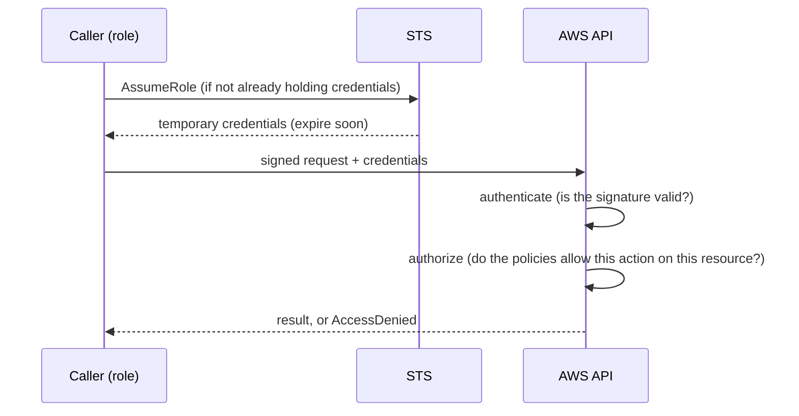
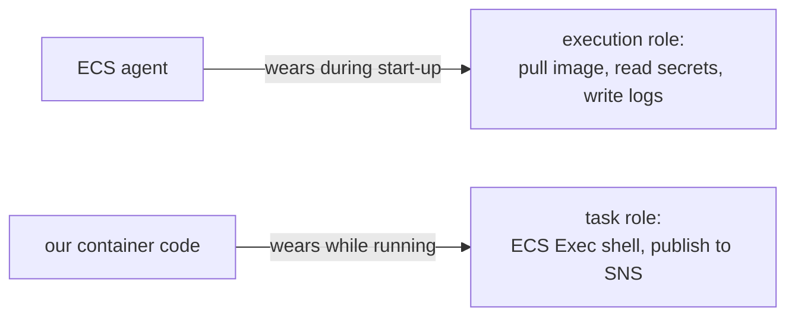
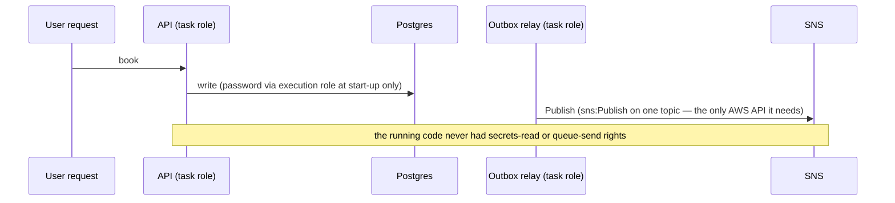
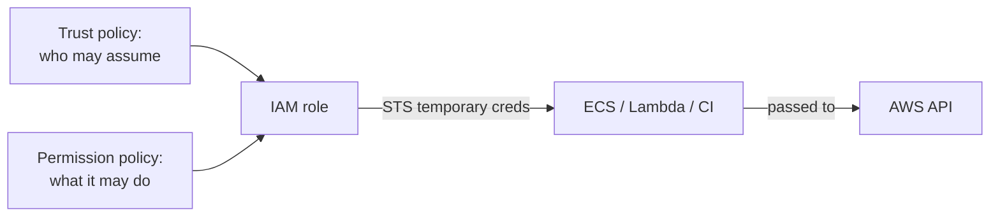

# 04. IAM: identity, authentication, authorization, roles and trust

History: see [CHANGELOG.md](../CHANGELOG.md) or run `pnpm docs:history`

> **Honesty label: ✅ Built in repository** (`infra/src/compute/iam.ts`, `jobs/worker-iam.ts`,
> `tickets/iam.ts`, `cicd.ts`), **⚙️ configured for deployment**.

**Prerequisites:** [01](01-what-is-aws.md), [02](02-vpc-and-networking.md), [03](03-security-groups.md).
This is the single most important "foundations" chapter. Read it slowly.

---

## A. The problem first

You have networked resources. Now: **how do you control who is allowed to do what?**

- Should the API container be allowed to delete the production database? Obviously not.
- Should the background worker be allowed to read the customer's other bookings? Obviously not.
- Should GitHub Actions be allowed to do *anything* in your AWS account, forever? No.
- Should one compromised container be able to read every secret in your account? No.

If every part of the system had the same all-powerful credential, one breach would be total. The
problem is **least privilege**: give every actor exactly the permissions it needs, no more, and make
those permissions *temporary*.

Where it appears in MiniTickets: everywhere. Every container, every Lambda, and the CI pipeline run
under an IAM role with a hand-written, minimal policy. The infra comments even name what each policy
deliberately *excludes*.

---

## B. What it is

### Plain English

**IAM (Identity and Access Management)** is AWS's system for "who may do what". An **identity** is who
you are. **Authentication** is proving it. **Authorization** is deciding what you may do. A **role** is
a badge with a permission list that anyone allowed can wear temporarily.

### The terms, built up in order (this order matters)

Read these as a chain; each depends on the previous one.

1. **Identity** — a *principal*: a user, a role, or an AWS service acting on someone's behalf. "Who is
   asking?"
2. **Authentication (authn)** — proving the identity. With a password, a signed request, or a
   temporary token. "Prove you are who you say."
3. **Authorization (authz)** — after identification, deciding whether this principal may perform this
   action on this resource. "Are you allowed?"
4. **Policy** — the JSON document that expresses authorization. It has `Effect` (Allow/Deny), `Action`
   (what API calls), `Resource` (which resources, by ARN), and optionally `Condition` (extra rules).
5. **Role** — an identity that has permissions but **no permanent credentials**. Instead, a permitted
   principal *assumes* it and receives temporary credentials.
6. **Trust policy** — attached to a role; names **who may assume it**. This is the "who can wear the
   badge" document.
7. **Permission policy** — attached to a role; names **what the wearer may do**. This is the "what the
   badge allows" document.
8. **sts:AssumeRole** — the API call that assumes a role, returning temporary credentials, if the
   trust policy allows it.
9. **STS (Security Token Service)** — the AWS service that issues those temporary credentials.
10. **Temporary credentials** — an access key + secret + **session token** that expires. Safer than
    long-lived keys because a leak has a short life.

**Identity-based vs resource-based policy.** A policy attached to a user or role is *identity-based*.
A policy attached to a *resource* (like an SQS queue policy) is *resource-based*; it says who may
access that resource. MiniTickets uses both: roles for our code, and resource policies on queues to let
SNS write to them ([16](16-sns.md)).

**Least privilege** — grant the minimum actions on the minimum resources.

---

## C. How it works internally

### What happens on every single AWS API call

Every call to an AWS API (SendMessage, GetItem, Publish, ...) runs through the same steps:



1. **Authentication.** AWS verifies the request's signature using the credentials. If the credentials
   are expired or forged, the call fails before authorization even begins.
2. **Authorization.** AWS evaluates the applicable policies. An explicit `Deny` always wins; otherwise,
   a matching `Allow` is needed. If nothing allows it, access is denied (default deny).
3. **Result.** The action happens, or you get an error naming the action and resource.

Key insight: **authorization is evaluated on the server, on every call.** You cannot "get in" once and
stay in with broader rights; each call is checked.

### Trust policy and the confused deputy problem

A trust policy answers "who may wear this badge?" For MiniTickets' ECS roles, the answer is "the ECS
tasks service":

```json
{
  "Effect": "Allow",
  "Principal": { "Service": "ecs-tasks.amazonaws.com" },
  "Action": "sts:AssumeRole",
  "Condition": { "StringEquals": { "aws:SourceAccount": "<our account id>" } }
}
```

That `Condition` is doing real work. ECS is one giant service shared by every AWS customer. Without
the condition, ECS acting for *another account* could, in principle, be tricked into using *our* role
if someone learned its ARN. This is the **confused deputy** problem: a trusted helper (the deputy) is
fooled into using its power on behalf of the wrong person. The condition pins to "only when the request
comes from *our* account".

Interesting nuance, stated honestly in the code: the **worker** role's trust policy does **not** add
this condition, because a Lambda function's role is assumed on behalf of the function's own account,
and the role can only be attached to a function by a principal with `iam:PassRole` on it in this
account. The code comment even says "if AWS documents one later, add it". This is the kind of detail
that distinguishes someone who copied a policy from someone who understands it.

### Execution role vs task role (a MiniTickets signature)

ECS uses **two** roles, worn at different moments:



- **Execution role** — worn by the **ECS agent** *before* our code runs. It pulls the image from ECR,
  reads the two (or three) secrets the task needs, and writes logs. Our application code **never**
  holds these permissions.
- **Task role** — worn by **our code** while it runs. For the API it allows only: the four
  `ssmmessages` actions for ECS Exec, `sns:Publish` on exactly one topic, and the specific
  DynamoDB/S3 reads for tickets.

Why split them? Because "starting a task" and "running the app" are different jobs with different
needs. If the running app only needs to publish to one SNS topic, it should not also be able to read
the database password. The split *is* least privilege.

---

## D. Our MiniTickets implementation

### D1. The API's two roles — `infra/src/compute/iam.ts`

**Execution role** (`minitickets-dev-api-execution-role`):
- Trust: `ecs-tasks.amazonaws.com`, conditioned on `aws:SourceAccount`.
- Permissions: AWS managed `AmazonECSTaskExecutionRolePolicy` (ECR pull + CloudWatch Logs write) plus
  an inline `read-secrets` policy allowing `secretsmanager:GetSecretValue` on **exactly** the DB
  master secret, the Redis URL secret, and (when entry is on) the revalidate secret.
- Note the deliberate exclusion: **no `kms:Decrypt`**, because both secrets use the AWS-managed
  `aws/secretsmanager` key, which Secrets Manager decrypts for any caller allowed to read the secret.

**Task role** (`minitickets-dev-api-task-role`):
- Trust: same service trust policy.
- Permissions: three inline policies:
  - `ecs-exec` — the four `ssmmessages` actions (cannot be resource-scoped; they only open message
    channels).
  - `send-jobs` — `sns:Publish` on the **one** booking-events topic.
  - `ticket-reads-and-posters` — `dynamodb:Query` on one table; `s3:GetObject` on `tickets/*` and the
    poster prefixes; `s3:PutObject` on the poster prefixes **with a condition requiring SSE-S3
    encryption** (`s3:x-amz-server-side-encryption = AES256`).

The comment names the exclusions explicitly: "The API cannot consume either SQS queue or read the
signing secret." That is a designed boundary, not an accident.

There is a subtle correctness detail in the code worth noticing: the function returns each role's ARN
only after its policies are attached:

```ts
return {
  executionRoleArn: pulumi.all([executionRole.arn, executionManaged.id, executionSecrets.id]).apply(([arn]) => arn),
  taskRoleArn: pulumi.all([taskRole.arn, taskExec.id, taskSendJobs.id, taskAssets.id]).apply(([arn]) => arn),
};
```

Without this, ECS could start the first task while the role still had no permissions and fail to read
the secrets. That is a genuine race the code closes on purpose.

### D2. The worker's single role — `infra/src/jobs/worker-iam.ts`

Unlike ECS, a Lambda has **one** role (`minitickets-dev-worker-role`) because the same role is used
both by the Lambda service (to poll the queue, to write logs) and by our code (DynamoDB, SES, the
backoff). Its policy is one statement per thing it touches:

```json
{ "Sid": "ReadJobsQueue",   "Action": ["sqs:ReceiveMessage","sqs:DeleteMessage",
                                       "sqs:ChangeMessageVisibility","sqs:GetQueueAttributes"],
  "Resource": "<the one queue>" }
{ "Sid": "ProcessedJobsTable","Action": ["dynamodb:GetItem","dynamodb:PutItem"],
  "Resource": "<the one table>" }
{ "Sid": "SendBookingEmails","Action": "ses:SendEmail", "Resource": "<our identities>",
  "Condition": { "StringEquals": { "ses:FromAddress": "<our sender>" } } }
{ "Sid": "WriteWorkerLogs", "Action": ["logs:CreateLogStream","logs:PutLogEvents"],
  "Resource": "<the one log group>:*" }
```

Read the comment for `SendBookingEmails`: the `ses:FromAddress` **condition** means stolen credentials
could not send email as anyone else. And the queue statement **deliberately omits `SendMessage` and
any DLQ permission** — the worker cannot dump failures into the rescue tray, because SQS does that
([19](19-dead-letter-queue.md)).

### D3. Tickets and CI/CD roles

- `infra/src/tickets/iam.ts` defines `minitickets-dev-tickets-role` for the ticket Lambda: consume one
  queue, reserve/complete one table, write only `tickets/` in S3, read one signing secret, write one
  log group.
- `infra/src/cicd.ts` defines the GitHub OIDC provider and two roles — publish and deploy — each with a
  tightly scoped policy (only the three ECR repos; only two SSM parameters). Chapter [24](24-oidc-cicd.md)
  covers these in full.

### D4. Resource-based policies

Lesson: not all authorization is role-based. The SNS topic needs permission to write into each SQS
queue, so each queue carries a **queue policy** naming "SNS only, from this topic, in this account"
([16](16-sns.md)). The break-glass handling of "who may use a DLQ" is likewise a resource policy
([19](19-dead-letter-queue.md)).

### Trace: how a booking avoids ever needing broad permissions



---

## E. Security and permissions

This whole chapter *is* section E, so here we compress it into the three questions.

**REACH.** The caller must be able to reach the AWS API endpoint (network). For most resources that is
the public AWS endpoint over HTTPS; for private resources it may need a NAT gateway or VPC endpoint
([02](02-vpc-and-networking.md)).

**ALLOWED.** The policies attached to the caller's identity (and any resource policy on the target)
decide. Explicit deny wins; default is deny.

**IDENTITY / CREDENTIALS.** Production callers use **roles** and temporary credentials via STS. No
long-lived access keys are stored in containers or in GitHub.

**Encryption.** Policies interact with encryption: reading a secret stored with a **customer-managed**
KMS key needs `kms:Decrypt`; MiniTickets' secrets use the AWS-managed key, so `GetSecretValue` alone
suffices (noted in `compute/iam.ts`). Encrypting an S3 upload can even be *required by policy*, as the
poster-write condition shows.

---

## F. The AWS console walkthrough

> Read-only inspection. Editing policies has immediate, security-relevant effect.

1. **IAM → Roles.** Search `minitickets-dev`. Open `minitickets-dev-api-execution-role`. The
   **Trust relationships** tab shows the trust policy (ECS service + `aws:SourceAccount`). The
   **Permissions** tab shows the managed policy plus the inline `read-secrets`.
2. Open `minitickets-dev-api-task-role`. Confirm it is small: `ecs-exec`, `send-jobs`, and the ticket
   read/poster policy.
3. Open `minitickets-dev-worker-role`. Read the four statements. Notice what is *missing*
   (`SendMessage`, DLQ, Postgres).
4. **IAM → Policies.** Search for the inline policy names (`worker`, `read-secrets`).
5. **IAM → Identity providers.** Find the GitHub OIDC provider ([24](24-oidc-cicd.md)).
6. **IAM → Access Analyzer** (if enabled) can flag resources reachable from outside your account.

Fastest habit: on any "AccessDenied", read the error — it names the **action** and often the
**resource ARN**. Compare that against the role's policy directly.

---

## G. Real production scenarios

### Scenario 1 — "AccessDenied on a new API call."

- **Cause:** the role lacks the action (least privilege working as intended), or the resource ARN does
  not match.
- **Investigate:** the error names the action and ARN. Compare with the inline policy.
- **Recover:** add the *minimum* needed action on the *specific* resource. Never widen to `*`.
- **Lesson:** least privilege means you *will* hit AccessDenied during development; that is the design
  proving itself.

### Scenario 2 — "A container can read secrets it should not."

- **Cause:** someone merged execution-role and task-role duties, or widened `Resource` to `*`.
- **Impact:** the running app can read the DB password — a breach amplifier.
- **Fix:** restore the split; scope to the two secret ARNs.

### Scenario 3 — "A leaked credential."

- **Cause:** long-lived access keys committed somewhere.
- **Impact depends on scope.** With MiniTickets' design, a leaked *worker* credential can only touch
  one queue, one table, send as one address, write one log group — bounded. A leaked *root/account*
  credential would be catastrophic.
- **Recover:** rotate/revoke; prefer roles so leaks expire. This is exactly why CI uses OIDC, not
  stored keys.

### Scenario 4 — "Confused deputy / cross-account risk."

- **Cause:** a trust policy with a service principal but no `aws:SourceAccount` condition.
- **Investigate:** review trust policies for missing conditions.
- **Fix:** add the condition where supported (as the ECS roles do).

### Cost and performance

- IAM costs nothing.
- Authorization is evaluated server-side per call; there is no meaningful latency to design around at
  this scale.

---

## H. Decisions and alternatives

- **Roles, not users, for code.** No long-lived keys anywhere in production. The alternative (IAM users
  with access keys) is the classic leak waiting to happen.
- **Split execution vs task roles.** Strict separation of "starting the container" from "running the
  app". The alternative (one combined role) is simpler but grants the app more power than it needs.
- **Inline, hand-written, ARN-scoped policies.** Maximum clarity and least privilege. The alternative
  (broad managed policies) is quicker but wider.
- **AWS-managed key for secrets** to avoid `kms:Decrypt` complexity. The alternative (customer-managed
  KMS key) gives more control and rotation but adds key policies and cost.
- **OIDC for CI** instead of stored keys. Covered in [24](24-oidc-cicd.md).
- **`aws:SourceAccount` conditions** on service-principal trusts to defeat confused-deputy attacks.

---

## I. Interview preparation

### 30-second answer

> "IAM controls who may call which AWS API on which resource. A role has a trust policy (who may wear
> it) and permission policies (what the wearer may do), and it yields temporary credentials via STS.
> MiniTickets separates ECS's execution role — which pulls images and reads secrets before the app runs
> — from the task role our code wears; each policy is scoped to specific resource ARNs. The running API
> can only publish to one SNS topic; the worker can only touch one queue, one table, one sender address
> and one log group."

### Follow-up questions

- **Beginner:** Authentication vs authorization? *(→ proving identity vs deciding permitted actions.)*
- **Beginner:** What are the two policies every role has? *(→ trust policy and permission policy.)*
- **Intermediate:** What does `sts:AssumeRole` return? *(→ temporary credentials with an expiry and a
  session token.)*
- **Intermediate:** Execution role vs task role? *(→ ECS agent at start-up vs your code at runtime.)*
- **Intermediate:** Identity-based vs resource-based policy? *(→ attached to the identity vs attached
  to the resource, e.g. an SQS queue policy.)*
- **Senior:** What is the confused deputy problem, and how is it fixed here? *(→ a shared service
  tricked into using your role; fixed with an `aws:SourceAccount` condition on the trust policy.)*
- **Senior:** Why does the worker role have no DLQ or `SendMessage` permission? *(→ least privilege;
  SQS moves messages to the DLQ and the API publishes via SNS, so the worker needs neither.)*
- **Senior:** How does encryption interact with IAM? *(→ customer-managed KMS keys add `kms:Decrypt`;
  AWS-managed keys do not, which is why MiniTickets' secrets avoid extra grants.)*
- **Senior:** Why prefer OIDC over stored access keys for CI? *(→ no long-lived secrets to leak;
  temporary, scoped credentials per run.)*

### Scenario questions

1. **"AccessDenied after adding a feature."** → read the error, add the minimum action on the exact
   ARN.
2. **"We suspect a container has too much power."** → compare its task role against what its code
   actually calls; look for `*` resources.
3. **"Design CI auth for a repo."** → OIDC provider + a deploy role scoped to only the needed
   resources ([24](24-oidc-cicd.md)).

---

## J. Quick revision

**Five things to remember**

1. **Authn** = who you are; **authz** = what you may do; IAM authorizes every API call, server-side.
2. A **role** has a **trust policy** (who may assume it) and **permission policies** (what it may do);
   STS hands out **temporary** credentials.
3. **Least privilege**: minimum actions on minimum ARNs — and MiniTickets documents its exclusions.
4. The **execution role** starts the task; the **task role** is worn by your code.
5. Trust policies for shared services need the **`aws:SourceAccount`** condition (confused deputy).

**One diagram**



**Three common mistakes**

1. Storing long-lived access keys instead of using roles.
2. Using `"Resource": "*"` when a specific ARN would do.
3. Forgetting the confused-deputy condition on a service trust policy.

**Where next:** [05. ECR](05-ecr.md) — where the images that these roles pull live.
