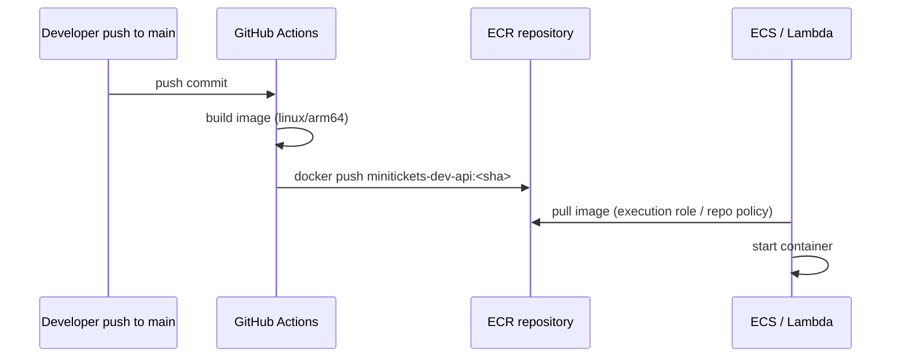
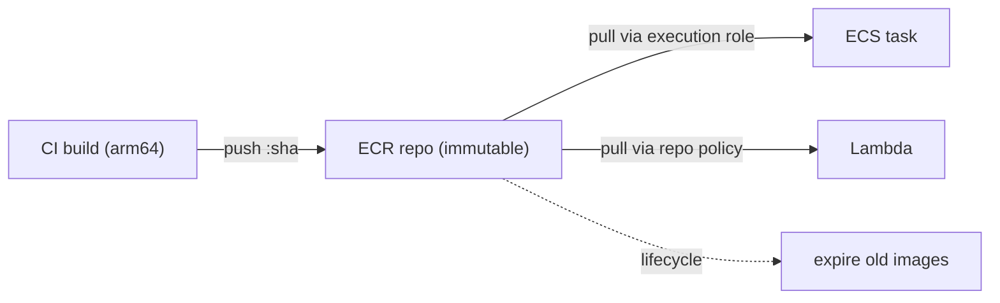

# 05. ECR: where our container images live

> **Honesty label: ✅ Built in repository** (`infra/src/registry.ts`), **⚙️ configured for deployment**.

**Prerequisites:** [01](01-what-is-aws.md), [04. IAM](04-iam.md).

---

## A. The problem first

Our application runs as **containers** ([06](06-ecs-fargate.md)). A container is built from an **image**
— a packaged filesystem with our compiled code and its dependencies. Two questions follow:

1. Where does the image live so that the machines that run it can fetch it?
2. How do those machines authenticate to fetch it, and how do we stop the shelf from filling with
   every image we ever built?

You cannot run a container from a developer's laptop in production: the runtime host is somewhere in
AWS and has no access to your filesystem. The image must be stored somewhere both the build and the
runtime can reach, with access control.

Where it shows up in MiniTickets: `infra/src/registry.ts` creates three private repositories (api, web,
worker) before any container runs.

---

## B. What it is

### Plain English

**ECR (Elastic Container Registry)** is AWS's private shelf for Docker images. You push images to it
from CI, and ECS or Lambda pull them from it at run time. It is private: only your account (or whoever
you explicitly allow) can read from it.

### The terms

- **Container image** — the packaged application. Tracked by `repository:tag` (for example
  `minitickets-dev-api:abc1234`).
- **Tag** — a human-readable label for a specific image build. MiniTickets tags images with the **git
  SHA**, so a tag always means exactly one commit.
- **Digest** — the content-addressed, immutable identifier of an image (a hash). Even a mutable tag
  points at a digest.
- **Repository** — a named collection of images of one service.
- **Registry** — the service holding repositories.
- **Image tag mutability** — whether a tag can be overwritten to point at different code.
- **Image scanning** — a vulnerability check run against an image.
- **Lifecycle policy** — rules that expire old images to control storage cost.

---

## C. How it works internally

### The lifecycle of an image



The build and the run are decoupled: CI pushes once, and any number of runtime hosts pull.

### Why "immutable tags" matter

By default, Docker lets you push a new image under an existing tag, silently replacing what the tag
meant. That is dangerous: a tag you deployed yesterday could mean different code today. MiniTickets sets
**`imageTagMutability: IMMUTABLE`**, so a tag can never point at different code. Because images are
tagged with the git SHA, a tag always identifies exactly one build and deploys are traceable. This is
one of those small settings that prevents an entire class of "which code is actually running?"
incidents.

### Why a lifecycle policy is not optional

Every push costs storage, and images pile up fast. Worse, if the *currently deployed* image is expired,
ECS can no longer start a replacement task (after a Spot interruption or a crash). The policy is
ordered so that does **not** happen:

| Priority | Rule | Why |
| --- | --- | --- |
| 1 | Keep the newest **10** images tagged `deployed-*` | These are the **rollback targets** — images CD actually deployed |
| 2 | Keep the newest **30** other tagged images | Images published on each push but never deployed |
| 3 | Expire **untagged** images after 1 day | Leftovers from a half-finished push |

Rules run in priority order, and an image matched by rule 1 is never expired by rule 2 — so a deployed
image stays safe even when 30 newer, never-deployed images exist. The code comment is blunt about why
this was reworked: a single "keep the newest 10" rule could delete the *running* image after 10 pushes.

---

## D. Our MiniTickets implementation

`createRegistry()` in `infra/src/registry.ts`:

1. Iterates over `imageServices` (from `infra/src/image-repos.ts`: api, web, worker) and creates one
   repository per service via `createRepo`.
2. Each repository has `IMMUTABLE` tags, `scanOnPush: true`, and `forceDelete: true` (dev only, so the
   stack can be destroyed; production keeps it false).
3. Attaches the shared three-rule lifecycle policy (`deleteBeforeReplace: true`, because the AWS
   provider replaces rather than updates a lifecycle policy; creating-then-deleting would remove the
   *new* policy).
4. Adds a **repository policy** for the worker repo so the **Lambda service** may pull it.

### The worker repository policy (a nice least-privilege detail)

ECS pulls an image using the task's **execution role** (an IAM permission on our side). **Lambda is
different**: the *Lambda service itself* pulls the image, so the **repository** must allow it. That is
a **resource-based policy** stuck on the repo:

```ts
Action: ["ecr:BatchGetImage", "ecr:GetDownloadUrlForLayer"],
Principal: { Service: "lambda.amazonaws.com" },
Condition: {
  StringLike: { "aws:SourceArn": "arn:aws:lambda:<region>:<account>:function:minitickets-dev-*" },
},
```

Two things to notice:

- Only the **two read actions** an image pull needs (manifest + layers) — nothing more.
- The **condition** restricts it to Lambda working on a function named `minitickets-dev-*` in **our**
  account and region. Without it, Lambda working for *any* account could pull our image if it knew the
  address — the **confused deputy** again ([04](04-iam.md)).

### URLs versus ARNs

The function returns both forms, and the distinction matters:

- `repositoryUrl` — for **Docker** (where to push/pull).
- `arn` — for **IAM policies** (what a role may touch).

`workerRepoUrl` is returned only **after** the pull policy exists, so the Lambda that reads the URL is
created after the policy that lets it pull. The same "return after policies attach" pattern appears in
`compute/iam.ts` ([04](04-iam.md)).

### The push path

CI builds `linux/arm64` images and pushes. The architecture is not incidental: the ECS task specifies
`cpuArchitecture: "ARM64"` (Graviton), so an x86 image would fail with an **`exec format error`**. The
build and the runtime platform must match. See `infra/src/image-tag.ts` for the tag plumbing and
[24](24-oidc-cicd.md) for the pipeline.

---

## E. Security and permissions

**REACH.** ECR is reached over HTTPS via the ECR API and the Docker registry API. Runtime pulls happen
from inside AWS (ECS) or from the Lambda service.

**ALLOWED.**
- **Push (CI):** the `minitickets-dev-gh-publish` role, scoped to **exactly the three repos**
  ([24](24-oidc-cicd.md)).
- **Pull (ECS):** the task **execution role** with the AWS-managed `AmazonECSTaskExecutionRolePolicy`.
- **Pull (Lambda):** the **repository policy** above.

**IDENTITY / CREDENTIALS.** CI uses temporary credentials from the OIDC role. ECS uses its execution
role. No long-lived Docker registry passwords are stored anywhere.

**Encryption and scanning.** Images are encrypted at rest by ECR (default). `scanOnPush: true` runs a
basic vulnerability scan on every pushed image, so base-image CVEs surface early.

---

## F. The AWS console walkthrough

> Read-only. Do not delete an image — you may delete the one that is running.

1. **ECR → Repositories.** You should see `minitickets-dev-api`, `minitickets-dev-web`,
   `minitickets-dev-worker`.
2. Open `minitickets-dev-api` → **Images**. Each row shows a tag (a git SHA) and a digest. Confirm you
   **cannot** push a new image under an existing tag (immutability).
3. Open the **Lifecycle policy** tab. You should see the three rules.
4. Open the **Permissions** tab on the worker repo. You should see the Lambda pull policy with the
   `aws:SourceArn` condition.
5. **Scan findings** (per image) show the vulnerability scan results.
6. **ECR → Private registry → Registry permissions** is empty here (no cross-account access).

Mapping: repositories and policies → `infra/src/registry.ts`; which service uses which repo →
`infra/src/image-repos.ts`.

---

## G. Real production scenarios

### Scenario 1 — "ECS cannot start a replacement task: image not found."

- **Cause:** the running image was expired by a lifecycle policy, or the tag was overwritten.
- **Investigate:** check the ECR repo — is the tag still there? Check the lifecycle policy.
- **Recover:** re-push the image (rebuild from the commit) or roll back to an image still present. The
  **prevention** is exactly the priority-1 rule keeping deployed images.

### Scenario 2 — "`exec format error` on the task."

- **Cause:** an x86_64 image on an ARM64 task (or vice versa). Build and runtime platform disagree.
- **Investigate:** the error is explicit. Check the build platform and `runtimePlatform`.
- **Recover:** rebuild for `linux/arm64`.

### Scenario 3 — "Lambda cannot pull the worker image."

- **Cause:** a missing/wrong repository policy, or the `aws:SourceArn` condition does not match the
  function name/region.
- **Investigate:** the error names `ecr:BatchGetImage`. Check the repo policy.
- **Recover:** fix the policy. If AWS tries to add its own rule on deploy, you are missing
  `ecr:SetRepositoryPolicy` — better to keep the policy in code, as MiniTickets does.

### Scenario 4 — "Images consumed a lot of storage."

- **Cause:** lifecycle policy missing or too generous.
- **Recover:** tune the counts. Storage is billed per GB.

### Cost and performance

- You pay for **storage** (per GB/month) and **data transfer** out. The first 50 GB/month of storage is
  within the free tier for private repos at the time of writing (verify).
- Scanning is free at the time of writing for basic scans.
- Pulling at task start adds a little startup latency; images are cached on the host when possible.

---

## H. Decisions and alternatives

- **One repository per service.** Separate build/deploy cycles; clean ownership. Alternative: one
  mega-repo for everything — simpler but blurs boundaries.
- **Immutable tags + git-SHA tags.** Traceable deploys, no "what is running?" ambiguity. Alternative:
  mutable tags (e.g. `latest`) — convenient, dangerous.
- **Scan on push.** Early CVE visibility. Alternative: scheduled full-registry scans.
- **Repo policy for Lambda pull written in code.** Visible and reviewed, rather than auto-added on
  first deploy with extra rights. This is a deliberate "no hidden magic" choice.
- **ARM64/Graviton.** Cheaper and often faster. Trade-off: images must be built for ARM.
- **Alternatives to ECR:** Docker Hub (public, rate-limited, needs stored credentials), GitHub
  Container Registry (fine, another system to secure). Within AWS, ECR integrates most cleanly with
  ECS/Lambda and IAM.

---

## I. Interview preparation

### 30-second answer

> "ECR is AWS's private container registry. MiniTickets has three repositories — api, web and worker —
> with **immutable, git-SHA tags**, scan-on-push, and a lifecycle policy that keeps the last 10
> *deployed* images (the rollback targets), the last 30 other tagged images, and expires untagged
> images after a day. ECS pulls with its execution role; Lambda pulls via a repository policy scoped by
> `aws:SourceArn`, which avoids the confused-deputy problem."

### Follow-up questions

- **Beginner:** What is a container image? Where does it live? *(→ packaged app; stored in a registry.)*
- **Beginner:** Why not run from a laptop image? *(→ the runtime host cannot reach your filesystem.)*
- **Intermediate:** Why immutable tags? *(→ a tag must always mean one build; traceable deploys.)*
- **Intermediate:** Why keep the last 10 *deployed* images specifically? *(→ so ECS can always start a
  replacement/rollback from the running image even after many pushes.)*
- **Senior:** How does Lambda pull differ from ECS pull? *(→ Lambda service pulls, needing a repository
  policy; ECS pulls with the task execution role.)*
- **Senior:** Explain the confused deputy here and the fix. *(→ restrict the principal with an
  `aws:SourceArn` condition to our functions.)*
- **Senior:** How would you handle a security finding on a base image? *(→ rebuild and re-push;
  immutability makes a new tag, and CD deploys it.)*

### Scenario questions

1. **"Tasks fail to start after a cleanup."** → lifecycle policy expired the running image.
2. **"`exec format error`."** → architecture mismatch (build arm64 to match the ARM64 task).
3. **"Lambda can't pull."** → repo policy / `aws:SourceArn` condition.

---

## J. Quick revision

**Five things to remember**

1. ECR is AWS's private registry; MiniTickets has **api, web, worker** repos.
2. Tags are **immutable** and equal to the **git SHA**.
3. The lifecycle policy keeps **10 deployed** + **30 other tagged**, expires untagged after 1 day.
4. **ECS** pulls with the execution role; **Lambda** pulls via a **repository policy**.
5. `scanOnPush` gives early vulnerability visibility; build **arm64** to match the task.

**One diagram**



**Three common mistakes**

1. Using mutable `latest` tags and losing track of what runs.
2. A lifecycle policy that deletes the currently deployed image.
3. Building an x86 image for an ARM64 task (`exec format error`).

**Where next:** [06. ECS and Fargate](06-ecs-fargate.md) — how these images actually run.
