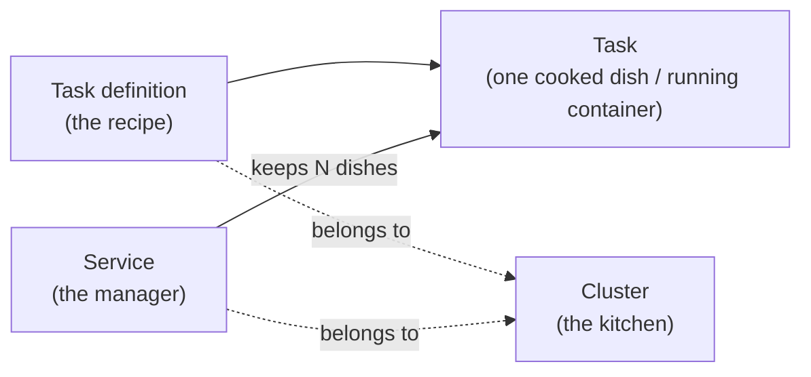
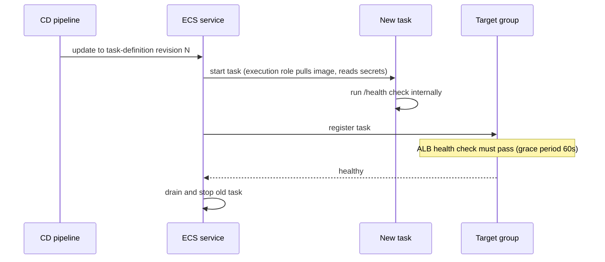
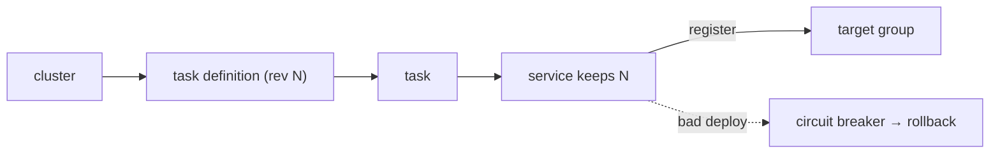

# 06. ECS and Fargate: running containers without servers

History: see [CHANGELOG.md](../CHANGELOG.md) or run `pnpm docs:history`

> **Honesty label: ✅ Built in repository** (`infra/src/compute/*`), **⚙️ configured for deployment**
> (the `computeEnabled` switch).

**Prerequisites:** [01](01-what-is-aws.md), [03](03-security-groups.md), [04. IAM](04-iam.md),
[05. ECR](05-ecr.md).

---

## A. The problem first

Our web and API apps are containers. Something has to:

- pick a machine to run them on,
- start them, and restart them if they crash,
- keep the right number running,
- roll out a new version without downtime,
- put a new task in the load balancer's list when it is healthy ([07](07-alb.md)),
- and stop a bad deployment automatically.

Doing this by hand on a server you manage means patching the OS, scaling manually, and babysitting
crashes. The problem is: **run and manage containers without managing servers.**

Where it shows up in MiniTickets: `infra/src/compute/cluster.ts`, `task.ts`, `service.ts` (and the web
equivalents). The API service keeps one task running; the web service does the same.

---

## B. What it is

### Plain English

**ECS (Elastic Container Service)** is AWS's container runner. A **cluster** is a named folder. A
**task definition** is the recipe for one container run. A **task** is one running copy of the recipe.
A **service** is the manager that keeps the right number of tasks running and healthy. **Fargate** is
the engine that finds the machine for each task so you never touch a server.

### The terms, in build order

1. **Cluster** — a logical grouping. Empty clusters are **free**. MiniTickets calls its cluster
   `minitickets-dev`.
2. **Capacity provider** — the kind of machine tasks may run on: `FARGATE` (on-demand) or
   `FARGATE_SPOT` (spare capacity, ~70% cheaper, interruptible with a 2-minute warning).
3. **Task definition** — the blueprint: image, CPU/memory, environment variables, secrets, log
   configuration, health check, roles, and network mode. Every change makes a new numbered
   **revision** (`minitickets-dev-api:1`, `:2`, …); old revisions stay, which is what makes rollback
   possible.
4. **Task** — one instantiated task definition: the actual running container(s).
5. **Service** — keeps a **desired count** of tasks running; replaces failed tasks; integrates with a
   load balancer; performs rolling deployments.
6. **Fargate** — the serverless engine that provisions the host. You say how big (CPU/memory); AWS
   does the rest.
7. **awsvpc network mode** — each task gets its own network interface and IP inside your VPC, so it can
   wear a security group. Fargate requires this.
8. **Container Insights** — optional per-task CPU/memory metrics (billed as custom metrics).
9. **Service Connect** — ECS's service-to-service networking that gives a task a stable name
   (`http://api:4000`) for other tasks to call.

---

## C. How it works internally

### The four nouns, as a kitchen



- The **task definition** says *what* to cook. It runs nothing.
- A **task** is one dish cooked from it.
- The **service** is the manager who guarantees the right number of dishes are on the counter, replacing
  any that fall.
- The **cluster** is the kitchen they all live in.

### What happens when you deploy a new revision

1. CD updates the service to point at a new task-definition revision.
2. The service starts a new task.
3. The new task is registered in the target group but is **not** sent traffic until it passes the
   **health check** (with a **grace period** so slow Node startup does not kill it).
4. Once healthy, the old task is drained and stopped.
5. If the new tasks keep failing, the **deployment circuit breaker** stops the deployment and
   **rolls back** to the last revision that worked.

This is a **rolling deployment** (one in, one out) with an automatic rollback safety net.

### Fargate Spot and interruption

`FARGATE_SPOT` is spare AWS capacity at roughly 70% off, but AWS may reclaim the machine with a
**2-minute warning**. ECS sends the task a signal and starts a replacement. The trade-off is a short
window of errors — fine for dev, not for production, where you would use `FARGATE` or a mixed strategy
(a small on-demand base plus Spot for burst).

---

## D. Our MiniTickets implementation

### D1. Cluster and capacity providers — `infra/src/compute/cluster.ts`

```ts
const cluster = new aws.ecs.Cluster(`${prefix}-cluster`, {
  name: prefix,
  settings: [{ name: "containerInsights", value: "disabled" }],
});
const capacityProviders = new aws.ecs.ClusterCapacityProviders(`${prefix}-capacity`, {
  clusterName: cluster.name,
  capacityProviders: ["FARGATE", "FARGATE_SPOT"],
});
return { clusterName: capacityProviders.clusterName };
```

Two deliberate choices:

- **Container Insights disabled** — it collects per-task CPU/memory as **custom** metrics, billed a few
  dollars a month even for one small task. The free basic service metrics are enough for dev.
- **Return the name from the capacity-providers resource**, not the cluster, so anything that uses it
  waits until the providers are attached. Otherwise the service could be created first and fail with
  "capacity provider FARGATE_SPOT is not associated with the cluster". A real race, closed on purpose.

### D2. Task definition — `infra/src/compute/task.ts`

The API task definition (`minitickets-dev-api`) shows almost every Fargate idea at once:

- `requiresCompatibilities: ["FARGATE"]`, `networkMode: "awsvpc"`.
- **Size:** `256`/`512` without Service Connect; `512`/`1024` with it, because ECS adds a proxy
  container that shares the task's CPU/memory and AWS recommends +256 CPU / +64 MB. Fargate sells
  fixed pairs, so 512 CPU starts at 1024 MB. (The comment even estimates the extra cost.)
- **arm64:** `cpuArchitecture: "ARM64"` — must match the image ([05](05-ecr.md)).
- **Two roles:** `executionRoleArn` (ECS starts the task) and `taskRoleArn` (our code runs) —
  [04](04-iam.md).
- **Environment vs secrets:** plain settings (`NODE_ENV`, `HOST=0.0.0.0`, `PORT=4000`, `DB_HOST`,
  `DB_PORT`, `DB_NAME`, `WEB_ORIGIN`, `TRUST_PROXY_HOPS`, and the SNS topic ARN) are `environment`;
  the DB username/password, the Redis URL and the revalidate secret are `secrets` — the task
  definition holds only **where** they are, and ECS injects the **values** at start-up using the
  execution role. The RDS master secret is JSON, so `"<arn>:username::"` selects the `username` key.
- **Logs:** the `awslogs` driver sends every printed line to CloudWatch, one stream per task.
- **Health check:** runs *inside* the container (the slim image has no `curl`, so `node` fetches
  `/health`). `startPeriod: 15` means failures in the first 15 s do not count; three failures in a row
  mark the container unhealthy and ECS replaces the task. Note: **`/health`, not `/ready`** — a
  database hiccup must not kill a working API.
- **`initProcessEnabled: true`** — a tiny init process as PID 1, recommended for ECS Exec, which opens
  child shells inside the container.

There is also a separate `migration-task.ts`, so the database migration can use a different image than
the running API during a deploy.

### D3. Service — `infra/src/compute/service.ts`

```ts
const service = new aws.ecs.Service(`${prefix}-api-service`, {
  name: `${prefix}-api`,
  cluster: inputs.clusterName,
  taskDefinition: inputs.taskDefinitionArn,
  desiredCount: 1,
  capacityProviderStrategies: [{ capacityProvider: "FARGATE_SPOT", weight: 1 }],
  networkConfiguration: {
    subnets: inputs.publicSubnetIds,
    securityGroups: [inputs.apiSgId],
    assignPublicIp: true,
  },
  deploymentCircuitBreaker: { enable: true, rollback: true },
  enableExecuteCommand: true,
  loadBalancers: inputs.apiTargetGroupArn
    ? [{ targetGroupArn: inputs.apiTargetGroupArn, containerName: "api", containerPort: 4000 }]
    : undefined,
  healthCheckGracePeriodSeconds: inputs.apiTargetGroupArn ? 60 : undefined,
  // serviceConnectConfiguration when entry is on
});
```

Read the choices:

- **`desiredCount: 1`** — enough for dev; production would be 2+ across AZs.
- **`assignPublicIp: true` in public subnets** — because there is **no NAT gateway**
  ([02](02-vpc-and-networking.md)), a task in a private subnet could not pull its image, read Secrets
  Manager or send logs (all public AWS endpoints). In a public subnet with a public IP it reaches them
  through the internet gateway. Is that unsafe? The API security group still blocks **all** inbound
  except port 4000 from the load balancer ([03](03-security-groups.md)). So the public IP makes the
  task *reachable in theory* but the firewall makes it *unusable in practice* except through the ALB.
- **Circuit breaker with rollback** — a bad deploy does not loop forever; it reverts.
- **`enableExecuteCommand: true`** — ECS Exec, so we can open a shell *inside* the running container
  from a laptop (needs the `ssmmessages` permissions on the task role, [04](04-iam.md)). Because the
  container sits inside the VPC, that shell can reach the private RDS and Valkey that a laptop cannot.
- **`healthCheckGracePeriodSeconds: 60`** — ignore early health-check failures while Node starts.

**Service Connect** (only when the entry layer is on) makes the API both a *server* (offering the name
`api`, so web tasks can call `http://api:4000`) and a *client* (able to call `http://web:3000` for its
revalidate hook). One subtle detail the code calls out: the API's proxy listens on port **14000** via
`ingressPortOverride`, so the ALB keeps calling the container on 4000 **directly**, not through the
proxy — which keeps the API's proxy-hop count (`TRUST_PROXY_HOPS`) correct so it can find the real
visitor IP.

### D4. Logs — `infra/src/compute/logs.ts`

The compute layer creates CloudWatch **log groups** (for `api` and `worker`) with a **7-day
retention**. The task's `awslogs` driver and the worker role both write here ([21](21-cloudwatch.md)).

### Trace: from container to healthy



---

## E. Security and permissions

**REACH.** Tasks are created by ECS, run in the VPC subnets, wear a security group, and reach AWS APIs
through the internet gateway (public subnet + public IP) because there is no NAT.

**ALLOWED.**
- The **execution role** lets the ECS agent pull images and read secrets.
- The **task role** lets our code do its (few) AWS calls.
- Both trust policies use `aws:SourceAccount` ([04](04-iam.md)).

**IDENTITY / CREDENTIALS.** The container never holds long-lived credentials; ECS injects temporary
role credentials into the task, and secrets are injected as environment variables at start-up.

**Encryption.** Secrets in transit to the container are TLS; data at rest is encrypted (RDS, Valkey,
DynamoDB, S3). The log group is encrypted by CloudWatch's default.

**ECS Exec.** A notable capability *and* a security consideration: it opens a shell inside the running
container. It is gated by the `ssmmessages` task-role policy and by IAM controlling who may call
`execute-command`. Useful for debugging; treat it like production shell access.

---

## F. The AWS console walkthrough

> Read-only. Do not stop tasks or force a new deployment to "see what happens" — that is an outage.

1. **ECS → Clusters.** Open `minitickets-dev`. Note the capacity providers (FARGATE, FARGATE_SPOT) and
   that Container Insights is off.
2. **Services** tab → `minitickets-dev-api`. Watch: desired count, running count, **deployments**,
   and events (deployment progress, circuit-breaker messages).
3. **Task definitions** → `minitickets-dev-api`. Open the latest **revision** and read the container
   definition: environment, secrets (shown as `valueFrom` ARNs, not values), log config, health check.
4. **Tasks** tab → open the running task → **Networking** shows the subnet, security group and the
   private/public IP (confirms `assignPublicIp`).
5. **Logs** tab on the task links straight to its CloudWatch stream.
6. To debug, **ECS → Clusters → Service → Execute command** would open a shell (owner action; needs
   IAM permission).

Mapping: tasks, revisions, service config all trace to `infra/src/compute/*`.

---

## G. Real production scenarios

### Scenario 1 — "A deployment is stuck / failed."

- **Cause:** new tasks fail health checks, or cannot start (image missing, secret unreadable).
- **Investigate:** the service **events** tell the story. If the circuit breaker tripped, look for the
  failure reason in the task's stopped reason.
- **Recover:** the circuit breaker rolls back automatically. Fix the cause and redeploy.
- **Note:** the grace period matters — a slow start with no grace period looks like a failed deploy.

### Scenario 2 — "A Spot interruption caused a brief outage."

- **Cause:** `FARGATE_SPOT` reclaim. Expected by design in dev.
- **Impact:** a minute or two of errors while a replacement starts.
- **Fix for production:** use `FARGATE`, or an on-demand base with Spot for burst.

### Scenario 3 — "The task can't reach the database."

- **Cause:** the task is in the wrong subnet/security group, or the db group does not allow the api
  group ([03](03-security-groups.md)).
- **Investigate:** from the task's shell (ECS Exec), test connectivity and DNS.

### Scenario 4 — "Container is stuck at start-up: cannot pull image / read secret."

- **Cause:** execution role missing ECR-pull or secret-read permission, or the image tag was expired
  ([05](05-ecr.md)).
- **Investigate:** the task's **stopped reason** names the failure.

### Scenario 5 — "We must debug inside a running container."

- ECS Exec opens a shell. Because the container is inside the VPC, that shell can reach private RDS and
  Valkey. Remember this is powerful access; it is why the `ssmmessages` permission is on the task role
  and IAM controls who may run it.

### Cost and performance

- **Fargate is billed per vCPU-second and GB-second** while tasks run; empty clusters are free. Spot is
  ~70% cheaper. The task size (256/512 vs 512/1024) directly changes the hourly cost, which is why the
  code comments mention it.
- **Container Insights** would add custom-metric cost (disabled here).
- Rolling deploys briefly run old + new tasks, a small cost spike per deploy.

---

## H. Decisions and alternatives

- **Fargate, not EC2-backed ECS.** No servers to patch or scale; pay per task. Trade-off: less control
  (no SSH to the host) and a per-unit price premium. Alternatives: ECS on EC2 (more control, more
  ops), EKS/Kubernetes (powerful, much more complexity), App Runner (simpler, less flexible), Lambda
  for short jobs.
- **Fargate Spot for dev.** ~70% cheaper, interruptible. Production would use FARGATE.
- **Public subnets + public IP, no NAT.** Cost-driven; safe because the security group blocks inbound.
  Alternative: private subnets + NAT gateway/endpoints (cleaner isolation, extra cost).
- **2+ tasks across AZs in production** for availability. MiniTickets uses 1 for dev.
- **Rolling deployments with a circuit breaker + rollback.** Simple and safe. Alternatives:
  blue/green (CodeDeploy), canary — more control, more machinery.
- **Service Connect** for internal service naming. Alternatives: direct target-group references, or a
  service mesh (overkill here).

---

## I. Interview preparation

### 30-second answer

> "ECS runs containers; a cluster is a folder, a task definition is the recipe, a task is one running
> copy, and a service keeps the right number running and healthy. MiniTickets runs on Fargate in
> awsvpc mode, so each task gets its own IP and security group, on FARGATE_SPOT for cost. The API
> service keeps one task, registers it in the ALB target group with a 60-second health-check grace
> period, and enables the deployment circuit breaker with rollback. It runs in a public subnet with a
> public IP because there's no NAT gateway, but the api security group blocks everything except the
> load balancer."

### Follow-up questions

- **Beginner:** Task definition vs task vs service? *(→ recipe vs one running copy vs the manager.)*
- **Beginner:** What does Fargate actually do? *(→ provisions the host so you don't manage servers.)*
- **Intermediate:** Why `awsvpc` mode? *(→ each task gets its own IP and can wear a security group;
  Fargate requires it.)*
- **Intermediate:** What is the deployment circuit breaker? *(→ stops a failing deployment and rolls
  back.)*
- **Intermediate:** Why is there a health-check grace period? *(→ so slow startup doesn't read as
  failure and get the task killed.)*
- **Senior:** Why are tasks in public subnets here, and is that safe? *(→ no NAT gateway; the security
  group blocks all inbound except the ALB, so the public IP is reachable-in-theory only. Production
  would use private subnets + NAT or endpoints.)*
- **Senior:** Spot vs on-demand, and when is each right? *(→ Spot is ~70% off but interruptible; use it
  for interruptible/dev, on-demand for user-facing production.)*
- **Senior:** What is the risk of ECS Exec, and how is it controlled? *(→ shell access inside prod;
  gated by the `ssmmessages` task-role policy and by IAM on `execute-command`.)*
- **Senior:** How does Service Connect's `ingressPortOverride` matter here? *(→ keeps the proxy out of
  the ALB path so `TRUST_PROXY_HOPS` stays accurate for real client IP.)*

### Scenario questions

1. **"A deploy failed."** → service events + circuit breaker + task stopped reason.
2. **"Brief outage during a Spot reclaim."** → expected; use on-demand for production.
3. **"Task can't reach RDS."** → subnet/security group; test from inside the container.

---

## J. Quick revision

**Five things to remember**

1. **Cluster** (folder) → **task definition** (recipe) → **task** (running copy) → **service**
   (manager).
2. **Fargate** provisions the host; **awsvpc** gives each task its own IP + security group.
3. MiniTickets: `minitickets-dev` cluster, **FARGATE_SPOT** for the API, **1** task, circuit breaker
   with rollback.
4. Tasks run in **public subnets with a public IP** (no NAT), firewalled to only the ALB.
5. **ECS Exec** gives a shell inside the running container (needs `ssmmessages` on the task role).

**One diagram**



**Three common mistakes**

1. Confusing a task definition (blueprint) with a task (running).
2. Forgetting the health-check grace period for slow-starting apps.
3. Assuming a public subnet is unsafe by itself — the **security group** is the actual lock.

**Where next:** [07. Application Load Balancer](07-alb.md) — how traffic reaches these tasks.
