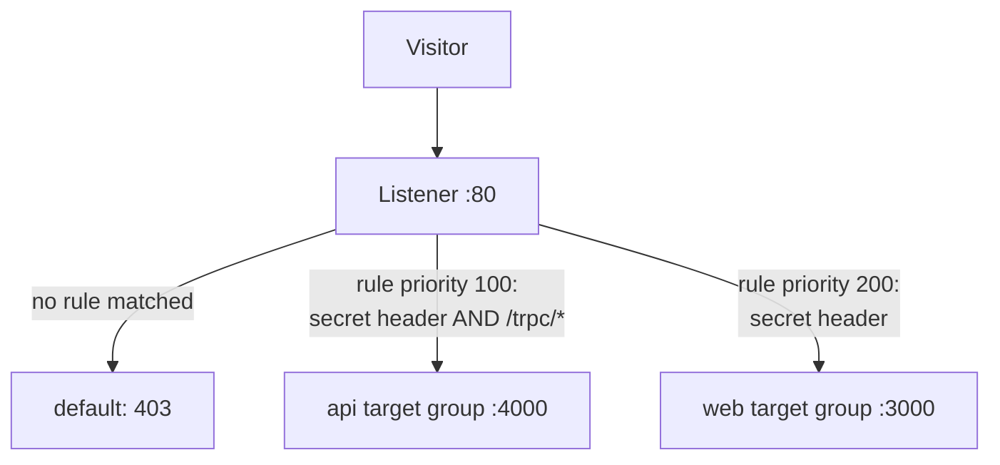
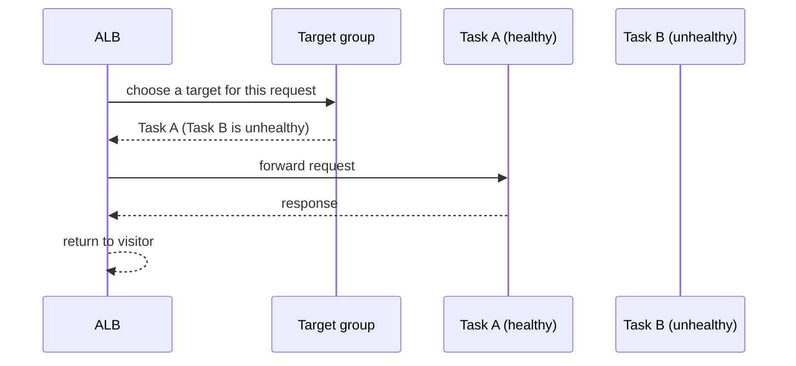
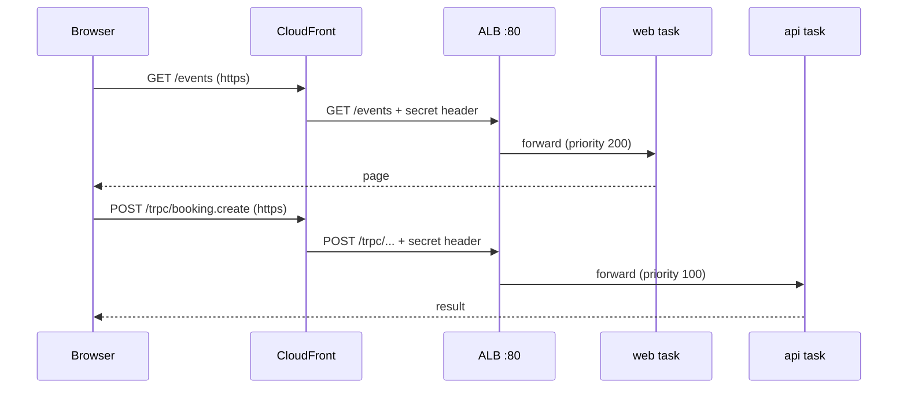
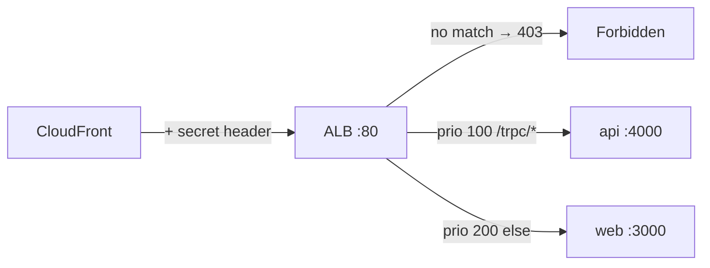

# 07. Application Load Balancer: routing the request

History: see [CHANGELOG.md](../CHANGELOG.md) or run `pnpm docs:history`

> **Honesty label: ✅ Built in repository** (`infra/src/entry/alb.ts`, `listener.ts`,
> `target-groups.ts`), **⚙️ configured for deployment** (the `entryEnabled` switch).

**Prerequisites:** [02](02-vpc-and-networking.md), [03](03-security-groups.md),
[06. ECS/Fargate](06-ecs-fargate.md).

---

## A. The problem first

Our web and API containers each have their **own IP address**, and those addresses change every time a
task restarts or a deploy rolls out. A visitor's browser cannot be told "connect to 10.0.1.7 on port
4000"; by tomorrow that address is gone.

We also need to send `/trpc/*` calls to the **API** and everything else to the **web** app, from the
**same origin** (so the browser's session cookie works and CORS is a non-issue).

The problem: **provide one stable public address that spreads requests across healthy containers and
routes each request to the right app, even as containers come and go.**

Where it shows up: `infra/src/entry/*`. The load balancer is the single public entry point; web and API
tasks accept traffic only from it.

---

## B. What it is

**Plain English:** the **Application Load Balancer (ALB)** is the receptionist at the front door. Every
visitor talks to the receptionist, never to the staff directly. The receptionist reads what the visitor
asks for (the URL path) and walks them to the right desk.

### The terms

- **Load balancer** — distributes incoming traffic across multiple targets. "Application" (layer 7)
  means it understands HTTP and can route by path/host; a "Network" LB only forwards TCP.
- **Listener** — watches one port/protocol (here HTTP :80) and holds the routing logic.
- **Rule** — a condition (path, header, host) plus an action (forward to a target group). Rules have
  **priorities**; the lowest number is checked first and the first match wins.
- **Default action** — what happens when no rule matches. MiniTickets answers a fixed **403 Forbidden**.
- **Target group** — the list of containers (by IP) that can handle one kind of request, plus a health
  check definition.
- **Health check** — the ALB periodically calls a path on each target; only **healthy** targets get
  traffic.
- **Deregistration delay (draining)** — when a target is removed, the ALB stops sending it *new*
  requests but keeps it in the list briefly so in-flight requests finish.

---

## C. How it works internally

### The receptionist and the signboard



Rules are checked from the **lowest priority number up**. `/trpc/*` must be checked **before** the
"everything else" web rule, so it gets priority **100** and web gets **200**. If the priorities were
reversed, API calls would be sent to the web app.

### What happens behind a target group



The ECS service registers a task in the target group when it starts and removes it when it stops. The
ALB only sends traffic to **healthy** entries.

### Health checks, precisely

MiniTickets uses, for both groups: **every 15 s**, **5 s timeout**, HTTP 200 = pass, **2 passes in a
row** = healthy, **3 failures in a row** = unhealthy. Unhealthy targets get no traffic, and ECS
replaces the task.

Two deliberate path choices:

- API checks **`/health`**, not `/ready` — a brief database hiccup must not take every API task out of
  the load balancer.
- Web checks **`/`** — a plain server-rendered page needing no database, so it answers 200 whenever
  Next.js itself is up.

### The two locks (why a stranger cannot bypass CloudFront)

In CloudFront mode, **two independent locks** keep everyone except our distribution out
([09](09-cloudfront.md)):

1. The **alb security group** lets in only CloudFront's IP ranges ([03](03-security-groups.md)).
2. The **secret header** checked by the rules. This blocks *other people's* CloudFront distributions,
   which use the *same* IP ranges — so lock 1 alone would let them in.

A request without the secret header matches no rule and hits the default **403**. Safe by default: a
request reaches a task only if a rule explicitly says so.

---

## D. Our MiniTickets implementation

### D1. The ALB — `infra/src/entry/alb.ts`

```ts
const alb = new aws.lb.LoadBalancer(`${prefix}-alb`, {
  name: prefix,                       // "minitickets-dev"
  loadBalancerType: "application",
  internal: false,                    // internet-facing
  subnets: inputs.publicSubnetIds,    // needs subnets in ≥2 AZs; we have 2
  securityGroups: [inputs.albSgId],
  dropInvalidHeaderFields: true,      // cheap defence against request smuggling
  enableDeletionProtection: false,    // dev: allow the switch-off destroy; prod would be true
});
```

It returns `albArn`, `albDnsName` (used by CloudFront as its origin; also the CNAME target in
ALB-only mode), and `albArnSuffix` (CloudWatch names the ALB's metrics by this, not the ARN,
[21](21-cloudwatch.md)).

### D2. Target groups — `infra/src/entry/target-groups.ts`

Shared settings: `targetType: "ip"` (Fargate tasks have their own IPs), `protocol: "HTTP"`,
`deregistrationDelay: 30`.

The **deregistration delay** is worth understanding. The default is **300 s**, meaning every deploy
would wait 5 minutes for nothing; MiniTickets' requests take milliseconds, so **30 s** is plenty. On a
normal deploy the order is: ALB drains the task for 30 s → ECS sends SIGTERM → our graceful shutdown
closes cleanly. **On a Spot interruption the docs do *not* guarantee draining finishes before SIGTERM**,
so do not rely on it there ([06](06-ecs-fargate.md)).

Note there is deliberately **no fixed `name`**: Pulumi adds a random suffix. Some changes (like the
port) *replace* a target group, and two cannot share a name, so a fixed name would make that replace
fail.

### D3. Listener and rules — `infra/src/entry/listener.ts`

```ts
const listener = new aws.lb.Listener(`${prefix}-http`, {
  loadBalancerArn: inputs.albArn,
  port: 80, protocol: "HTTP",
  defaultActions: [{ type: "fixed-response",
    fixedResponse: { statusCode: "403", contentType: "text/plain", messageBody: "Forbidden" } }],
});
```

The listener is **HTTP on port 80**, because in CloudFront mode the browser's HTTPS *ends at
CloudFront*, which then talks to the ALB over plain HTTP (inside the AWS network). The two rules:

```ts
const hasSecretHeader = {
  httpHeader: { httpHeaderName: inputs.originHeaderName, values: [inputs.originHeaderValue] },
};
// priority 100: /trpc/* -> api
conditions: [hasSecretHeader, { pathPattern: { values: ["/trpc/*"] } }],
// priority 200: everything else -> web
conditions: [hasSecretHeader],
```

The rules return their target-group ARNs only **after the rule exists**, because ECS refuses to create a
service with a target group that no load balancer uses yet ("target group ... does not have an
associated load balancer"). The same "return after wired up" pattern appears in `cluster.ts` and
`iam.ts`.

### D4. The alternative mode (`cdnEnabled = false`)

Without CloudFront, `infra/src/entry/https-listener.ts` takes the listener's place: an **HTTPS :443**
listener (default → web) with a `/trpc/*` rule → api, plus an HTTP :80 listener that **301-redirects**
everything to HTTPS. The ALB's public doors (80 and 443) are opened by
`infra/src/entry/alb-public-ingress.ts` from a configurable `allowedCidrs`. Exactly one of the two
listener files is used per deployment — never both.

### Trace: a browser request for an events page and a tRPC call



---

## E. Security and permissions

**REACH.** The ALB is internet-facing; in CloudFront mode only CloudFront's ranges may reach it; in
ALB-only mode the open ports are set by `allowedCidrs`.

**ALLOWED.** Security-group rules ([03](03-security-groups.md)) plus the listener rules' header
condition. This is *network/HTTP* control, not IAM.

**IDENTITY / CREDENTIALS.** The ALB itself does not assume a role for routing. It does need an ACM
certificate for HTTPS in the non-CloudFront mode ([08](08-tls-acm.md)).

**Encryption.** In CloudFront mode the browser→CloudFront hop is HTTPS, and CloudFront→ALB is HTTP
(a dev compromise, inside the AWS network). In ALB-only mode HTTPS terminates at the ALB. Production
would put a certificate on the ALB and use `https-only` at the origin so the whole path is encrypted.

**`dropInvalidHeaderFields: true`** is a cheap hardening step against request-smuggling tricks.

---

## F. The AWS console walkthrough

> Read-only. Do not delete a rule or deregister a target to test.

1. **EC2 → Load Balancers.** Open `minitickets-dev`. Note the scheme (internet-facing), the AZs and
   the security group.
2. **Listeners tab** → the `:80` listener. Confirm the **default action is a fixed 403**.
3. **Rules** → you should see priority **100** (`/trpc/*` → api) and priority **200** (→ web), both
   with the secret-header condition.
4. **Target groups** → `...-api-tg` and `...-web-tg`. Open each → **Targets** shows the task IPs and
   their health. **Health checks** shows the timings and path.
5. **Monitoring tab** on the ALB shows request count, 5xx, response time (the ALB alarm watches 5xx,
   [21](21-cloudwatch.md)).

Mapping: ALB → `entry/alb.ts`; rules → `entry/listener.ts`; groups → `entry/target-groups.ts`.

---

## G. Real production scenarios

### Scenario 1 — "502 / 504 from the load balancer."

- **Cause:** the ALB reached no healthy target. Either the containers failed their health check, or
  the target group's port/path is wrong, or the container's **security group** does not allow the ALB
  ([03](03-security-groups.md)).
- **Investigate:** check target health. 502 often means "connected but bad gateway"; 504 means "the
  target did not answer in time".
- **Recover:** fix the health check path/port or the security group; the ECS service replaces
  unhealthy tasks.

### Scenario 2 — "A deploy caused errors for a few seconds."

- **Cause:** the deregistration delay / graceful shutdown interplay. If the app does not handle
  SIGTERM, in-flight requests fail during draining.
- **Investigate:** look for errors exactly at deploy time.
- **Recover/prevent:** implement graceful shutdown; the 30 s drain gives it a window.

### Scenario 3 — "Someone bypassed CloudFront."

- **Cause:** in ALB-only mode, the doors are open per `allowedCidrs` (default `0.0.0.0/0`).
- **Impact:** no caching, and possibly reaching the app without the intended edge protections.
- **Fix:** use CloudFront mode, or restrict `allowedCidrs` to a known set.

### Scenario 4 — "Health checks flap."

- **Cause:** the `/health` endpoint is slow under load, or the interval/timeout is too tight.
- **Investigate:** the target group's health-check history.
- **Recover:** tune timing; ensure `/health` is cheap and does not depend on `/ready`'s deeper checks.

### Cost and performance

- An ALB is billed **hourly plus per LCU** (capacity units based on connections/requests/bytes). It
  costs money even when idle, which is why it is behind the `entryEnabled` switch.
- Layer-7 health checking and draining give near-zero-downtime deploys.

---

## H. Decisions and alternatives

- **ALB (layer 7), not NLB (layer 4).** We need path-based routing and HTTP health checks; an NLB
  cannot read the URL.
- **Same-origin routing** (`/trpc/*` and pages from one address) avoids CORS and makes the session
  cookie work on the same origin.
- **Default 403 + secret header.** Safe by default; a request reaches a task only when a rule allows it.
- **`/health` for the API, `/` for web.** Isolate liveness from deeper readiness.
- **30 s drain** instead of the 300 s default. Faster deploys; safe because requests are quick.
- **Two entry modes.** CloudFront-fronted (default) or ALB-only with its own certificate. The
  alternative (always CloudFront) is simpler but needs a working distribution (5–15 min to create,
  [09](09-cloudfront.md)).
- **Alternatives considered:** API Gateway (great for APIs, less so for SSR pages), NLB (no HTTP
  awareness), or a self-managed nginx (more work).

---

## I. Interview preparation

### 30-second answer

> "An ALB is a layer-7 load balancer. MiniTickets has one internet-facing ALB in two public subnets,
> with an HTTP :80 listener whose default action is a fixed 403. Two rules share a secret-header
> condition: priority 100 sends `/trpc/*` to the api target group, priority 200 sends everything else
> to the web group. Targets are Fargate task IPs; the ALB only routes to those passing a 15-second
> health check. A 30-second deregistration delay lets in-flight requests finish during deploys."

### Follow-up questions

- **Beginner:** Listener vs rule vs target group? *(→ the port's ear vs a match+action vs the list of
  targets.)*
- **Beginner:** Why two target groups? *(→ one kind of request per group: pages vs API.)*
- **Intermediate:** Why is `/trpc/*` priority 100 and web 200? *(→ rules check lowest-priority first;
  the specific path must win before the catch-all.)*
- **Intermediate:** Why is the default action a 403? *(→ fail closed: a request reaches a task only if
  a rule allows it, and both rules require the secret header.)*
- **Senior:** How do you deploy with zero downtime? *(→ health checks gate traffic; deregistration
  delay drains; graceful shutdown on SIGTERM closes connections.)*
- **Senior:** Why not rely on draining for Spot interruptions? *(→ AWS does not guarantee drains
  complete before SIGTERM on reclaim.)*
- **Senior:** Why `targetType: ip`? *(→ Fargate tasks have per-task IPs under awsvpc.)*

### Scenario questions

1. **"502s after a deploy."** → target health, health-check path/port, security group.
2. **"Errors for a few seconds around deploys."** → graceful shutdown + deregistration delay.
3. **"Traffic is reaching the app without CloudFront."** → check the mode and `allowedCidrs`.

---

## J. Quick revision

**Five things to remember**

1. The ALB is the **single public entry point**; tasks accept traffic only from it.
2. **Listener** (port 80) + **rules** by priority: **100** `/trpc/*`→api, **200** →web.
3. Default action is a **fixed 403** — fail closed.
4. **Target groups** hold task IPs; only **healthy** targets get traffic (`/health`, `/`).
5. **30 s deregistration delay** drains in-flight requests during deploys.

**One diagram**



**Three common mistakes**

1. Reversing rule priorities so API calls hit the web app.
2. Health-checking a deep `/ready` path and causing mass unhealthy states on a DB blip.
3. Assuming the ALB encrypts the origin hop in CloudFront mode (it is HTTP in dev).

**Where next:** [08. DNS, TLS and ACM](08-tls-acm.md) — the padlock and the name.
