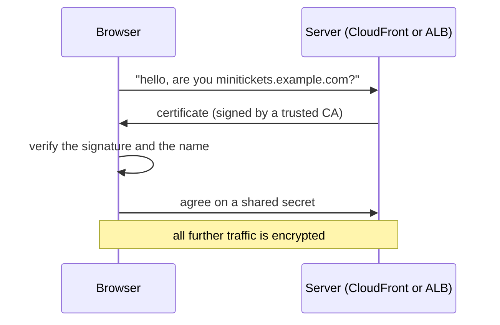
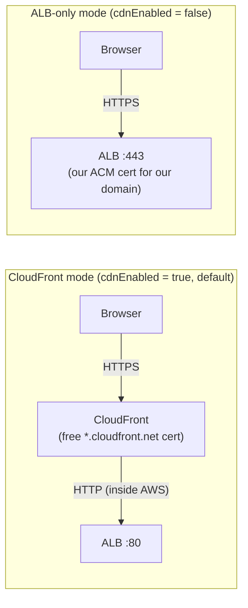
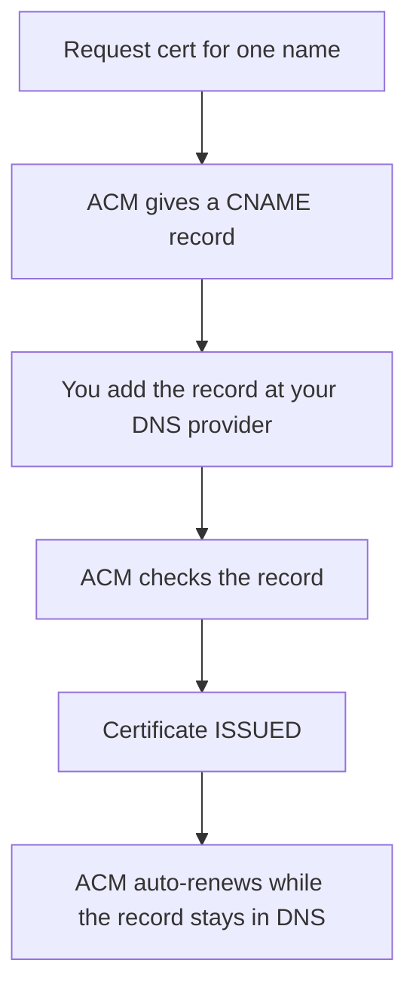
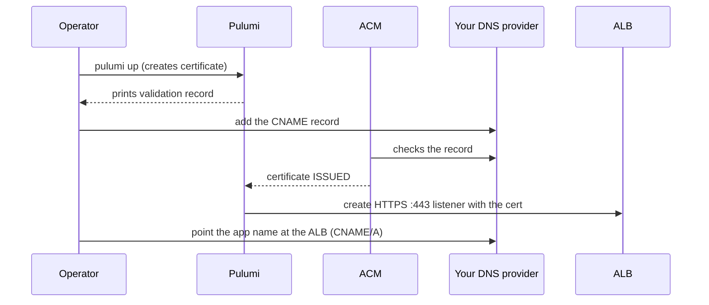
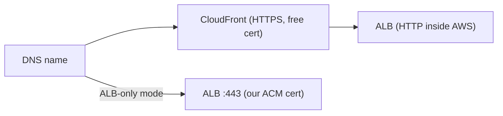

# 08. DNS, TLS and ACM: the name and the padlock

History: see [CHANGELOG.md](../CHANGELOG.md) or run `pnpm docs:history`

> **Honesty label: ✅ Built in repository** (`infra/src/certificate.ts`, `infra/src/entry/mode.ts`,
> `infra/src/entry/https-listener.ts`), **⚙️ configured for deployment**.

**Prerequisites:** [01](01-what-is-aws.md), [07. ALB](07-alb.md).

---

## A. The problem first

Two problems, both about trust on the internet:

1. **Names.** People type a name (`minitickets.example.com`), not an IP address. Something must map the
   name to whatever currently serves the app — and that address changes (the ALB's DNS name, the
   CloudFront distribution's name).
2. **Trust.** When a browser connects to a site, how does it know it is talking to the *real* site and
   not an impostor? And how is the traffic kept private from anyone in between?

Without HTTPS, a login cookie can be sniffed, passwords can be read, and browsers show "Not secure".
Worse, modern cookie security (`Secure` flag) *requires* HTTPS — so without it, sessions cannot be
properly protected at all.

Where it shows up: `infra/src/certificate.ts` (the certificate), and the two entry modes in
`infra/src/entry/`.

---

## B. What it is

### Plain English

**DNS** is the internet's phone book: it turns a name into an address. **TLS** is the encryption that
makes HTTPS secure. **A certificate** is a signed ID card that proves a server owns a name.
**ACM (AWS Certificate Manager)** issues and renews those certificates for free.

### The terms

- **DNS** — the Domain Name System. Records include **A** (name → IPv4), **AAAA** (IPv6), **CNAME**
  (name → another name), and **TXT** (arbitrary text, used for verification).
- **TLS (Transport Layer Security)** — the encryption protocol. **HTTPS** is HTTP over TLS.
- **TLS termination** — the point where encryption is decrypted. It can be at CloudFront and/or at the
  ALB; the encrypted leg is only as far as the terminator.
- **Certificate** — an X.509 document signed by a **certificate authority (CA)** that binds a public
  key to a domain name.
- **CA (Certificate Authority)** — an entity a browser already trusts. Amazon is one, through ACM.
- **ACM (AWS Certificate Manager)** — AWS's service that issues and auto-renews public certificates
  for free.
- **DNS validation** — proving you control a domain by adding a specific record. It proves *control of
  the name*, not who you are as a person.
- **CNAME / A record** — how you point your name at CloudFront (CNAME to the distribution) or the ALB.
- **Proxy hops / `X-Forwarded-For`** — each proxy in front of the app appends the address it saw;
  trusting the right number of hops is how the app finds the *real* visitor IP.

---

## C. How it works internally

### The HTTPS handshake, simply

If the certificate is missing, expired, or for the wrong name, the browser refuses or warns.

### Where TLS terminates in each mode

MiniTickets has **two entry modes** (`infra/src/entry/mode.ts`):

- **CloudFront mode (default):** the browser's HTTPS ends at CloudFront, which uses its **free**
  `*.cloudfront.net` certificate. No domain name is needed at all. CloudFront then talks to the ALB
  over plain HTTP **inside the AWS network** (a dev compromise; production would encrypt this hop too).
- **ALB-only mode:** there is no CloudFront, so the browser talks straight to the ALB over **HTTPS on
  port 443**, using **our own ACM certificate** for our domain. `https-listener.ts` waits for the
  certificate to be **ISSUED** before creating the listener; an HTTP :80 listener 301-redirects to
  HTTPS.

Exactly one of `listener.ts` / `https-listener.ts` is used per deployment — never both.

### The certificate and its DNS validation

`infra/src/certificate.ts` requests a certificate for **exactly one name** — deliberately **no
wildcard** `*.example.com`, because least privilege: a leaked app certificate would not cover the
owner's other subdomains.

Because the DNS is **not** in Route 53, Pulumi cannot add the record for us. It is printed as a stack
output (`pulumi stack output certificateValidationRecord`) and copied into the DNS provider **by
hand**.

Two things about the certificate's lifecycle matter:

- **Renewal.** An ACM certificate is valid about 13 months; ACM renews it **by itself**, for free, as
  long as the validation record is still in DNS. So: add the record once, and **never delete it**.
- **Why it is always on**, not behind the entry switch: validation waits for *you* (adding the record)
  and then for DNS to spread, which can take minutes to hours. If the certificate were created only on
  deploy day, the HTTPS listener would wait with the meter running. A certificate is free, so it is
  created now and is issued long before it is needed.

**Region:** ACM certificates belong to one region, and both an ALB and CloudFront have constraints —
**CloudFront only accepts certificates from `us-east-1`**. MiniTickets' region is `us-east-1`, so the
same certificate would fit either.

### The proxy-hop count (`TRUST_PROXY_HOPS`)

This is a subtle but important correctness detail. Each proxy in front of the app appends the address
it saw to `X-Forwarded-For`. The app must trust **exactly** the right number of proxies (`mode.ts`):

- Entry off: **0** hops (nothing in front; trust nobody).
- CloudFront mode: **2** hops (CloudFront, then the ALB).
- ALB-only mode: **1** hop (just the ALB).

Why "exactly"? Trusting **too many** hops is the unsafe direction. With only the ALB in front, the
`X-Forwarded-For` the API receives is "<whatever the client sent>, <client IP>" (the ALB appends the
real client IP). Trusting **2** hops would skip the real client IP and read the address the **client
wrote** — so anyone could pick their own apparent IP. That is why the value is computed per mode and
never "2 always, to be safe".

---

## D. Our MiniTickets implementation

- **`infra/src/certificate.ts`** — `createCertificate({ domainName })`:
  - `new aws.acm.Certificate(..., { domainName, validationMethod: "DNS" })`.
  - Returns `certificateArn` and the single `validationRecord` (name/type/value) for manual entry.
- **`infra/src/entry/mode.ts`** — pure functions computing `trustProxyHops(cdnEnabled, entryEnabled)`
  and the mode, unit-tested in `mode.test.ts` (no AWS resources, so it is testable).
- **`infra/src/entry/https-listener.ts`** — the ALB-only listeners: waits for the certificate to be
  issued, creates the HTTPS :443 listener and the `/trpc/*` rule, and the HTTP :80 → 301 redirect.
- **`infra/src/entry/alb-public-ingress.ts`** — opens the ALB's ports to `allowedCidrs` (default
  `0.0.0.0/0`, or your own IP `/32` in dev).
- **`infra/src/entry/cdn.ts`** — the CloudFront default certificate (no domain needed) and the
  `appUrl` output.
- **`infra/src/compute/task.ts`** — passes `TRUST_PROXY_HOPS` and `WEB_ORIGIN` into the API container.

The API reads these in `apps/api/src/config/env.ts` and `apps/api/src/app.ts` (Fastify's `trustProxy`).

### Trace: first-time setup in ALB-only mode

---

## E. Security and permissions

**REACH.** The certificate's DNS record must be added at your DNS provider (a manual step, because the
DNS is not in Route 53).

**ALLOWED.** ACM validates **DNS control**, not identity. Anyone who can edit the domain's DNS can get
a certificate for it — which is why DNS access is sensitive.

**IDENTITY / CREDENTIALS.** The principal that creates the certificate needs ACM permissions (the
Pulumi/CI principal). Traffic encryption does not involve IAM.

**Encryption.**

- **In transit (browser → edge):** HTTPS/TLS, always.
- **Edge → ALB:** HTTP in CloudFront mode (dev compromise; inside the AWS network); HTTPS in ALB-only
  mode (the ALB terminates TLS).
- **At rest:** covered by the data services ([10](10-rds-postgres.md)–[14](14-s3.md)).

**Cookie security.** HTTPS is what makes the `Secure` session cookie valid — a real security reason,
not just a browser warning.

**Wildcard avoidance.** One name, not `*`, is least privilege applied to certificates.

---

## F. The AWS console walkthrough

> Read-only. Do not delete a validation record — it breaks auto-renewal.

1. **Certificate Manager (ACM)** in **us-east-1**. Find `minitickets-dev-cert`. Confirm **Status =
   Issued** and the domain (one name). The **Domains** section shows the validation CNAME.
2. Look up the validation CNAME at your DNS provider and confirm it is present (it must stay).
3. **EC2 → Load Balancers → Listeners** (ALB-only mode): confirm the HTTPS :443 listener uses the ACM
   certificate, and the :80 listener redirects to HTTPS.
4. **CloudFront mode:** the distribution uses the default `*.cloudfront.net` certificate.
5. **Your DNS provider:** confirm the name points at the CloudFront distribution (CNAME) or the ALB
   (CNAME/A), depending on mode.

Mapping: certificate → `infra/src/certificate.ts`; listeners → `entry/listener.ts` /
`entry/https-listener.ts`.

---

## G. Real production scenarios

### Scenario 1 — "Browser shows 'Not secure' or a certificate error."

- **Cause:** wrong name, an expired certificate, or a chain the browser does not trust.
- **Investigate:** ACM status and the name on the certificate; check the listener uses the right one.
- **Recover:** fix the certificate/listener. Auto-renewal prevents expiry **only if the validation
  record is still in DNS** — a deleted record is the classic cause of a sudden expiry.

### Scenario 2 — "Certificate expired after a year."

- **Cause:** the DNS validation record was removed, so ACM could not renew.
- **Recover:** re-add the record; re-issue if needed. Keep the record forever.

### Scenario 3 — "The app logs the wrong client IP."

- **Cause:** `TRUST_PROXY_HOPS` wrong for the mode. Too high → reads the client-supplied
  `X-Forwarded-For` (spoofable). Too low → reads a proxy's IP.
- **Investigate:** compare the mode with the value the API got. `entry/mode.ts` is the source of truth.
- **Security note:** trusting too many hops is a real vulnerability, not just a logging bug.

### Scenario 4 — "A new subdomain does not resolve."

- **Cause:** missing DNS record, or DNS propagation delay.
- **Recover:** add the record; wait for propagation (minutes to hours).

### Cost and performance

- ACM **public certificates are free**.
- TLS adds a little handshake latency; CloudFront's edge termination and HTTP/2–3 mitigate it
  ([09](09-cloudfront.md)).

---

## H. Decisions and alternatives

- **CloudFront default certificate (no domain) vs own domain + ACM.** MiniTickets supports both; the
  default mode needs no domain at all, which keeps dev simple. Trade-off: the CloudFront name is
  `*.cloudfront.net`.
- **One name, no wildcard.** Least privilege. Trade-off: each subdomain needs its own record.
- **DNS validation, not email validation.** Automatable and less error-prone; requires DNS access.
- **`us-east-1` for the certificate.** Required by CloudFront; also matches the ALB's region.
- **HTTP-origin in CloudFront mode.** A dev compromise; production would add a certificate on the ALB
  and use `https-only` at the origin.
- **Manual DNS record.** Because the domain is not in Route 53. Alternative: host the zone in Route 53
  and let Pulumi (or ACM) manage records automatically.
- **Alternatives to ACM:** Let's Encrypt (free, automatable via ACME, self-managed renewal). ACM's
  auto-renewal and native ALB/CloudFront integration make it the natural AWS choice.

---

## I. Interview preparation

### 30-second answer

> "DNS maps our name to CloudFront or the ALB; TLS gives HTTPS. MiniTickets has two modes: with
> CloudFront, the browser's HTTPS ends at the edge using the free `*.cloudfront.net` certificate and
> CloudFront talks to the ALB over HTTP inside AWS; without CloudFront, a DNS-validated ACM certificate
> terminates HTTPS at the ALB on 443 and port 80 redirects. The certificate is for one name, not a
> wildcard, and ACM renews it for free as long as the validation record stays in DNS. `TRUST_PROXY_HOPS`
> is computed per mode so the app reads the real client IP."

### Follow-up questions

- **Beginner:** What does TLS do? *(→ encrypts traffic and proves the server's identity.)*
- **Beginner:** What is a certificate? *(→ a CA-signed binding of a public key to a domain.)*
- **Intermediate:** How does DNS validation work? *(→ add a record only the domain owner can; ACM
  checks it.)*
- **Intermediate:** Why no wildcard certificate? *(→ least privilege: a leak would not cover other
  subdomains.)*
- **Intermediate:** Why is the certificate always on, not behind the entry switch? *(→ issuance waits
  on manual DNS; create it early so the listener never waits.)*
- **Senior:** Why is `TRUST_PROXY_HOPS` mode-dependent, and what is the risk? *(→ too many hops trusts
  client-supplied `X-Forwarded-For`, which is spoofable.)*
- **Senior:** Why is the CloudFront→ALB hop HTTP, and what would you change for production? *(→ dev
  compromise; add an ALB certificate and use `https-only` at the origin.)*
- **Senior:** Where must a CloudFront certificate live, and why? *(→ `us-east-1`; CloudFront only
  accepts certificates from there.)*

### Scenario questions

1. **"Sudden certificate expiry."** → deleted DNS validation record; ACM could not renew.
2. **"Wrong client IP in logs."** → wrong `TRUST_PROXY_HOPS` for the mode.
3. **"New subdomain doesn't resolve."** → missing DNS record / propagation.

---

## J. Quick revision

**Five things to remember**

1. **DNS = names; TLS = the padlock; ACM = free, auto-renewing certificates.**
2. CloudFront mode uses the **free `*.cloudfront.net`** certificate; ALB-only mode uses **our ACM
   certificate** on :443.
3. DNS validation proves **control of the name**; keep the record forever so renewal works.
4. Certificates are **one name, not wildcard** (least privilege), and CloudFront needs `us-east-1`.
5. `TRUST_PROXY_HOPS` is **mode-dependent** (0/1/2) — too many is a spoofing risk.

**One diagram**

**Three common mistakes**

1. Deleting the DNS validation record and breaking auto-renewal.
2. Trusting too many proxy hops (spoofable client IP).
3. Assuming the CloudFront→ALB hop is encrypted in dev (it is HTTP).

**Where next:** [09. CloudFront](09-cloudfront.md) — the CDN, caching, and origin protection.
