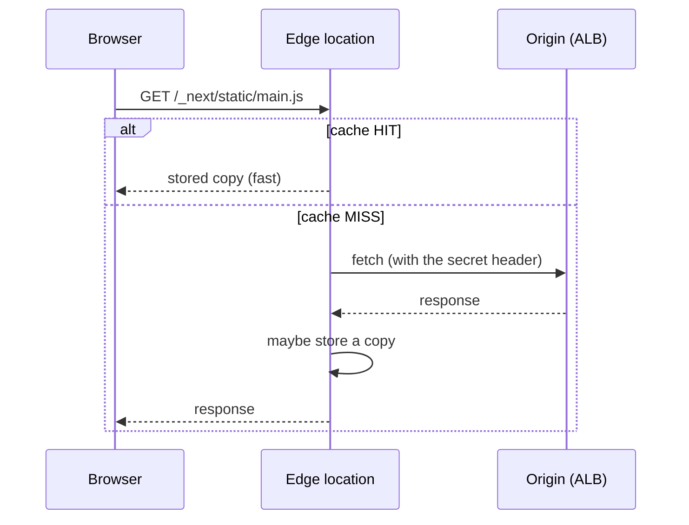
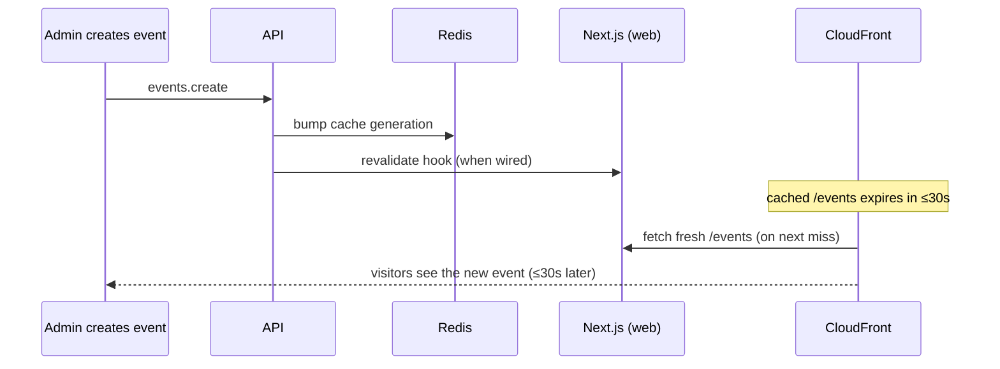
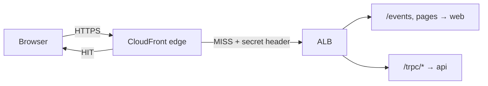

# 09. CloudFront: the CDN and origin protection

History: see [CHANGELOG.md](../CHANGELOG.md) or run `pnpm docs:history`

> **Honesty label: ✅ Built in repository** (`infra/src/entry/cdn.ts`, `origin-secret.ts`, `mode.ts`),
> **⚙️ configured for deployment** (the `cdnEnabled` switch). **The committed dev configuration uses
> `cdnEnabled=false`**, so in dev the ALB-only path is active; CloudFront is configured and exercised
> by tests but is not necessarily the live path. The code comments themselves note that CloudFront
> mode is the default and that the revalidate hook is "not wired up yet" on AWS.

**Prerequisites:** [07. ALB](07-alb.md), [08. DNS/TLS/ACM](08-tls-acm.md).

---

## A. The problem first

Our app has three different kinds of traffic, and they want opposite handling:

1. **Static assets** (`/_next/static/*` JS and CSS). The same for every visitor, never changing once
   built. **Cache them aggressively.**
2. **The public events page** (`/events`). The same HTML for everyone, changing occasionally. **Cache
   briefly.**
3. **Per-user API calls and pages** (`/trpc/*`, `/dashboard`). Contain one user's data and depend on
   their cookie. **Never cache, and never share.**

Also, we want HTTPS without necessarily owning a domain, and we want the app served from a location
near the visitor.

The problem: **serve different kinds of content with different caching rules from one address, add
HTTPS, and stop anyone bypassing the cache layer to hit the origin directly.**

Where it shows up: `infra/src/entry/cdn.ts` and `origin-secret.ts`.

---

## B. What it is

**Plain English:** **CloudFront** is a **CDN (content delivery network)** — hundreds of AWS buildings
around the world ("edge locations"). The browser talks to the nearest one. The edge either answers
from its own copy (**cache HIT**) or fetches from our ALB (the **origin**) and maybe keeps a copy
(**cache MISS**).

### The terms

- **CDN** — a network of caches placed close to users.
- **Edge location** — one CDN point of presence.
- **Origin** — where CloudFront fetches from on a miss (the ALB here).
- **Distribution** — one CloudFront configuration (one origin, a set of behaviors).
- **Cache behavior** — a rule mapping a **path pattern** to caching/forwarding settings. Ordered; the
  first match wins; a **default behavior** covers everything else.
- **Cache policy** — how long to keep a copy (**TTL**s) and what makes two requests "the same" (the
  **cache key**: which query strings, headers, cookies).
- **Origin request policy** — which parts of the incoming request are forwarded to the origin.
- **TTL (min/default/max)** — the edges of how long a response may be cached.
- **Cache invalidation** — explicitly removing a cached copy.
- **Origin protection** — stopping direct access to the origin, so all traffic goes through the edge.

---

## C. How it works internally

### The basic flow



### The cache key is the whole game

Two requests share a cached entry only if their **cache key** matches. MiniTickets tunes the key
carefully per behavior:

- For **static assets**, the key is basically the path. File names contain a content hash, so a given
  name never changes — safe to cache for a year. (Next.js already sends `max-age=31536000, immutable`.)
- For **`/trpc/*`**, caching is **disabled** and everything (including cookies) is forwarded, because
  answers are per-user.
- For **`/events`**, a **custom** cache policy exists (below).

### The `Cache-Control` header decides the `/events` TTL

The web app sends, for `/events`:

```
Cache-Control: public, max-age=0, s-maxage=30, stale-while-revalidate=300
```

Meaning: the **browser keeps no copy** (`max-age=0`); CloudFront (the shared cache) keeps the page
**30 s** (`s-maxage=30`); then for up to **5 more minutes** it may hand out the **old** copy once while
fetching a **new** one in the background (`stale-while-revalidate=300`). The cache policy's TTLs are
only the **edges** of what that header may do:

- **`minTtl: 0`** — respect `no-store`/`private` (does not store even responses marked no-store; e.g.
  Next's RSC payloads and error pages).
- **`defaultTtl: 0`** — a response **without** `Cache-Control` is **not stored**. Fails **closed**,
  never open: if the web app ever stops sending its header, the page is simply not cached.
- **`maxTtl: 330`** — upper bound on `s-maxage` and the end of the stale window (30 s fresh + 300 s
  stale).

### The RSC trap (a genuinely advanced detail)

Next.js uses the **same URL** for two different answers:

- a normal visit gets the **full HTML** page;
- a client-side navigation (clicking a `<Link>`) sends an **`RSC: 1`** header and gets an **RSC
  payload** (React's own `text/x-component` format), not HTML.

Next marks this with `Vary: rsc, next-router-state-tree, ...`, but **CloudFront ignores `Vary`** — it
only looks at its **cache key**. If the key were just the URL, a stored HTML page could be handed to a
navigation (the router gets HTML it cannot read) or a stored RSC payload to a visitor (the browser
shows raw RSC text). So those headers go **into the key**, and the policy whitelists
`RSC`, `Next-Router-State-Tree`, `Next-Router-Prefetch`, `Next-Router-Segment-Prefetch`, `Next-Url` so
HTML and RSC requests never share an entry. The `_rsc` query string is also in the key because Next 16
answers a 307 with the correct `_rsc` when it is missing — dropping it would create a redirect loop on
every client-side navigation.

This is the kind of thing that separates "I know what a CDN is" from "I have actually run a Next.js app
behind a CDN".

### The four behaviors of the distribution

| Path pattern | Purpose | Cache policy | Origin request policy | Methods |
| --- | --- | --- | --- | --- |
| `/_next/static/*` | JS/CSS (hashed names) | `CachingOptimized` | — | GET, HEAD |
| `/trpc/*` | API (per-user) | `CachingDisabled` | `AllViewer` (cookies + headers) | all methods |
| `/events` | public events page | custom `/events` policy | — (key only) | GET, HEAD |
| `*` (default) | all other pages | `CachingDisabled` | `AllViewer` | GET, HEAD |

The default behavior forwards the **cookie** (pages show who is logged in) and never caches. Writes
(mutations) go through `/trpc/*`, so a POST to a page is refused at the edge and never reaches the ALB.

### Origin protection

CloudFront adds a **secret header** to every request it sends to the ALB, and the listener rules let a
request through only when it is present ([07](07-alb.md)). The value is a **random 32-character Pulumi
secret** (`entry/origin-secret.ts`) that stays a secret and is never exported.

There are **two locks**: (1) the alb security group allows only CloudFront's IP ranges; (2) the secret
header. The second lock matters because *other people's* CloudFront distributions use the *same* IP
ranges as ours — that is exactly why the header is needed.

---

## D. Our MiniTickets implementation

`createCdn({ albDnsName, originHeaderName, originHeaderValue })`:

- Looks up AWS managed policies by name: `Managed-CachingOptimized`, `Managed-CachingDisabled`,
  `Managed-AllViewer`.
- Creates our own `${prefix}-events-page` cache policy (TTLs and key above).
- Creates the distribution:
  - `httpVersion: "http2and3"` (browser→edge HTTP/2 and HTTP/3).
  - `priceClass: "PriceClass_100"` — the cheapest edge locations (North America and Europe); visitors
    elsewhere still work, served from the nearest of those.
  - Origin = the ALB's DNS name, `originProtocolPolicy: "http-only"`, with the secret header in
    `customHeaders`.
  - The ordered behaviors and default behavior above.
  - `viewerCertificate: { cloudfrontDefaultCertificate: true }` — the free `*.cloudfront.net`
    certificate, so no domain is needed.
- Returns `appUrl` = `https://<distribution domain>`, used as the API's `WEB_ORIGIN` ([08](08-tls-acm.md)).

### Why caching `/events` matters, and the alternative that was *not* built

When an event is created, `events.create` fixes the layers below at once (a Redis generation bump,
then the Next.js revalidate hook). On a busy page the new event reaches visitors within ~30 s
(`s-maxage`); on a quiet page the first visitor within 5 minutes may get the old copy once
(stale-while-revalidate).

MiniTickets deliberately does **not** do a **CloudFront invalidation** from `events.create`. The code
lists why: the first 1,000 paths a month are free then `$0.005` per path; it takes seconds to minutes to
reach every edge; it needs IAM rights and the AWS SDK in the API task; and it can fail like any call. A
short TTL costs nothing, needs no code, and has a **known, bounded** delay. Events are created rarely,
so seeing a new one 30 s late harms nobody. 💡 This is a textbook example of choosing the simpler,
bounded-cost option over the "clever" one.

### Trace: a new event appearing



---

## E. Security and permissions

**REACH.** CloudFront is reached from anywhere over HTTPS; it reaches the ALB on port 80 (allowed only
from CloudFront's ranges).

**ALLOWED.**
- The **alb security group** allows only CloudFront's prefix list.
- The listener **rules** require the secret header.
- Creating/updating the distribution needs CloudFront permissions on the Pulumi/CI principal.

**IDENTITY / CREDENTIALS.** The origin-secret header is the credential between CloudFront and the ALB.
It is stored as a Pulumi **secret**, never printed.

**Encryption.**
- Browser→CloudFront: **HTTPS**.
- CloudFront→ALB: **HTTP** in dev (inside the AWS network; production would add an ALB certificate and
  `https-only`).
- `compress: true` at the edge (gzip/Brotli) where the cache policy allows it.

**Why caching matters for security.** Never caching `/trpc/*` and the default pages is a *security*
decision, not just performance: a cached per-user response could show one customer's data to another.

---

## F. The AWS console walkthrough

> Read-only. Do not create invalidations or change behaviors to "test" — that changes global state.

1. **CloudFront → Distributions.** Open `minitickets-dev-cdn` (if deployed with `cdnEnabled=true`).
2. **Behaviors** tab: confirm the four behaviors and their order (`/_next/static/*`, `/trpc/*`,
   `/events`, default `*`). Open `/events` to see the custom cache policy.
3. **Origins** tab: confirm the origin is the ALB's DNS name and that a **custom header** is set
   (the header *name* is visible; the value is what matters).
4. **Cache policies** (CloudFront → Policies → Cache): open `minitickets-dev-events-page` and read
   the TTLs and the cache key (query strings, headers, no cookies).
5. **Monitoring** shows requests, cache hit rate, error rates.
6. Confirm the **viewer certificate** is the default `*.cloudfront.net`.

Mapping: everything here is `infra/src/entry/cdn.ts` and `origin-secret.ts`.

---

## G. Real production scenarios

### Scenario 1 — "Users see one another's data."

- **Cause:** a per-user behavior was cached. The `/trpc/*` or default behavior lost its
  `CachingDisabled`, or cookies were dropped from the key.
- **Impact:** **severe** — a data-leak class of bug.
- **Investigate:** the cache policy on the offending behavior; check that cookies are forwarded for
  per-user paths.
- **Recover:** restore `CachingDisabled` + `AllViewer`, and invalidate the affected paths.

### Scenario 2 — "A client-side navigation shows raw RSC text or HTML."

- **Cause:** the `/events` cache key lost one of the Next.js RSC headers, so an HTML entry was handed
  to a navigation (or vice versa).
- **Investigate:** compare the behavior's header whitelist with the code.
- **Recover:** restore the headers in the key; the RSC answers are `no-store` so they should never have
  been stored anyway.

### Scenario 3 — "New events appear late."

- **Cause:** the `s-maxage` window. Expected and bounded (~30 s busy, up to 5 min quiet).
- **Investigate:** confirm the `/events` behavior and the `Cache-Control` header the app sends.
- **Recover (if ever needed):** an invalidation — the option MiniTickets deliberately did not build
  ([H](#h-decisions-and-alternatives)).

### Scenario 4 — "Someone bypasses CloudFront and hits the ALB directly."

- **Cause:** in CloudFront mode, a request without the secret header would be 403 by the listener, and
  the security group would drop non-CloudFront sources. If the mode is ALB-only, there is no CDN at all.
- **Investigate:** which mode is active (`cdnEnabled`), and whether the secret header is configured on
  both ends.

### Scenario 5 — "Cache hit rate is low / origin load is high."

- **Cause:** key explosion — too many query strings or headers in the key. MiniTickets whitelists only
  `venue`, `from`, `to`, `_rsc` for `/events`, so `?utm_source=...` and random junk get the **same**
  cached copy.
- **Investigate:** the cache key and the variety of query strings. Note the honest limit: `?venue=<random>`
  still makes new entries (the value is free text), but each is a normal, rate-limitable request.

### Cost and performance

- CloudFront is billed per request and per GB transferred; caching reduces origin load and cost.
- `PriceClass_100` limits edge locations to the cheapest tier.
- Creating/updating a distribution takes ~5–15 minutes to propagate to all edges.
- HTTP/2 and HTTP/3 speed up page loads.

---

## H. Decisions and alternatives

- **CloudFront over no CDN.** HTTPS without owning a domain, edge caching, and origin protection. The
  ALB-only mode is the alternative when you do not want CloudFront.
- **Four behaviors with three caching philosophies.** Aggressive for static, brief for `/events`, never
  for per-user. The alternative (one default behavior) would either over-cache private data or
  under-cache static assets.
- **A custom `/events` cache policy.** Because no AWS managed policy fits the exact key needed. The
  alternative (`CachingOptimized`) would ignore the filters and the RSC headers.
- **No invalidation from `events.create`.** Short TTL instead; simpler, cheaper, bounded. See the
  reasoning above.
- **Secret header + security-group prefix list.** Two locks. The alternative (only the prefix list)
  fails to exclude *other CloudFront distributions*.
- **The free `*.cloudfront.net` certificate.** No domain needed. The alternative (a custom domain)
  needs an ACM certificate in `us-east-1`.
- **`PriceClass_100`.** Cheapest tier. The alternative (all edges) improves global latency at higher
  cost.

---

## I. Interview preparation

### 30-second answer

> "CloudFront is a CDN in front of the ALB. MiniTickets uses four behaviors: hashed `/_next/static/*`
> cached for a year, `/trpc/*` never cached and all cookies forwarded, `/events` cached briefly with a
> custom policy whose key is only the three filters plus the Next.js RSC headers, and a default
> behavior that never caches per-user pages. The origin is protected by two locks — the ALB's security
> group allows only CloudFront's IP ranges, and every edge request carries a secret header the listener
> checks. We deliberately don't invalidate on event creation; a 30-second TTL is simpler and bounded."

### Follow-up questions

- **Beginner:** What is a CDN? *(→ caches near users.)*
- **Beginner:** What is a cache key? *(→ what makes two requests share an entry.)*
- **Intermediate:** Why never cache `/trpc/*`? *(→ per-user answers; a cached copy could leak data.)*
- **Intermediate:** How does `/events` decide its TTL? *(→ the app's `Cache-Control`; the policy sets
  only the min/default/max edges.)*
- **Intermediate:** Why `defaultTtl: 0`? *(→ fail closed: no header means no caching.)*
- **Senior:** What is the RSC trap and how do you fix it? *(→ Next uses one URL for HTML and RSC;
  CloudFront ignores `Vary`, so the RSC headers must be in the cache key.)*
- **Senior:** How is the origin protected, and why is one lock not enough? *(→ SG prefix list alone
  admits other distributions; the secret header distinguishes ours.)*
- **Senior:** Why not invalidate on event creation? *(→ cost, propagation delay, IAM/SDK in the API,
  failure modes; a bounded TTL is simpler.)*

### Scenario questions

1. **"Users see each other's data."** → a per-user behavior got cached; restore `CachingDisabled`.
2. **"Navigation shows raw RSC."** → missing RSC header in the cache key.
3. **"Events appear late."** → `s-maxage` window; expected; invalidation if you truly need it.

---

## J. Quick revision

**Five things to remember**

1. CloudFront is a **CDN** in front of the ALB; HTTPS terminates at the edge (free cert).
2. **Four behaviors:** static (cache long), `/trpc/*` (never), `/events` (brief), default (never).
3. The **cache key** decides sharing; the **`Cache-Control` header** decides the TTL within policy
   edges (`minTtl 0`, `defaultTtl 0`, `maxTtl 330`).
4. **Origin protection = two locks**: CloudFront IP ranges (security group) + **secret header**.
5. The **RSC headers** must be in the `/events` key because CloudFront ignores `Vary`.

**One diagram**



**Three common mistakes**

1. Caching a per-user path (data-leak risk).
2. Forgetting the secret header, leaving a second lock open.
3. Ignoring the RSC trap and serving HTML to a client-side navigation.

**Where next:** Part 3, starting with [10. RDS for PostgreSQL](10-rds-postgres.md).
