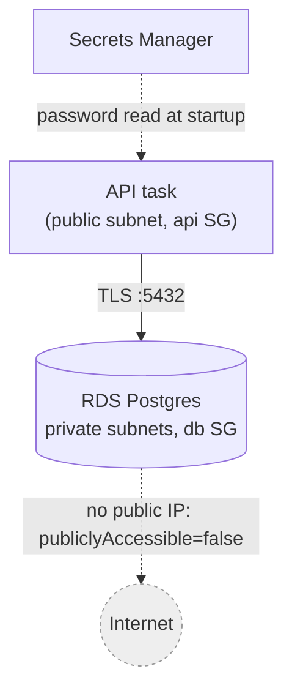
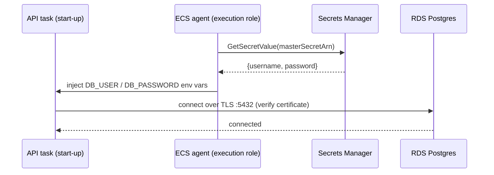
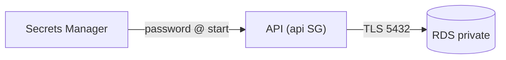

# 10. RDS for PostgreSQL: the main database

History: see [CHANGELOG.md](../CHANGELOG.md) or run `pnpm docs:history`

> **Honesty label: ✅ Built in repository** (`infra/src/data/postgres.ts`), **⚙️ configured for
> deployment** (the `dataEnabled` switch). All the "production vs dev" trade-offs below are stated in
> the code's own comments.

**Prerequisites:** [02](02-vpc-and-networking.md), [03](03-security-groups.md), [04. IAM](04-iam.md).

---

## A. The problem first

MiniTickets stores users, events, bookings and the outbox. This data must be:

- **Durable** — a server restart must not lose bookings.
- **Consistent** — two people must not book the same last seat (a `SELECT ... FOR UPDATE` transaction,
  [15](15-transactional-outbox.md)).
- **Queryable** — relational queries across users, events and bookings.
- **Backed up** — we must be able to recover to a point in time.
- **Private** — not reachable from the internet.

Running your own database means installing the engine, patching it, tuning backups, and handling a
disk failure at 3 a.m. The problem is: **get a reliable, backed-up, private relational database without
becoming a database operator.**

Where it shows up: `infra/src/data/postgres.ts`, and the API's `DATABASE_URL` wiring.

---

## B. What it is

**Plain English:** **RDS (Relational Database Service)** is a managed SQL database. You choose the
engine and size; AWS runs the machine, patches the engine, takes backups, and can fail over to a
standby.

### The terms

- **RDS** — AWS's managed relational database service.
- **PostgreSQL** — a popular open-source relational database; an **ACID** engine (Atomicity,
  Consistency, Isolation, Durability).
- **Instance class** — the machine size (`db.t4g.micro` here: a small ARM/Graviton instance).
- **Storage** — the disk type and size (`gp3`, 20 GB here).
- **Subnet group** — the set of subnets RDS may place the database in (private subnets only).
- **Encryption at rest** — the disk, backups and snapshots are encrypted.
- **Multi-AZ** — a standby copy in another AZ, with automatic failover (~a minute).
- **Backup retention** — how long automatic daily backups (and point-in-time recovery) are kept.
- **Final snapshot** — a backup taken when the instance is deleted.
- **Deletion protection** — a guard that prevents accidental deletion.
- **RDS-managed master password** — AWS creates a strong password and stores it in Secrets Manager,
  rotating it periodically.
- **`rds.force_ssl`** — a Postgres parameter (on by default in Postgres 15+) that refuses non-SSL
  connections.

---

## C. How it works internally

### Where the database lives



The database is in **private subnets** (no internet route, [02](02-vpc-and-networking.md)), behind the
**db security group** (only the api group may connect, [03](03-security-groups.md)), with
**`publiclyAccessible: false`** so its name resolves only to a private `10.0.x.x` address.

### Why a subnet group needs two AZs even for one database

RDS demands subnets in **at least 2 AZs** even for a single-AZ database, because if you later turn on
Multi-AZ (or AWS has to move the database), the second AZ is already prepared.

### Where the password comes from (the elegant part)

With `manageMasterUserPassword: true`, **AWS generates a strong password and stores it in Secrets
Manager**:

- The password **never appears** in our code, in Pulumi config, or in Pulumi state.
- We only ever see the secret's **ARN** (its address).
- The API's execution role is allowed to read exactly that secret ([04](04-iam.md)).
- **RDS rotates the password every 7 days by default** — and the API reads it from the secret, never
  from a copy.

There is a real, documented **limitation**: the API reads the secret **only at startup**. A rotation
while a task is running is not picked up until the task restarts. This is worth naming honestly in an
interview.

### The SSL default

RDS for Postgres 15+ sets `rds.force_ssl = 1`, so the database **refuses** connections without SSL.
The API connects with SSL and **verifies the certificate** (`apps/api/src/config/database.ts`).

---

## D. Our MiniTickets implementation

`createPostgres({ privateSubnetIds, dbSgId })`:

1. **Subnet group** `minitickets-dev-db-subnets` — private subnets, 2 AZs.
2. **Instance** `minitickets-dev-db`:

| Setting | Value | Dev choice and the production alternative |
| --- | --- | --- |
| Engine | `postgres` 17 | same major as local Docker `postgres:17.6`; minor patches by AWS |
| Class | `db.t4g.micro` | smallest ARM (2 vCPU burstable, 1 GB) |
| Storage | 20 GB `gp3` | cheaper/faster than old `gp2` |
| Encryption | `storageEncrypted: true` | free, and cannot be enabled later without a rebuild |
| DB / user | `minitickets` / `minitickets` | |
| Password | `manageMasterUserPassword: true` | rotated every 7 days, stored in Secrets Manager |
| Network | private subnets, db SG, `publiclyAccessible: false`, port 5432 | |
| Multi-AZ | **false** | production: true (failover ~1 min) |
| Deletion protection | **false** | production: true |
| Final snapshot | **skipped** | production: taken |
| Backup retention | **1 day** | production: 7–35 days |
| Apply immediately | **true** | production: false (maintenance window) |

The dev-only settings each **trade safety for easy, cheap teardown** — the code says so plainly. This
is a mini-lesson in why a dev environment and a production environment are configured differently even
when they run the same application.

The function returns `address`, `port` and `masterSecretArn` — **never the password**. Note the
defensive check on the secret ARN:

```ts
masterSecretArn: db.masterUserSecrets.apply((secrets) => {
  const arn = secrets[0]?.secretArn;
  if (!arn) throw new Error("RDS returned no master password secret (is manageMasterUserPassword on?)");
  return arn;
}),
```

If the secret were ever missing, it fails with a **clear message** instead of writing `"undefined"`
into an IAM policy. Small defensive details like this prevent mysterious failures later.

### Trace: the API connecting



---

## E. Security and permissions

**REACH.** The database has no public IP and lives in private subnets; only the db security group's
allowlist (the api group) can reach port 5432.

**ALLOWED.** Two layers: the **network** (security group, [03](03-security-groups.md)) and the
**database credentials** (the password). IAM controls who may read the password **secret**, not the
database connection itself.

**IDENTITY / CREDENTIALS.** The API task obtains the password from Secrets Manager via its execution
role at start-up ([04](04-iam.md), [12](12-secrets-kms.md)). The password is never stored in the app.

**Encryption.** At rest: `storageEncrypted` with an AWS-managed KMS key ([12](12-secrets-kms.md)). In
transit: SSL is **forced** by `rds.force_ssl`, and the API verifies the certificate.

---

## F. The AWS console walkthrough

> Read-only. Do not modify the instance or reboot it to "test".

1. **RDS → Databases.** Open `minitickets-dev-db`. The **Connectivity & security** tab shows the
   endpoint (a private address), the port, the security group, and `Publicly accessible: No`.
2. **Configuration** shows the engine version, class, storage and Multi-AZ status.
3. **Maintenance & backups** shows the backup retention (1 day here) and the maintenance window.
4. **Logs & events** shows recent events (backups, restarts).
5. **Secrets Manager** → find the RDS master secret (named by RDS) and confirm rotation is enabled.
6. **Performance Insights / Monitoring** shows CPU, connections, and (if enabled) query-level insight.

Mapping: every setting here is a line in `infra/src/data/postgres.ts`.

---

## G. Real production scenarios

### Scenario 1 — "The API cannot connect: too many connections."

- **Cause:** each API task opens a connection pool; many tasks (or a leak) exhaust Postgres's connection
  limit.
- **Investigate:** the instance's `DatabaseConnections` metric; the pool size in the app.
- **Recover/prevent:** a connection pooler (e.g. RDS Proxy), smaller pools, or fewer tasks. This is a
  classic scaling problem once you scale out the API.

### Scenario 2 — "Failover during an AZ outage."

- **Cause:** the AZ hosting the (single-AZ) instance fails.
- **Impact:** in dev, downtime until AWS recovers or replaces it. In production with **Multi-AZ**, a
  standby takes over in about a minute.
- **Lesson:** single-AZ is a deliberate dev cost trade-off, not a design that scales to production.

### Scenario 3 — "Password rotation broke a long-running task."

- **Cause:** the API reads the password only at start-up; a 7-day rotation is not picked up until the
  task restarts.
- **Impact:** a task that outlives a rotation could fail on reconnect.
- **Investigate/recover:** restart the task (picks up the new password) or implement re-reading the
  secret. This is the documented limitation.

### Scenario 4 — "We need to restore to yesterday."

- **Cause:** accidental data change.
- **Investigate/recover:** point-in-time recovery within the backup retention window. In dev that
  window is only **1 day**; production keeps 7–35. A reminder that retention is a design decision.

### Scenario 5 — "The disk filled."

- **Cause:** growth beyond 20 GB.
- **Recover:** enable storage autoscaling or increase the size. Watch the free-storage metric.

### Cost and performance

- Billed **per hour** while running (instance + storage) — an **idle cost**, which is exactly why the
  data layer is behind a switch. Multi-AZ roughly doubles the cost.
- `gp3` gives good baseline IOPS; `db.t4g.micro` is burstable (good for dev, can be throttled under
  sustained load).

---

## H. Decisions and alternatives

- **Managed RDS over self-managed Postgres on EC2.** Less ops, automated backups/patching/failover.
  Trade-off: less control, hourly cost.
- **RDS-managed master password.** No password anywhere in code/config/state; rotated for us. Trade-off:
  the app must read the secret (and, currently, only at startup).
- **Single-AZ, 1-day backups, no final snapshot (dev).** Cheap and easy to tear down. Production flips
  every one of these.
- **Private subnets + `publiclyAccessible: false`.** No internet path to the data, ever.
- **Graviton (`t4g`) + `gp3`.** Cheaper per unit.
- **Postgres 17 major only.** AWS applies minor patches automatically.
- **Alternatives:** Aurora (more scalable, pricier), Aurora Serverless v2 (scales to near-zero),
  DynamoDB (NoSQL, wrong fit for relational bookings), self-managed on EC2 (control, more ops),
  a connection pooler like **RDS Proxy** (worth it as you scale tasks).

---

## I. Interview preparation

### 30-second answer

> "RDS is AWS's managed Postgres. MiniTickets runs a small Graviton instance in a private subnet group
> behind a security group that only the API can reach, with encryption at rest, forced SSL in transit,
> and a **mechanically managed master password** that lives in Secrets Manager and rotates. Dev uses
> single-AZ, 1-day backups and no final snapshot for cheap teardown; production would use Multi-AZ, a
> longer retention window, deletion protection and a final snapshot."

### Follow-up questions

- **Beginner:** What is RDS? *(→ managed relational database.)*
- **Beginner:** Why isn't the database reachable from the internet? *(→ private subnets +
  `publiclyAccessible: false` + security group.)*
- **Intermediate:** How does the app get the database password? *(→ RDS-managed secret in Secrets
  Manager, read by the execution role at start-up.)*
- **Intermediate:** What does Multi-AZ give you, and why is it off in dev? *(→ failover ~1 min; costs
  ~2×, unnecessary for dev.)*
- **Intermediate:** What is a subnet group, and why two AZs for one DB? *(→ where RDS may live; a
  second AZ is ready for Multi-AZ/moves.)*
- **Senior:** Why can't encryption at rest be enabled after creation? *(→ a rebuild is required; so it
  is on from the start.)*
- **Senior:** What is the password-rotation limitation here? *(→ the app reads the secret only at
  startup; a long-running task needs a restart to pick up a rotated password.)*
- **Senior:** How would you handle connection exhaustion as you scale the API? *(→ RDS Proxy, smaller
  pools, or fewer tasks.)*
- **Senior:** How do you design backup retention and final snapshots? *(→ RPO/RTO: retention window
  sets the recovery point, Multi-AZ sets the recovery time.)*

### Scenario questions

1. **"Too many connections under load."** → pool sizing / RDS Proxy.
2. **"An AZ outage."** → single-AZ downtime vs Multi-AZ failover.
3. **"Restore yesterday's data in dev."** → only a 1-day retention window; production keeps more.

---

## J. Quick revision

**Five things to remember**

1. RDS = **managed Postgres**; the instance lives in **private subnets** behind the **db security
   group**.
2. The **master password is managed by AWS**, stored and rotated in **Secrets Manager**; the app reads
   it at start-up only.
3. Encryption **at rest** is on and cannot be added later without a rebuild; SSL is **forced** in
   transit.
4. Dev trades safety for cheap teardown: **single-AZ, 1-day backups, no final snapshot**; production
   flips all three.
5. The database returns an **address/port/secret ARN**, never a password.

**One diagram**



**Three common mistakes**

1. Thinking RDS is reachable because it has an endpoint — the endpoint is a **private** name.
2. Forgetting that a rotated password needs a task restart to take effect.
3. Assuming dev's 1-day backup window is enough (it is not, for real data).

**Where next:** [11. ElastiCache with Valkey](11-elasticache.md) — the other data store.
