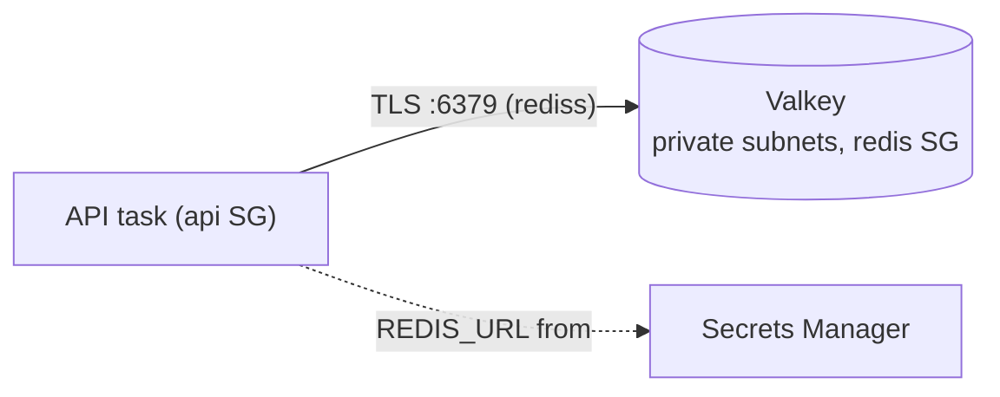
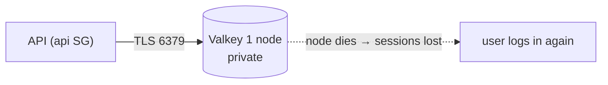

# 11. ElastiCache with Valkey: sessions and caching

History: see [CHANGELOG.md](../CHANGELOG.md) or run `pnpm docs:history`

> **Honesty label: ✅ Built in repository** (`infra/src/data/cache.ts`), **⚙️ configured for
> deployment** (the `dataEnabled` switch).

**Prerequisites:** [02](02-vpc-and-networking.md), [03](03-security-groups.md), [10. RDS](10-rds-postgres.md).

---

## A. The problem first

Two needs that a relational database serves poorly:

1. **Sessions.** When a user logs in, the server must remember them on the next request. Writing every
   session to Postgres on every request would hammer the database for data that is short-lived and
   rarely queried.
2. **Read caches.** Some pages read the same data repeatedly. Hitting Postgres every time is slower and
   more expensive than reading a fast in-memory copy.

Both want a store that is **extremely fast**, **in memory**, and **fine with data disappearing** (a
lost session just means re-login). The problem: **a fast, ephemeral key-value store, managed, private,
and encrypted.**

Where it shows up: `infra/src/data/cache.ts` and the Redis URL in `data/secrets.ts`.

---

## B. What it is

**Plain English:** **ElastiCache** is a managed in-memory cache. MiniTickets uses its **Valkey** engine
— a licence-compatible fork of Redis — to store login sessions and some cached data.

### The terms

- **ElastiCache** — AWS's managed in-memory data store (Valkey, Redis, or Memcached).
- **Redis / Valkey** — an in-memory key-value store with data structures. **Valkey** is the open-source
  fork created after Redis changed its license; it speaks the same protocol, so `ioredis` and the app's
  session code work unchanged. On ElastiCache it is about **20% cheaper** than Redis.
- **Session** — server-side login state keyed by a cookie (MiniTickets uses a `sid` cookie). Stored in
  Redis because it must survive across API tasks.
- **TTL / expiry** — a key can expire, which is what makes a session "log out" eventually.
- **Replication group** — ElastiCache's container for a primary node plus optional read replicas.
- **Auth token** — the cache's password.
- **Transit encryption** — TLS on connections (the `s` in `rediss://`).

---

## C. How it works internally

### Where the cache sits



### Why a "replication group", not a single "cache cluster"

The code comment is precise: a **replication group** (not a single `cache cluster`) is the **only kind
that supports TLS + an auth token**, and it lets you add a replica later without rebuilding. So even
though MiniTickets starts with **one node**, it uses the replication-group resource so encryption and
auth are possible now and scaling is possible later.

### The auth token, and why `special: false`

```ts
const authToken = new random.RandomPassword(`${prefix}-valkey-token`, { length: 32, special: false });
```

Two details:

- **32 characters**, generated by Pulumi, and marked a **secret** — encrypted in Pulumi state and shown
  as `[secret]` in every preview.
- **`special: false`** keeps it to letters and digits, so it is **safe inside a URL**. Characters like
  `@` or `/` would break `rediss://:<token>@<host>:6379`. This is a small but real bug avoided by design.

### What it stores, and what "losing it" means

Sessions are short-lived: if the node dies, users are simply logged out until it comes back. That is
tolerable in dev and is exactly why **no backups** are configured (`snapshotRetentionLimit: 0`). A cache
is not the source of truth — Postgres is.

---

## D. Our MiniTickets implementation

`createCache({ privateSubnetIds, redisSgId })`:

1. **Auth token** — random 32 chars, `special: false`, secret.
2. **Subnet group** `minitickets-dev-valkey-subnets` — private subnets, 2 AZs.
3. **Replication group** `minitickets-dev-valkey`:
   - `engine: "valkey"`, `engineVersion: "8.2"` (compatible with Redis 7.2 commands — enough for the
     `GET`/`SET` with expiry/`DEL` the app uses).
   - `nodeType: "cache.t4g.micro"` (small ARM, 2 vCPU burstable, 0.5 GB RAM), `numCacheClusters: 1`,
     `automaticFailoverEnabled: false`, `multiAzEnabled: false`, port **6379**.
   - Private subnets + the **redis security group**.
   - `transitEncryptionEnabled: true` and `atRestEncryptionEnabled: true` — **free and cannot be added
     to a running group without a rebuild**.
   - `authToken` set.
   - `snapshotRetentionLimit: 0`, `applyImmediately: true` (dev).

It returns `primaryEndpoint` and `authToken` (the token stays a secret Output, never exported as a
stack output).

### The URL, built in the secrets layer

`data/secrets.ts` composes the full URL and stores it in Secrets Manager:

```
rediss://:<token>@<primary endpoint>:6379
```

- `rediss` = Redis **over TLS**.
- The empty part before `:` is the **username** (none, so the default user).
- The part after `:` is the **auth token**.

This is the exact format `ioredis` and MiniTickets' env check accept
(`apps/api/src/config/env.ts` requires a `redis://` or `rediss://` URL; `rediss://` makes ioredis use
TLS and verify the server's certificate by itself).

### Trace: a login session

```mermaid
sequenceDiagram
    participant B as Browser
    participant API as API
    participant VK as Valkey
    B->>API: POST /trpc/auth.login (credentials)
    API->>VK: SET session:<sid> = user, EX <ttl>
    API-->>B: Set-Cookie: sid=...; Secure; HttpOnly
    B->>API: next request + sid cookie
    API->>VK: GET session:<sid>
    VK-->>API: user
```

---

## E. Security and permissions

**REACH.** The node is in **private subnets** behind the **redis security group**, which allows only
the **api** group on port 6379 ([03](03-security-groups.md)). No public endpoint.

**ALLOWED.** Network (security group) + the **auth token**. IAM controls who may read the URL **secret**,
not the Redis commands themselves (Redis has its own auth via the token).

**IDENTITY / CREDENTIALS.** The API task gets `REDIS_URL` from Secrets Manager via its execution role
([04](04-iam.md), [12](12-secrets-kms.md)).

**Encryption.** **In transit:** `transitEncryptionEnabled` — every connection must use TLS, so session
ids are never sent as plain text. **At rest:** `atRestEncryptionEnabled` — data written to disk (swap,
backups) is encrypted.

---

## F. The AWS console walkthrough

> Read-only. Do not modify the node or delete it.

1. **ElastiCache → Valkey/Redis caches.** Open `minitickets-dev-valkey`. Confirm engine **Valkey**,
   node type, one node, and **no** Multi-AZ/failover.
2. **Connectivity:** the primary endpoint (a private address) and port 6379; the security group.
3. **Security:** confirm **encryption in transit** and **at rest** are enabled.
4. **Backups:** confirm snapshot retention is 0 (dev).
5. **Metrics** show engine CPU, connections, cache hits/misses.

Mapping: every setting is a line in `infra/src/data/cache.ts`.

---

## G. Real production scenarios

### Scenario 1 — "Users are randomly logged out."

- **Cause:** the single node restarted (no replica, no failover), so in-memory sessions were lost.
- **Impact:** annoyance, not data loss — they log in again.
- **Recover/prevent:** production uses 2+ nodes across AZs with `automaticFailoverEnabled` and
  `multiAzEnabled`.

### Scenario 2 — "Connection errors after a network change."

- **Cause:** the app must use `rediss://` (TLS); a plain `redis://` would be refused.
- **Investigate:** the connection error and the URL scheme. The env check enforces the scheme.

### Scenario 3 — "Memory full / keys evicted."

- **Cause:** too many keys or no expiry; the cache evicts, and sessions may vanish or the node hits an
  out-of-memory error.
- **Investigate:** the eviction/`currItems` metrics.
- **Recover/prevent:** ensure keys have TTLs (sessions should), size the node correctly.

### Scenario 4 — "Cache stampede after a restart."

- **Cause:** many clients miss the cache at once and all hit Postgres.
- **Impact:** a load spike on the database (a well-known failure mode; see the MiniTickets cache
  concepts in `../concepts/cache-stampede.md`).
- **Prevent:** request coalescing, jittered TTLs, or a warm-up.

### Cost and performance

- Billed **per hour per node** while running — an **idle cost**. Behind the `dataEnabled` switch.
- In-memory reads are sub-millisecond, which is the entire point.
- `t4g.micro` is burstable: fine for dev; sustained load needs a larger node.

---

## H. Decisions and alternatives

- **Valkey over Redis.** ~20% cheaper on ElastiCache and API-compatible. Trade-off: a newer engine with
  a smaller (but growing) ecosystem.
- **A replication group with one node.** Enables TLS + auth now and scaling later, without a rebuild.
  The alternative (a single `cache cluster`) cannot use TLS + an auth token.
- **TLS + auth token on, no backups (dev).** Encryption is free and irreversible-if-off; backups are
  pointless for sessions.
- **Private subnets + redis SG.** No public path.
- **The app accepts `rediss://` and verifies the certificate.** The `s` matters.
- **Alternatives:** Redis on ElastiCache (pricier), Memcached (no persistence/structures), DynamoDB with
  TTL (different model), or self-managed Redis on EC2 (more ops). Some teams avoid a cache entirely at
  small scale and use Postgres — a valid trade-off MiniTickets does not take, because sessions benefit
  from in-memory speed.

---

## I. Interview preparation

### 30-second answer

> "ElastiCache is a managed in-memory store; MiniTickets uses its Valkey engine for login sessions. It's
> a single-node replication group in private subnets behind a security group that only the API can
> reach, with TLS in transit and encryption at rest, and a random auth token that's safe inside a
> `rediss://` URL. Dev uses one node with no failover or backups because a lost session just means a
> re-login; production would use two nodes across AZs with automatic failover."

### Follow-up questions

- **Beginner:** Why not store sessions in Postgres? *(→ write load and latency; sessions are ephemeral
  and fast-access.)*
- **Beginner:** What does `rediss://` mean? *(→ Redis over TLS.)*
- **Intermediate:** Why a replication group instead of a single cache cluster? *(→ only it supports TLS
  + an auth token, and allows adding replicas later.)*
- **Intermediate:** Why `special: false` on the token? *(→ URL-safe characters; `@`/`/` would break the
  URL.)*
- **Intermediate:** What happens if the node dies? *(→ sessions lost; users log in again. No failover in
  dev.)*
- **Senior:** How do you cache safely given the stampede risk? *(→ TTL jitter, request coalescing,
  cache-aside with locks.)*
- **Senior:** When would you *not* use a cache? *(→ when the DB is fast enough and consistency matters
  more; a cache adds a failure mode and invalidation complexity.)*
- **Senior:** How does auth token + TLS + security group combine? *(→ defence in depth: network ACL,
  transport encryption, application auth.)*

### Scenario questions

1. **"Random logouts."** → single node restart; production adds failover.
2. **"Connection refused."** → must use `rediss://` with TLS.
3. **"DB load spike after a cache restart."** → stampede; add coalescing/jitter.

---

## J. Quick revision

**Five things to remember**

1. ElastiCache = managed in-memory store; MiniTickets uses **Valkey** for **sessions**.
2. A **replication group** (even with 1 node) is required for **TLS + auth token**.
3. The **auth token** is random, 32 chars, **URL-safe**; the URL is `rediss://:<token>@<host>:6379`.
4. Encryption **transit + at rest** are free and on from the start.
5. Dev: **1 node, no failover, no backups** — a lost session is acceptable; production adds replicas.

**One diagram**



**Three common mistakes**

1. Using `redis://` instead of `rediss://` (no TLS → refused).
2. Using a single `cache cluster` and then discovering TLS + auth are unsupported.
3. Treating the cache as a source of truth (it is not).

**Where next:** [12. Secrets Manager and KMS](12-secrets-kms.md).
