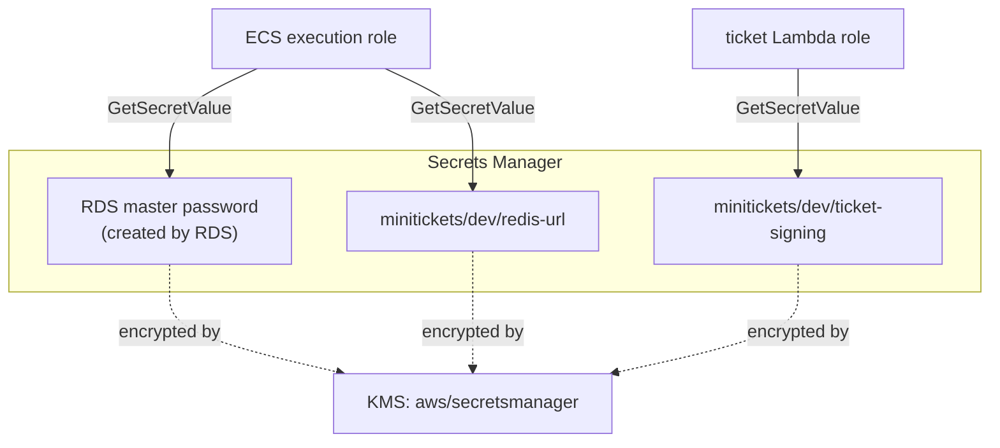
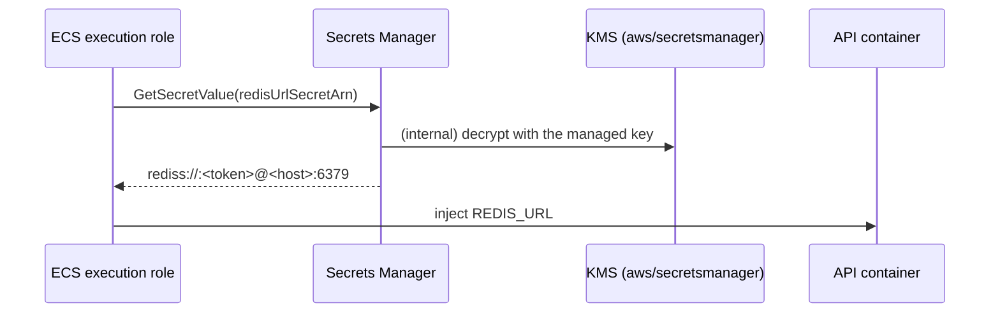
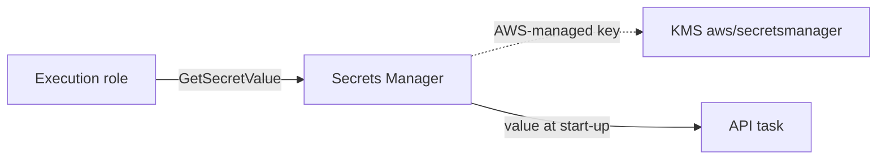

# 12. Secrets Manager and KMS: passwords and encryption keys

> **Honesty label: ✅ Built in repository** (`infra/src/data/secrets.ts`, `infra/src/tickets/storage.ts`)
> plus the RDS-managed secret. **⚙️ configured for deployment.**

**Prerequisites:** [04. IAM](04-iam.md), [10. RDS](10-rds-postgres.md), [11. ElastiCache](11-elasticache.md).

---

## A. The problem first

Our app needs secrets: the database password, the Redis URL (which contains its auth token), and the
ticket-signing key. Where do these live?

Bad options: in the code (leaks to everyone with the repo), in environment files baked into an image
(leaks to everyone with the image), in config files committed to version control (leaks forever). Any
of these means a single leak compromises the data.

The problem: **store secrets so that (1) they are never in code or images, (2) only approved callers
can read them, (3) every read is auditable, and (4) data at rest is encrypted.**

Where it shows up: `infra/src/data/secrets.ts` (the Redis URL), the RDS-managed password,
`infra/src/tickets/storage.ts` (the signing key), and IAM policies that read them.

---

## B. What it is

**Plain English:** **Secrets Manager** is a locked safe inside AWS. You put a value in; only callers
that IAM allows can read it back, and every read is logged. **KMS (Key Management Service)** is the key
locker that provides the **encryption keys** used to protect data — at rest in databases, buckets,
queues, and the secrets themselves.

### The terms

- **Secret** — a value (password, API key, connection string) stored and access-controlled by Secrets
  Manager.
- **Secret version** — the actual value of a secret; you can have multiple versions (for rotation).
- **Rotation** — replacing a secret's value on a schedule (RDS rotates the master password every 7 days
  by default).
- **Recovery window** — how long a deleted secret is retained before permanent deletion.
- **KMS (Key Management Service)** — the service that creates and controls encryption keys.
- **AWS-managed key** vs **customer-managed key (CMK)** — who owns the key and its policy. The
  AWS-managed key `aws/secretsmanager` encrypts secrets by default and needs **no** `kms:Decrypt`
  grant for anyone allowed to read the secret.
- **Envelope encryption** — encrypting data with a data key, and the data key with a KMS key. Why KMS
  can protect huge amounts of data without handling all of it directly.
- **Encryption at rest / in transit** — scrambled on disk vs scrambled on the wire (TLS).

---

## C. How it works internally

### The two safes in MiniTickets



- The **RDS master password** is created by RDS (`manageMasterUserPassword` in
  `data/postgres.ts`) — MiniTickets does **not** create a secret for it, because RDS already did.
- The **Redis URL** is created in `data/secrets.ts`.
- The **ticket-signing key** is created in `tickets/storage.ts` (a 32-byte random value, hex-encoded).

### Why "no `kms:Decrypt` needed"

A frequent question: "doesn't reading a secret require a KMS permission?" The answer here is **no**,
and the code explains why: both secrets use the **default AWS-managed key** (`aws/secretsmanager`),
which Secrets Manager decrypts for **any caller allowed to read the secret**. A **customer-managed**
KMS key would add key policies and a `kms:Decrypt` grant to every reader — a cost and a complexity the
dev setup does not need.

This is a precise, senior-level distinction: encryption is happening either way; the difference is
**who owns the key and what extra permission reading it requires**.

### Where the password is never seen

- The password is **never** in code, Pulumi config, or Pulumi state.
- MiniTickets only ever sees the secret's **ARN** (its address).
- Only the **ARN** leaves `postgres.ts` and `secrets.ts`.
- Only IAM-approved callers read the value, and every read is logged.

---

## D. Our MiniTickets implementation

### D1. The Redis URL — `infra/src/data/secrets.ts`

```ts
const secret = new aws.secretsmanager.Secret(`${prefix}-redis-url`, {
  name: "minitickets/dev/redis-url",
  description: "REDIS_URL for the minitickets api (rediss://:<token>@<host>:6379)",
  recoveryWindowInDays: 0,     // dev: delete at once when the layer is switched off
});
new aws.secretsmanager.SecretVersion(`${prefix}-redis-url-value`, {
  secretId: secret.id,
  secretString: pulumi.secret(
    pulumi.interpolate`rediss://:${inputs.authToken}@${inputs.redisEndpoint}:6379`,
  ),
});
return { redisUrlSecretArn: secret.arn };    // only the ARN leaves this file
```

Two details:

- **`recoveryWindowInDays: 0`** — delete at once when the layer is switched off. By default AWS keeps a
  deleted secret for 7–30 days **and blocks its name**, so switching the layer back on would fail with
  "secret is scheduled for deletion". Production keeps the default window so a deleted secret can be
  recovered. Another dev-vs-production trade-off, stated in the code.
- **`pulumi.secret(...)`** keeps the URL encrypted in Pulumi state and hidden in previews, because it
  contains the token.

### D2. The ticket-signing key — `infra/src/tickets/storage.ts`

```ts
const key = new random.RandomBytes(`${prefix}-ticket-signing-key`, { length: 32 });
const secret = new aws.secretsmanager.Secret(`${prefix}-ticket-signing`, {
  name: "minitickets/dev/ticket-signing", recoveryWindowInDays: 7,
});
new aws.secretsmanager.SecretVersion(`${prefix}-ticket-signing-value`, {
  secretId: secret.id, secretString: pulumi.secret(key.hex),
});
```

A 32-byte (256-bit) random key, hex-encoded, stored as a secret. The ticket worker reads it via
`GetSecretValue` and uses it to **HMAC-sign** issued tickets (`apps/worker/src/tickets/token.ts`). The
code notes a real operational point: **no automatic rotation in this phase**, because dropping a key
would invalidate already-issued HMACs — you would keep previous keys when adding rotation.

### D3. Encryption everywhere else

KMS/AWS-managed keys protect data at rest across the system without extra configuration: RDS
(`storageEncrypted`, [10](10-rds-postgres.md)), DynamoDB (`serverSideEncryption`,
[13](13-dynamodb.md)), S3 (SSE-S3, [14](14-s3.md)), SQS (SSE-SQS, [17](17-sqs.md)), and ElastiCache
(`atRestEncryptionEnabled`, [11](11-elasticache.md)).

### Trace: an API task starting



---

## E. Security and permissions

**REACH.** Secrets Manager is reached over HTTPS via its API. There is no VPC requirement for the
calls MiniTickets makes (the tasks reach AWS APIs through the internet gateway, [06](06-ecs-fargate.md)).

**ALLOWED.** IAM. The API **execution role** may `secretsmanager:GetSecretValue` on **exactly** the
DB master secret, the Redis URL secret, and (when entry is on) the revalidate secret — never `*`
([04](04-iam.md)). The ticket Lambda role may read **only** the ticket-signing secret.

**IDENTITY / CREDENTIALS.** Roles, never long-lived keys. The ECS agent reads secrets at start-up using
the execution role; the Lambda uses its role at run time.

**Encryption.** Secret values are encrypted with the AWS-managed `aws/secretsmanager` key, so reading
them needs no `kms:Decrypt`. A customer-managed key would add that requirement.

**Auditability.** `GetSecretValue` calls are logged, so unusual reads are visible.

---

## F. The AWS console walkthrough

> **Never reveal a secret value** in a shared screen. Read-only inspection is fine; revealing/rotating
> changes live state.

1. **Secrets Manager → Secrets.** You should see `minitickets/dev/redis-url` and
   `minitickets/dev/ticket-signing`, plus the RDS-managed secret.
2. Open the Redis URL secret. **Do not click "Retrieve secret value" on a shared screen.** Note the
   ARN and the rotation status.
3. Open the RDS master secret: confirm **rotation is enabled** (every 7 days, the RDS default).
4. **KMS → AWS managed keys.** Find `aws/secretsmanager` and `aws/rds` (and friends). Note that they
   are AWS-managed, which is why no explicit `kms:Decrypt` grant is needed for our readers.
5. **CloudTrail** can show who called `GetSecretValue` and when.

Mapping: `minitickets/dev/redis-url` → `data/secrets.ts`; `minitickets/dev/ticket-signing` →
`tickets/storage.ts`.

---

## G. Real production scenarios

### Scenario 1 — "AccessDenied reading a secret."

- **Cause:** the role's policy does not list that secret's ARN, or (with a CMK) the role lacks
  `kms:Decrypt`.
- **Investigate:** the error names the action. Compare the role policy and the secret's key.
- **Recover:** add the **minimum** grant — the specific secret ARN, and `kms:Decrypt` only if a CMK is
  used.

### Scenario 2 — "A secret was committed to the repository."

- **Cause:** someone hardcoded a value instead of using Secrets Manager.
- **Impact:** the value is in history forever; rotation is the only real fix.
- **Recover:** rotate the secret immediately, then move it into Secrets Manager and reference the ARN.
  Remember the ticket-signing lesson: rotating an HMAC key invalidates existing tickets unless you keep
  previous keys.

### Scenario 3 — "Rotation broke a running task."

- **Cause:** the app read the secret only at start-up; the value changed underneath it.
- **Recover:** restart the task (picks up the new value), or implement re-reading.
- **Lesson:** rotation is a *design* concern, not just a setting.

### Scenario 4 — "A deleted secret blocks re-creation."

- **Cause:** `recoveryWindowInDays` keeps the name reserved (the AWS default). In dev it is set to 0 to
  avoid exactly this.
- **Recover:** restore/force-delete the scheduled secret, or wait out the window.

### Scenario 5 — "We need to prove who read a secret."

- **Cause:** a security audit.
- **Investigate:** CloudTrail `GetSecretValue` events.

### Cost and performance

- Secrets Manager charges **per secret per month** plus per API call; the ticket-signing secret is a
  standing charge (~$0.40/month before calls, per the code). KMS charges per key (AWS-managed keys are
  free to the customer for this usage pattern) and per request.
- Reads at start-up are negligible; per-request secret reads would be wasteful (cache in the app).

---

## H. Decisions and alternatives

- **Secrets Manager over environment files / SSM Parameter Store.** Managed rotation, audit, and
  access control. Trade-off: a small monthly cost per secret.
- **AWS-managed key over customer-managed key.** No `kms:Decrypt` grants, no key policies, no monthly
  key fee. Trade-off: less control over key policy and rotation; a CMK is the choice when compliance
  demands it.
- **RDS-managed password** instead of storing it ourselves. Trade-off: the startup-only read
  limitation.
- **No automatic rotation for the signing key.** Because rotation would invalidate issued tickets
  unless old keys are kept. A deliberate, documented constraint.
- **Short recovery window in dev (0), default in production.** Cost and teardown convenience vs
  recoverability.
- **Alternatives:** SSM Parameter Store (SecureString) is cheaper but without native rotation; HashiCorp
  Vault (more power, more ops); environment variables from the orchestrator (no audit/rotation).

---

## I. Interview preparation

### 30-second answer

> "MiniTickets keeps secrets in Secrets Manager: the Redis URL, the ticket-signing key, and the
> RDS-managed database password. Only ARNs leave the infrastructure code; the ECS execution role reads
> the data secrets at start-up and the ticket Lambda role reads only the signing key. Values are
> encrypted with the AWS-managed `aws/secretsmanager` key, so readers need no `kms:Decrypt`. RDS rotates
> the master password every seven days, which is why the app reads it at startup only."

### Follow-up questions

- **Beginner:** Why not put a password in an environment file? *(→ it leaks with the image/repo.)*
- **Beginner:** What does Secrets Manager do? *(→ stores values, controls access, logs reads, can
  rotate.)*
- **Intermediate:** AWS-managed vs customer-managed KMS key? *(→ who owns the key/policy; a CMK adds
  `kms:Decrypt` to readers and a key fee.)*
- **Intermediate:** Why does MiniTickets not create a secret for the DB password? *(→ RDS already did,
  via `manageMasterUserPassword`.)*
- **Intermediate:** What does `recoveryWindowInDays: 0` do? *(→ delete at once so the layer can switch
  off and on without a name conflict.)*
- **Senior:** What breaks if you rotate the ticket-signing key naively? *(→ issued HMACs become invalid;
  keep previous keys.)*
- **Senior:** How do you rotate a database password without downtime? *(→ a dual-credential rotation,
  or a pooler that re-reads; the naive approach breaks running tasks.)*
- **Senior:** When would you choose a customer-managed KMS key? *(→ compliance, cross-account access,
  custom key policies, granular audit.)*

### Scenario questions

1. **"A secret leaked into git."** → rotate immediately; the value is in history forever.
2. **"AccessDenied reading a secret."** → policy ARN mismatch, or a CMK missing `kms:Decrypt`.
3. **"Rotation broke a task."** → startup-only read; restart or implement re-read.

---

## J. Quick revision

**Five things to remember**

1. Secrets live in **Secrets Manager**; only **ARNs** leave the infra code.
2. The **RDS password is RDS-managed** and rotates every **7 days**; the app reads it at **start-up**.
3. The **Redis URL** (`rediss://:<token>@<host>`) and the **ticket-signing key** are our secrets.
4. Values use the **AWS-managed** `aws/secretsmanager` key → readers need **no `kms:Decrypt`**.
5. **KMS** protects data at rest everywhere (RDS, DynamoDB, S3, SQS, ElastiCache).

**One diagram**



**Three common mistakes**

1. Hardcoding a secret (it leaks to everyone with the repo/image).
2. Assuming reading a secret always needs `kms:Decrypt` (only with a customer-managed key).
3. Rotating an HMAC signing key without keeping the old one.

**Where next:** [13. DynamoDB](13-dynamodb.md).
