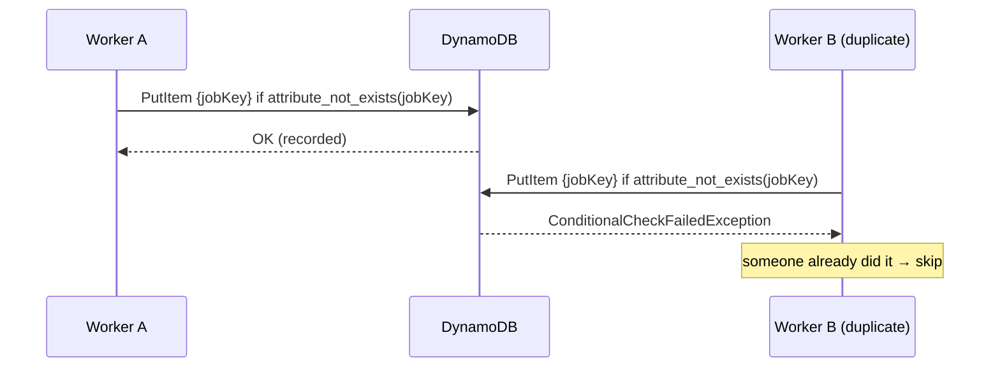
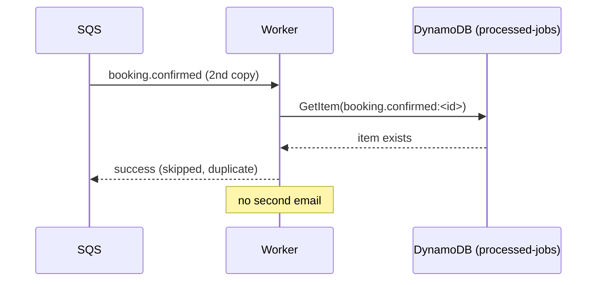
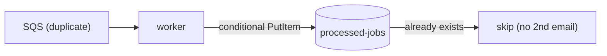

# 13. DynamoDB: idempotency and issued tickets

> **Honesty label: ✅ Built in repository** (`infra/src/jobs/processed-jobs-table.ts`,
> `infra/src/tickets/storage.ts`), **⚙️ configured for deployment**. The tables are "always on" (an
> idle on-demand table costs nothing but storage).

**Prerequisites:** [04. IAM](04-iam.md), [17. SQS](17-sqs.md) (for the idempotency use case),
[19. DLQ](19-dead-letter-queue.md).

---

## A. The problem first

MiniTickets needs two things a relational database is not the best fit for:

1. **"Have I already done this job?"** Queues deliver **at least once**, so a worker can receive the
   same message twice ([17](17-sqs.md)). Before sending an email, the worker must ask "is this booking
   already handled?" — a fast, simple lookup keyed by a business key. It also needs the record to
   **expire automatically** so the table does not grow forever.
2. **Issued tickets.** When a ticket is created, the system must store it under `(owner, booking seat)`
   such that two concurrent deliveries cannot create two tickets — a **conditional** reservation — and
   it must be queryable **by event date** for door check-in.

The problem: **a serverless key-value store with conditional writes, automatic expiry, and a secondary
index — without running a database server.**

Where it shows up: `infra/src/jobs/processed-jobs-table.ts` (idempotency), `infra/src/tickets/storage.ts`
(tickets), `apps/worker/src/processed-jobs.ts`, `apps/worker/src/tickets/store.ts`.

---

## B. What it is

**Plain English:** **DynamoDB** is a managed NoSQL key-value/table database. You define a **key**; you
put and get items by that key in single-digit milliseconds; AWS scales it for you. It supports
**conditional writes** ("only write if this is not already there") and **TTL** ("delete this
automatically later").

### The terms

- **Table / item / attribute** — like table/row/column, but items can have different attributes.
- **Partition key (hash key)** — the primary lookup key. Two items cannot share it.
- **Sort key (range key)** — optional second part of the primary key, allowing multiple items per
  partition key.
- **Global Secondary Index (GSI)** — an alternative key you can query by.
- **Conditional write** — a `ConditionExpression` that makes the write fail if the condition is not met
  (the basis of safe idempotency).
- **TTL (time to live)** — an attribute holding a Unix time; DynamoDB deletes the item **some time
  after** it (usually within a few days; AWS promises no exact second). **Deleting by TTL is free.**
- **Billing mode** — `PAY_PER_REQUEST` (on-demand, per read/write) or `PROVISIONED` (reserved capacity,
  billed hourly whether used or not).
- **Point-in-time recovery (PITR)** — continuous backups to a past point.
- **Encryption at rest** — **always on** in DynamoDB, with an AWS-owned key (free).

---

## C. How it works internally

### Conditional writes: the whole basis of idempotency



The condition `attribute_not_exists(jobKey)` means "only create this item if it is not there". The
first writer wins; the second gets a `ConditionalCheckFailedException`. That is exactly how MiniTickets
turns **at-least-once** delivery into **effectively once** processing
(`apps/worker/src/handlers/booking-confirmed.ts`, [19](19-dead-letter-queue.md)).

### TTL as a free cleanup

The worker writes `expiresAt` 30 days ahead. DynamoDB deletes the item **some time after** that time, at
no write cost. Why 30 days? Because a message can live in the source queue for 4 days and in the DLQ for
14 — 30 days is far longer, so **any duplicate delivery still finds the record**.

### Two different tables, two different keys

| Table | Key | Purpose |
| --- | --- | --- |
| `minitickets-dev-processed-jobs` | partition `jobKey` | "is this job done?" (idempotent consumer) |
| `minitickets-dev-tickets` | partition `userId`, sort `ticketId`; GSI `by-event-date` | issued tickets, queryable by event date |

---

## D. Our MiniTickets implementation

### D1. The processed-jobs table — `infra/src/jobs/processed-jobs-table.ts`

```ts
const table = new aws.dynamodb.Table(`${prefix}-processed-jobs`, {
  name: `${prefix}-processed-jobs`,
  billingMode: "PAY_PER_REQUEST",
  hashKey: "jobKey",
  attributes: [{ name: "jobKey", type: "S" }],
  ttl: { attributeName: "expiresAt", enabled: true },
  pointInTimeRecovery: { enabled: false },
  deletionProtectionEnabled: false,
  tags: tagsFor(`${prefix}-processed-jobs`),
});
```

The comments justify each choice:

- **Partition key `jobKey`** (string). "Every item is found by it, and two items can't share one; the
  worker's conditional put (`attribute_not_exists(jobKey)`) relies on that." DynamoDB has **no other
  fixed columns**: `doneAt` and `expiresAt` are just attributes.
- **`PAY_PER_REQUEST`** — no capacity to plan; pay per read/write (~$0.125/million reads and
  $0.625/million writes in `us-east-1` at the time of writing). **One email = 1 consistent read + 1
  write.** The alternative `PROVISIONED` bills reserved capacity hourly, used or not.
- **TTL `expiresAt`**, set 30 days ahead.
- **Encryption at rest** is always on with an AWS-owned key (free, nothing to set).
- **PITR off** — "a lost table only means a possible duplicate email; backups would cost money for data
  we can do without. Production would weigh that differently." Honest and correct.
- **Deletion protection off** in dev, so the stack can be removed in one go.

The store interface (`apps/worker/src/processed-jobs.ts`) exposes just two operations: `isDone(jobKey)`
(a `GetItem`) and `markDone(jobKey)` (a conditional `PutItem` returning `"recorded"` or
`"already-recorded"`). The handler knows only this interface, so tests pass a fake and only this file
knows about DynamoDB.

### D2. The tickets table — `infra/src/tickets/storage.ts`

```ts
const table = new aws.dynamodb.Table(`${prefix}-tickets`, {
  name: `${prefix}-tickets`,
  billingMode: "PAY_PER_REQUEST",
  hashKey: "userId", rangeKey: "ticketId",
  attributes: ["userId", "ticketId", "eventDate", "eventDateKey"].map(name => ({ name, type: "S" })),
  globalSecondaryIndexes: [{
    name: "by-event-date",
    keySchemas: [{ attributeName: "eventDate", keyType: "HASH" },
                 { attributeName: "eventDateKey", keyType: "RANGE" }],
    projectionType: "ALL",
  }],
  serverSideEncryption: { enabled: true },
});
```

Design points:

- **Key `(userId, ticketId)`** — tickets belong to a user, identified by a ticket id.
- **GSI `by-event-date`** — so the system can query tickets by event date (useful for door check-in),
  without scanning.
- **`serverSideEncryption: { enabled: true }`** — explicitly on.
- **Persistent across compute/data off/on** — the comment explains why: **issued tickets and their
  signing key must agree**, so this data is kept even when other layers are switched off.

The ticket store (`apps/worker/src/tickets/store.ts`) uses **conditional writes** for exactly the
reasons above: `reserve` writes one conditional reservation per `(owner, booking seat)`; concurrent
deliveries may race, and the loser **strongly reads the winner's canonical token** instead of making a
second one. That is idempotency applied to ticket issuance.

### Trace: a duplicate booking message



---

## E. Security and permissions

**REACH.** DynamoDB is reached over HTTPS via its API. The worker Lambda runs **outside the VPC**
([02](02-vpc-and-networking.md)), so it reaches DynamoDB directly with no VPC endpoint or NAT.

**ALLOWED.**
- Worker role: **`dynamodb:GetItem` and `dynamodb:PutItem`** on **one** table — no `Scan`, `Query` or
  `Delete` (TTL deletes, for free) ([04](04-iam.md)).
- Ticket Lambda role: `GetItem`, `PutItem`, `UpdateItem` on the one tickets table
  (`infra/src/tickets/iam.ts`).
- API task role: `dynamodb:Query` on the tickets table (read-only).

**IDENTITY / CREDENTIALS.** Roles, temporary credentials.

**Encryption.** Always on at rest (AWS-owned key / explicit SSE). In transit: HTTPS.

---

## F. The AWS console walkthrough

> Read-only. Do not delete items or the table.

1. **DynamoDB → Tables.** You should see `minitickets-dev-processed-jobs` and `minitickets-dev-tickets`.
2. Open `processed-jobs` → **Additional settings** → confirm **TTL on `expiresAt` is on**, and that
   point-in-time recovery is off.
3. **Explore items**: filter by a `jobKey` like `booking.confirmed:<id>`; the item shows `doneAt` and
   `expiresAt`.
4. Open `tickets` → **Indexes** → confirm the `by-event-date` GSI. **Explore items** to see the key
   `(userId, ticketId)`.
5. **Monitor** shows read/write capacity and throttles (on-demand scales automatically, but the
   `ConsumedWriteCapacityUnits` metric is still worth watching).

Mapping: both tables are `infra/src/jobs/processed-jobs-table.ts` and `infra/src/tickets/storage.ts`.

---

## G. Real production scenarios

### Scenario 1 — "A customer got two emails."

- **Cause:** the idempotency record was missing (e.g. the table was recreated empty) or the key used the
  message id instead of the **business** key. The handler deliberately keys by the **booking**, so a
  duplicate message with a different `messageId` is still recognised.
- **Investigate:** the `processed-jobs` item for the booking, and the handler's `jobKey` construction
  (`booking.confirmed:<bookingId>`).
- **Recover:** the design already prevents it; check table existence and permissions.

### Scenario 2 — "Table missing after a fresh local setup."

- **Cause:** DynamoDB Local starts empty; `apps/worker`'s error mapping literally says "processed-jobs
  table not found (locally: run `pnpm jobs:table`)".
- **Recover:** create the local table.

### Scenario 3 — "Conditional write failures under concurrency."

- **This is expected and correct.** Two workers holding two copies both see "not done"; the conditional
  put lets only one record. The other just finds it already recorded. For emails, the design accepts a
  rare duplicate in the crash/race window and explains the honest reasoning in
  `handlers/booking-confirmed.ts`.

### Scenario 4 — "TTL did not delete the item exactly on time."

- **Cause:** TTL deletion is not exact; AWS deletes "usually within a few days". This is documented
  behaviour, not a bug. It is also why the design uses a 30-day window far longer than any queue
  lifetime.

### Scenario 5 — "Hot partition."

- **Cause:** an on-demand table is fine at MiniTickets' scale, but a single partition key with extreme
  volume can throttle. Consider a composite/sharded key if it ever became a problem.

### Cost and performance

- On-demand: pay per read/write. **A lost table only risks a duplicate email** — which is why PITR is
  off in dev.
- Single-digit-millisecond latency; TTL deletion is **free**.
- Encryption at rest is included.

---

## H. Decisions and alternatives

- **DynamoDB over a Postgres table for idempotency.** No server, conditional writes, free TTL deletion,
  and no impact on the main database. Trade-off: a second data store to operate and secure.
- **On-demand billing.** No capacity planning. Trade-off: higher per-unit cost than provisioned at very
  high, steady volume.
- **Business key, not message id.** Survives duplicate envelopes from the outbox relay
  ([15](15-transactional-outbox.md)).
- **PITR off in dev.** The data is disposable; production would weigh it differently.
- **GSI `by-event-date`.** Enables date queries without scans.
- **Alternatives:** a Postgres table with a unique constraint (works, but couples background work to the
  main DB); Redis for idempotency (fast, but ephemeral — a restart could re-send); SQS FIFO with
  deduplication (different model, throughput limits).

---

## I. Interview preparation

### 30-second answer

> "DynamoDB is a managed key-value store. MiniTickets uses it two ways: a `processed-jobs` table keyed by
> a business `jobKey`, where a conditional put (`attribute_not_exists`) plus a 30-day TTL implements an
> idempotent consumer, and a `tickets` table keyed by `(userId, ticketId)` with a `by-event-date` GSI
> for issued tickets. Both are on-demand, encrypted at rest, and accessed by narrow IAM policies; the
> worker can only GetItem and PutItem on its one table."

### Follow-up questions

- **Beginner:** What is a partition key? *(→ the primary lookup key; unique per item.)*
- **Beginner:** What is TTL? *(→ automatic, free deletion some time after a Unix time.)*
- **Intermediate:** How does a conditional write enable idempotency? *(→ the second writer's condition
  fails, so it skips.)*
- **Intermediate:** Why is the job key the booking, not the message id? *(→ duplicate envelopes with
  different ids still map to one job.)*
- **Intermediate:** Why 30-day TTL? *(→ longer than the queue (4 days) and DLQ (14 days), so duplicates
  are always caught.)*
- **Senior:** On-demand vs provisioned billing? *(→ pay-per-request with no planning vs reserved
  capacity billed hourly; on-demand wins at spiky/low volume.)*
- **Senior:** Why is PITR off here, and when would you turn it on? *(→ lost data only risks a duplicate
  email; turn it on when the data is not reconstructible.)*
- **Senior:** When is DynamoDB the wrong choice? *(→ relational queries, multi-item transactions,
  ad-hoc analytical queries.)*

### Scenario questions

1. **"Duplicate emails."** → check the idempotency table and the business key.
2. **"Local worker fails: table not found."** → create the local table (`pnpm jobs:table`).
3. **"TTL did not fire exactly."** → expected; deletion is eventual and free.

---

## J. Quick revision

**Five things to remember**

1. DynamoDB = managed **key-value** store with **conditional writes** and **TTL**.
2. `processed-jobs` (key `jobKey`) implements the **idempotent consumer**; TTL 30 days, on-demand.
3. `tickets` (key `userId`/`ticketId`, GSI `by-event-date`) stores **issued tickets**.
4. A **conditional put** is what makes at-least-once delivery **effectively once**.
5. IAM is narrow: GetItem/PutItem on one table, no Scan/Query/Delete for the worker.

**One diagram**



**Three common mistakes**

1. Keying idempotency by the message id instead of the business key.
2. Expecting TTL deletion to be exact-to-the-second.
3. Leaving the worker role with broad DynamoDB permissions.

**Where next:** [14. S3](14-s3.md).
