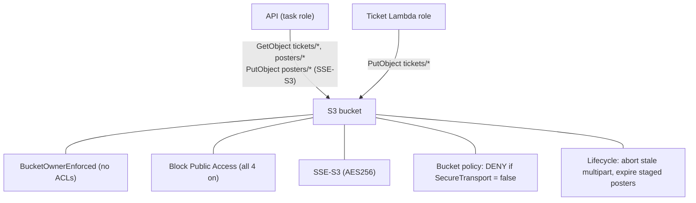
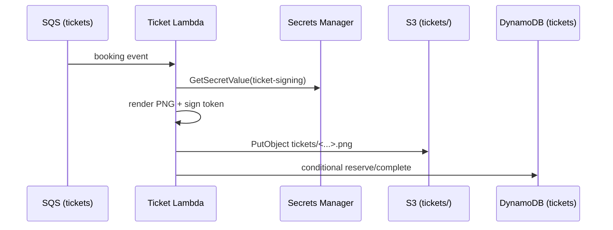
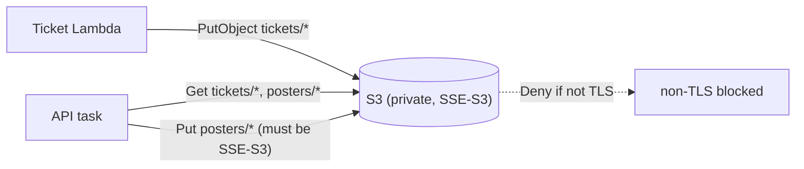

# 14. S3: storing ticket objects and posters

History: see [CHANGELOG.md](../CHANGELOG.md) or run `pnpm docs:history`

> **Honesty label: ✅ Built in repository** (`infra/src/tickets/storage.ts`), **⚙️ configured for
> deployment**. The bucket is "always on" (persistent across the compute/data switches).

**Prerequisites:** [04. IAM](04-iam.md), [12. Secrets/KMS](12-secrets-kms.md).

---

## A. The problem first

Tickets are rendered as **PNG images** (with QR codes), and event posters are images too. Images are
binary blobs — not a natural fit for a relational table or a key-value item. They need:

- **Effectively unlimited, durable storage.**
- **Private** access only (a ticket is personal; a poster may be public-facing via the app, but the
  bucket should not be world-readable).
- **Encryption at rest** without managing keys.
- **TLS-only** access.
- **Cleanup** of abandoned uploads so storage cost does not creep.

The problem: **cheap, durable, private blob storage with encryption, TLS enforcement, and lifecycle
cleanup — without running a file server.**

Where it shows up: `infra/src/tickets/storage.ts` and the ticket worker's asset code.

---

## B. What it is

**Plain English:** **S3 (Simple Storage Service)** is unlimited file storage on the internet. You make a
**bucket** and store **objects** under **keys**.

### The terms

- **Bucket** — a container for objects; names are globally unique. MiniTickets names it
  `minitickets-dev-ticket-assets-<account>`.
- **Object / key / prefix** — S3 has a **flat namespace**; "folders" are just key **prefixes** like
  `tickets/` or `posters/`.
- **Object Ownership (`BucketOwnerEnforced`)** — disables ACLs, so the bucket owner owns every object.
  Simpler and safer.
- **Block Public Access** — four switches that block any public access path.
- **SSE-S3 / SSE-KMS** — server-side encryption with an S3-managed key (AES256) vs a KMS key. SSE-S3
  avoids a paid KMS key and decryption grants.
- **Bucket policy** — a resource-based policy on the bucket; here used to **deny** any non-TLS request.
- **Lifecycle rule** — automatically transitions, expires, or aborts objects (e.g. abandoned multipart
  uploads).
- **Multipart upload** — splitting a large upload into parts; a cancelled one leaves parts that cost
  storage until aborted.
- **`forceDestroy`** — whether a bucket can be deleted while it still contains objects (dangerous in
  production).

---

## C. How it works internally

### The bucket's five guards



Each guard solves a specific risk:

- **`BucketOwnerEnforced`** removes the legacy ACL system entirely, so there is no confusing
  per-object permission model.
- **Block Public Access (all four on)** is a hard stop against accidental public exposure — the single
  most common S3 mistake.
- **SSE-S3 (AES256)** encrypts everything at rest with **no paid KMS key and no decryption grants**.
- **The bucket policy denies `s3:*` when `aws:SecureTransport` is false** — a belt-and-braces TLS-only
  rule enforced by S3 itself, not just by the client.
- **Lifecycle rules** bound storage cost from abandoned uploads.

### Why a `DENY` policy is stronger than "just use TLS"

A common mistake is to assume "we configure the SDK to use TLS, so we are fine." A bucket policy that
**denies** the action when `aws:SecureTransport` is false means S3 itself refuses any plaintext request,
even if a misconfigured client tried one. Explicit `Deny` always wins in policy evaluation — this is
policy-as-enforcement, not policy-as-suggestion.

---

## D. Our MiniTickets implementation

`createTicketStorage()` in `infra/src/tickets/storage.ts`:

1. **The bucket**

   ```ts
   const bucket = new aws.s3.Bucket(`${prefix}-ticket-assets`, {
     bucket: pulumi.interpolate`${prefix}-ticket-assets-${account}`,
     forceDestroy: false,
     tags: tagsFor(`${prefix}-ticket-assets`),
   });
   ```

   `forceDestroy: false` means the bucket cannot be wiped by a destroy while it holds objects — safe.

2. **Ownership controls** — `objectOwnership: "BucketOwnerEnforced"`.
3. **Public access block** — all four flags true.
4. **Server-side encryption** — `AES256` (SSE-S3).
5. **Bucket policy** — a `Deny` of `s3:*` on the bucket and its objects when
   `aws:SecureTransport: "false"`.
6. **Lifecycle configuration** with two rules:
   - `abort-incomplete-ticket-uploads` — prefix `tickets/`, abort incomplete multipart uploads after
     **1 day** (bound abandoned storage **without** expiring a ticket before a far-future event).
   - `expire-staged-posters` — prefix `poster-uploads/`, expire after **1 day** and abort incomplete
     multipart uploads (rejected/abandoned uploads never become posters; bound their cost).

Note the deliberate asymmetry: the ticket assets are **not** age-expired (a ticket for a far-future
event must survive), but **staged poster uploads** are expired after a day. Business retention for
tickets is explicitly deferred in the code comment.

7. **The ticket-signing key** is also created here (a 32-byte random secret in Secrets Manager,
   [12](12-secrets-kms.md)) — because issued tickets and their signing key must agree.

### Prefixes and IAM (least privilege for objects)

| Prefix | Written by | Read by |
| --- | --- | --- |
| `tickets/` | ticket Lambda role (`s3:PutObject`) | API task role (`s3:GetObject`) |
| `posters/` | API task role (`PutObject`, **requires SSE-S3**) | API task role (`GetObject`) |
| `poster-uploads/` | API task role (`PutObject`, requires SSE-S3) | API task role (`GetObject`) |

The API's poster-write permission carries a **condition**:

```json
Condition: { StringEquals: { "s3:x-amz-server-side-encryption": "AES256" } }
```

The code comment: "no ticket writes, Scan, signing-secret read or bucket listing". The API can write
posters **only if** the upload declares SSE-S3 encryption — an IAM policy that enforces an encryption
requirement on every write.

### Trace: rendering a ticket



---

## E. Security and permissions

**REACH.** S3 is reached over HTTPS via its API. Lambda is outside the VPC ([02](02-vpc-and-networking.md)),
so no VPC endpoint is required.

**ALLOWED.**
- Public access is **blocked at the bucket** (all four switches) and **denied over plaintext** by the
  bucket policy.
- The **worker** role may `PutObject` only on `tickets/*`.
- The **API** task role may `GetObject` on `tickets/*` and the poster prefixes, and `PutObject` on the
  poster prefixes **with the SSE-S3 condition**.
- `BucketOwnerEnforced` removes ACLs entirely.

**IDENTITY / CREDENTIALS.** Roles, temporary credentials ([04](04-iam.md)).

**Encryption.** SSE-S3 (AES256) at rest — no paid KMS key, no `kms:Decrypt`. TLS enforced in transit by
the `Deny` policy.

---

## F. The AWS console walkthrough

> Read-only. Do not make a bucket public, and do not delete objects.

1. **S3 → Buckets.** Find `minitickets-dev-ticket-assets-<account>`.
2. **Permissions tab:** confirm **Block all public access** is on, and read the **bucket policy**
   (the `Deny` for non-TLS).
3. **Properties tab:** confirm **default encryption** is SSE-S3 (AES256) and **Object Ownership** is
   `BucketOwnerEnforced`.
4. **Management tab:** confirm the two lifecycle rules.
5. **Objects:** browse the `tickets/`, `posters/` and `poster-uploads/` prefixes.
6. **CloudWatch/S3 metrics:** storage and request counts.

Mapping: every setting is `infra/src/tickets/storage.ts`.

---

## G. Real production scenarios

### Scenario 1 — "The bucket became public."

- **Cause:** someone disabled Block Public Access to "share a poster".
- **Impact:** any object becomes world-readable — including personal tickets.
- **Investigate:** the public access block and the bucket policy.
- **Recover:** re-enable all four switches; serve public content through the app instead of making the
  bucket public.

### Scenario 2 — "Plaintext request rejected."

- **Cause:** a client used HTTP. The `Deny` policy refuses it.
- **Investigate:** the error mentions `aws:SecureTransport`.
- **Recover:** fix the client to use HTTPS (the correct behaviour).

### Scenario 3 — "Storage cost crept up."

- **Cause:** abandoned multipart uploads or rejected poster uploads.
- **Investigate:** the lifecycle rules and incomplete-multipart metrics.
- **Recover:** the lifecycle rules already bound it (1 day); tune if needed.

### Scenario 4 — "A ticket for a far-future event disappeared."

- **Cause:** an over-eager lifecycle rule.expired `tickets/`.
- **Investigate:** the lifecycle configuration. MiniTickets deliberately does **not** age-expire ticket
  assets for this reason; only the *incomplete multipart* parts are aborted.

### Scenario 5 — "An upload wrote without encryption."

- **Cause:** a client bypassed the SSE requirement.
- **Impact:** the IAM condition on the API's `PutObject` would refuse it; SSE-S3 default encryption
  covers anything else.

### Cost and performance

- Billed per GB stored, per request, and per GB transferred out. Lifecycle rules bound cost.
- SSE-S3 is free; SSE-KMS would add per-request KMS cost.
- Serving images from S3 through the app (rather than a public bucket) keeps them private.

---

## H. Decisions and alternatives

- **SSE-S3 over SSE-KMS.** No paid key, no decryption grants; sufficient for this data. The alternative
  (SSE-KMS) gives a customer-managed key and granular audit at extra cost/complexity.
- **`BucketOwnerEnforced` (no ACLs).** Simpler model; ACLs are legacy.
- **Block Public Access, all four.** Hard protection against the most common S3 incident.
- **TLS-only via a `Deny` policy.** Server-side enforcement, not client-side hope.
- **Lifecycle: abort multipart, expire staged posters, but do not age-expire tickets.** Correct
  retention per data type.
- **`forceDestroy: false`.** Protects data from an accidental destroy.
- **Alternatives:** storing images in the database (bad for size/backup), pushing to CloudFront for
  public posters, or a different object store. For MiniTickets' scale, S3 is the obvious right tool.

---

## I. Interview preparation

### 30-second answer

> "S3 is object storage. MiniTickets has a private bucket for ticket PNGs and posters, with object
> ownership enforced (no ACLs), Block Public Access fully on, SSE-S3 encryption, and a bucket policy
> that denies any non-TLS request. Lifecycle rules abort incomplete multipart uploads and expire staged
> poster uploads after a day, but tickets are not age-expired because a far-future event ticket must
> survive. IAM is per-prefix: the worker writes only `tickets/`, and the API can write posters only when
> the upload declares SSE-S3."

### Follow-up questions

- **Beginner:** What are buckets, objects and keys? *(→ container, item, path; S3 is flat.)*
- **Beginner:** Why not make the bucket public? *(→ tickets are personal; use the app to serve content.)*
- **Intermediate:** How do you enforce TLS on a bucket? *(→ a bucket policy `Deny` when
  `aws:SecureTransport` is false.)*
- **Intermediate:** SSE-S3 vs SSE-KMS? *(→ S3-managed AES256 key vs KMS key; KMS adds cost and
  `kms:Decrypt`.)*
- **Intermediate:** Why abort incomplete multipart uploads? *(→ they consume storage but are not usable.)*
- **Senior:** Why not age-expire ticket objects? *(→ a ticket for a far-future event must survive;
  only staged uploads and multipart parts are cleaned.)*
- **Senior:** How does an IAM condition enforce encryption? *(→ `s3:x-amz-server-side-encryption`
  required to equal AES256 on `PutObject`.)*
- **Senior:** `forceDestroy` in dev vs prod? *(→ dev convenience vs protection against accidental data
  loss.)*

### Scenario questions

1. **"The bucket was made public."** → re-enable Block Public Access; serve via the app.
2. **"A plaintext upload failed."** → the `Deny` policy; use HTTPS.
3. **"Storage creep."** → incomplete multipart uploads; lifecycle bounds them.

---

## J. Quick revision

**Five things to remember**

1. S3 = **object storage**; flat namespace with key **prefixes** (`tickets/`, `posters/`,
   `poster-uploads/`).
2. **Block Public Access** (all four), **BucketOwnerEnforced** (no ACLs), **SSE-S3** encryption.
3. A bucket policy **denies non-TLS** requests — server-side enforcement.
4. **Lifecycle** aborts incomplete multipart uploads and expires staged posters after a day; **tickets
   are not age-expired**.
5. IAM is per-prefix; poster writes **require SSE-S3** by policy condition.

**One diagram**



**Three common mistakes**

1. Making the bucket public to serve an image.
2. Assuming client-side TLS config is enough (the bucket policy is the real enforcement).
3. Age-expiring ticket objects that must survive to a far-future event.

**Where next:** Part 4 begins with [15. The transactional outbox](15-transactional-outbox.md).
