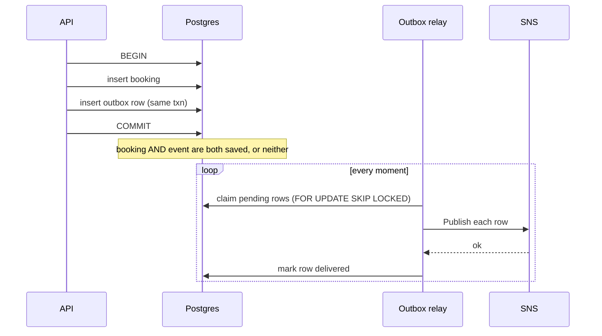
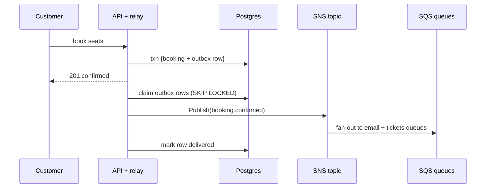
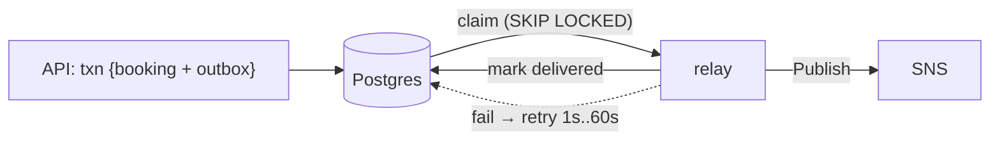

# 15. The transactional outbox: reliable publishing after a commit

History: see [CHANGELOG.md](../CHANGELOG.md) or run `pnpm docs:history`

> **Honesty label: ✅ Built in repository** (`apps/api/src/services/outbox.ts`,
> `apps/api/src/queries/outbox.ts`, `apps/api/src/queues/jobs.ts`), **⚙️ configured for deployment**
> (the relay runs inside the API container; publishing requires the SNS topic and the `send-jobs` task
> policy).

**Prerequisites:** [10. RDS/Postgres](10-rds-postgres.md), [16. SNS](16-sns.md) (read together),
[04. IAM](04-iam.md).

---

## A. The problem first

When a booking is confirmed, two things must happen:

1. **Commit the booking** to Postgres. (Both customer and money are involved; this must happen.)
2. **Emit an event** so the email and ticket get produced later.

Here is the trap. Suppose you commit the booking, then publish to SNS, and the publish fails (network
blip, SNS throttle, or the process crashes between the two steps). Now the booking exists but the event
never went out: **the customer has a booking and no email, forever, and nothing will ever notice.**

Reverse the order (publish first, then commit) and you get the opposite disaster: a publish that
succeeds and a commit that rolls back means we send a confirmation email for a booking that does not
exist.

So the two operations — a database write and a message publish — must be **atomic together**, but they
live in **two different systems**, and there is no distributed transaction. This is a classic problem
with a well-known name: **the dual-write problem**.

Where it shows up: `apps/api/src/services/outbox.ts` and the booking transaction in
`apps/api/src/queries/bookings.ts`.

---

## B. What it is

**Plain English:** the **transactional outbox** moves the event *into the database* in the same
transaction as the booking. A separate, simple relay then reads those saved events and publishes them
*afterwards*. If the publish fails, the event is still sitting safely in the database, and the relay
just tries again.

### The terms

- **Dual-write problem** — trying to update two systems atomically without a shared transaction.
- **Outbox table** — a table holding the events we intend to publish, written in the same transaction as
  the business change.
- **Relay (publisher)** — the process that reads pending outbox rows and publishes them.
- **At-least-once publish** — the relay guarantees "published at least once," never "exactly once".
- **Idempotent consumer** — the receiver must tolerate duplicates ([13](13-dynamodb.md)).
- **`FOR UPDATE SKIP LOCKED`** — a Postgres clause that lets several relays claim different rows
  without blocking each other.
- **Backoff** — waiting longer after each failure (here 1 s → 60 s).

---

## C. How it works internally

### The two-phase trick



The key insight: **the atomic step is now a single database transaction.** Postgres guarantees the
booking and its event are committed together or not at all. The publish, which cannot be part of that
transaction, is moved to a **separate, retryable step** that reads from the committed state.

### Why "at least once" is the right guarantee here

The relay may publish a row and then fail to mark it delivered (crash in between). On the next pass it
publishes it again. So the pipeline is **at-least-once**, and the **consumer** must be idempotent. That
is exactly why the worker has the `processed-jobs` table ([13](13-dynamodb.md),
[19](19-dead-letter-queue.md)). The two patterns fit together: **outbox guarantees the event is never
lost; idempotency guarantees a duplicate is harmless.**

### Why the relay retries forever (and the worker does not)

This is a deliberately different philosophy from the DLQ chapter, and the reason is the data:

- A committed booking confirmation **must never be dropped**. There is no human who could "repair" a
  missing event, because the event is the evidence of a real commitment.
- The relay controls its **own pacing** (unlike a queue that pushes to a consumer), so an infinite retry
  with backoff is safe and bounded in cost.

So the outbox retries **forever**; the worker's queue uses a **bounded** budget and a DLQ for the cases
where a human really can help (e.g. a permanently invalid email address). Explaining that contrast is a
senior-level answer.

---

## D. Our MiniTickets implementation

### D1. The relay loop — `apps/api/src/services/outbox.ts`

Three functions and a set of deliberate behaviours:

```ts
// 1. Retry forever, from 1 second to 60 seconds.
//    The cap also bounds exponential arithmetic for a row that has failed for a long time.
export function retryInMs(attempts: number): number {
  return Math.min(60_000, 1000 * 2 ** Math.min(attempts, 6));
}

export async function relayOnce(log: Log): Promise<number> {
  // 2. Missing queue configuration pauses delivery, never discards a committed confirmation.
  if (!jobs.jobsEnabled) return 0;
  return outbox.deliverBatch(async (row) => {
    ...
  });
}
```

Behaviours to notice, straight from the comments:

- **`retryInMs`** goes 1 s, 2 s, 4 s, … capped at 60 s. The `min(attempts, 6)` **bounds the exponent** so
  a row failing for days does not compute `2**10000` and overflow. A small, real bug avoided.
- **`jobsEnabled` gate** — if the queue is not configured, the relay **pauses** rather than discarding.
  Nothing is lost; it simply stops delivering until configuration returns.
- **Treats stored JSON as untrusted input** — the relay re-validates the payload (the message came from
  the database, but it is still parsed as input).
- **Keeps both the original `messageId` and the `correlationId`** so logs can be tied together across
  systems.

### D2. The claiming query — `apps/api/src/queries/outbox.ts`

`deliverBatch` claims up to **10** pending rows per pass using `FOR UPDATE SKIP LOCKED`:

- **`FOR UPDATE`** locks the claimed rows so no other relay instance publishes them at the same time.
- **`SKIP LOCKED`** means a second relay instance (or a second API task) **skips** those rows and takes
  the next ones instead of blocking. This is what lets the relay run safely in more than one place.
- On success, the row is marked delivered; on failure, it is left pending with its `attempts` incremented
  and `nextAttemptAt` set to `now + retryInMs(attempts)`.

So the retry state lives **in the database**, not in memory: a restart does not lose a due time.

### D3. The publisher — `apps/api/src/queues/jobs.ts`

The relay publishes through `@aws-sdk/client-sns` and, notably, configures the SDK with **`maxAttempts: 1`**.
Why disable the SDK's own retries? Because **the relay owns retries** via the outbox row's `attempts` and
`nextAttemptAt`. Letting the SDK also retry would create two competing retry mechanisms and confusing
duplicate semantics. One owner for retry, decided in the code.

When `jobsEnabled` is false (no topic ARN), the same module falls back so local development works
without AWS.

### Trace: booking → event → queue



---

## E. Security and permissions

**REACH.** The relay runs inside the API container and reaches Postgres (private subnet, `db` security
group) and SNS (public AWS API, reached through the internet gateway because there is no NAT,
[06](06-ecs-fargate.md)).

**ALLOWED.** The API **task role** has a `send-jobs` policy allowing `sns:Publish` on **one** topic
only ([04](04-iam.md)). It can also read/write the outbox table (through its database connection, not
IAM).

**IDENTITY / CREDENTIALS.** The API container runs under the task role; no long-lived keys.

**Encryption.** The outbox rows live in the encrypted RDS database ([10](10-rds-postgres.md)); the SNS
publish is over HTTPS. The event payload contains personal data (an email address), which is why the
worker's error logging never prints the body ([19](19-dead-letter-queue.md)).

---

## F. The AWS console walkthrough

> The outbox table itself is a **Postgres** table — you inspect it with SQL, not the AWS console. The
> Amazon side is SNS.

1. **CloudWatch → Logs → the api log group → Logs Insights**: run the saved
   `minitickets-dev/follow-one-request` query with a `correlationId` to watch a booking's relay lines.
2. **SNS → Topics → `minitickets-dev-booking-events`** ([16](16-sns.md)): confirm its subscriptions
   point at the two queues.
3. **SNS → Topics → the topic → Monitoring**: `NumberOfMessagesPublished` shows the relay working.
4. In the database (via a session), a query like
   `SELECT id, attempts, delivered_at, next_attempt_at FROM outbox WHERE delivered_at IS NULL`
   shows anything still pending and how many times it has failed.

Mapping: `relayOnce`/`retryInMs` → `services/outbox.ts`; `deliverBatch` → `queries/outbox.ts`; publish →
`queues/jobs.ts`.

---

## G. Real production scenarios

### Scenario 1 — "A booking was confirmed but no email ever came."

- **Cause candidates:** the outbox row is still pending (SNS was unreachable for a long time); the API
  process died before the relay ran and never restarted; `jobsEnabled` is false; the SNS publish was
  denied by IAM.
- **Investigate:** look for pending outbox rows (`delivered_at IS NULL`); check the API logs for relay
  errors; check `NumberOfMessagesPublished` on the topic.
- **Recover:** the relay will publish once it can; if the cause was IAM, fix the policy. **Nothing is
  lost**, because the row is durable.

### Scenario 2 — "The same event was published twice."

- **Cause:** the relay published and then crashed before marking the row delivered — **expected**
  under at-least-once.
- **Impact:** two queue messages. Harmless *because* the worker is idempotent
  ([13](13-dynamodb.md)). This is the pattern working exactly as designed.

### Scenario 3 — "The relay is falling behind."

- **Cause:** SNS throttling or slow publishes; the batch of 10 cannot keep up.
- **Investigate:** pending-row count and the relay's throughput in logs.
- **Recover:** the backoff protects the system, but you would raise capacity (more API tasks) and check
  SNS quotas. `SKIP LOCKED` means more tasks can share the load safely.

### Scenario 4 — "The outbox table grew huge."

- **Cause:** delivered rows are never cleaned up.
- **Investigate:** table size and the age of delivered rows.
- **Recover:** prune delivered rows on a schedule. (Not built here — a real operational task for a
  long-lived system. 💡 Conceptual.)

### Cost and performance

- No extra AWS cost: the outbox lives in the existing database; SNS is request-billed.
- The cost is a small extra DB transaction per booking and a polling loop, negligible at MiniTickets'
  scale.
- `SKIP LOCKED` avoids lock contention as relays scale.

---

## H. Decisions and alternatives

- **Transactional outbox over dual-write.** Correctness: the event cannot be lost. This is the central
  reason.
- **Polling relay in the API vs a separate worker.** Co-locating the relay in the API is simpler (no
  new service); production might move it to its own worker so a slow relay does not compete with
  request handling.
- **Infinite retry with backoff (1 s → 60 s), not the DLQ's bounded budget.** Because a committed
  confirmation must never be dropped and the relay self-paces. **This is the deliberate contrast with
  [19](19-dead-letter-queue.md).**
- **`FOR UPDATE SKIP LOCKED`, batch of 10.** Safe concurrent claiming without blocking; tunable.
- **SDK `maxAttempts: 1`.** One visible retry owner (the outbox), not two.
- **Alternatives:**
  - **Change Data Capture (CDC)** — e.g. Debezium or DynamoDB Streams — publishing from the database log.
    More machinery.
  - **DynamoDB Streams** if the write were in DynamoDB. Not our case.
  - **Publish-then-commit with a reconciliation job.** Worse: requires guessing what was lost.
  - **A true two-phase commit (XA/2PC)** across Postgres and SNS. SNS does not participate; not real here.

---

## I. Interview preparation

### 30-second answer

> "The transactional outbox solves the dual-write problem: the API writes the booking and an outbox row
> in the same Postgres transaction, so either both or neither are saved. A relay then claims pending
> rows with `FOR UPDATE SKIP LOCKED`, publishes them to SNS, and marks them delivered. If publishing
> fails it retries forever with exponential backoff from one to sixty seconds, because a committed
> confirmation must never be lost. Delivery is at-least-once, so the consumer is idempotent."

### Follow-up questions

- **Beginner:** What is the dual-write problem? *(→ updating two systems atomically without a shared
  transaction.)*
- **Beginner:** Where does the event go first? *(→ into the database, with the booking.)*
- **Intermediate:** Why is the relay's guarantee "at least once," not "exactly once"? *(→ it can
  publish then crash before marking delivered.)*
- **Intermediate:** How does the relay avoid two instances publishing the same row? *(→
  `FOR UPDATE SKIP LOCKED`.)*
- **Intermediate:** Why disable the SDK's own retries (`maxAttempts: 1`)? *(→ one retry owner: the
  outbox.)*
- **Senior:** Why does the outbox retry forever while the worker DLQs? *(→ a committed confirmation is
  irreplaceable and relay-paced; a stuck email has a human-repairable failure and a real deadline.)*
- **Senior:** How do you keep the outbox table from growing forever? *(→ prune delivered rows; not yet
  built.)*
- **Senior:** Compare this to CDC. *(→ CDC reads the DB log; the outbox is application-level and does
  not need a connector, at the cost of an extra table and relay.)*

### Scenario questions

1. **"Booking confirmed, no email."** → pending outbox row / relay failure / IAM / `jobsEnabled`.
2. **"Duplicate event."** → expected at-least-once; idempotency absorbs it.
3. **"Relay lag."** → scale API tasks; `SKIP LOCKED` shares the work.

---

## J. Quick revision

**Five things to remember**

1. The outbox makes the DB write and the event **one transaction** — no lost events.
2. A **relay** publishes pending rows and marks them delivered; failures are retried.
3. The guarantee is **at-least-once**; the consumer must be **idempotent**.
4. `FOR UPDATE SKIP LOCKED` lets multiple relays claim rows without blocking.
5. Retries are **unbounded** (1 s → 60 s) here, **unlike** the worker's bounded DLQ budget.

**One diagram**



**Three common mistakes**

1. Publishing directly from the request instead of writing the event in the transaction.
2. Expecting exactly-once; the outbox is at-least-once, so duplicates must be safe.
3. Two competing retry mechanisms (SDK + outbox) instead of one owner.

**Where next:** [16. SNS](16-sns.md) — where the relay publishes.
