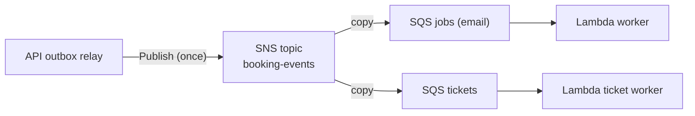
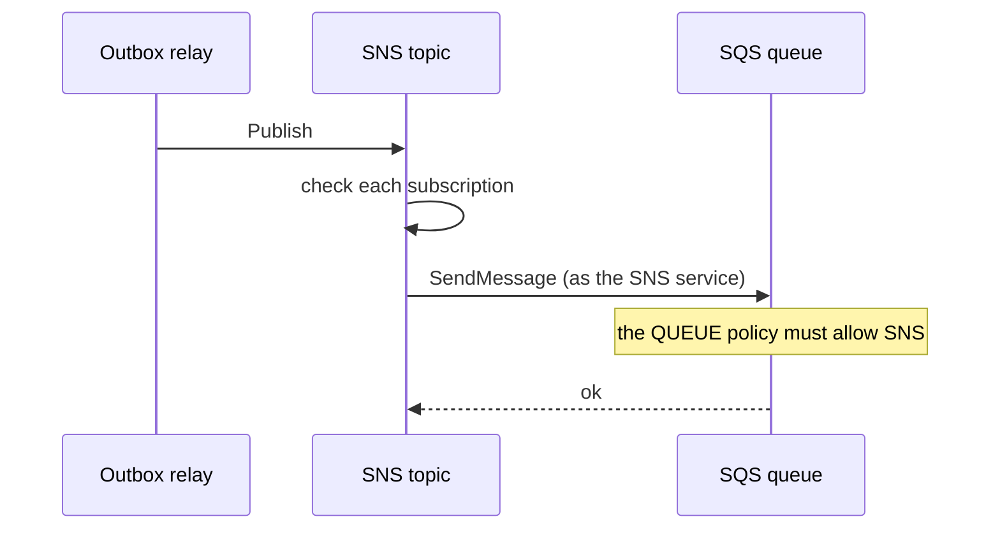
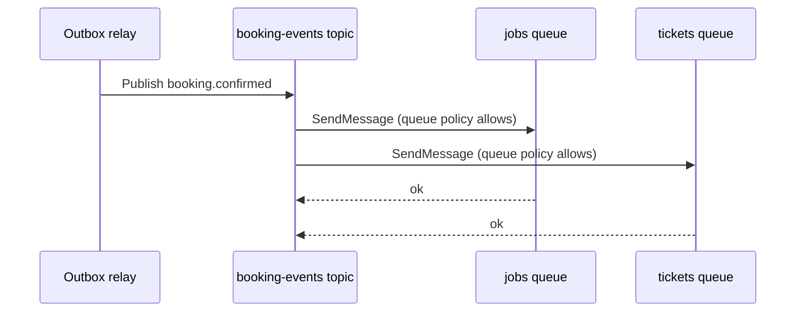
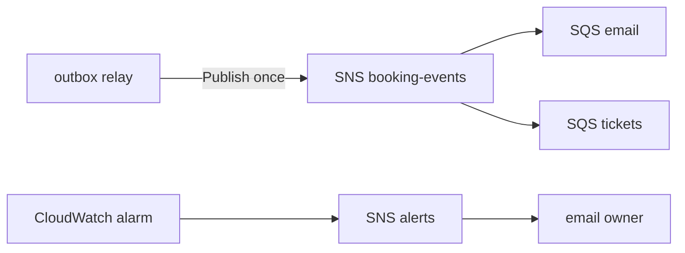

# 16. SNS: one event, many consumers (fan-out)

History: see [CHANGELOG.md](../CHANGELOG.md) or run `pnpm docs:history`

> **Honesty label: ✅ Built in repository** (`infra/src/jobs/booking-events.ts`,
> `infra/src/observability/alert-topic.ts`), **⚙️ configured for deployment** (booking events need
> compute on; the alert topic is always on).

**Prerequisites:** [04. IAM](04-iam.md), [15. Outbox](15-transactional-outbox.md).

---

## A. The problem first

A confirmed booking produces **two** independent pieces of work:

1. Send the confirmation **email**.
2. Render the **ticket** image.

These are independent: a slow email must not delay the ticket, and a broken ticket renderer must not
stop emails. They also have different failure characteristics and could later have different teams.

If the API published directly to *one* queue, we would have to choose. If it published to both itself,
we would need two publishes, two retries, and — worst — a way to keep them consistent (the state where
one succeeded and the other failed is exactly the dual-write problem again,
[15](15-transactional-outbox.md)).

The problem: **deliver one event to several independent consumers, without the producer knowing about
any of them, and without a second dual-write.**

Where it shows up: `infra/src/jobs/booking-events.ts`.

---

## B. What it is

**Plain English:** **SNS (Simple Notification Service)** is a loudspeaker. Something **publishes** one
message to a **topic**; SNS delivers a copy to every **subscriber**. The publisher does not know or care
who is listening.

### The terms

- **Pub/Sub (publish–subscribe)** — one publisher, many independent listeners.
- **Topic** — the named channel you publish to.
- **Subscription** — one delivery target attached to a topic (here: an SQS queue).
- **Fan-out** — one event copied to many destinations.
- **Filter policy** — an optional rule that lets a subscription receive only some messages.
- **Resource policy** — a policy on a resource (here the *queue*) saying who may write to it.
- **Confused deputy** — a shared service tricked into acting for the wrong account; SNS fan-out needs
  conditions to prevent it.

---

## C. How it works internally

### The loudspeaker



The producer publishes **once**. SNS makes the copies. Adding a third consumer (say SMS) means adding a
subscription — **the API never changes.**

### The permission direction that surprises people

Here is the detail that trips up almost everyone: when SNS delivers to an **SQS queue**, the permission
needed is on the **queue**, not on SNS and not on the consumer Lambda. The queue must carry a **resource
policy** that says *"the SNS service, from this topic, in this account, may SendMessage to me."*



Why the conditions matter: without `aws:SourceArn` (this topic) and `aws:SourceAccount` (this account),
**any** SNS topic in **any** account could be configured to deliver into our queue — a confused-deputy
attack. The MiniTickets policy pins it to exactly our topic and account.

---

## D. Our MiniTickets implementation

### D1. The booking-events topic — `infra/src/jobs/booking-events.ts`

```ts
const name = "minitickets-dev-booking-events";
const topic = new aws.sns.Topic(name, { name, tags: tagsFor(name) });

for (const [consumer, queue] of [["email", email], ["tickets", tickets]] as const) {
  // WHO: SNS only, from THIS topic in THIS account. WHAT: SendMessage on ONE queue.
  // ATTACHED: the queue resource policy, not either Lambda's execution role.
  new aws.sqs.QueuePolicy(`${name}-${consumer}`, { ... });
  new aws.sns.TopicSubscription(`${name}-${consumer}`, {
    topic: topic.arn, protocol: "sqs", endpoint: queue.queueArn, rawMessageDelivery: true,
  });
}
```

Points to notice:

- **Two subscriptions, two queues.** Email and tickets each get their own copy and their own buffer.
- **`rawMessageDelivery: true`** — SNS delivers the original JSON body to the queue instead of wrapping it
  in an SNS envelope. The worker parses the booking payload directly (its handler expects the
  `BookingConfirmedMessage` shape).
- **The queue policy is the resource-based half** of the authorization — see above.
- The topic is **always on**: request-billed, no idle fee.

### D2. The alert topic — `infra/src/observability/alert-topic.ts`

MiniTickets uses SNS **twice**: this fan-out topic, and the **alert topic**
`minitickets-dev-alerts` that CloudWatch alarms publish to ([21](21-cloudwatch.md)). The alert topic has
its own resource policy allowing **only CloudWatch alarms of this account** whose names start with
`minitickets-dev-` to publish, again with the confused-deputy conditions, and an **email subscription**.

One notable choice, quoted from the code: the alert topic is **not encrypted on purpose**, because
CloudWatch can publish to an encrypted topic only if the key's policy lets the CloudWatch service use it,
and the free AWS-managed `aws/sns` key has a fixed policy that does not. The messages contain no
personal data — only "alarm X is in ALARM". Choosing *not* to encrypt, for a documented and correct
reason, is the opposite of sloppiness.

### Trace: a booking event fanning out



---

## E. Security and permissions

**REACH.** SNS is a public AWS service reached over HTTPS by signed API calls. There is no security
group on a topic, and the API reaches it through the internet gateway ([06](06-ecs-fargate.md)).

**ALLOWED.**
- **Publishing:** the API task role's `send-jobs` policy allows `sns:Publish` on **one** topic
  ([04](04-iam.md)).
- **Delivering to a queue:** the **queue resource policy** allows the **SNS service** from **this topic**
  in **this account**.
- **Alarm publishing to the alert topic:** the **topic resource policy** allows the CloudWatch service
  for our alarms only.

**IDENTITY / CREDENTIALS.** The publisher uses its role; the *delivery* is performed by the SNS service
identity, authorized by a resource policy.

**Encryption.** The `booking-events` topic's payload flows to queues that are SSE-SQS encrypted
([17](17-sqs.md)). The alert topic is intentionally unencrypted (documented reason above).

---

## F. The AWS console walkthrough

> Read-only. Do not delete a subscription.

1. **SNS → Topics.** You should see `minitickets-dev-booking-events` and `minitickets-dev-alerts`.
2. Open `booking-events` → **Subscriptions** tab: two SQS subscriptions (email and tickets). Confirm
   **raw message delivery** is enabled.
3. Open the **Access policy** on `minitickets-dev-alerts`: confirm only CloudWatch alarms of this
   account with the `minitickets-dev-` prefix may publish.
4. **Subscriptions** on `minitickets-dev-alerts`: the email address, and its status (confirmed vs
   pending).
5. Open each **queue** (SQS console, [17](17-sqs.md)) → **Access policy**: confirm the SNS-only
   resource policy with the confused-deputy conditions.
6. **Monitoring** on the topic: `NumberOfMessagesPublished` and `NumberOfNotificationsDelivered`.

Mapping: `booking-events` → `infra/src/jobs/booking-events.ts`; `alerts` →
`infra/src/observability/alert-topic.ts`.

---

## G. Real production scenarios

### Scenario 1 — "Messages are published but never arrive in the queue."

- **Cause:** the **queue resource policy** is missing or wrong (e.g. no `aws:SourceArn` match). SNS
  cannot deliver and the delivery fails.
- **Investigate:** the topic's delivery metrics; the queue access policy.
- **Recover:** fix the queue policy so the topic may `SendMessage`.

### Scenario 2 — "Alarm emails are not arriving."

- **Cause:** the email subscription is **pending confirmation** — SNS sent a "Confirm subscription"
  email and nobody clicked it.
- **Investigate:** the subscription status in the console.
- **Recover:** confirm the subscription (or request confirmation again). Note an unconfirmed
  subscription expires after 3 days.

### Scenario 3 — "Adding a new consumer (SMS/tickets)."

- **Do:** add a queue + its DLQ ([19](19-dead-letter-queue.md)) + a queue policy + an SNS subscription,
  and make the new consumer idempotent.
- **Do not:** change the API. Fan-out is the whole point.

### Scenario 4 — "One consumer is slow, the other is fast."

- **This is the design.** Each queue buffers independently, so a slow email worker cannot hold up
  tickets. If they shared one queue, the slow one *would* hold up the other.

### Cost and performance

- SNS is **request-billed**; there is no idle fee. The first 1,000 email notifications a month are free
  at the time of writing (verify).
- Fan-out happens in the AWS network, close to the queues, so it is fast.

---

## H. Decisions and alternatives

- **SNS fan-out to two SQS queues.** Decouples the producer from consumers and keeps each consumer's
  buffer independent. The alternative (the API publishing to each queue itself) reintroduces the
  dual-write problem.
- **`rawMessageDelivery: true`.** The consumer sees the original payload. The alternative (the SNS
  envelope) would require the worker to unwrap it.
- **Queue resource policies, not consumer role policies.** Because delivery is done by the SNS service.
- **Alert topic unencrypted.** A documented, deliberate choice given the AWS-managed key limitation.
- **Alternatives:** EventBridge (richer routing/rules, good for many event types), Kinesis (ordered,
  replayable stream), direct SQS (no fan-out). For "one event, a few consumers", SNS is the simplest
  correct tool.

---

## I. Interview preparation

### 30-second answer

> "SNS is pub/sub fan-out: the outbox relay publishes a booking event once to the `booking-events` topic,
> and SNS copies it to two SQS queues — email and tickets — so the consumers are independent and the API
> doesn't know about them. Delivery is authorized by a resource policy on each queue that allows the SNS
> service only from that topic and account, which avoids the confused-deputy problem. SNS is used twice:
> for booking fan-out, and for the alert topic CloudWatch alarms publish to."

### Follow-up questions

- **Beginner:** What is pub/sub? *(→ one publisher, many subscribers.)*
- **Beginner:** Why two queues instead of one? *(→ independent buffering and failure domains.)*
- **Intermediate:** Which policy allows SNS to write to an SQS queue? *(→ the queue's resource policy.)*
- **Intermediate:** What do `aws:SourceArn` and `aws:SourceAccount` prevent? *(→ the confused-deputy
  problem.)*
- **Intermediate:** What does `rawMessageDelivery` do? *(→ delivers the original payload, no SNS
  envelope.)*
- **Senior:** How does SNS fan-out avoid the dual-write problem? *(→ the producer publishes to one
  target; AWS does the copying.)*
- **Senior:** When would you use EventBridge or Kinesis instead? *(→ richer routing/rules vs ordered,
  replayable streaming.)*
- **Senior:** Why is the alert topic unencrypted, and is that acceptable? *(→ CloudWatch can't publish to
  a topic encrypted with the AWS-managed key; the messages hold no personal data.)*

### Scenario questions

1. **"Published but never delivered."** → queue resource policy.
2. **"No alarm emails."** → pending subscription confirmation.
3. **"Add a third consumer."** → new queue + policy + subscription; no API change.

---

## J. Quick revision

**Five things to remember**

1. SNS = **pub/sub fan-out**: publish once, many subscribers get a copy.
2. MiniTickets: `booking-events` → **two** SQS queues (email, tickets); plus `alerts` for CloudWatch.
3. Delivery to a queue is allowed by the **queue's resource policy**, not the consumer's role.
4. `aws:SourceArn` + `aws:SourceAccount` conditions prevent the **confused deputy**.
5. `rawMessageDelivery: true` means the consumer sees the original JSON payload.

**One diagram**



**Three common mistakes**

1. Putting the publish permission on the consumer role instead of the queue resource policy.
2. Forgetting the `aws:SourceArn`/`aws:SourceAccount` conditions (confused deputy).
3. Expecting one queue to serve unrelated consumers without coupling them.

**Where next:** [17. SQS](17-sqs.md) — the queues SNS writes into.
