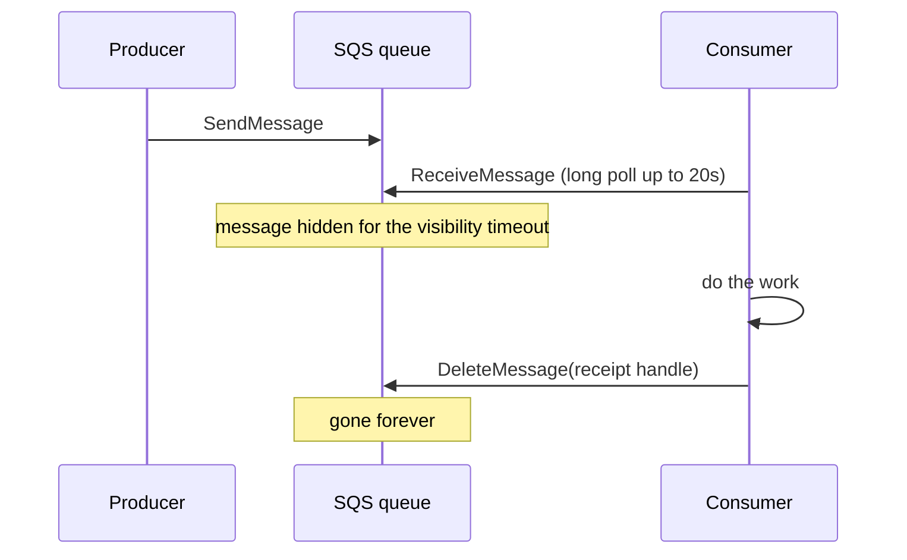
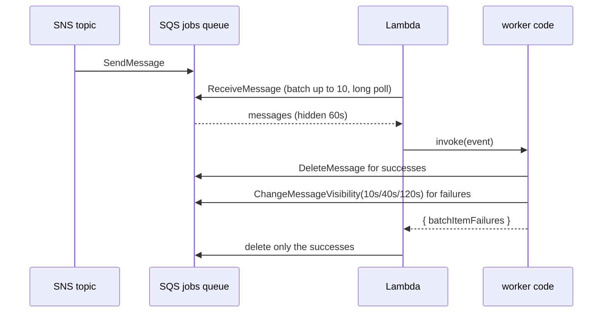
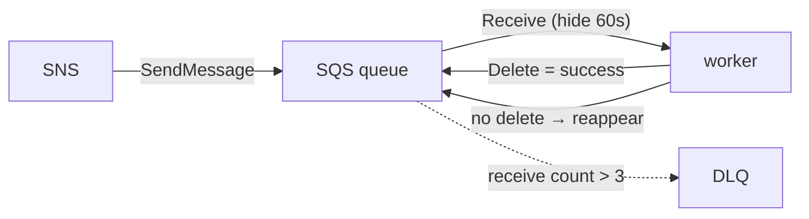

# 17. SQS: the durable work queues

History: see [CHANGELOG.md](../CHANGELOG.md) or run `pnpm docs:history`

> **Honesty label: ✅ Built in repository** (`infra/src/jobs/queues.ts`,
> `apps/worker/src/batch.ts`, `apps/worker/src/retry-later.ts`), **⚙️ configured for deployment**
> (compute switch). The DLQ is covered fully in [19](19-dead-letter-queue.md).

**Prerequisites:** [16. SNS](16-sns.md), [06. ECS/Fargate](06-ecs-fargate.md) (for the "no consumer
running" idea), [18. Lambda](18-lambda.md) (read together).

---

## A. The problem first

Between the moment a booking event is published and the moment the email is sent, there is a gap. During
that gap:

- The email service might be **down** or **throttling**.
- The consumer might **crash**.
- A **traffic spike** might produce far more events than the consumer can handle at once.

If SNS called the email-sending code **directly**, every one of those conditions would mean **lost
work** or a **failed request**. The customer's confirmation would simply evaporate.

The problem: **hold the work durably until a consumer is ready, remember what is in flight, and retry
what fails — without the producer waiting.**

Where it shows up: `infra/src/jobs/queues.ts` (the infrastructure) and the worker's batch handling
(`apps/worker/src/batch.ts`).

---

## B. What it is

**Plain English:** **SQS (Simple Queue Service)** is a to-do list. Producers **send** messages; consumers
**receive** them one batch at a time, do the work, and **delete** what they finished. If a consumer dies
mid-work, the message comes back.

### The terms (the ones you must know cold)

- **Queue** — the durable list.
- **Message** — one unit of work (a JSON booking event here).
- **Producer / consumer** — who sends / who reads and works.
- **Visibility timeout** — how long a received message **hides** from other consumers while it is being
  worked on. If it is not deleted in time, it becomes visible again. **MiniTickets: 60 s (email), 180 s
  (tickets).**
- **Receipt handle** — a per-delivery ticket that proves which delivery you are deleting or modifying.
  You cannot help but notice it: the worker passes it to `ChangeMessageVisibility`
  (`apps/worker/src/retry-later.ts`).
- **Receive count (`ApproximateReceiveCount`)** — how many times a message has been delivered. This is
  what the DLQ budget ([19](19-dead-letter-queue.md)) counts.
- **Long polling** — waiting up to 20 s for a message instead of returning empty immediately
  (`receiveWaitTimeSeconds: 20`). Fewer empty calls, faster pickup.
- **Message retention** — how long a message is kept before deletion. **MiniTickets: 4 days** on the
  source queues.
- **Standard vs FIFO queue** — standard is high-throughput and **at-least-once** (may repeat, may
  reorder); FIFO preserves order and deduplicates but has lower throughput. **MiniTickets uses
  standard.**
- **At-least-once delivery** — the guarantee you must design for.

---

## C. How it works internally

### The hide-and-delete dance



The single most important idea: **SQS does not delete on read.** Reading only **hides**. Only an explicit
delete removes the message. That is what makes failures safe: a consumer that crashes never deletes, so
the message returns.

### What "failure" means to SQS

SQS has **no notion of success or failure**. It only knows: *was the message deleted within the visibility
timeout?* If yes, success. If no, the receive count grows. Everything about retries and the DLQ
([19](19-dead-letter-queue.md)) follows from that single fact.

### Why standard queues, and why that is fine

Standard queues favour throughput and durability over strict ordering. MiniTickets does not need strict
order (each booking is independent), and it handles duplicates with an **idempotent consumer**
([13](13-dynamodb.md)). FIFO would add throughput limits and a different dedup model for an ordering
guarantee we do not need.

### The two real timeouts

- **Visibility timeout** must be **long enough** that the consumer finishes before the message
  reappears. Too short → a message reappears while still being handled → a **duplicate**. MiniTickets
  sets **60 s** for email, which is **6× the worker's 10 s Lambda timeout** (AWS's own rule of thumb,
  because Lambda may retry a throttled invocation of the same batch inside that window).
- **Message retention** bounds how long work may wait during a long outage. **4 days** is "long enough
  for a weekend with the worker broken"; the DLQ keeps them longer (14 days) so the two periods do not
  collide.

---

## D. Our MiniTickets implementation

### D1. The two queue pairs — `infra/src/jobs/queues.ts`

`createJobQueues(kind)` is called twice, once with `"jobs"` (email) and once with `"tickets"`. Each call
creates a **source queue and a DLQ**:

```ts
const visibilityTimeoutSeconds = kind === "tickets" ? 180 : 6 * WORKER_TIMEOUT_SECONDS;
const queue = new aws.sqs.Queue(queuePrefix, {
  name: queuePrefix,                     // minitickets-dev-jobs or minitickets-dev-tickets
  visibilityTimeoutSeconds,              // 60 (email) or 180 (tickets)
  messageRetentionSeconds: 4 * DAY,
  receiveWaitTimeSeconds: 20,            // long polling
  sqsManagedSseEnabled: true,            // SSE-SQS encryption
  redrivePolicy: pulumi.jsonStringify({ deadLetterTargetArn: dlq.arn, maxReceiveCount: 3 }),
  tags: tagsFor(queuePrefix),
});
```

Why `6 × WORKER_TIMEOUT_SECONDS` for email: AWS's guidance for a Lambda queue consumer is that the
queue's visibility timeout should be **at least 6× the function timeout**, because Lambda can retry a
throttled invocation of a batch for up to that long. Getting this wrong in the *short* direction causes
**duplicate deliveries** — one of the most common SQS bugs.

### D2. The ticket queue is special, in one respect

The tickets queue has a **180 s** visibility timeout (3 minutes) instead of 60, because rendering a
ticket image (and calling SES-adjacent work) can take longer than an email. The same code, one
conditional, two different queues.

### D3. Delivery to the queue is authorized by a resource policy

The queues carry the SNS subscription policies from [16](16-sns.md). This is the same crucial lesson:
**the queue's resource policy**, not the consumer role, is what lets SNS write into it.

### D4. The consumer's discipline — `apps/worker/src/batch.ts`

The worker receives a **batch of up to 10** messages and returns a `batchItemFailures` list naming only
the ones that failed:

```ts
const batchItemFailures: SQSBatchItemFailure[] = [];
for (const record of event.Records) {
  try {
    await handleBookingConfirmed(JSON.parse(record.body), deps, messageLog);
  } catch (err) {
    messageLog.error("message failed", { error: describe(err) });
    batchItemFailures.push({ itemIdentifier: record.messageId });
  }
}
return { batchItemFailures };
```

**Partial batch failure** is the whole point: one bad message does not poison its nine neighbours. The
queue deletes the successes and retries only the failures. This works **only** because the event source
mapping sets `FunctionResponseTypes = ["ReportBatchItemFailures"]` ([18](18-lambda.md),
[19](19-dead-letter-queue.md)).

### D5. The backoff — `apps/worker/src/retry-later.ts`

Because Lambda's event source mapping **does nothing special** for a failed message, the worker adjusts
the visibility timeout itself:

```ts
const wait = backoffSeconds(Number(record.attributes?.ApproximateReceiveCount ?? "1"));
await sqs.send(new ChangeMessageVisibilityCommand({
  QueueUrl: queueUrl, ReceiptHandle: record.receiptHandle, VisibilityTimeout: wait,
}));
```

`backoffSeconds` returns **10 s → 40 s → 120 s** (factor 4, capped). The full retry/DLQ story is
[19](19-dead-letter-queue.md); here the point is that **the consumer deliberately sets its own retry
timing** using the visibility timeout and the receipt handle.

### Trace: a message through the queue



---

## E. Security and permissions

**REACH.** SQS is a public AWS service reached over HTTPS by signed API calls. There is **no security
group** on a queue — it is not a resource inside your VPC.

**ALLOWED.**
- **Writing:** the **queue resource policy** allows the **SNS service** from our topic and account
  ([16](16-sns.md)).
- **Reading/deleting:** the **worker role** may `ReceiveMessage`, `DeleteMessage`,
  `ChangeMessageVisibility`, `GetQueueAttributes` on **one** queue ([04](04-iam.md)).
- `SendMessage` is **deliberately absent** from the worker role: the worker consumes, it does not
  produce.

**IDENTITY / CREDENTIALS.** The Lambda service polls the queue using the function's role; the worker code
uses the same role for `ChangeMessageVisibility`.

**Encryption.** **SSE-SQS** (`sqsManagedSseEnabled: true`) encrypts message bodies at rest with an
SQS-managed key — free, and no `kms:Decrypt` grant needed. In transit, every call is HTTPS. Bodies
contain personal data (an email address), which is why the worker's error logging never prints the body
([19](19-dead-letter-queue.md)).

---

## F. The AWS console walkthrough

> Read-only. Do not purge a queue or delete a message.

1. **SQS → Queues.** You should see `minitickets-dev-jobs`, `minitickets-dev-tickets`, and their two
   DLQs ([19](19-dead-letter-queue.md)).
2. Open `minitickets-dev-jobs`. Confirm: **visibility timeout 1 minute**, **message retention 4 days**,
   **receive wait 20 s**, **encryption** on.
3. **Dead-letter queue** tab: shows the DLQ and `maxReceiveCount = 3`.
4. **Access policy**: the SNS-only resource policy with the confused-deputy conditions.
5. **Monitoring**: `ApproximateNumberOfMessagesVisible` (how much work waits),
   `ApproximateAgeOfOldestMessage` (how stuck it is), `NumberOfMessagesSent/Received/Deleted`.
6. **Send and receive messages** tab: you *can* peek, but do not delete real messages.

Mapping: all queue settings → `infra/src/jobs/queues.ts`; the consumer → `apps/worker/src/*`.

---

## G. Real production scenarios

### Scenario 1 — "The same email was sent twice."

- **Cause candidates:** the visibility timeout was too short (message reappeared mid-work), or Lambda
  retried a throttled batch, or the relay published twice (at-least-once, [15](15-transactional-outbox.md)).
- **Investigate:** the worker's idempotency table ([13](13-dynamodb.md)); check the visibility timeout vs
  the function timeout.
- **Recover:** ensure idempotency, and keep the visibility timeout **≥ 6× the function timeout**.

### Scenario 2 — "Messages pile up but nothing is read."

- **Cause:** the Lambda is off, broken, throttled, or its **event source mapping is disabled**
  ([18](18-lambda.md)).
- **Investigate:** the queue's `ApproximateAgeOfOldestMessage` (this is exactly what the
  `oldest-message-age` alarm watches, [21](21-cloudwatch.md)), and the Lambda's metrics.
- **Recover:** enable/repair the trigger; the messages are still there (up to 4 days).

### Scenario 3 — "A message reappears and is processed again."

- **This is at-least-once, working as designed.** The consumer must be idempotent. Do not fight it;
  design for it.

### Scenario 4 — "One bad message fails the whole batch."

- **Cause:** returning a plain failure (or crashing) instead of `batchItemFailures`.
- **Investigate:** confirm the event source mapping has `ReportBatchItemFailures` ([18](18-lambda.md)).
- **Recover:** ensure the handler returns per-message results.

### Scenario 5 — "Messages expired before being processed."

- **Cause:** an outage longer than the 4-day retention.
- **Impact:** real work lost — the one case the queue does not save you from.
- **Recover/prevent:** alert on age (it exists), and consider a longer retention for critical queues.

### Cost and performance

- SQS is **request-billed**; **an idle queue costs nothing**, which is why the queues are always on.
- Long polling reduces empty receives (and cost).
- Batching 10 messages per Lambda call reduces invocation cost.

---

## H. Decisions and alternatives

- **Standard queues, not FIFO.** Throughput over strict order; duplicates handled by idempotency. The
  alternative (FIFO) gives ordering/dedup at lower throughput and a different dedup key.
- **Two queues, one per consumer.** Independent buffering and failure domains ([16](16-sns.md)).
- **60 s (email) / 180 s (tickets) visibility.** Email follows the 6× rule; tickets need more time.
- **4-day retention, 14-day DLQ.** Long enough for a weekend outage, ordered so a message can never be
  deleted the instant it reaches the DLQ ([19](19-dead-letter-queue.md)).
- **SSE-SQS encryption.** Free, no key management.
- **Consumer-owned backoff.** Because Lambda offers no per-failure delay.
- **Alternatives:** Kafka/Kinesis (ordered, replayable streams, retained log), EventBridge (routing),
  a database table as a queue (simpler in some apps, but you must build visibility/retries/DLQ
  yourself). SQS is the pragmatic default for "durable work list with retries".

---

## I. Interview preparation

### 30-second answer

> "SQS is a durable queue. Producers send; consumers receive a batch, work, and delete; if a consumer
> doesn't delete within the visibility timeout, the message reappears. MiniTickets has two standard
> queues — email and tickets — each with a DLQ, maxReceiveCount 3, four-day retention and SSE-SQS
> encryption. Email's visibility timeout is 60 seconds, six times the worker's 10-second function timeout,
> to avoid duplicates. The consumer returns `batchItemFailures` so only failed messages retry, and it
> controls its own backoff via `ChangeMessageVisibility`."

### Follow-up questions

- **Beginner:** Does reading a message remove it? *(→ no; only an explicit delete does.)*
- **Beginner:** What is the visibility timeout? *(→ how long a received message hides while being worked.)*
- **Intermediate:** Why 6× the function timeout? *(→ Lambda may retry a throttled batch within that
  window; too short a timeout causes duplicates.)*
- **Intermediate:** What does `batchItemFailures` solve? *(→ one bad message doesn't replay the whole
  batch.)*
- **Intermediate:** Standard vs FIFO? *(→ at-least-once/unordered/high-throughput vs ordered/deduped.)*
- **Senior:** How do you set the visibility timeout? *(→ ≥ 6× the consumer's max processing time;
  MiniTickets uses 60 s email, 180 s tickets.)*
- **Senior:** What is the one failure a queue cannot save you from? *(→ an outage longer than the
  retention period, 4 days here.)*
- **Senior:** How does the consumer change its own retry timing, and why? *(→ `ChangeMessageVisibility`
  with the receipt handle, because Lambda has no per-failure delay.)*

### Scenario questions

1. **"Duplicate emails."** → visibility timeout too short / Lambda batch retry; fix timeout, rely on
   idempotency.
2. **"Nothing is being consumed."** → trigger disabled/broken/throttled; watch the age metric.
3. **"One poison message."** → it dead-letters after 3 receives by design ([19](19-dead-letter-queue.md)).

---

## J. Quick revision

**Five things to remember**

1. SQS is a **durable list**: read hides, **delete** removes; no delete → retry.
2. MiniTickets: `jobs` + `tickets` queues, each with a **DLQ**, `maxReceiveCount 3`.
3. Visibility timeout **60 s (email = 6× function timeout)** / **180 s (tickets)**; retention **4 days**.
4. **Partial batch failures** keep one bad message from poisoning a batch.
5. **SSE-SQS** encryption; the **queue resource policy** lets SNS write in.

**One diagram**



**Three common mistakes**

1. Setting the visibility timeout shorter than the processing time (duplicates).
2. Returning a whole-batch failure instead of `batchItemFailures`.
3. Forgetting the queue can outlive neither the retention window nor a disabled consumer.

**Where next:** [18. Lambda](18-lambda.md) — the consumer that reads these queues.
