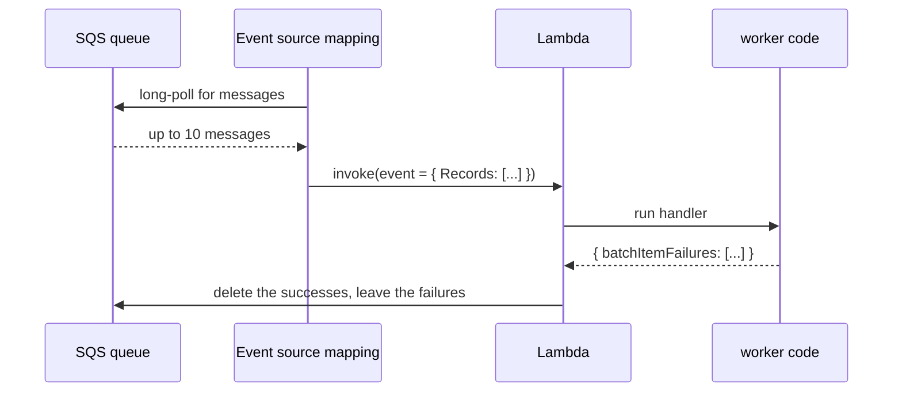
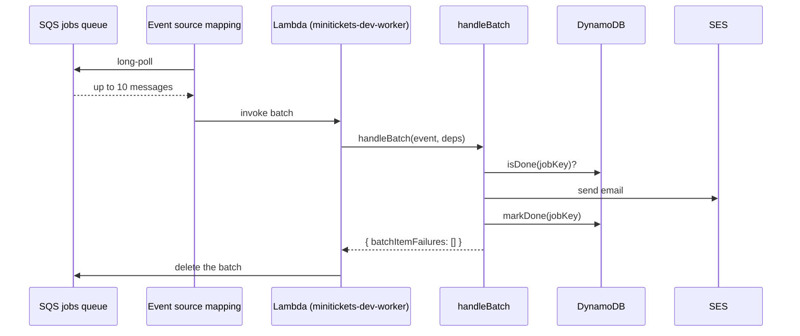
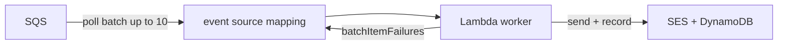

# 18. Lambda: the serverless consumer

> **Honesty label: ✅ Built in repository** (`infra/src/jobs/worker-lambda.ts`,
> `infra/src/jobs/queue-trigger.ts`, `apps/worker/src/lambda.ts`), **⚙️ configured for deployment**
> (compute switch; reserved concurrency optional from config).

**Prerequisites:** [17. SQS](17-sqs.md), [04. IAM](04-iam.md), [13. DynamoDB](13-dynamodb.md).

---

## A. The problem first

The worker must run whenever there is queue work and **not run** when there is none. Options:

- A container that **polls constantly** costs money 24/7 even at zero traffic.
- A cron job that polls every minute adds delay and still runs around the clock.
- A person pressing a button is not a system.

The problem: **run code the instant there is work, at exactly the scale the work needs, and pay only for
the milliseconds the code actually runs.**

Where it shows up: `infra/src/jobs/worker-lambda.ts` (the function) and
`infra/src/jobs/queue-trigger.ts` (the event source mapping).

---

## B. What it is

**Plain English:** **Lambda** runs a function for you with no server. You give it code; AWS starts it
when an event arrives, runs it, and stops it — billing **per invocation and per millisecond**.

### The terms

- **Function** — the deployable code plus its configuration.
- **Invocation** — one call of the function with one event.
- **Event** — the input (here, a batch of SQS messages).
- **Event source mapping** — the resource that makes Lambda **poll** a queue/stream for you and invoke
  the function. (Lambda is not "pushed" SQS events; it **polls**.)
- **Batch size** — how many messages arrive in one invocation (up to 10 here).
- **`ReportBatchItemFailures`** — a function-response type; lets the function say *which* messages failed
  so only those retry. **Without it, a normal return means "all succeeded."**
- **Cold start** — the delay when a fresh execution environment is created (runtime + your module
  top-level). Reused after that.
- **Reserved concurrency** — a per-function cap on simultaneous executions; also acts as a throttle.
- **Container-image Lambda** — the function is deployed as a container image (what MiniTickets does), so
  it can be up to 10 GB and use any runtime/libraries. Alternative: a zip with a supported runtime.
- **Timeout** — the maximum run time (here **10 seconds**).

---

## C. How it works internally

### The polling loop Lambda does for you



You never write the polling code. The event source mapping is the "glue" resource, and it is exactly
where two crucial settings live:

1. **Batch size** (up to 10) — how many messages per invocation.
2. **`FunctionResponseTypes = ["ReportBatchItemFailures"]`** — honour the function's list of failures.

### What Lambda manages versus what our code does

| Concern | Who |
| --- | --- |
| Polling the queue | **AWS (event source mapping)** |
| Scaling up/down with load | **AWS** |
| Creating/destroying execution environments | **AWS** |
| Deciding success/failure per message | **Our code** (`batch.ts`) |
| Retry delay (backoff) | **Our code** (`retry-later.ts` + `ChangeMessageVisibility`) |
| Idempotency | **Our code** (`processed-jobs.ts`) |

The pattern: **AWS provides the runtime and the scale; you own the semantics.**

### Cold starts, honestly

The first invocation after a period of quiet pays a cold start: AWS creates the execution environment and
runs your module's top-level code. `apps/worker/src/lambda.ts` deliberately builds its dependencies
(DynamoDB client, SES client, config) **once at module load**, then reuses them for every subsequent
invocation in the same environment. That is the standard Lambda performance pattern: do expensive setup
outside the handler, not inside it.

### Concurrency, and why reserved concurrency matters

Lambda can run many invocations of the function at once. If the queue floods, Lambda scales up — which is
great, until the **downstream** (SES, or the database, or an external API) cannot take it. Setting
**reserved concurrency** caps how many run at once, which both protects downstreams and prevents one
function from consuming the account's entire concurrency budget. MiniTickets exposes it as optional
config (`workerReservedConcurrency`).

---

## D. Our MiniTickets implementation

### D1. The function — `infra/src/jobs/worker-lambda.ts`

```ts
const fn = new aws.lambda.Function(`${prefix}-worker`, {
  name: `${prefix}-worker`,
  packageType: "Image",
  imageUri: pulumi.interpolate`${inputs.image}:${tag}`,
  architectures: ["arm64"],
  timeout: 10,                                   // WORKER_TIMEOUT_SECONDS
  role: inputs.roleArn,                          // minitickets-dev-worker-role
  reservedConcurrentExecutions: inputs.reservedConcurrency,  // optional
  environment: { variables: {
    JOBS_QUEUE_URL: ...,
    PROCESSED_JOBS_TABLE: ...,
    MAIL_FROM: ...,
    AWS_REGION: ...,
  }},
  loggingConfig: { logGroup: inputs.logGroupName },
});
```

Points to notice:

- **Container image (`packageType: "Image"`)** — the same worker code is packaged and pushed to ECR
  ([05](05-ecr.md)); the Lambda pulls via the **repository policy** ([05](05-ecr.md)). The build is
  **arm64** to match `architectures: ["arm64"]` (and to use cheaper Graviton).
- **`timeout: 10`** — the origin of the `6 × WORKER_TIMEOUT_SECONDS = 60 s` visibility timeout in the
  queue ([17](17-sqs.md)). The two constants are linked on purpose.
- **`JOBS_QUEUE_URL`** is provided because the worker's **backoff** needs it to call
  `ChangeMessageVisibility` ([17](17-sqs.md)).
- **`MAIL_FROM`** is present only when SES is configured (`jobs/email.ts`); otherwise the worker falls
  back to a log-only mailer.
- **`loggingConfig.logGroup`** points at the `worker` log group ([21](21-cloudwatch.md)).

### D2. The event source mapping — `infra/src/jobs/queue-trigger.ts`

This is the piece that turns "a queue with messages" into "a running function":

```ts
new aws.lambda.EventSourceMapping(`${prefix}-worker-trigger`, {
  eventSourceArn: inputs.queueArn,
  functionName: inputs.functionName,
  batchSize: 10,
  functionResponseTypes: ["ReportBatchItemFailures"],   // ← the critical line
  // (plus scaling config / batching window as configured)
});
```

**`functionResponseTypes: ["ReportBatchItemFailures"]` is the single most important setting in the async
pipeline.** Without it, Lambda would treat the worker's normal return as "everything succeeded" and
**delete the failed messages too** — silently losing customer emails and defeating the DLQ entirely
([19](19-dead-letter-queue.md)).

### D3. The handler — `apps/worker/src/lambda.ts`

The handler keeps module-level state built once and reused:

```ts
// built ONCE per execution environment, not per invocation
const deps = buildDeps();          // DynamoDB store, mailer, logger, config
export const handler = async (event: SQSEvent): Promise<SQSBatchResponse> =>
  handleBatch(event, deps);
```

The actual per-message logic lives in `handlers/booking-confirmed.ts`, deliberately **pure** (no queue,
no Lambda, no AWS) so it can be unit-tested with fakes.

### D4. The tickets function

`infra/src/tickets/lambda.ts` defines a **second** Lambda (`minitickets-dev-tickets`) with its own role,
image and `imageConfig.command` pointing at `ticket-lambda.handler`. It runs **outside the VPC** for the
same reason the worker does: no NAT gateway means a VPC-attached function could not reach AWS APIs
(DynamoDB, S3, Secrets Manager), and "all facts travel in the event; only AWS APIs are needed"
([02](02-vpc-and-networking.md)).

### Trace: from message to email



---

## E. Security and permissions

**REACH.** Lambda runs **outside the VPC**, so it reaches AWS APIs (DynamoDB, S3, SES, Secrets Manager)
through AWS's own network with **no NAT gateway and no security group**
([02](02-vpc-and-networking.md)). This is the deliberate consequence of skipping the NAT.

**ALLOWED.** The function runs as `minitickets-dev-worker-role` ([04](04-iam.md)), whose four statements
allow exactly: read/delete/change-visibility on **one** queue, GetItem/PutItem on **one** table,
`ses:SendEmail` with a `ses:FromAddress` condition, and writing **one** log group. The **tickets**
function has its own separate role.

**IDENTITY / CREDENTIALS.** Lambda assumes the role and injects **temporary** credentials into the
execution environment. No long-lived keys.

**Encryption.** In transit, all AWS calls are HTTPS. The function itself holds no data at rest; its logs
go to an encrypted CloudWatch log group, and it reads secrets (the signing key) over the Secrets Manager
API ([12](12-secrets-kms.md)).

---

## F. The AWS console walkthrough

> Read-only. Do not disable the trigger or delete the function.

1. **Lambda → Functions.** Open `minitickets-dev-worker`. Check the **runtime** (container image),
   **architecture** (arm64), **timeout** (10 s), and the **role**.
2. **Configuration → Triggers**: the SQS trigger, its **batch size**, and the **response type**
   (`ReportBatchItemFailures`).
3. **Configuration → Environment variables**: `JOBS_QUEUE_URL`, `PROCESSED_JOBS_TABLE`, `MAIL_FROM`.
4. **Monitor tab**: `Invocations`, `Errors`, `Duration` (against the 10 s timeout), `Throttles`. This is
   what the `worker-errors` alarm watches ([21](21-cloudwatch.md)).
5. **Configuration → Concurrency**: reserved concurrency, if set.
6. Open `minitickets-dev-tickets` to compare the second function.

Mapping: the function and trigger are `jobs/worker-lambda.ts` and `jobs/queue-trigger.ts`; the code is
`apps/worker/src/*`.

---

## G. Real production scenarios

### Scenario 1 — "The worker Lambda crashed or timed out."

- **Cause:** an unexpected exception escaped the handler, a timeout, or out-of-memory. **Note:** a
  *failed message* is NOT this — the handler catches those and reports `batchItemFailures`, so Lambda
  counts the call as a success. Only an escaped exception/timeout is a Lambda error.
- **Impact:** the whole batch reappears after the visibility timeout, including messages that had
  succeeded — hence idempotency ([13](13-dynamodb.md)).
- **Investigate:** the `worker-errors` alarm and the worker log group ([21](21-cloudwatch.md)).
- **Recover:** fix the crash; the messages are still in the queue.

### Scenario 2 — "Duplicate emails."

- **Cause candidates:** Lambda retrying a throttled batch; the visibility timeout too short; the relay
  publishing twice. The handler is idempotent, so this should be rare — but see the honest
  "effectively once" reasoning in `handlers/booking-confirmed.ts`.
- **Investigate:** the `processed-jobs` table and the visibility timeout.

### Scenario 3 — "Throttling downstream."

- **Cause:** Lambda scaled up and overwhelmed SES or another dependency.
- **Investigate:** the function's `Throttles` metric and the downstream's errors.
- **Recover:** set **reserved concurrency** to cap parallel invocations.

### Scenario 4 — "Cold starts make the first message slow."

- **Cause:** a fresh execution environment. The worker builds dependencies once per environment, so
  *subsequent* invocations are fast.
- **Recover/prevent:** keep the deployment package lean, avoid heavy top-level work, or set provisioned
  concurrency (💡 Conceptual; costs money even when idle).

### Scenario 5 — "The trigger is disabled and nothing is processed."

- **Cause:** the event source mapping was disabled (manually or by Lambda after repeated failures at the
  queue level).
- **Investigate:** the trigger state in the console, plus the queue's age metric.
- **Recover:** re-enable it; the messages are still in the queue (up to 4 days).

### Cost and performance

- Billed **per invocation** and **per GB-second**, plus a free monthly allowance. **An idle function
  costs nothing** — the whole reason to use Lambda here instead of an always-on poller.
- Batching 10 messages per invocation lowers invocation count and cost.
- Reserved concurrency caps cost exposure and protects downstreams.
- arm64 (Graviton) is cheaper per GB-second than x86.

---

## H. Decisions and alternatives

- **Lambda (event-driven) over an always-on poller.** Only pay when there is work; scale to zero. The
  alternative (a container polling) costs 24/7.
- **Container-image Lambda.** Reuses the existing worker image and dependencies; up to 10 GB. Trade-off:
  larger cold starts than a tiny zip.
- **`ReportBatchItemFailures` + a 60 s visibility timeout.** Correct partial-failure semantics and no
  duplicate deliveries.
- **arm64.** Cheaper and fast. Must match the image build.
- **Reserved concurrency (optional).** Protects downstreams; trades peak throughput for stability.
- **Outside the VPC.** Avoids needing a NAT gateway for AWS APIs; see [02](02-vpc-and-networking.md).
- **Alternatives:** an ECS worker service (constant cost, more control), Fargate-run one-off tasks,
  App Runner (containers with HTTP), or a plain cron/EC2 poller. For "consume a queue", Lambda is the
  natural fit.

---

## I. Interview preparation

### 30-second answer

> "Lambda runs code with no servers, billed per invocation and millisecond. MiniTickets deploys the
> worker as an arm64 container-image function with a 10-second timeout, an event source mapping that
> polls the SQS queue in batches of 10, and `ReportBatchItemFailures` so only failed messages retry —
> without that setting, a normal return deletes failed messages too. Dependencies are built once at
> module load to reduce cold-start cost, and reserved concurrency can cap invocations to protect SES."

### Follow-up questions

- **Beginner:** What is a Lambda function? *(→ serverless code run on events.)*
- **Beginner:** Does Lambda cost anything when idle? *(→ no; pay per invocation/duration.)*
- **Intermediate:** What is an event source mapping? *(→ the resource that makes Lambda poll a queue and
  invoke the function.)*
- **Intermediate:** Why does `ReportBatchItemFailures` matter? *(→ otherwise a normal return means "all
  succeeded" and failed messages are deleted.)*
- **Intermediate:** What is a cold start, and how does the worker reduce it? *(→ environment setup;
  dependencies built once at module load.)*
- **Senior:** What is the relationship between the function timeout and the queue's visibility timeout?
  *(→ the visibility timeout should be ≥ 6× the function timeout; 10 s → 60 s.)*
- **Senior:** How do you protect a downstream like SES from a queue flood? *(→ reserved concurrency /
  scaling config.)*
- **Senior:** When would you choose an ECS worker over Lambda? *(→ steady high throughput, long-running
  work, or needing to be inside the VPC.)*

### Scenario questions

1. **"Worker errors alarm fired."** → escaped exception/timeout; the batch reappears; check logs.
2. **"Downstream throttling."** → cap concurrency with reserved concurrency.
3. **"Nothing is consumed."** → trigger disabled; queue age grows; re-enable.

---

## J. Quick revision

**Five things to remember**

1. Lambda = **serverless functions**, billed per invocation and ms; **idle is free**.
2. An **event source mapping** polls SQS and invokes the function in **batches of ≤ 10**.
3. `ReportBatchItemFailures` makes **partial failures** work; without it failures are deleted.
4. MiniTickets: **arm64 container-image** function, **10 s timeout**, deps built once at module load.
5. It runs **outside the VPC** to reach AWS APIs without a NAT gateway.

**One diagram**



**Three common mistakes**

1. Omitting `ReportBatchItemFailures`, so failures are silently deleted.
2. Doing heavy setup inside the handler instead of at module load (slow cold starts).
3. Letting the function scale unbounded into a fragile downstream.

**Where next:** [19. Dead-letter queues](19-dead-letter-queue.md) — the flagship chapter, where all of
17 and 18 come together.
