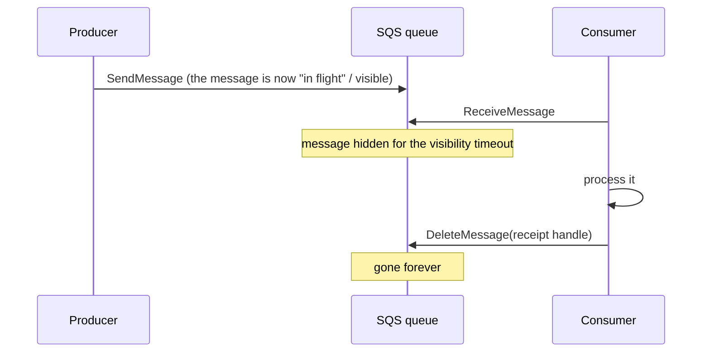
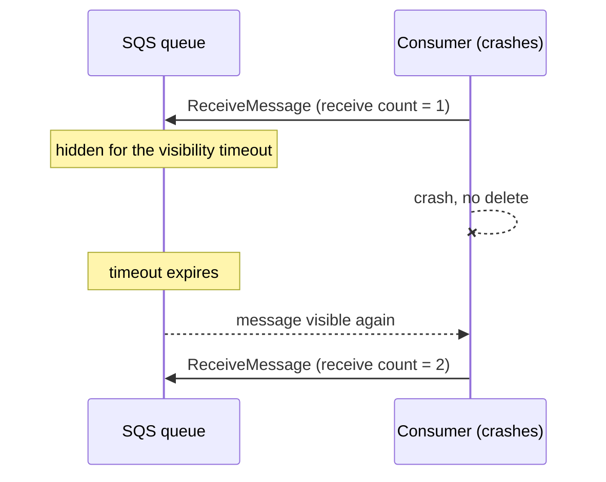
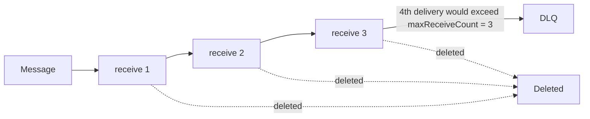
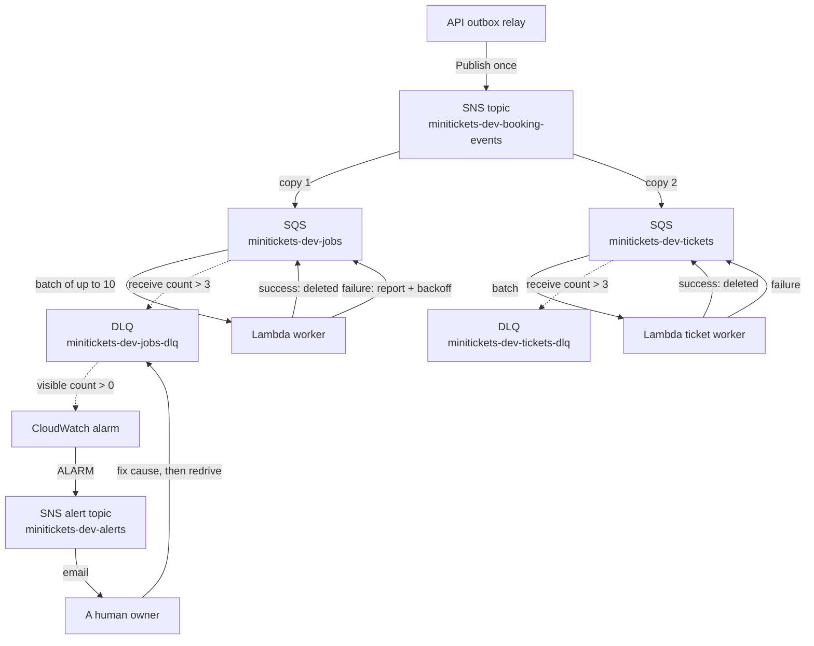
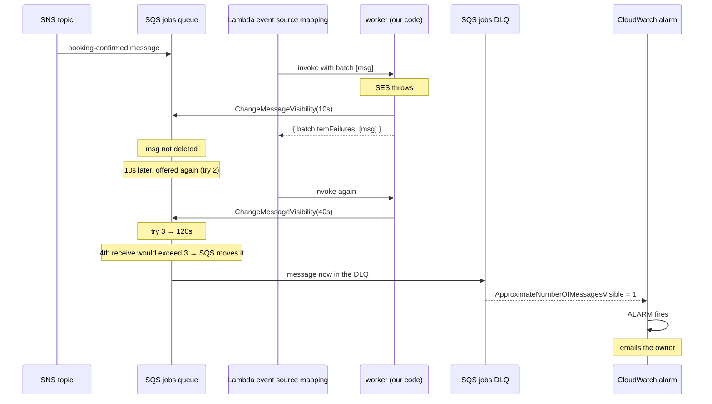
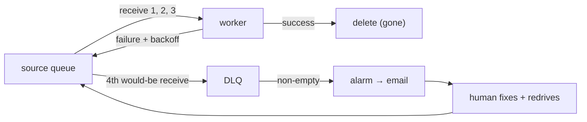

# 19. Dead-letter queues: the repair tray

History: see [CHANGELOG.md](../CHANGELOG.md) or run `pnpm docs:history`

> **This is the flagship chapter.** The task that created this handbook asked for the dead-letter
> queue to be written first, fully, as the model for every other chapter. It is deliberately the
> deepest one. If you understand everything here, you understand the retry-and-recovery heart of
> MiniTickets.
>
> **Honesty label: ✅ Built in repository.** `infra/src/jobs/queues.ts` defines the DLQs and the
> machinery is exercised by tests and the local runner. **Live AWS acceptance is separate** — we do
> **not** claim an alarm email was received, a redrive was run, or the DLQ was inspected in a real
> account here.

**Prerequisites:** this chapter assumes you have read [17. SQS](17-sqs.md) and
[18. Lambda](18-lambda.md), or already understand: what a queue is, what a message is, what a
consumer is, what deletion means, what a visibility timeout is, and how retries work. If any of those
is fuzzy, read those two chapters first. We will recap each briefly, but they are the ground floor.

---

## A. The problem first

### Start with a story, not a definition

Imagine you post a letter at the post office. The clerk says "we will deliver it, and if we cannot, we
will keep trying." Good. But the address is wrong. The post office tries again. Still wrong. Tries a
third time. Still wrong.

Now ask the question every engineer must ask: **what does "we keep trying" mean when trying cannot
possibly succeed?**

If the answer is "we try forever", then:

- That one letter is redelivered for eternity, forever consuming a clerk's attention.
- The pile of undeliverable letters grows without bound.
- Nobody can tell a *temporarily* stuck letter from a *permanently* impossible one.
- Real work gets delayed behind garbage.

If the answer is "we delete it after a few tries", then you have silently thrown away a customer's
confirmation email, and nobody will ever know.

**Neither extreme is acceptable.** A production system needs a third place for work that has failed
too many times: not "retry forever", not "delete", but **"set it aside safely, tell a human, and let
the human decide."** That place is the dead-letter queue.

### Why is a simpler approach not enough?

You might think: "just log the failure and move on." But logs are for *knowing*, not for *recovering*.
A log line does not contain the work in a form you can replay. A dead-letter queue keeps the **whole
original message**, byte for byte, so that after you fix the cause you can push it back through the
pipeline and the customer finally gets their email.

You might think: "just retry forever with a longer and longer delay." That is sometimes right (and
MiniTickets does exactly that for a *different* queue — see [15](15-transactional-outbox.md)), but it
is wrong when the failure is permanent and no one is watching. An infinitely retried poison message
is invisible: it never triggers an alert because it never "gives up", and it never succeeds.

### How the problem appears in MiniTickets

Recall the async pipeline: after a booking commits, an outbox relay publishes an event to SNS, SNS
fans it out to SQS queues, and a Lambda worker sends the email. The worker can fail for reasons that
are *temporary* (SES is briefly throttling) or *permanent* (the message is malformed, the SES identity
was never verified, the IAM policy is missing). We must:

1. Keep retrying the temporary ones until they succeed.
2. Stop burning effort on the permanent ones.
3. Never lose a customer's confirmation silently.
4. Give a human a clear, actionable list.

The dead-letter queue is how MiniTickets satisfies all four at once.

> **One-sentence summary of the whole chapter:** a DLQ is where a queue puts a message that has been
> received too many times without being deleted, so a human can repair the cause and replay it.

---

## B. What it is (plain English, then the real terms)

### The plain-English version

A **dead-letter queue** is a second queue. It is not read by any worker. Messages arrive in it
automatically, but only after the *first* queue has given up on them. Nothing in it moves unless a
person moves it. It is a tray labelled "problems to look at", where the "problems" are still real,
intact work items.

### The precise version, term by term

- **Source queue** — the normal queue the worker reads from. In MiniTickets the email one is
  `minitickets-dev-jobs`.
- **Dead-letter queue (DLQ)** — a separate queue that the source queue is *configured to send to*.
  MiniTickets: `minitickets-dev-jobs-dlq`.
- **Receive count** — SQS tracks how many times a given message has been delivered to a consumer.
  Each delivery increments an attribute called `ApproximateReceiveCount`.
- **`maxReceiveCount`** — the number of receives after which the source queue stops offering the
  message and moves it to the DLQ instead. MiniTickets uses **3**. ("Max" here means "maximum
  receives before dead-lettering", so the 4th delivery is the one that goes to the DLQ.)
- **Redrive policy** — the configuration on the *source* queue that names the DLQ and the
  `maxReceiveCount`. In MiniTickets this is a JSON string stored on the queue.
- **Redrive allow policy** — a *second* configuration, on the *DLQ*, saying **which source queues are
  allowed to use this DLQ**. MiniTickets restricts it to exactly one source queue.
- **Redrive (message move task)** — the act of moving messages *back* from the DLQ into a queue so
  they get processed again. This is a manual, deliberate operation, not automatic.
- **Retention period** — how long a queue keeps a message before deleting it for good. MiniTickets:
  source queue **4 days**, DLQ **14 days** (the SQS maximum).

Notice how every term is a small, concrete knob. That is the whole design: the DLQ is not magic, it is
a couple of settings plus a discipline.

### Where it sits relative to things you may have heard

- It is **not** Lambda's "asynchronous invocation DLQ" (a different feature that catches failed
  *invocations*, not failed *messages*). We are talking about the **SQS source queue's** DLQ.
- It is **not** an error tracker like Sentry. It holds *recoverable work*, not just *error reports*.
- It is **not** a dead end. The word "dead" is misleading; a DLQ is precisely the thing that keeps
  a message alive long enough to be rescued.

---

## C. How it works internally

We will build the mental model in layers, smallest first.

### Layer 1 — one message, one receive, one delete

Start with the simplest possible queue.



The key idea: **SQS does not delete a message when it is read.** It hides it. The message is only
truly gone when the consumer explicitly deletes it, using a per-delivery "receipt handle" that proves
which delivery it is deleting.

### Layer 2 — what if the consumer crashes?

If the consumer never deletes, the visibility timeout expires and the message becomes visible again.
Another consumer (or the same one) receives it a second time.



This is why queues are **at-least-once**: the same message can be delivered more than once. That fact
is why MiniTickets needs an idempotent consumer ([13](13-dynamodb.md) and
`apps/worker/src/processed-jobs.ts`), but it is a separate concern from the DLQ. Hold that thought.

### Layer 3 — add a receive budget

Now add the rule: "if a message has been received N times and still not deleted, stop offering it and
move it aside."



`maxReceiveCount = 3` means: three receives are allowed; when a fourth would be needed, the message is
sent to the DLQ instead. The move is done **by SQS itself** — our code never calls "send to DLQ".
This is important and is a favourite interview trap: **the producer and consumer have no idea the DLQ
exists.** The queue does the moving.

### Layer 4 — who decides a receive "failed"?

Here is a subtle point. SQS has no notion of success or failure. It only knows: **was the message
deleted within the visibility timeout?** If yes, it succeeded. If no, its receive count grows.

So "failure" in SQS terms means "not deleted in time". In MiniTickets, the worker decides a message
failed whenever its handler throws. When that happens, the worker:

1. Does **not** delete the message.
2. Instead calls `ChangeMessageVisibility` to set a *custom, growing* wait (10 s, 40 s, 120 s).
3. Reports the message id in `batchItemFailures`.

A message that keeps failing therefore keeps not-being-deleted, its receive count climbs, and on the
4th would-be receive SQS routes it to the DLQ. The growing backoff and the DLQ budget are two halves
of one design.

### Layer 5 — the full MiniTickets picture

Now assemble everything, including the fan-out that puts a copy in each queue.



Read it as five stories at once:

- **Fan-out (top):** one booking event becomes two independent work items.
- **Normal path (middle):** each worker deletes what it succeeds at.
- **Failure path:** failures are not deleted; the worker applies backoff.
- **Dead-letter path (dashed):** after too many receives, SQS moves the message to the matching DLQ.
- **Alarm path:** an empty-looking DLQ that becomes non-empty is what wakes the human.

### What AWS manages versus what our code must do

| Concern | Who handles it in MiniTickets |
| --- | --- |
| Tracking the receive count | **AWS (SQS)** |
| Moving a message to the DLQ after the budget | **AWS (SQS)** |
| Deleting successful messages | AWS, but only because the worker's `batchItemFailures` list tells the event source mapping which ones *not* to delete |
| Deciding success vs failure | **Our code** (`handleBatch` throws → listed as failed) |
| Growing the retry delay (backoff) | **Our code** (`retry-later.ts` + `backoff.ts`) |
| Noticing the DLQ has content | **AWS (CloudWatch metric)** + **our alarm config** |
| Repairing the cause and replaying | **A human** |
| Not sending duplicate emails on replay | **Our code** (idempotency, `processed-jobs.ts`) |

The pattern to memorise: **AWS moves and counts; you decide and repair.** Misattributing any row of
that table is the usual interview mistake.

---

## D. Our MiniTickets implementation

Everything below is the real code. Open the file and follow along.

### D1. The infrastructure: `infra/src/jobs/queues.ts`

The function is `createJobQueues(kind)`, where `kind` is `"jobs"` (email) or `"tickets"`. It creates a
**pair** of queues per kind, so there are two DLQs: `minitickets-dev-jobs-dlq` and
`minitickets-dev-tickets-dlq`.

**The DLQ itself** (comments 2 in the file):

```ts
const dlq = new aws.sqs.Queue(`${queuePrefix}-dlq`, {
  name: `${queuePrefix}-dlq`,
  messageRetentionSeconds: 14 * DAY,
  sqsManagedSseEnabled: true,
  tags: tagsFor(`${queuePrefix}-dlq`),
});
```

- `messageRetentionSeconds: 14 * DAY` — the SQS maximum. A DLQ must retain **longer** than its source,
  and the code comment explains exactly why: in a standard queue, a message's age counts from when it
  was **first sent**. If the DLQ kept messages for less time than the source, a message could be
  deleted the instant it arrived, before anyone could look at it.
- `sqsManagedSseEnabled: true` — encryption at rest with a key **managed by SQS** (SSE-SQS). It is
  free, and — the key point — nobody needs a KMS permission to use the queue. A customer-managed KMS
  key would add key policies and a monthly key fee for no benefit in dev.

**The source queue and its redrive policy** (comment 3):

```ts
const visibilityTimeoutSeconds = kind === "tickets" ? 180 : 6 * WORKER_TIMEOUT_SECONDS;
const queue = new aws.sqs.Queue(queuePrefix, {
  name: queuePrefix,
  visibilityTimeoutSeconds,
  messageRetentionSeconds: 4 * DAY,
  receiveWaitTimeSeconds: 20,
  sqsManagedSseEnabled: true,
  redrivePolicy: pulumi.jsonStringify({ deadLetterTargetArn: dlq.arn, maxReceiveCount: 3 }),
  tags: tagsFor(queuePrefix),
});
```

Three things deserve care:

- `redrivePolicy` is the whole link: `deadLetterTargetArn` names the DLQ; `maxReceiveCount: 3` is the
  budget. It is one JSON string on the source queue.
- `visibilityTimeoutSeconds` is **60 s** for email (6 × the worker's 10 s Lambda timeout) and **180 s**
  for tickets. The AWS guidance is "at least 6 × the function timeout" for a Lambda reader, because
  Lambda may retry a *throttled* invocation of the same batch inside that window. Too short a
  visibility timeout lets a message reappear while it is still being handled → a duplicate email.
- `messageRetentionSeconds: 4 * DAY` — four days is "long enough for a weekend with the worker
  broken".

**The redrive allow policy** (comment 4):

```ts
new aws.sqs.RedriveAllowPolicy(`${queuePrefix}-dlq-allow`, {
  queueUrl: dlq.url,
  redriveAllowPolicy: pulumi.jsonStringify({ redrivePermission: "byQueue", sourceQueueArns: [queue.arn] }),
});
```

This is easy to forget and worth understanding. By default a DLQ can be *used* by any source queue in
the account. `redrivePermission: "byQueue"` with a single `sourceQueueArns` locks the DLQ to exactly
one source. Without it, some other queue could accidentally configure this DLQ as its own, mixing
unrelated messages into the list a human reads — and, worse, into a later redrive. It is a *security
and correctness* control, not a nicety.

Note the deliberate circularity, called out in the code: the source queue references the DLQ's ARN,
and the allow policy references the source queue's ARN. That circle is why the allow policy is its own
resource.

### D2. The trigger: `infra/src/jobs/queue-trigger.ts`

The Lambda event source mapping is what actually reads the queue. Crucially it sets
**`FunctionResponseTypes = ["ReportBatchItemFailures"]`**. Without that, Lambda would ignore the
worker's list of failures and treat a normal return as "everything succeeded" — deleting the failed
messages too and defeating the whole DLQ. This single setting is the difference between a working DLQ
and a silent data-loss bug.

### D3. The worker's decision: `apps/worker/src/batch.ts`

`handleBatch` loops over up to 10 records. Each one gets its own `try/catch`:

```ts
try {
  const result = await handleBookingConfirmed(JSON.parse(record.body), deps, messageLog);
  // ...
} catch (err) {
  messageLog.error("message failed", { error: describe(err) });
  batchItemFailures.push({ itemIdentifier: record.messageId });
}
return { batchItemFailures };
```

Two design choices matter:

- **Partial batch failure.** One bad message does not poison its nine neighbours. Only the failed ids
  are reported, so the queue deletes the rest and retries just those.
- **A malformed message is a failure too.** Its comment says it plainly: "it will fail on every try,
  so after 3 tries the queue moves it to the dead-letter queue, where a person can look at it." This
  is the deliberate use of the DLQ as a *poison-message quarantine*.

### D4. The backoff: `apps/worker/src/retry-later.ts` and `backoff.ts`

Why does the worker set the delay itself instead of trusting Lambda? Because Lambda's event source
mapping **does nothing special for a failed message** — it just leaves it, and it reappears when the
queue's visibility timeout (60 s) expires. Lambda has no "wait longer after each failure" setting. So
the worker sets it explicitly:

```ts
const wait = backoffSeconds(Number(record.attributes?.ApproximateReceiveCount ?? "1"));
await sqs.send(new ChangeMessageVisibilityCommand({
  QueueUrl: queueUrl, ReceiptHandle: record.receiptHandle, VisibilityTimeout: wait,
}));
```

`backoffSeconds` returns **10 s after the 1st failure, 40 s after the 2nd, 120 s after the 3rd** (a
factor of 4, capped). Combined with `maxReceiveCount: 3`, that is roughly 10 + 40 + 120 s of patience
before the message is dead-lettered.

The `receiptHandle` is the per-delivery ticket: only the consumer that received *this* delivery can
change its visibility or delete it. If `JOBS_QUEUE_URL` is not set, the code logs a warning and skips
the custom wait — the message still comes back, just after the queue's own timeout. **Nothing is lost**
either way; that is a deliberate fail-safe.

### D5. The alarm: `infra/src/observability/alarm-specs.ts`

A DLQ is useless if nobody notices it filling up. The `dlq-not-empty` alarm in `alarmSpecs` watches
`ApproximateNumberOfMessagesVisible` in the `AWS/SQS` namespace: **Maximum statistic, 60-second
period, one evaluation period, greater than zero**. `treatMissingData: "ignore"` is set so that
silence does not itself clear the last alarm state. When it fires, the alarm publishes to the SNS
topic `minitickets-dev-alerts`, which emails a human.

### D6. Trace one failed message end to end

Follow a real booking whose email keeps failing.



That is the complete lifecycle: **publish → fail → backoff → fail → backoff → dead-letter → alert.**

### D7. Verification in this repository

- The queue values above are asserted by the observability/queue tests in the repository, and the
  alarm specs are unit-tested so every alarm has a documented reason.
- Locally you can reproduce the whole thing with the scripts: `pnpm jobs:dlq` lists the local DLQ and
  `pnpm jobs:redrive` moves messages back, against the ElasticMQ container that simulates SQS.
- **What is not verified here:** an actual AWS alarm email, an actual console redrive, and the real
  deployed account state. Treat those as ⚙️ *configured for deployment* until checked.

---

## E. Security and permissions

Use the three questions.

### REACH — how does anything talk to the DLQ?

Nothing in our application code talks to the DLQ at all. **Only SQS itself writes to it**, by moving
messages from the source queue. Reaching the DLQ for a human happens with:

- the AWS CLI (`pnpm jobs:dlq` maps to SQS API calls locally), or
- the AWS console, or
- a redrive operation.

The transport is SQS's API over **HTTPS (port 443)**. There is **no security group** on a queue — SQS
is a public AWS service reached over the internet by signed API calls, not a resource inside your VPC.

### ALLOWED — which policy authorizes what?

| Action | Who is allowed | Where it is configured |
| --- | --- | --- |
| SQS moves a message from source → DLQ | No IAM identity needed; it is the queue's own redrive policy | `redrivePolicy` on the source queue |
| A specific source queue may use this DLQ | The source queue itself | `RedriveAllowPolicy` (`byQueue`, one source ARN) |
| An alarm reads the DLQ's depth | CloudWatch | The metric is built in; the alarm targets the SNS alert topic |
| A human inspects or redrives | An IAM principal with SQS permissions | Checked by SQS on each API call |

Notice the split: the **redrive policy is configuration, not IAM**. This confuses many people. IAM
controls who can *call the SQS API*. The redrive policy controls *SQS's internal behaviour*.

### IDENTITY / CREDENTIALS — who is the caller?

- **The worker Lambda** runs with `minitickets-dev-worker-role`. That role may `ReceiveMessage` and
  `DeleteMessage` on the **source** queue and `ChangeMessageVisibility` on it. Its inline policy names
  **one queue ARN**. It deliberately has **no DLQ permissions whatsoever** — the worker cannot read,
  write, or purge the DLQ. That is least privilege applied to the rescue tray.
- **A human operator** uses their own IAM identity (temporary credentials via STS, or a console
  session).

A redrive specifically needs, on the DLQ: receive, delete and attribute-access permissions; the
`sqs:StartMessageMoveTask` permission; and **send** permission on the **destination** queue. If the
queues were encrypted with a **customer-managed** KMS key, extra KMS grants would be required. Because
MiniTickets uses **SSE-SQS** (SQS-managed keys), our applications need no KMS permission to use the
queues. That is exactly why the code chose SSE-SQS.

### Encryption

Both the source queue and the DLQ are encrypted at rest (`sqsManagedSseEnabled`). In transit, every SQS
API call is HTTPS. The message body still contains personal data (an email address), which is why
`batch.ts`'s `describe()` **never prints the message body** — only field names on a validation error.

---

## F. The AWS console walkthrough

> **Honesty note:** these are the steps you *would* take. We do not claim they were performed in a
> live account. Know which clicks are read-only and which change live state.

**Region:** `us-east-1` (the committed dev region). Console labels change over time; find the resource
by *name*, not by memory of a menu.

### Read-only inspection (safe)

1. **SQS → Queues.** Look for `minitickets-dev-jobs` and `minitickets-dev-jobs-dlq`.
2. Open `minitickets-dev-jobs` → **Dead-letter queue** tab. Confirm the DLQ name and
   `maxReceiveCount = 3`. This is the redrive policy from the code.
3. Open `minitickets-dev-jobs-dlq` → **Access policy** / redrive allow policy. Confirm it allows only
   the matching source queue.
4. **Monitoring** tab on the DLQ: watch `ApproximateNumberOfMessagesVisible`. This is the number the
   alarm watches.
5. **CloudWatch → Alarms → All alarms.** Find `minitickets-dev-jobs-dlq-not-empty`. Check its state
   and its **History**, which shows state transitions.
6. **CloudWatch → Logs → Log groups → the worker group → Logs Insights.** Query for the
   `correlationId` of a failing booking to see the error lines the worker wrote.

### Actions that change live state (owner-only, deliberate)

- **Start DLQ redrive** (SQS → DLQ → **Start DLQ redrive**) moves messages back to the source. This
  *causes real work to happen again* — potentially sending real emails. Do it only after the cause is
  fixed, and only at a rate the downstream service can absorb.
- **Purge queue** deletes everything in the DLQ permanently. Never do this to "tidy up".
- **Delete a message** discards one item forever.

### How the console connects to the code

Everything you see in the console has a line in `infra/src/jobs/queues.ts` or
`infra/src/observability/alarm-specs.ts`. If the console and the code disagree, that is **drift** — the
deployed state has been changed by hand. The fix is to reconcile via the committed config, never by
clicking more.

---

## G. Real production scenarios

### Scenario 1 — "The DLQ has one message and the alarm emailed us."

- **Cause:** one booking's email failed three times. The most common MiniTickets causes: SES is still
  in the sandbox and the recipient is unverified; the SES identity is missing; the IAM policy for
  `ses:SendEmail` does not match; or the message body failed schema validation.
- **Impact:** one customer has no confirmation email. Bounded, not catastrophic.
- **Investigate:** take the message's `correlationId`, search CloudWatch Logs for the worker's
  `"message failed"` line, and read the error. `describe()` deliberately shows *which fields* were
  wrong for a validation error.
- **Recover:** fix the cause (verify the identity, correct the policy, or fix the producer's payload),
  then redrive the DLQ **slowly**. Idempotency means a message that already sent will be recognised
  and skipped.
- **Prevention:** the alarm itself is the prevention. One failure is exactly the threshold.

### Scenario 2 — "The DLQ jumped from 0 to 500 during a traffic spike."

- **Cause:** a *systemic* failure. During a spike, a downstream dependency (SES) throttles. Many
  bookings fail at once.
- **Impact:** hundreds of customers waiting on emails.
- **Investigate:** is it throttling (temporary) or a policy/identity problem (permanent)? The error
  text tells you. Check the *oldest* message age too — a growing age means the worker is not keeping
  up.
- **Recover:** for throttling, raise capacity (reserved concurrency, SES production access) and let the
  backoff do its job; redrive in controlled batches. For a policy bug, fix and redrive.
- **Cost/performance:** redrive can send quickly; pace it so the provider and your own consumer are not
  overwhelmed.

### Scenario 3 — "The DLQ is fine, but emails are late."

- **The trap:** a healthy, empty DLQ does **not** mean customers are being served. Messages could be
  ageing in the *source* queue while the worker is throttled.
- **Investigate:** the `oldest-message-age` alarm and metric on the **source** queue. That is the
  "nobody is reading fast enough" signal. The DLQ alarm is "we gave up"; the age alarm is "we are
  falling behind".

### Scenario 4 — "Invalid messages keep arriving."

- **Cause:** a producer bug sends a payload that fails `BookingConfirmedMessage.parse`. It can never
  succeed.
- **Impact:** it will burn three receives then sit in the DLQ — which is exactly the correct outcome.
  The poison message is quarantined instead of retried forever.
- **Investigate:** the error names the wrong fields. Fix the producer or the schema.
- **Prevention:** shared Zod schemas (`packages/shared`) mean producer and consumer agree on the shape;
  the DLQ is the backstop when they disagree anyway.

### Scenario 5 — "A whole Lambda invocation crashed or timed out."

- **Cause:** not a per-message failure but a runtime crash. Lambda may not get to report
  `batchItemFailures`.
- **Impact:** the whole batch's messages reappear (they were never deleted) — including ones that had
  actually succeeded. This is why idempotency matters: the safe ones must be safe to redo.
- **Investigate:** the worker-errors alarm and the logs, looking for the crash rather than a
  per-message error.
- **Lesson:** partial-batch reporting protects you *when the function returns*; a full crash is a
  different failure mode that re-delivers the batch. At-least-once, always.

### Scenario 6 — "Missing permissions."

- **Cause:** the worker role lost `ReceiveMessage`/`DeleteMessage`/`ChangeMessageVisibility`, or the
  operator lacks redrive permissions (or KMS grants on a customer-managed-key queue).
- **Investigate:** the error is an explicit `AccessDenied`, which is a relief — it is the *clearest*
  failure to diagnose.
- **Recover:** fix the policy; because it is least-privilege, the diff is small.

### Cost and performance notes

- An idle queue costs **nothing** (SQS is request-billed), which is why the queues are "always on".
- Each receive and each `ChangeMessageVisibility` is a request; the DLQ does not add cost when empty.
- Alarms cost a small monthly amount each (`$0.10` per alarm-month at the time of writing — verify).
- The real "cost" of a DLQ is human attention, which the alarm is designed to spend only when needed.

---

## H. Decisions and alternatives

### Why this design?

- **Bounded retry budget (`maxReceiveCount: 3`) plus a human.** Permanent failures stop consuming
  resources; temporary ones get up to three spaced tries before a human is involved.
- **Backoff owned by the worker.** Because Lambda's event source mapping does not offer per-failure
  delays, the worker sets them with `ChangeMessageVisibility`, so the *same* logic runs on AWS and in
  the local runner. One code path, one behaviour.
- **Per-consumer DLQs.** Email and tickets have separate DLQs so unrelated failures never mix.
- **Two different retry philosophies in one system.** The **outbox** retries **forever** (a committed
  confirmation must never be lost, and the relay controls its own pacing). The **worker** uses a
  **bounded** budget because email delivery has a real, human deadline and a DLQ gives a person a
  clear list. Being able to explain *why these two differ* is a senior-level signal.

### Alternatives and trade-offs

| Alternative | When it is better | Trade-off |
| --- | --- | --- |
| **Infinite retries** (what the outbox does) | The work must eventually happen and no human can help | Personal-data-ageing; a persistent poison message is invisible |
| **No DLQ, just logs** | Throwaway work | You cannot replay; the customer's email is lost |
| **Stream/Kinesis with checkpointing** | Very high throughput, ordered replay | More complexity; a different mental model |
| **Step Functions** | Multi-step workflows with explicit failure branches | Heavier; overkill for "send an email" |
| **A "parking" table in Postgres** | You want SQL queries over failures | You must build the movement and the alarm yourself |
| **SNS dead-letter for the topic** | The failure is at *fan-out* time | Different layer; not a substitute for the queue's DLQ |

### Limitations to know

- **Messages expire.** The DLQ's 14 days is a hard deadline. If nobody notices in time, the work is
  gone. A DLQ is not an archive.
- **Age semantics.** In a standard queue, retention counts from first send; the DLQ's age *metric*
  measures time since *movement*. Do not confuse the two.
- **Redrive can duplicate.** Replaying work can repeat effects, so idempotency still matters.
- **A crashed invocation re-delivers the whole batch**, DLQ or not.
- **No jitter.** If many messages fail at once, their retries can cluster. `backoff.ts` notes jitter as
  not built. *💡 Conceptual improvement.*
- **The DLQ is per source queue**, not a global bin. That is a feature (isolation) and a limitation
  (you must watch several).

---

## I. Interview preparation

### The 30-second answer

> "A dead-letter queue is a second SQS queue that receives messages from a source queue after they have
> been received `maxReceiveCount` times without being deleted. In MiniTickets the source queue is
> `minitickets-dev-jobs` with `maxReceiveCount: 3`, and SQS itself moves the message — our code never
> does. A CloudWatch alarm on the DLQ's visible-message count emails an owner, who fixes the cause and
> then runs a redrive to replay the messages. Replay can duplicate side effects, so the consumer is
> idempotent as well."

### Follow-up questions

**Beginner**

- What is a message, a producer and a consumer? *(→ the SQS chapter, section C.)*
- What does "deleting" a message mean? *(→ it is only gone when explicitly deleted; reading only
  hides it.)*
- Why can the same message arrive twice? *(→ at-least-once delivery.)*

**Intermediate**

- Who moves a message into the DLQ? *(→ SQS, based on the redrive policy. Not your code, not Lambda.)*
- What does `maxReceiveCount: 3` mean exactly? *(→ three receives allowed; the fourth would-be receive
  diverts the message.)*
- How does the worker apply exponential backoff if Lambda has no such setting? *(→ `ChangeMessageVisibility`
  on the receipt handle, 10 s → 40 s → 120 s.)*
- Why must a DLQ retain *longer* than its source queue? *(→ in a standard queue, retention counts from
  first send, so a shorter DLQ could delete messages on arrival.)*

**Senior**

- Compare the outbox's infinite retry with the worker's DLQ. Why are they different?
  *(→ a committed confirmation must never be lost and is relay-paced; email has a human deadline and a
  DLQ gives a clear, repairable list. Different failure semantics, different guarantees.)*
- What happens if the whole Lambda invocation crashes instead of returning a failure list?
  *(→ the batch is not deleted and reappears, including messages that had succeeded — hence
  idempotency. `ReportBatchItemFailures` only helps when the function returns.)*
- Why does the worker have no DLQ permissions? *(→ least privilege. The worker must not be able to read
  or purge the rescue tray; only SQS moves messages in, and only a human moves them out.)*
- How would you add jitter, and why? *(→ randomise the backoff to de-synchronise retries during
  correlated failures.)*
- What is the difference between Lambda's async-invocation DLQ and an SQS source-queue DLQ?
  *(→ the first catches failed *invocations*; the second catches failed *messages*. MiniTickets uses
  the SQS one.)*

### Scenario questions (with approach)

1. **"The DLQ alarm fired for one message; walk me through it."** → correlationId → worker logs → read
   the error → fix cause → redrive slowly → idempotency prevents duplicates. Confirm the alarm email
   actually reached a human.
2. **"The DLQ has 500 messages after a spike."** → decide throttling vs permanent → raise capacity or
   fix policy → redrive in paced batches.
3. **"Emails are late but the DLQ is empty."** → wrong metric; look at source-queue age and the
   `oldest-message-age` alarm. Empty DLQ ≠ served.
4. **"Add a new consumer queue for SMS."** → new queue + new DLQ + its own redrive-allow policy + a new
   alarm; keep isolation; make the consumer idempotent.
5. **"A message keeps failing with a schema error."** → it will dead-letter after 3 tries, by design;
   fix the producer or the shared schema; use the DLQ as the quarantine.

---

## J. Quick revision

**Five things to remember**

1. A DLQ is a *second queue*, read by nobody automatically, fed by **SQS** after `maxReceiveCount`
   receives without deletion.
2. MiniTickets: `maxReceiveCount: 3`, source retention 4 days, DLQ retention 14 days, **SSE-SQS**
   encryption, one DLQ per consumer.
3. The worker owns backoff (10 s → 40 s → 120 s) via `ChangeMessageVisibility`; the queue owns moving
   to the DLQ.
4. `ReportBatchItemFailures` on the event source mapping is required, or failures would be deleted as
   successes.
5. The alarm (`...-dlq-not-empty`) is what makes the DLQ useful; a human repairs and **redrives**, and
   idempotency makes replay safe.

**One diagram**



**Three common mistakes**

1. Thinking *our code* sends to the DLQ. It does not — **SQS** does, from the redrive policy.
2. Believing "the DLQ is empty, so everything is fine." An empty DLQ with a growing source-queue age
   means you are falling behind, not succeeding.
3. Assuming replay is free of duplicates. Redrive repeats work; the consumer must be idempotent.

**Where next**

This chapter leaned on queues and Lambda. If those still feel shaky, go back to [17. SQS](17-sqs.md)
and [18. Lambda](18-lambda.md). If the async pipeline now makes sense, continue to
[20. SES](20-ses.md) to see *why* an email would fail enough times to reach this tray, then
[21. CloudWatch](21-cloudwatch.md) to see the alarm machinery in full.

**Related original reference:** [`../concepts/dead-letter-queue.md`](../concepts/dead-letter-queue.md)
(short card, read-only) and the SQS card [`../concepts/sqs.md`](../concepts/sqs.md).
