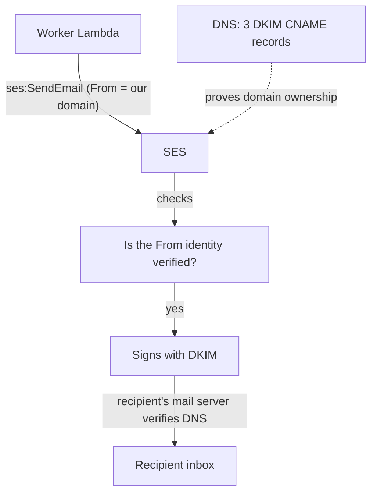
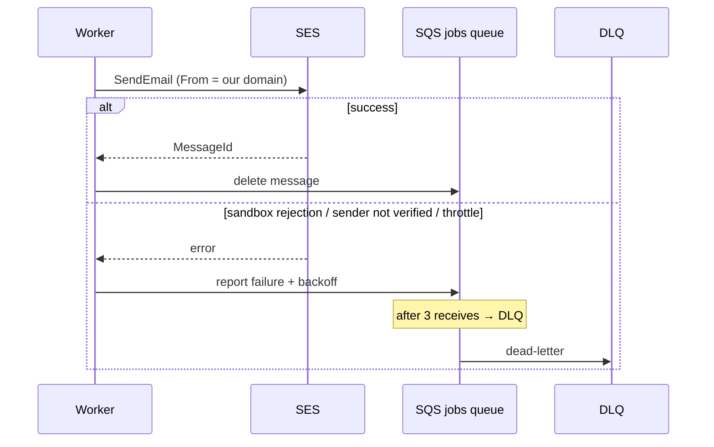
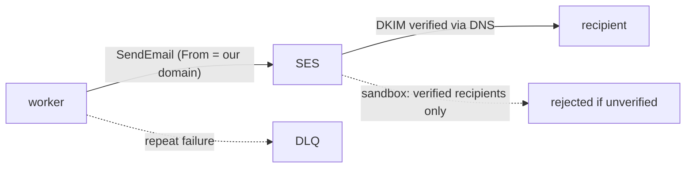

# 20. SES: sending the confirmation email

> **Honesty label: ✅ Built in repository** (`infra/src/jobs/email.ts`,
> `apps/worker/src/ses-mailer.ts`) plus a fallback `LogMailer`. ⚙️ **In practice MiniTickets starts in
> the SES sandbox**, which means emails only go to verified recipients unless production access was
> requested. The code says so.

**Prerequisites:** [12. Secrets/KMS](12-secrets-kms.md), [18. Lambda](18-lambda.md),
[19. DLQ](19-dead-letter-queue.md).

---

## A. The problem first

The whole point of the booking flow is that the customer gets a **confirmation email**. Sending email
from your own server is surprisingly hard:

- Mail servers that send from a random IP are treated as **spam** and blocked.
- You must prove you **own the sending domain**, or every provider distrusts you.
- You need **bounce and complaint** handling, or you damage your sending reputation.
- New accounts are **rate-limited** until approved.

The problem: **send transactional email reliably, from a domain we can prove we own, with AWS managing
the reputation and infrastructure.**

Where it shows up: `infra/src/jobs/email.ts` (identities + DKIM) and
`apps/worker/src/ses-mailer.ts` (the actual send).

---

## B. What it is

**Plain English:** **SES (Simple Email Service)** is AWS's email sender. You **verify** a domain or
address, and SES sends your mail with all the authentication that keeps it out of spam folders.

### The terms

- **SES (Simple Email Service)** — AWS's managed email sending (and receiving) service.
- **Identity** — a domain or an email address you have proven you own and may send as.
- **Domain identity** — the whole domain may send (e.g. `example.com`).
- **Email identity** — a single address (used here for the test recipient).
- **DKIM (DomainKeys Identified Mail)** — cryptographic signatures in the email headers proving it came
  from your domain. SES **Easy DKIM** gives you **three CNAME records** to add to DNS.
- **Sandbox** — the default new-account mode: you may send only to **verified** recipients, up to about
  **200 emails/day at 1/second**.
- **Production access** — SES lifts the sandbox limits after a review (you describe how you handle
  bounces/complaints).
- **`ses:FromAddress` condition** — an IAM condition that restricts *which* address a role may send from.
- **Bounce / complaint** — a delivery failure / a recipient marking your mail as spam.

---

## C. How it works internally

### The trust chain



The three DKIM CNAME records are what let the recipient's mail server **cryptographically verify** that
the message really came from your domain. Without DKIM, mail is much more likely to be spam-filtered or
rejected.

### The sandbox, and why it is the first thing to understand

A new SES account is in the **sandbox**. In the sandbox:

- You may send **only to verified addresses**.
- There is a low daily cap and a low per-second rate.

This is exactly why a **test recipient identity** is created in `email.ts`: so that, in the sandbox, the
worker can actually send to *your own* address while the domain is still unverified for arbitrary
recipients. In an interview, saying "we start in the sandbox and request production access when we need
it" is the correct, honest answer.

---

## D. Our MiniTickets implementation

### D1. The identities — `infra/src/jobs/email.ts`

```ts
const domainIdentity = new aws.ses.DomainIdentity(`${prefix}-domain`, { domain: inputs.domainName });
new aws.ses.DomainDkim(`${prefix}-dkim`, { domain: domainIdentity.domain });
// DKIM records come out as an output: sesDkimRecords -> copy into Cloudflare by hand

const testIdentity = new aws.ses.EmailIdentity(`${prefix}-test`, { email: inputs.testRecipient });
```

- **Domain identity + Easy DKIM** for the real domain; the three CNAME records are printed as a stack
  output and added **by hand** at the DNS provider (Cloudflare here), the same manual-DNS pattern as the
  ACM certificate ([08](08-tls-acm.md)).
- **Email identity** for the configurable test recipient (a **secret** value in config), which AWS
  verifies by emailing a link you click.
- The layer is **always on when a domain is configured**, and **not behind a switch** — identities are
  free, and the DNS records stay valid only while the identity exists. Create it once, keep it ready.

It returns `mailFrom`, `identityArns` and `dkimRecords`. Where they go:

- **`mailFrom`** → the worker's `MAIL_FROM` env var, and the `ses:FromAddress` condition on the worker
  role ([04](04-iam.md)).
- **`identityArns`** → the worker role's `ses:SendEmail` resource list — the Lambda may send **only**
  with these identities.

### D2. The sender — `apps/worker/src/ses-mailer.ts`

The mailer wraps an SES `SendEmailCommand`:

- `Source` = the configured `MAIL_FROM`.
- `Destination.ToAddresses` = the customer.
- A subject and a text body built from the booking.
- Optionally a **configuration set** for tracking (the code uses `UseConfigurationSetName`).

The mailer sits behind a small **`Mailer` interface**, so the handler (`handlers/booking-confirmed.ts`)
does not know SES exists. When no domain is configured, a **`LogMailer`** is used that just logs the
email instead of sending it — which is what makes local development work without AWS.

### D3. The IAM condition is the safety net

The worker role's SES statement is **not** simply "send any email":

```json
{ "Action": "ses:SendEmail", "Resource": "<our identity ARNs>",
  "Condition": { "StringEquals": { "ses:FromAddress": "<our sender>" } } }
```

The code comments why: even if the worker's credentials were somehow abused, they could not send email
**as anyone else**. Combined with the sandbox and the verified identity, this is defence in depth.

### Trace: the email that reaches the DLQ



This is the direct bridge to the flagship chapter: an SES failure that repeats is exactly what fills the
DLQ ([19](19-dead-letter-queue.md)).

---

## E. Security and permissions

**REACH.** The worker calls the SES API over HTTPS from **outside the VPC**
([02](02-vpc-and-networking.md), [18](18-lambda.md)).

**ALLOWED.** The worker role may `ses:SendEmail` **only** against **our identities** (`identityArns`)
**and only** with `ses:FromAddress` equal to our `mailFrom`. Verified identities and DKIM prove the domain
side; the sandbox limits blast radius on a new account.

**IDENTITY / CREDENTIALS.** The Lambda's role; temporary credentials.

**Encryption.** The SES API is HTTPS. Email content is not encrypted end-to-end by default (that would
require S/MIME/PGP, which is out of scope); the message contains an email address and booking details.
**Never log the message body** — the worker's error logging prints field names only, not the body
([19](19-dead-letter-queue.md)).

**Reputation as a security property.** Sending to unverified addresses in the sandbox is **blocked**, not
merely discouraged. This protects both you and AWS from abuse.

---

## F. The AWS console walkthrough

> Read-only. Do not delete an identity — it breaks sending and its DNS records.

1. **Amazon SES → Identities.** You should see the **domain identity** (status: verified, DKIM: success)
   and the **email identity** (the test recipient).
2. Open the domain identity → **Authentication (DKIM)**: the three CNAME records. Compare them with the
   DNS provider; they must match.
3. **Account dashboard**: shows the **sandbox** status, the daily/rate quotas, and the send statistics.
4. **Configuration sets**: if a configuration set is used, its tracking options.
5. **Suppression list** (production feature): addresses that bounced or complained — a real operational
   requirement once out of the sandbox.

Mapping: identities and DKIM → `infra/src/jobs/email.ts`; the send → `apps/worker/src/ses-mailer.ts`.

---

## G. Real production scenarios

### Scenario 1 — "The customer never received the email (and it is in the DLQ)."

- **Cause candidates:** SES is in the **sandbox** and the recipient is **not verified** (the most common
  by far); the identity verification failed; `ses:FromAddress` does not match; the account was
  rate-limited.
- **Investigate:** the worker's error log for the SES error code; the identity status in the console; the
  `ses:FromAddress` condition on the role.
- **Recover:** verify the recipient (sandbox), fix the identity, or request **production access**. Then
  **redrive** the DLQ slowly ([19](19-dead-letter-queue.md)).

### Scenario 2 — "Emails are landing in spam."

- **Cause:** DKIM records missing or wrong, or a poor sending reputation, or no SPF/DMARC alignment.
- **Investigate:** the identity's DKIM status and the DNS records.
- **Recover:** fix the DKIM CNAMEs; add SPF/DMARC as production hardening (💡 Conceptual).

### Scenario 3 — "We hit the sandbox sending limit."

- **Cause:** more than ~200 emails/day or more than 1/second in the sandbox.
- **Impact:** sends are **throttled**, which fails messages, which can fill the DLQ.
- **Recover:** request **production access**, and/or set **reserved concurrency** to slow the worker
  ([18](18-lambda.md)).

### Scenario 4 — "The same email was sent twice."

- **Cause:** at-least-once delivery plus a non-idempotent send. SES has **no idempotency key**, so the
  worker's own idempotency table is the guard ([13](13-dynamodb.md)). The honest limitation is documented
  in `handlers/booking-confirmed.ts`: the record is written **after** the send, so a crash in between can
  cause a rare duplicate.
- **Recover:** rely on the idempotency table; there is no SES-side dedup to lean on.

### Scenario 5 — "Bounces are damaging our reputation."

- **Cause:** sending to invalid addresses without handling bounces.
- **Recover (production):** configure a bounce/complaint handler and honour the suppression list. Not
  built in dev (💡 Conceptual).

### Cost and performance

- SES is very cheap per email; the **first 62,000 emails a month sent from an EC2/ECS/Lambda-hosted app
  are free** at the time of writing (verify), then a small per-1,000 price plus per-GB of attachments.
- Sending is fast; the constraint is the **rate limit** (and the sandbox limits).

---

## H. Decisions and alternatives

- **SES over a third-party provider.** Native AWS integration, IAM-scoped sending, and low cost. The
  alternative (SendGrid/Mailgun/Postmark) has richer deliverability tooling and template engines, at a
  different price and an external dependency.
- **Domain identity + Easy DKIM.** Proves domain ownership and improves deliverability. The alternative
  (single email identities) does not scale to arbitrary recipients.
- **Manual DNS records.** Because DNS is not in Route 53. The alternative (hosting the zone in Route 53)
  would let the records be created automatically.
- **`ses:FromAddress` condition.** Prevents sending as anyone else, even if credentials leaked.
- **LogMailer fallback.** Local development and tests run without AWS.
- **Sandbox is expected.** Start there, request production access when needed. This is a *phase*, not a
  defect.
- **Alternatives for handling load:** a dedicated email queue with its own DLQ (already the design via
  fan-out, [16](16-sns.md), [19](19-dead-letter-queue.md)), or a provider with a built-in retry/idempotency
  API.

---

## I. Interview preparation

### 30-second answer

> "SES sends the confirmation emails. MiniTickets verifies a domain identity with Easy DKIM — three CNAME
> records we add by hand — plus a verified test recipient for the sandbox. The worker role may send only
> with our identities and only from our configured address, via a `ses:FromAddress` condition. A new
> account is in the sandbox, so it can only send to verified addresses at ~200 a day and 1 per second;
> production access lifts that. SES has no idempotency key, so our own processed-jobs table prevents
> duplicate emails, and repeated SES failures dead-letter."

### Follow-up questions

- **Beginner:** What does SES do? *(→ sends email for you.)*
- **Beginner:** Why verify a domain? *(→ to prove you own it and avoid spam filtering.)*
- **Intermediate:** What is DKIM and why three CNAME records? *(→ cryptographic signatures; the records
  publish the public keys.)*
- **Intermediate:** What is the SES sandbox? *(→ verified recipients only, ~200/day, 1/s.)*
- **Intermediate:** How do we stop the worker sending as someone else? *(→ the `ses:FromAddress` IAM
  condition plus scoped identity ARNs.)*
- **Senior:** SES has no idempotency key — how do you avoid duplicate sends? *(→ the consumer's own
  idempotency table; the honest crash-window caveat.)*
- **Senior:** How do bounces/complaints affect design? *(→ suppression lists and a bounce handler;
  reputation management; not built here.)*
- **Senior:** How does an SES failure become a DLQ message? *(→ the worker reports failure; after 3
  receives the queue dead-letters it.)*

### Scenario questions

1. **"No email, message in the DLQ."** → sandbox + unverified recipient (most likely); then identity,
   IAM condition, throttling.
2. **"Mail in spam."** → DKIM/SPF/DMARC.
3. **"Duplicate email."** → idempotency table; SES has no dedup.

---

## J. Quick revision

**Five things to remember**

1. SES sends email; you must **verify a domain/identity** first.
2. **Easy DKIM** = **three CNAME records** added by hand; they prove domain ownership.
3. New accounts are in the **sandbox** (verified recipients only, ~200/day, 1/s) until production access.
4. The worker sends **only** with our identities and our From address (`ses:FromAddress` condition).
5. SES has **no idempotency key**; our `processed-jobs` table guards against duplicates; repeated failures
   **dead-letter**.

**One diagram**



**Three common mistakes**

1. Trying to send to unverified recipients while in the sandbox.
2. Forgetting the DKIM DNS records, so mail is spam-filtered.
3. Assuming SES deduplicates — it does not; idempotency is on us.

**Where next:** [21. CloudWatch](21-cloudwatch.md) — how we would *see* any of the above going wrong.
