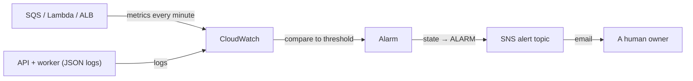
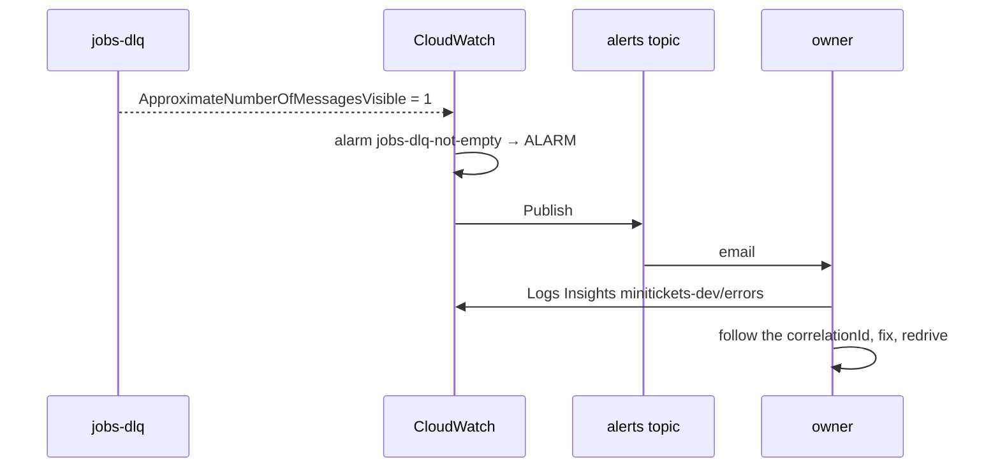
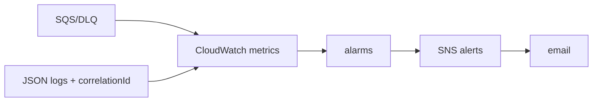

# 21. CloudWatch: logs, metrics, alarms and dashboards

> **Honesty label: ✅ Built in repository** (`infra/src/observability/*`), **⚙️ configured for
> deployment**. The **alarm definitions and specs** are unit-tested; whether a given alarm has fired in
> a live account is **not** verified here. The email subscription requires a human to confirm it.

**Prerequisites:** [17. SQS](17-sqs.md), [18. Lambda](18-lambda.md), [19. DLQ](19-dead-letter-queue.md),
[07. ALB](07-alb.md).

---

## A. The problem first

By this point MiniTickets has a lot of moving parts: an API on ECS, a worker Lambda, two queues and
their DLQs, an SES sender, a database. Something *will* break. The question is only: **will we know, and
will we know fast enough to help the customer before they complain?**

A system with no observability fails silently. A stuck queue, a crashing worker, an ALB returning 502s —
all of them are invisible unless something watches for them and tells a human. Worse, without **order**
in the logs, investigating a single booking across the API and the worker is guesswork.

The problem: **collect logs and metrics, turn the important ones into alerts that reach a human, and make
one customer's journey traceable end to end.**

Where it shows up: all of `infra/src/observability/` and the structured logging in both apps.

---

## B. What it is

**Plain English:** **CloudWatch** is AWS's monitoring service. It stores logs, records metrics (numbers
over time), watches those numbers with **alarms**, and draws **dashboards**. When an alarm fires, it
publishes to an **SNS topic** that emails a person.

### The terms

- **Observability** — logs + metrics + traces together: enough to understand the system's state.
- **Log group / log stream** — a container of logs / one source's ordered log lines.
- **Structured (JSON) logging** — every log line is a JSON object, so fields can be queried.
- **Correlation id (`correlationId`)** — a value following one booking across the API and the worker, so
  all its log lines can be found together.
- **Metric** — a number over time (e.g. `ApproximateNumberOfMessagesVisible`).
- **Namespace** — the grouping of metrics (e.g. `AWS/SQS`, `AWS/Lambda`, `AWS/ApplicationELB`).
- **Statistic** — how a period's samples collapse to one number (Sum, Maximum, Average).
- **Period** — the length of one data point window (e.g. 60 s, 300 s).
- **Alarm state** — `OK`, `ALARM`, or `INSUFFICIENT_DATA`.
- **`treatMissingData`** — what a period with **no data** means (`notBreaching` = fine; `ignore` = keep
  the last state).
- **Alarm action** — what happens on a state change (here: publish to the alert SNS topic).
- **Metric math** — a calculation over several metrics (used for the ALB 5xx alarm).
- **Logs Insights** — a query language over log groups.
- **Dashboard** — a page of metric/alarm widgets.

---

## C. How it works internally

### The flow, one line

### Why `treatMissingData` is not a detail

A metric with no data is ambiguous: it might mean "everything is fine" (no traffic) or "the metric
stopped reporting." CloudWatch lets you choose:

- **`notBreaching`** — no data = fine. Used for the **oldest-message-age**, **worker-errors** and
  **alb-5xx** alarms: a quiet queue or a day with no errors should not page anyone.
- **`ignore`** — no data = keep the current state. Used **only** for the **DLQ** alarm, and for a precise
  reason: SQS stops emitting a queue's metrics after about **6 hours** of inactivity. The DLQ is read by
  nobody, so a message could sit there **silently**; with `notBreaching`, the alarm would flip back to
  OK (and email "OK") **while the message is still there**. `ignore` keeps the last real state. A redrive
  or a purge *is* activity, so it reports 0 and the alarm returns to OK.

That single choice is the difference between an alarm that works and one that lies.

---

## D. Our MiniTickets implementation

### D1. The four alarms — `infra/src/observability/alarm-specs.ts`

The specs are **plain data** (no AWS resources), so a unit test can check every alarm and its reason.
`observability/alarms.ts` turns each spec into a real `aws.cloudwatch.MetricAlarm` that emails through
the alert topic. Every alarm **name must start with `minitickets-dev-`**, because the deploy role may
manage only alarms with that prefix ([24](24-oidc-cicd.md)).

| # | Alarm (`minitickets-dev-...`) | Watches | Why / threshold |
| --- | --- | --- | --- |
| 1 | `jobs-dlq-not-empty` | `ApproximateNumberOfMessagesVisible` on `jobs-dlq` | A booking email failed 3 times. **One** message is enough (`> 0`, 1 min). `treatMissingData: ignore`. |
| 2 | `jobs-oldest-message-age` | `ApproximateAgeOfOldestMessage` on `jobs` | Nobody is reading the queue. Threshold **≥ 300 s**, because even a failing message leaves within ~+190 s. `notBreaching`. |
| 3 | `worker-errors` | `Errors` on the Lambda (Sum) | The function **crashed or timed out** (not a failed message — those are caught and counted as success). Threshold `> 0` over 5 min. `notBreaching`. |
| 4 | `alb-5xx` | **metric math**: `FILL(target_5xx,0) + FILL(elb_5xx,0)` | Visitors got server errors. Threshold **≥ 5 in 5 min**. `notBreaching`. |

Two of these deserve emphasis:

- **Alarm 2 is the honest "stuck" alarm.** The threshold of 300 s is *derived*, not guessed: a healthy
  message disappears in seconds, and even a **failing** one leaves after roughly 0 s + 10 s + 40 s + 120 s
  before it dead-letters ([19](19-dead-letter-queue.md)). So ≥ 300 s means **nothing is reading the
  queue** — which is a completely different failure from "one message dead-lettered." This is why the
  handbook keeps saying: **an empty DLQ does not mean customers are fine.**
- **Alarm 1's description is an on-call runbook.** It literally tells you what to do: *"Find why: Logs
  Insights query `minitickets-dev/errors`, then follow its correlationId. Redrive after the fix."* An
  alarm that tells you the next step is worth ten that do not.

### D2. The alert topic — `infra/src/observability/alert-topic.ts`

`minitickets-dev-alerts`, an SNS topic with a **topic policy** allowing only CloudWatch alarms of this
account whose names start with `minitickets-dev-` to publish (confused-deputy conditions,
[16](16-sns.md)), and an **email subscription** you confirm by hand
([22](22-ssm-release.md)-style manual step). The topic is deliberately **not encrypted**, with the reason
documented (CloudWatch cannot publish to a topic encrypted with the free AWS-managed `aws/sns` key; the
messages contain no personal data).

### D3. Structured logs and the three saved queries — `infra/src/observability/log-queries.ts`

Both apps log **JSON**, carrying a `correlationId`, so Logs Insights can filter on any field. Three
**saved queries** (folder `minitickets-dev`) make investigation one click:

| Saved query | What it answers |
| --- | --- |
| `minitickets-dev/follow-one-request` | Paste a `correlationId` and see the API's **and** the worker's lines in order — the whole booking journey. |
| `minitickets-dev/errors` | Every error line of both apps, newest first — **where to start when an alarm fires.** |
| `minitickets-dev/worker-durations` | How many worker calls, how long (p95, max vs the 10 s timeout), how much memory. |

### D4. The dashboard and log groups

`observability/dashboard-body.ts` builds the metric/alarm widgets (the query text is shared with the
saved queries so the two never drift). Log groups are created in `compute/logs.ts` with a **7-day
retention** — long enough to investigate, short enough to bound cost.

### Trace: from a failure to a human

---

## E. Security and permissions

**REACH.** Apps write logs and CloudWatch reads metrics inside AWS; the alarm publishes to SNS. No
security-group involvement; the calls are AWS APIs.

**ALLOWED.**
- The **worker role** may write to **one** log group ([04](04-iam.md)).
- The API task role / ECS execution role writes its logs ([06](06-ecs-fargate.md)).
- The **alert topic policy** allows only CloudWatch alarms of this account with the `minitickets-dev-`
  prefix ([16](16-sns.md)).
- The **deploy role** may manage only `minitickets-dev-*` alarms and the named dashboard
  ([24](24-oidc-cicd.md)).

**IDENTITY / CREDENTIALS.** Roles; the alarm actions are performed by the CloudWatch service identity,
authorized by the topic policy.

**Encryption.** Log groups are encrypted at rest (CloudWatch default). Logs **must not contain secrets or
personal data**: the worker's error logging prints field names, not the message body
([19](19-dead-letter-queue.md)).

---

## F. The AWS console walkthrough

> Read-only, except confirming the subscription (which is a deliberate, safe action).

1. **CloudWatch → Alarms → All alarms.** Confirm the four `minitickets-dev-*` alarms and their states.
   Open one → **History** to see state transitions.
2. **CloudWatch → Logs → Log groups.** The `api` and `worker` groups, with **7-day retention** and JSON
   lines. Open **Logs Insights** → **Saved queries** → `minitickets-dev/errors`.
3. **CloudWatch → Dashboards.** Open `minitickets-dev`.
4. **SNS → Topics → `minitickets-dev-alerts` → Subscriptions.** Confirm the email subscription is
   **confirmed** (not "Pending confirmation").
5. **CloudWatch → Metrics.** Explore `AWS/SQS` (queue depth, oldest age) and `AWS/Lambda` (errors,
   duration) to see the underlying numbers behind each alarm.

Mapping: alarms → `observability/alarm-specs.ts` + `alarms.ts`; saved queries →
`observability/log-queries.ts`; the topic → `observability/alert-topic.ts`.

---

## G. Real production scenarios

### Scenario 1 — "We got a `jobs-dlq-not-empty` email."

- **Do:** open the saved `minitickets-dev/errors` query, find the failure, follow its `correlationId`
  across the API and worker, fix the cause, then **redrive** the DLQ ([19](19-dead-letter-queue.md)).
- **Remember:** one message = one customer without an email. The threshold is intentionally low.

### Scenario 2 — "The DLQ alarm fired, then flipped back to OK by itself."

- **Cause:** this is the trap `treatMissingData: ignore` was designed to prevent. If it happened, the
  state changed because of real activity (a redrive or a purge reported 0). If you did not do that,
  investigate how the message left.
- **Lesson:** nail the missing-data semantics of each alarm; they are not cosmetic.

### Scenario 3 — "No email arrived but the DLQ is empty."

- **Cause:** the failure is latency, not dead-lettering. Look at `jobs-oldest-message-age` and the source
  queue's age metric — the worker is falling behind or the trigger is disabled.
  **Empty DLQ ≠ served customers.**

### Scenario 4 — "The `alb-5xx` alarm fired."

- **Do:** the description points at `minitickets-dev/errors` and the ECS service events
  ([07](07-alb.md)). Five 5xx in five minutes is a real incident (a single stray 500 is not, in dev).

### Scenario 5 — "The `worker-errors` alarm fired."

- **Cause:** an escaped exception or timeout, **not** a per-message failure. The whole batch will
  reappear after the visibility timeout, so idempotency matters
  ([13](13-dynamodb.md), [18](18-lambda.md)).

### Scenario 6 — "Alarm emails stopped arriving."

- **Cause:** the SNS email subscription was never **confirmed**, or it expired (pending subscriptions
  expire after 3 days).
- **Recover:** confirm it in the SNS console.

### Cost and performance

- **Logs**: ingestion + storage per GB; the 7-day retention bounds it. Logs Insights queries are billed
  per GB scanned (~$0.005/GB; a few MB a day here).
- **Metrics**: standard service metrics are free; **custom** metrics (like Container Insights, disabled
  in [06](06-ecs-fargate.md)) cost a few dollars a month.
- **Alarms**: about $0.10 per alarm-month, plus notification costs (verify).
- **Dashboard**: the first three dashboards are free, then a small monthly charge.

---

## H. Decisions and alternatives

- **Four alarms chosen by "is a customer affected right now / is something stuck?"** — not a wall of
  every possible metric. The alarm-specs file documents each reason, and a test enforces the prefix.
- **Runbook text inside the alarm description.** The alert tells the on-call what to do; no separate wiki
  page to find at 3 a.m.
- **`treatMissingData` per alarm.** Correct semantics instead of a default that would lie about the DLQ.
- **Structured JSON logging with a correlation id.** Cross-service tracing without a full tracing system.
- **Saved queries shared with the dashboard.** One source of truth for query text.
- **Metrics over traces.** MiniTickets uses logs+metrics; a full distributed tracer (X-Ray or OpenTelemetry)
  is 💡 **Conceptual** and would add cost/complexity. For this size, a correlation id in JSON logs covers
  most of the value.
- **Alternatives:** CloudWatch Logs → a third-party (Datadog/Grafana/Sentry); Prometheus/Grafana;
  X-Ray for tracing. All are valid at larger scale.

---

## I. Interview preparation

### 30-second answer

> "We run four CloudWatch alarms, each chosen by whether a customer is affected: DLQ-not-empty (a booking
> email failed three times), oldest-message-age ≥ 5 minutes (nothing is reading the queue), worker-errors
> (the Lambda crashed or timed out), and ALB 5xx (≥ 5 in five minutes, summed with metric math across
> target and ELB errors). They publish to an SNS topic that emails an owner, and each alarm description
> contains the runbook. Logs are structured JSON with a correlation id, and three saved Logs Insights
> queries make investigation one click."

### Follow-up questions

- **Beginner:** What is a metric, and what is an alarm? *(→ a number over time; a rule that watches it.)*
- **Beginner:** How does an alarm reach a human? *(→ it publishes to an SNS topic with an email
  subscription.)*
- **Intermediate:** Why is the DLQ alarm's `treatMissingData` set to `ignore`? *(→ SQS stops reporting a
  quiet queue after ~6 h; `notBreaching` would flip to OK while a message still waits.)*
- **Intermediate:** Why is the age threshold 300 s? *(→ even a failing message leaves within ~190 s, so
  ≥ 300 s means nothing is reading.)*
- **Intermediate:** Why does `worker-errors` not fire for a single bad message? *(→ the handler catches
  those and counts the call as success; only escapes/timeouts count.)*
- **Senior:** How do you avoid alarm noise? *(→ correct statistic/period/threshold, `treatMissingData`,
  and rate-based thresholds in production.)*
- **Senior:** How do you trace one request across services? *(→ structured logs plus a correlation id;
  a full tracer is the next step.)*
- **Senior:** What would you add for production? *(→ dashboards/SLOs, rate-based 5xx, trace sampling,
  on-call routing, composite alarms.)*

### Scenario questions

1. **"DLQ alarm fired."** → errors query → correlationId → fix → redrive.
2. **"Emails late, DLQ empty."** → age alarm and source-queue age; a different failure.
3. **"5xx spike."** → ALB target health + ECS events + errors query.

---

## J. Quick revision

**Five things to remember**

1. Four alarms: **DLQ-not-empty, oldest-message-age, worker-errors, alb-5xx**; each has a documented
   reason.
2. `treatMissingData` matters: the DLQ uses **`ignore`**, the others **`notBreaching`**.
3. Alarms publish to **`minitickets-dev-alerts`** (SNS → email); the subscription needs human
   confirmation.
4. Logs are **JSON with a correlation id**; three **saved Logs Insights queries** do the investigation.
5. **An empty DLQ ≠ healthy** — watch the source-queue age too.

**One diagram**

**Three common mistakes**

1. Using `notBreaching` on the DLQ alarm (it would flip to OK while a message lingers).
2. Forgetting to confirm the SNS email subscription (alarms fire into the void).
3. Logging personal data or secrets into CloudWatch.

**Where next:** [22. SSM Parameter Store and the release record](22-ssm-release.md).
