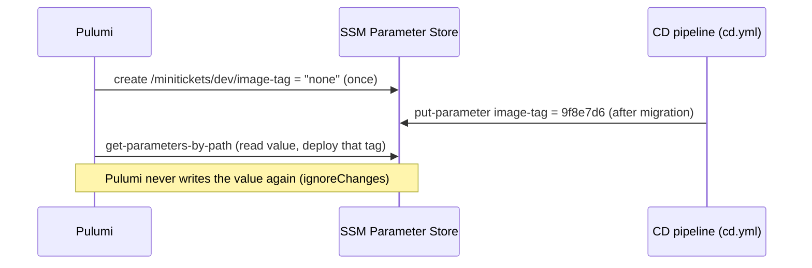
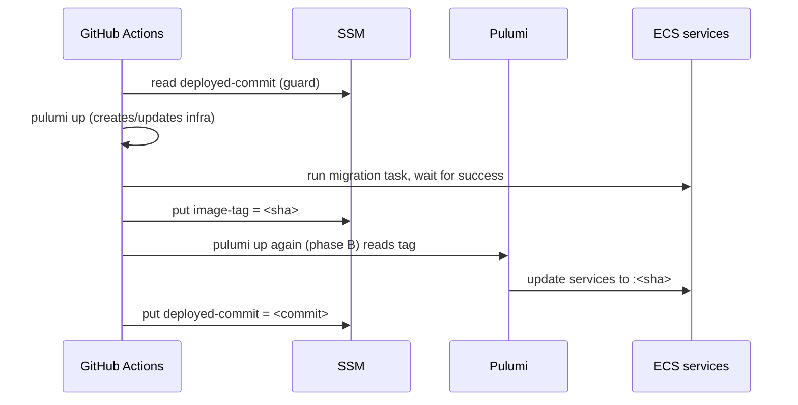
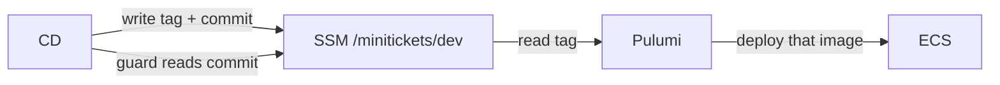

# 22. SSM Parameter Store and the release record

History: see [CHANGELOG.md](../CHANGELOG.md) or run `pnpm docs:history`

> **Honesty label: ✅ Built in repository** (`infra/src/release.ts`, `scripts/deploy-guard.sh`,
> `.github/workflows/cd.yml`), **⚙️ configured for deployment**.

**Prerequisites:** [05. ECR](05-ecr.md), [06. ECS/Fargate](06-ecs-fargate.md), [24. OIDC/CI-CD](24-oidc-cicd.md).

---

## A. The problem first

Two related deployment problems:

1. **"Which image is deployed right now?"** The CD pipeline builds an image tagged with a git SHA and
   pushes it to ECR. Something must record **which SHA is live**, so that a local `pulumi up` and a CI
   deploy agree and cannot silently roll the app back to an old image.
2. **"Has an old, already-approved deploy just overwritten newer infrastructure?"** Deploys are approved
   by a human and can be slow; if an older approved run executes *after* a newer one, it could delete or
   revert newer resources. This actually happened (the code names the incident of 2026-10-15), and a
   guard was added.

The problem: **a single, shared source of truth for the deployed image tag and the last-applied
infrastructure commit, writable by CI but not owned by any one deploy.**

Where it shows up: `infra/src/release.ts` and `scripts/deploy-guard.sh`.

---

## B. What it is

**Plain English:** **SSM Parameter Store** (part of AWS Systems Manager) is a small settings board in
AWS. You store named values; code reads them by name. MiniTickets stores two: the **deployed image tag**
and the **last deployed commit**.

### The terms

- **SSM Parameter Store** — AWS's managed key/value configuration service.
- **Parameter** — one named value (a "String", "StringList", or "SecureString" for secrets).
- **Path / hierarchy** — parameter names can be paths (`/minitickets/dev/...`) that group and allow
  listing by prefix.
- **Tier** — `Standard` (free, up to 10,000 per account/region) vs `Advanced` (paid, bigger values).
- **`insecureValue`** — storing a **non-secret** value in plain Pulumi state (so previews show it),
  versus `value` which marks it secret.
- **`ignoreChanges`** — tell Pulumi to ignore changes to a field made outside Pulumi (here, the value CD
  writes).
- **Two owners** — the pattern where Pulumi **creates** a resource once and a different system (CD)
  **updates** part of it.
- **Deploy guard** — a check that refuses to deploy if the running pipeline's code is older than what was
  deployed last.

---

## C. How it works internally

### The two-owner pattern



Three rules make this safe:

1. **Pulumi creates the parameter once** with a placeholder (`none`) and never changes the value.
2. **CD writes the value** after a successful migration.
3. **Pulumi reads** the current value from AWS on every preview/up, so the services run that tag.

**Why not put the tag in Pulumi config?** Because the deployed tag changes **on every deploy, from GitHub
Actions**. In config it would mean a commit to `main` per deploy, or a value that exists on only one
machine. In SSM it is **one value in AWS** that both a local `pulumi up` and CD read, so neither can
accidentally roll the app back.

### Why `ignoreChanges` on the value is essential

Without it, the next `pulumi up` would compare "AWS says `9f8e7d6`, my code says `none`" and write
`none` back — **breaking the next deploy** (no tag). `ignoreChanges: ["insecureValue"]` tells Pulumi:
"create it; after that, the value is not yours to manage."

### The deploy guard

`/minitickets/dev/deployed-commit` records the **full git commit whose infrastructure code CD applied
last**. `scripts/deploy-guard.sh` **reads it before any `pulumi` command** and **refuses older code**, so
an old approved run cannot clobber newer resources. Its last step **writes** the commit after a
successful deploy. This was added directly in response to a real incident (2026-10-15), which is a
useful, honest story to tell in an interview: *a bug became a guard.*

### Reading the value without failing on the first deploy

`readDeployedImageTag()` uses **`getParametersByPath`** (list everything under `/minitickets/dev`) rather
than `getParameter`. Why? Because on the **very first** `pulumi up`, the parameter does not exist yet;
`getParameter` would **fail**, while a path listing simply returns empty. It then **`unsecret`s** the
result (the AWS provider marks all listed values secret, but a git SHA is not secret, and hiding it would
hide which tag a preview deploys). A small, careful design against a first-run failure.

---

## D. Our MiniTickets implementation

### D1. The two parameters — `infra/src/release.ts`

```ts
export const imageTagParameterName = "/minitickets/dev/image-tag";
export const deployedCommitParameterName = "/minitickets/dev/deployed-commit";

const parameter = new aws.ssm.Parameter(`${prefix}-image-tag`, {
  name: imageTagParameterName,
  type: "String", tier: "Standard",
  insecureValue: NO_TAG_YET,                     // the placeholder "none"
  tags: tagsFor(`${prefix}-image-tag`),
}, { ignoreChanges: ["insecureValue"] });        // CD owns the value after creation
```

And the same shape for `deployed-commit`. Both are **always on**: a Standard parameter is free.

### D2. Who consumes what

| Value | Consumer |
| --- | --- |
| `parameterName`, `parameterArn` | CD (the deploy role may write **only** these two) |
| `deployedCommitParameterArn` | the deploy guard (CD reads/writes it) |
| `readDeployedImageTag()` | `index.ts` — the API and web task definitions use whatever tag is deployed |

### D3. The path and IAM

Because both parameters share the `/minitickets/dev` path, the deploy role's IAM can name **exactly** the
path and the two parameters ([24](24-oidc-cicd.md)), and `getParametersByPath` is checked against the
**path**. One decision (put everything under one path) makes the IAM narrow.

### Trace: a deploy writing the tag



---

## E. Security and permissions

**REACH.** SSM is reached over HTTPS by the CD role and by Pulumi (locally or in CI).

**ALLOWED.** The **deploy role** may read/write **only** the two parameters (plus `getParametersByPath`
on the `/minitickets/dev` path and `DescribeParameters` on `*`). It cannot touch any other SSM parameter
([24](24-oidc-cicd.md)). The parameter values are **not secrets** (a git SHA is public in the repo), so
they are stored as plain Strings — not SecureStrings.

**IDENTITY / CREDENTIALS.** The CD role, assumed via OIDC (temporary credentials,
[24](24-oidc-cicd.md)).

**Encryption.** Standard SSM parameters are not secret; `String` type. If a value were sensitive you
would use a `SecureString` (KMS-encrypted). MiniTickets puts actual secrets in **Secrets Manager**
([12](12-secrets-kms.md)) and only non-secret bookkeeping here.

---

## F. The AWS console walkthrough

> Read-only.

1. **Systems Manager → Parameter Store.** Open the `/minitickets/dev` path. You should see `image-tag`
   and `deployed-commit`.
2. Open `image-tag`: the value is a git SHA (or `none` before the first deploy). Note the **type
   (String)** and **tier (Standard)**.
3. Open `deployed-commit`: the commit the guard compares against.
4. **Who changed it?** CloudTrail shows the `PutParameter` calls and which role made them.
5. Compare the tag with **ECR → the api repo**: that SHA should exist as an image
   ([05](05-ecr.md)).

Mapping: both parameters → `infra/src/release.ts`; the guard → `scripts/deploy-guard.sh`.

---

## G. Real production scenarios

### Scenario 1 — "A deploy rolled the app back to an old image."

- **Cause:** someone ran `pulumi up` with a Pulumi config value, or a local run wrote the wrong tag.
- **Investigate:** the `image-tag` value and CloudTrail's `PutParameter` history.
- **Recover:** the two-owner rule prevents this: only CD writes the tag; Pulumi only reads. If it
  happened, `ignoreChanges` is missing or something bypassed the pipeline.

### Scenario 2 — "An old approved deploy deleted newer resources."

- **Cause:** a slow, approved run executing after a newer one.
- **Impact:** newer infrastructure deleted or reverted — the 2026-10-15 incident.
- **Recover/prevent:** the **deploy guard** (`deployed-commit`) refuses older code. This is the guard
  that exists *because* of that incident.

### Scenario 3 — "First deploy fails: parameter not found."

- **Cause:** code used `getParameter` instead of `getParametersByPath`.
- **Recover:** MiniTickets already uses the path listing so the first run succeeds.

### Scenario 4 — "The tag says a SHA that isn't in ECR."

- **Cause:** the image was never pushed (publish failed) or was expired by the lifecycle policy
  ([05](05-ecr.md)).
- **Investigate/recover:** verify the image exists; re-publish or roll back. The lifecycle policy's
  priority-1 rule (keep 10 deployed images) is the prevention.

### Cost and performance

- Standard parameters are **free** (up to 10,000). Reads at deploy time are negligible.

---

## H. Decisions and alternatives

- **SSM over Pulumi config for the deployed tag.** A single shared source of truth, no commit-per-deploy.
- **Two owners (Pulumi creates, CD writes).** Clean separation; `ignoreChanges` enforces it.
- **One path for both parameters.** Makes IAM narrow (`/minitickets/dev`).
- **Non-secret `String` type.** A git SHA is public; SecureString would be overkill.
- **A deploy guard on `deployed-commit`.** A concrete fix for a concrete incident.
- **`getParametersByPath`.** Tolerates the first deploy.
- **Alternatives:** store the tag as an ECS task-definition tag (less explicit), as a Git tag (requires
  a push), or in a DynamoDB table (more machinery). SSM is the standard "small config in AWS" tool.

---

## I. Interview preparation

### 30-second answer

> "We record the deployed image tag in SSM Parameter Store at `/minitickets/dev/image-tag`, and the last
> deployed infrastructure commit at `/minitickets/dev/deployed-commit`. Pulumi creates both once with a
> placeholder and ignores later value changes; the CD pipeline writes the values. Pulumi reads the tag on
> every up so the services run exactly the deployed image. The deployed-commit powers a deploy guard that
> refuses an older approved run after a newer one — added after a real incident."

### Follow-up questions

- **Beginner:** What is SSM Parameter Store? *(→ managed key/value config in AWS.)*
- **Beginner:** Why not put the tag in a config file? *(→ it changes per deploy, from CI; you'd need a
  commit each time.)*
- **Intermediate:** Why `ignoreChanges` on the value? *(→ so Pulumi doesn't overwrite CD's value with the
  placeholder.)*
- **Intermediate:** What does the deploy guard do? *(→ refuses to deploy if this run's code is older than
  the last-applied commit.)*
- **Intermediate:** Why `getParametersByPath` instead of `getParameter`? *(→ the first deploy has no
  parameter yet; a path listing returns empty instead of failing.)*
- **Senior:** Explain the two-owner pattern and why it prevents accidental rollbacks. *(→ one writer for
  the value; both a local up and CI read the same value.)*
- **Senior:** How would you rotate or recover if the parameter were corrupted? *(→ CloudTrail history,
  restore the correct value, guard against further writes.)*

### Scenario questions

1. **"Unexpected rollback."** → only CD should write the tag; check config/`ignoreChanges`.
2. **"Old deploy clobbered new infra."** → the deploy guard is the fix.
3. **"Tag not in ECR."** → publish/expiry; lifecycle policy prevents it.

---

## J. Quick revision

**Five things to remember**

1. Two SSM parameters under `/minitickets/dev`: **image-tag** and **deployed-commit**.
2. **Pulumi creates once, CD writes the value, Pulumi reads it** — the two-owner pattern.
3. **`ignoreChanges`** stops Pulumi overwriting CD's value with the placeholder; **`getParametersByPath`**
   survives the first deploy.
4. The **deploy guard** refuses an older approved run (added after the 2026-10-15 incident).
5. Values are **non-secret Strings**; real secrets live in Secrets Manager.

**One diagram**



**Three common mistakes**

1. Letting Pulumi manage the value, overwriting CI's tag.
2. Using `getParameter` and failing on the first deploy.
3. Storing a real secret as a plain `String` parameter.

**Where next:** [23. AWS Budgets](23-budgets.md).
