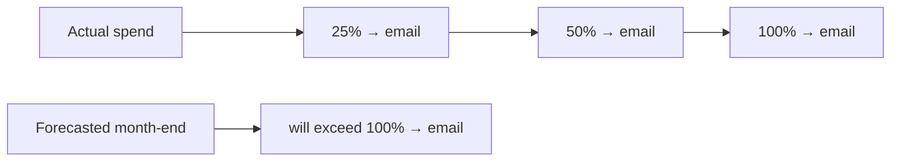
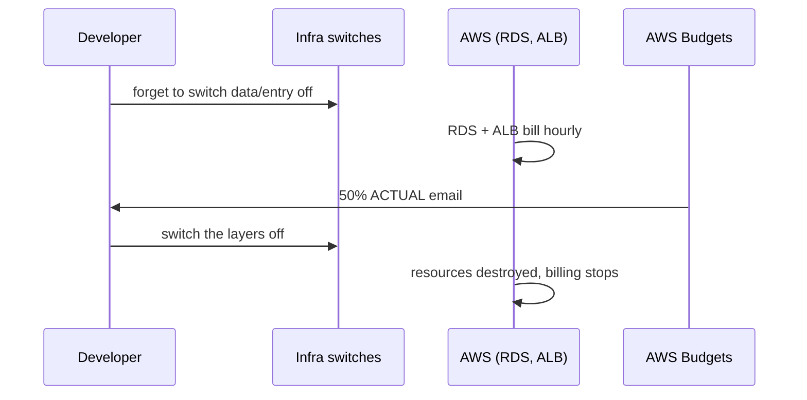
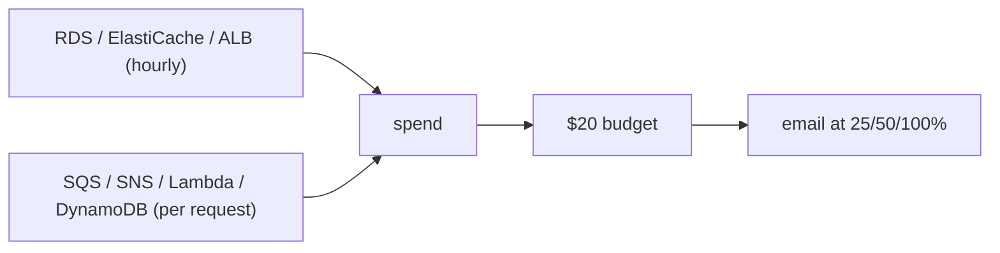

# 23. AWS Budgets: the cost smoke alarm

History: see [CHANGELOG.md](../CHANGELOG.md) or run `pnpm docs:history`

> **Honesty label: ✅ Built in repository** (`infra/src/budget.ts`), **⚙️ configured for deployment**.
> The budget **warns only**; it never stops anything.

**Prerequisites:** [01. What is AWS?](01-what-is-aws.md) (the cost model), [21. CloudWatch](21-cloudwatch.md)
(the alerting idea).

---

## A. The problem first

Cloud spending grows **quietly**. Nobody gets a phone call when a resource is left running; the bill just
arrives at the end of the month, sometimes with a number that makes you close the laptop. For a learning
project this is especially dangerous: it is easy to leave an RDS instance, a NAT gateway, or a load
balancer running after an experiment, and an idle RDS + ALB can quietly cost tens of dollars a month.

The problem: **know when spending is heading somewhere unwanted — before the month ends — without
building a whole cost-management system.**

Where it shows up: `infra/src/budget.ts`.

---

## B. What it is

**Plain English:** **AWS Budgets** is an email when spending gets high. You set a limit and thresholds;
AWS watches your real and predicted spend and emails you as you approach or pass them.

### The terms

- **Budget** — a spending limit you define (here, a monthly cost budget of **$20**).
- **Actual** spend — what you have really spent so far this period.
- **Forecasted** spend — AWS's prediction of the period-end total based on the trend so far.
- **Threshold** — the point that triggers a notification, as a **percentage** here (25%, 50%, 100%).
- **Notification type** — `ACTUAL` or `FORECASTED`.
- **Credits** — AWS promotional credits. `includeCredit: false` means the budget tracks **real usage**
  even while credits pay the bill.
- **Cost allocation tag** — a tag used to group/split costs. MiniTickets tags with `Project`,
  `Env`, `ManagedBy`.

---

## C. How it works internally

### What the four notifications mean



- **25% and 50% (ACTUAL)** are early warnings: plenty of time to react.
- **100% (ACTUAL)** means the limit is reached.
- **100% (FORECASTED)** is the most valuable one: AWS predicts the month-end total and warns **before**
  you actually spend it — giving you time to act.

### Why `includeCredit: false` is a deliberate, interesting choice

Many new accounts have promotional credits. With credits applied, the *bill* might be near zero even
though the account is **using** a lot. Setting `includeCredit: false` makes the budget track **real
usage**, so you see what the project **would** cost once the credits run out. This turns the budget from
"tell me my bill" into "tell me the true running cost" — a genuinely useful signal for a learning project
that must become sustainable.

### Why a budget is not a guard rail

Crucially: **AWS Budgets only warns.** It does not stop resources, does not deny API calls, and does not
prevent a runaway. To actually *cap* spending you would need different tools (e.g. a billing alarm that
triggers an automated response, AWS Service Quotas, or, in some setups, a "kill switch" automation). This
is an honest limitation to state in an interview: **Budgets is an observability tool for money.**

---

## D. Our MiniTickets implementation

`createBudget({ alertEmail })` in `infra/src/budget.ts`:

```ts
new aws.budgets.Budget(`${prefix}-monthly-budget`, {
  name: `${prefix}-monthly-cost`,
  budgetType: "COST",
  limitAmount: "20",
  limitUnit: "USD",
  timeUnit: "MONTHLY",
  costTypes: { includeCredit: false },
  notifications: [
    notification(inputs.alertEmail, 25, "ACTUAL"),
    notification(inputs.alertEmail, 50, "ACTUAL"),
    notification(inputs.alertEmail, 100, "ACTUAL"),
    notification(inputs.alertEmail, 100, "FORECASTED"),
  ],
  tags: { Project: "minitickets", Env: "dev", ManagedBy: "pulumi" },
});
```

A small helper (`notification`) builds each threshold block so the four alerts are not copy-pasted — the
same "one definition, no drift" instinct that runs through the whole infra codebase. The alert email is
the **same address** used by the CloudWatch alert topic ([21](21-cloudwatch.md)), so all operational and
cost mail lands in one place.

### How it connects to the architecture

The budget exists **because** MiniTickets is built in cost-switchable layers (`dataEnabled`,
`computeEnabled`, `entryEnabled`, `cdnEnabled`, [01](01-what-is-aws.md)). The idle costs the budget
watches for are exactly the hourly-billed resources:

| Resource | Billing | Idle cost? |
| --- | --- | --- |
| VPC, subnets, routes, IGW | free | no |
| Security groups, IAM, SSM parameters | free | no |
| SQS, SNS, DynamoDB (on-demand), Lambda | request-based | no (idle ≈ free) |
| **RDS Postgres** | per hour + storage | **yes** |
| **ElastiCache** | per hour per node | **yes** |
| **ALB** | per hour + LCU | **yes** |
| **NAT gateway** (not used) | per hour + GB | would be |
| CloudFront | per request + GB | low when quiet |

So the budget is really watching the **hourly** services. Turning the data and entry switches off is the
real cost control; the budget is the alarm that tells you when something is left on.

### Trace: an accidental idle cost



---

## E. Security and permissions

**REACH.** Budgets is a global billing feature; the Pulumi/CI principal creates it like any other
resource.

**ALLOWED.** The **deploy role** is granted `budgets:*` among the stack services ([24](24-oidc-cicd.md)),
and the alarm email address comes from Pulumi config (`alertEmail`).

**IDENTITY / CREDENTIALS.** Standard role-based; the budget is a configuration, not a running process
with its own identity.

**Data sensitivity.** The alert email is a configured address; the budget itself contains only cost
thresholds, no secrets.

---

## F. The AWS console walkthrough

> Read-only. Editing the budget changes when you get warned.

1. **Billing and Cost Management → Budgets.** Open `minitickets-dev-monthly-cost`. Confirm the $20 limit
   and the four notifications.
2. **Billing → Cost Explorer** (read-only): view actual cost by service and by tag. Filter by
   `Project = minitickets` to see only this project's spend.
3. **Cost Explorer → group by Service**: confirm RDS/ElastiCache/ALB dominate the hourly cost, and that
   the request-based services are near zero when idle.
4. **Billing → Free Tier**: check which free-tier allowances are in use.
5. **Billing and Cost Management → Cost allocation tags**: confirm `Project`, `Env`, `ManagedBy` are
   activated so Cost Explorer can group by them.

Mapping: the budget → `infra/src/budget.ts`; the tags on every resource → `infra/src/tags.ts`.

---

## G. Real production scenarios

### Scenario 1 — "We got a 50% ACTUAL email."

- **Cause:** most likely an hourly resource left running (RDS, ElastiCache, ALB) or an experiment with a
  NAT gateway or extra tasks.
- **Investigate:** Cost Explorer grouped by service and by tag.
- **Recover:** switch the offending layer off, or right-size the resource.

### Scenario 2 — "A FORECASTED 100% email before we spent anything near the limit."

- **Cause:** the *trend* is steep (e.g. an expensive resource was just started mid-month).
- **Impact:** none yet — this is the early warning doing its job.
- **Recover:** act now; you have time.

### Scenario 3 — "The bill is near zero but the budget still warns."

- **Cause:** `includeCredit: false` — the budget tracks **real usage**, not the credited bill.
- **This is intended.** It shows what the project would cost without credits.

### Scenario 4 — "We want to actually stop, not just warn."

- **Cause:** Budgets only notifies.
- **Recover (production):** add a billing alarm plus an automated response, or a hard quota/limit. Not
  built here — a real gap to name honestly (💡 Conceptual).

### Cost and performance

- AWS Budgets itself is essentially free for the first two budgets, then a small charge each (verify).
- The real "cost" of the budget is that it is only as useful as the action you take when it emails.

---

## H. Decisions and alternatives

- **A single $20 monthly cost budget with four thresholds.** Simple, cheap, covers both "getting close"
  and "predicted to exceed".
- **`includeCredit: false`.** Shows true running cost, not the credited bill.
- **Percentage thresholds, not fixed dollars.** Easier to reason about against the limit.
- **The same alert email as CloudWatch.** One inbox for both operations and cost.
- **Warnings only.** Budgets is a notification tool; the real control is the infra switches plus a
  discipline of tearing down experiments.
- **Alternatives / additions:** **Cost Anomaly Detection** (machine-learned spend anomalies), a
  **CloudWatch billing alarm** (metric-based, can trigger actions), **Service Quotas** (hard limits),
  and **tagging + Cost Explorer** for attribution. Also: just **turn things off** — the most reliable cost
  control of all, which MiniTickets already supports.

---

## I. Interview preparation

### 30-second answer

> "MiniTickets has a $20 monthly cost budget with four email notifications — 25, 50 and 100 percent of
> actual spend, and 100 percent forecasted — with credits excluded so it tracks real usage. It's a
> warning only; the real cost control is the layer switches that turn off hourly-billed resources like
> RDS, ElastiCache and the ALB. Request-based services like SQS, SNS, Lambda and DynamoDB cost nothing
> when idle."

### Follow-up questions

- **Beginner:** Which AWS services cost money when idle? *(→ the hourly ones: RDS, ElastiCache, ALB,
  NAT gateway.)*
- **Beginner:** What is the difference between an ACTUAL and a FORECASTED budget alert? *(→ real spend so
  far vs predicted month-end.)*
- **Intermediate:** Why exclude credits? *(→ to see the true running cost, not the credited bill.)*
- **Intermediate:** Does a budget stop spending? *(→ no; it only notifies.)*
- **Senior:** How do you actually *cap* spending? *(→ a billing alarm with automated action, Service
  Quotas, or tearing resources down; budgets alone don't stop anything.)*
- **Senior:** How do you attribute cost to a project? *(→ tagging plus Cost Explorer, and activating the
  cost allocation tags.)*
- **Senior:** Why are request-based services "free when idle"? *(→ no hourly charge, only per request.)*

### Scenario questions

1. **"50% alerted."** → Cost Explorer by service/tag; find the hourly resource left on.
2. **"Forecasted 100% before spending."** → a steep trend; act early.
3. **"Bill near zero but warned."** → credits excluded; it's showing true usage.

---

## J. Quick revision

**Five things to remember**

1. AWS Budgets **warns**; it never stops anything.
2. MiniTickets: **$20/month**, alerts at **25/50/100% ACTUAL** and **100% FORECASTED**.
3. **`includeCredit: false`** shows true usage, not the credited bill.
4. The idle costs are the **hourly** services: RDS, ElastiCache, ALB (NAT if used).
5. The real control is the **layer switches**, not the budget.

**One diagram**



**Three common mistakes**

1. Expecting a budget to stop spending.
2. Leaving an hourly resource running after an experiment.
3. Forgetting that request-based services are effectively free when idle (so idle != expensive for them).

**Where next:** [24. GitHub OIDC and CI/CD](24-oidc-cicd.md) — how all of this gets deployed safely.
