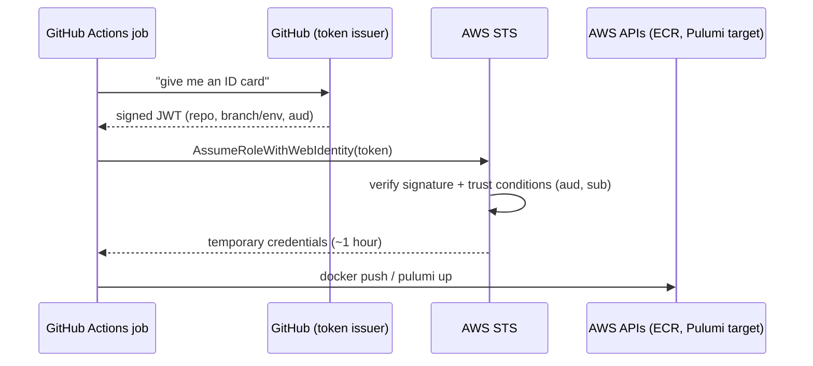
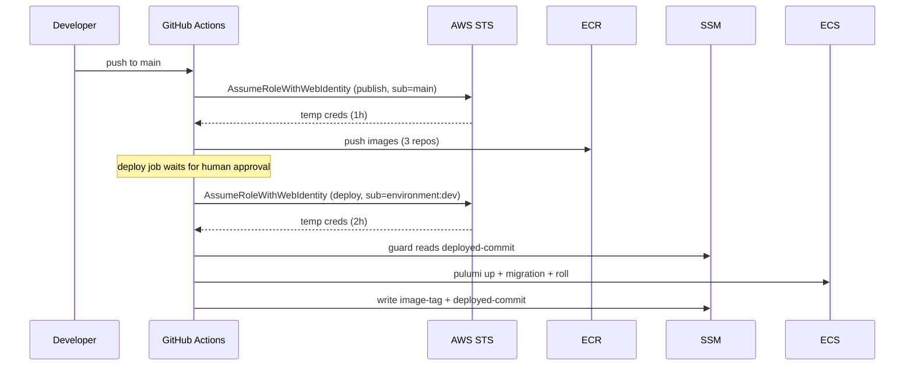
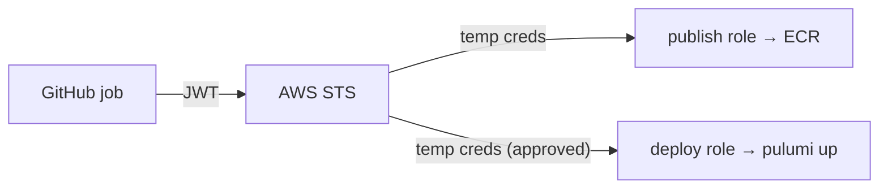

# 24. GitHub OIDC and CI/CD: deploying without stored keys

History: see [CHANGELOG.md](../CHANGELOG.md) or run `pnpm docs:history`

> **Honesty label: ✅ Built in repository** (`infra/src/cicd.ts`, `infra/src/publish-policy.ts`,
> `.github/workflows/*`), **⚙️ configured for deployment**. The two role ARNs are copied by hand into
> GitHub repository variables.

**Prerequisites:** [04. IAM](04-iam.md), [05. ECR](05-ecr.md), [22. SSM/release](22-ssm-release.md).

---

## A. The problem first

Continuous deployment needs GitHub Actions to be allowed to push images to ECR and to run `pulumi up`.
The obvious way — create an IAM user, generate an **access key**, paste it into GitHub **secrets** — is
also the most dangerous:

- The key is **long-lived**: it works until someone remembers to rotate it.
- It is a **static secret**: if it leaks (a bad workflow, a malicious dependency in `pnpm install`, a
  compromised action), the attacker has power **forever**, until you notice.
- It is **broad by default**: people usually give one user "enough to do everything," so a leak is total.

The problem: **let a specific GitHub workflow, in a specific repo, on a specific branch, perform a
specific, minimal set of AWS actions — with no stored secret and credentials that expire in an hour.**

Where it shows up: `infra/src/cicd.ts`.

---

## B. What it is

**Plain English:** **OIDC (OpenID Connect)** lets GitHub prove to AWS who it is, using a short-lived
signed token instead of a password. AWS checks the token, and if it matches a role's trust policy, hands
out **temporary** AWS credentials. Nothing secret is ever stored in GitHub.

### The terms

- **OIDC (OpenID Connect)** — an identity layer on top of OAuth; here, an external identity provider
  (GitHub) issuing signed tokens.
- **OIDC provider (IAM)** — the registration in your AWS account that says "tokens signed by GitHub's
  issuer may be used here."
- **JWT / token** — the short-lived signed "ID card" GitHub gives a job. It says **which** repo, branch,
  workflow, and environment the job runs in.
- **`sts:AssumeRoleWithWebIdentity`** — the API that swaps a web-identity token for AWS credentials.
- **`aud` (audience)** — who the token was made for. GitHub's AWS action asks for
  `sts.amazonaws.com`.
- **`sub` (subject)** — the identity details (repo, branch **or environment**). **The most important
  condition.**
- **Immutable subject** — GitHub's newer `sub` format that includes numeric **owner/repo IDs**, so a
  renamed or re-created repo with the same name cannot match.
- **Environment (GitHub)** — a named deployment target (`dev`) that can require a human **approval**
  before a job runs.
- **`iam:PassRole`** — permission to hand a role to a service; needed to create ECS/Lambda resources with
  IAM roles.

---

## C. How it works internally

### The token swap



Key point: the credentials are **temporary** and scoped to the role. If they leak, they expire quickly,
and they only ever had the role's limited permissions.

### Why `sub` is the whole security story

The IAM OIDC provider trusts **GitHub as a whole** — every repo on GitHub, everyone's, gets tokens from
the same issuer. Without a `sub` condition, **any** GitHub repository could assume your role. The `sub`
condition narrows it to one repo, one branch or one environment:

- **Publish role:** `...:ref:refs/heads/main` — only `main` of our repo (not a PR, not a fork, not a
  feature branch).
- **Deploy role:** `...:environment:dev` — only jobs that declare the `dev` environment, which has a
  **required reviewer**. GitHub starts such jobs only **after a human clicks Approve**.

The immutable-subject format adds **numeric IDs**, so even if the repo were renamed and someone recreated
one with the same name, its tokens would carry different IDs and be refused. That is a genuinely
advanced, real-world hardening detail.

### Why two roles

Least privilege across two very different jobs:

- The **publish job** runs `pnpm install` (lots of third-party code) on **every push to `main`**, with
  **no human in the loop**. It must **not** be able to change what runs in AWS.
- The **deploy job** runs `pulumi up`, which can change everything — but it only runs for a job a human
  **approved** in the `dev` environment.

So the role that touches untrusted dependencies is the *weak* one, and the powerful role is behind a human
gate. That ordering is the entire design.

---

## D. Our MiniTickets implementation

### D1. The OIDC provider — `infra/src/cicd.ts`

```ts
new aws.iam.OpenIdConnectProvider(`${prefix}-github-oidc`, {
  url: "https://token.actions.githubusercontent.com",
  clientIdLists: ["sts.amazonaws.com"],
  // no thumbprintLists: AWS verifies GitHub's CA against its own trusted list
});
```

### D2. The publish role

- **Trust:** `Principal: { Federated: provider.arn }`, `Action: sts:AssumeRoleWithWebIdentity`,
  conditions `aud = sts.amazonaws.com` **and** `sub = <prefix>:ref:refs/heads/main`. Both must match
  (`StringEquals`, no wildcards).
- **Permissions:** the `push-images` policy from `publish-policy.ts`, scoped to **exactly the three ECR
  repos** (`repoArns` from `registry.ts`) — the check/pull actions **and** the push actions.
- **Session:** `maxSessionDuration: 3600` (1 hour) — long enough for a build, short enough to expire.

A lesson the code records: the **worker repo's** ARN reached AWS only with the next `pulumi up`, and a CD
run already in flight got `not authorized ... BatchGetImage on ... worker`. **A new repo needs the
publish policy applied *before* the push that publishes to it** — a real ordering trap.

### D3. The deploy role

- **Trust:** `sub = <prefix>:environment:dev`. Note the honest limitation documented in the code: `sub`
  names the **environment**, not the branch; which branches may deploy to `dev` is an environment
  setting, and the **approval is the real gate**.
- **Session:** `maxSessionDuration: 7200` (2 hours), because a deploy that turns everything on/off waits
  for RDS (10–15 min) and CloudFront (15–30 min), twice in a two-phase deploy. Credentials that died
  halfway through `pulumi up` would leave the stack half-changed.
- **Permissions:** this role is **honestly broad** (the code says so in a "HONEST SUMMARY"). `pulumi up`
  creates and deletes VPCs, databases, load balancers, CloudFront distributions and IAM roles, and Pulumi
  does not know most resource IDs in advance. So statement `10a` grants whole services on `*`.

**What limits it anyway** (this is the meat of the chapter):

| Limit | Statement | Effect |
| --- | --- | --- |
| **WHO** | trust policy | only an approved job in the `dev` environment of our repo |
| **WHERE** | `DenyOtherRegions` | nothing outside `us-east-1` (global services call through it) |
| **IAM** | `10c`–`10g` | only roles named `minitickets-dev-*`; only attached to ECS/Lambda; only one managed policy (`AmazonECSTaskExecutionRolePolicy`) may be attached; `PassRole` only to ECS/Lambda |
| **Secrets** | `10b` | only `minitickets/*` and the RDS-managed `rds!*` secrets |
| **ECR / SSM** | `10h`, `10i` | only our 3 repos and our 2 parameters |
| **Job pipeline** | `10j`, `10k` | only `minitickets-dev-*` queues, tables, functions; SES identities in this account/region |
| **Observability** | `10m` | only the topic, alarms and dashboard named `minitickets-dev*` |
| **Time** | session | credentials last at most 2 hours |

And, to be honest, **what it does not stop** (the code lists these): `iam:PutRolePolicy` **cannot be
limited by content**, so an approved job could write an inline policy widening a `minitickets-dev-*` role.
The proper fixes are a **permissions boundary** or **one AWS account per environment** — noted, not built
in dev. The real protection is the **approval**: you see **which commit** you approve.

### D4. The workflows

`.github/workflows/*` use the roles:

- The **publish** job assumes `AWS_PUBLISH_ROLE_ARN` (a repo variable) and pushes images.
- The **deploy** job runs in the `dev` environment (so it needs approval), assumes
  `AWS_DEPLOY_ROLE_ARN`, runs the **deploy guard** ([22](22-ssm-release.md)), does `pulumi up`, runs the
  **migration**, writes the **image tag**, and rolls the services.

### Trace: a push to main



---

## E. Security and permissions

**REACH.** GitHub Actions reaches AWS's STS and API endpoints over HTTPS. There are no stored AWS keys
in the repository.

**ALLOWED.**
- OIDC provider: GitHub's tokens, audience `sts.amazonaws.com`.
- Publish: three ECR repos only.
- Deploy: the broad-but-bounded set above; `DenyOtherRegions` caps geography; the environment approval
  caps *who*.

**IDENTITY / CREDENTIALS.** Federated temporary credentials via `sts:AssumeRoleWithWebIdentity`; 1 h
(publish) / 2 h (deploy). **No long-lived access keys anywhere.**

**Encryption.** All calls are HTTPS; the tokens are short-lived and signed.

**Honest gaps (documented in code):** the deploy role is broad in `us-east-1`; `PutRolePolicy` cannot be
content-limited; a **permissions boundary** or **separate accounts per environment** is the proper
hardening and is **not built**.

---

## F. The AWS console (and GitHub) walkthrough

> Read-only. Do not edit trust policies to "test" — that changes who can deploy.

1. **IAM → Identity providers.** Find the GitHub OIDC provider (`token.actions.githubusercontent.com`),
   audience `sts.amazonaws.com`.
2. **IAM → Roles → `minitickets-dev-gh-publish`.** **Trust relationships** shows the `aud` + `sub`
   (main). **Permissions** shows the `push-images` policy listing the three repos.
3. **IAM → Roles → `minitickets-dev-gh-deploy`.** Trust shows `sub = ...:environment:dev`. Permissions
   shows the long policy; scan for `DenyOtherRegions` and the `minitickets-dev-*` scoping.
4. **GitHub repo → Settings → Environments → `dev`.** Confirm a **required reviewer** is set (this is
   the real gate).
5. **GitHub repo → Settings → Variables.** `AWS_PUBLISH_ROLE_ARN` and `AWS_DEPLOY_ROLE_ARN` (copied by
   hand from the stack outputs).
6. **CloudTrail → AssumeRoleWithWebIdentity** events show each job assuming its role.

Mapping: everything here → `infra/src/cicd.ts` (+ `publish-policy.ts`).

---

## G. Real production scenarios

### Scenario 1 — "A CD run fails: `not authorized to perform sts:AssumeRoleWithWebIdentity`."

- **Cause:** the token's `sub` does not match the trust policy. Classic reasons: the job declares an
  `environment` when the role expects `ref:refs/heads/main` (or vice versa); a **fork** or **PR** job is
  trying to assume the role; the immutable subject prefix changed.
- **Investigate:** the assumed-role error in CloudTrail shows the `sub`. Compare with the trust policy.
- **Recover:** fix the workflow (branch/environment) or the `sub` in the policy.

### Scenario 2 — "The publish succeeds but a new repo fails."

- **Cause:** the new repo's ARN is not yet in the publish policy (the ordering trap above).
- **Recover:** apply the policy (a `pulumi up`) **before** the push to the new repo.

### Scenario 3 — "An old approved deploy clobbers newer infrastructure."

- **Cause:** the deploy ran with old code after a newer deploy.
- **Recover/prevent:** the **deploy guard** (`deployed-commit`, [22](22-ssm-release.md)) refuses older
  code.

### Scenario 4 — "A malicious dependency in `pnpm install`."

- **Why it is bounded:** the job that runs `pnpm install` uses the **publish** role, which can only push
  images to three repos — it **cannot** change what runs in AWS (that needs the deploy role, behind
  approval). The two-role split is the mitigation.

### Scenario 5 — "Someone tries a fork/PR deploy."

- **Why it fails:** the trust policy's `sub` requires `main` (publish) or `environment:dev` (deploy);
  a fork/PR token has a different `sub`.

### Cost and performance

- OIDC providers and IAM roles are **free**.
- The 1 h / 2 h session durations are chosen to fit a build and a slow two-phase deploy.

---

## H. Decisions and alternatives

- **OIDC over stored access keys.** No long-lived secrets to leak; credentials expire. This is the modern
  best practice.
- **Two roles (publish vs deploy).** The untrusted-code job is weak; the powerful job is behind a human
  approval.
- **Environment-based `sub` for deploy.** Uses GitHub's required-reviewer gate as the real protection.
- **Immutable subject (with IDs).** Defends against repo renames/re-creation.
- **`StringEquals`, no wildcards.** Prevents accidental widening.
- **Region deny.** Caps the broad policy geographically.
- **Honest about the broad deploy role.** The code documents its own limits and the proper fixes
  (permissions boundary, account-per-environment) rather than pretending it is perfect.
- **Alternatives:** stored keys (simpler, dangerous), self-hosted runners with instance roles (more
  control, more ops), a separate AWS account per environment (best isolation, more setup), AWS CodePipeline
  (native, less familiar to many teams). For GitHub-hosted CI, OIDC is the right default.

---

## I. Interview preparation

### 30-second answer

> "We deploy without stored AWS keys using GitHub OIDC. GitHub issues a short-lived signed token; AWS's
> IAM OIDC provider verifies it and, based on the trust policy's `aud` and `sub`, issues temporary
> credentials. There are two roles: a publish role scoped to three ECR repos and only `main`, and a deploy
> role that only an approved job in the `dev` environment can assume, scoped by `DenyOtherRegions` and
> `minitickets-dev-*` resource patterns. Credentials last one and two hours. The deploy role is honestly
> broad in-region because `pulumi up` needs it; the real gate is the human approval."

### Follow-up questions

- **Beginner:** What problem do stored AWS keys have? *(→ long-lived; a leak is permanent.)*
- **Beginner:** What does OIDC replace? *(→ the stored access key; it uses temporary credentials.)*
- **Intermediate:** What are `aud` and `sub`? *(→ who the token is made for, and who the job is;
  `sub` is the key condition.)*
- **Intermediate:** Why does `sub` matter so much? *(→ the OIDC provider trusts all of GitHub; `sub`
  restricts it to our repo/branch/environment.)*
- **Intermediate:** Why two roles? *(→ the job running third-party code must not change what runs in
  AWS; the powerful job needs approval.)*
- **Senior:** What is the immutable subject? *(→ GitHub's `sub` with numeric owner/repo IDs, defeating
  repo-recreation attacks.)*
- **Senior:** Why is the deploy role broad, and how would you narrow it properly? *(→ `pulumi up` needs
  many services/unknown IDs; a permissions boundary or an account per environment.)*
- **Senior:** What does the deploy guard add? *(→ refuses older approved runs after newer changes.)*
- **Senior:** Where is the real gate, branch or environment? *(→ the environment's required reviewer;
  the approval is the protection.)*

### Scenario questions

1. **"CD fails to assume the role."** → `sub` mismatch (branch vs environment, fork, prefix).
2. **"New repo publish fails."** → policy applied after the push; apply it first.
3. **"Old deploy clobbers new infra."** → the deploy guard.

---

## J. Quick revision

**Five things to remember**

1. **OIDC** gives GitHub **temporary** AWS credentials — **no stored keys**.
2. **`aud` + `sub`** in the trust policy are the security; `sub` restricts to our repo/branch or
   environment.
3. **Two roles:** publish (3 ECR repos, `main`, 1 h) and deploy (`environment:dev`, 2 h, broad but
   bounded).
4. The **real gate is the environment approval**; the **deploy guard** blocks older runs.
5. Honest gap: the deploy role is broad in-region; a **permissions boundary** or **account-per-env**
   is the proper fix (not built).

**One diagram**



**Three common mistakes**

1. Trusting GitHub without a `sub` condition (any repo could assume the role).
2. Using one broad role for both the untrusted build and the deploy.
3. Putting long-lived keys in GitHub secrets instead of using OIDC.

**Where next:** [99. Verification gaps](99-verification-gaps.md) — what still needs checking in a live
account.
