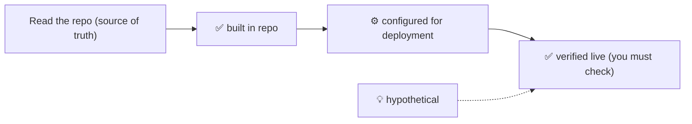

# 99. Verification gaps and honesty ledger

> **This chapter is the honesty ledger for the whole handbook.** Everything else teaches; this one tells
> you **exactly what has been checked and how**. Read it before you quote any number from this handbook
> as fact.

---

## A. The four honesty labels (recap)

Every chapter carries one of these labels at the top. They are the backbone of the handbook's honesty,
so here they are again, precisely defined:

| Label | Means | How you can trust it |
| --- | --- | --- |
| ✅ **Built in repository** | The code exists in the repo and does the thing described. | Read the cited file. |
| ⚙️ **Configured for deployment** | The code *declares* the resource/config, but it only exists in AWS when the stack is deployed with the relevant switch on. | Compare with `pulumi config` / switch defaults. |
| ✅ **Verified live in AWS** | Someone has seen it in a real AWS account. | Console screenshots / CLI output. **This handbook contains none.** |
| 💡 **Hypothetical / conceptual** | A pattern, alternative, or production practice that MiniTickets does **not** implement. | Treated as teaching material only. |

**The single most important sentence in this handbook:** *almost every resource here is ✅ built in the
repo and ⚙️ configured for deployment — the handbook does **not** claim any of it was verified live.*

---

## B. What is verified, and how

### B1. Verified by reading the source (✅ built in repository)

These facts come from reading the actual files, and the citations in each chapter point at them:

- The VPC/subnet/route/IGW layout, CIDRs and AZ count (`infra/src/network.ts`).
- The five security groups and their exact rules (`infra/src/security.ts`).
- The IAM role/policy/trust structure (`infra/src/**/iam*.ts`, `infra/src/cicd.ts`).
- ECR repos, tag mutability, lifecycle rules, Lambda pull policy (`infra/src/registry*.ts`).
- ECS cluster/service/task definitions and the Spot capacity provider (`infra/src/compute/*`).
- ALB listener, rules, target groups and health checks (`infra/src/entry/*`).
- ACM + CloudFront configuration, including `cdnEnabled` default (`infra/src/entry/*`).
- RDS, ElastiCache and secret definitions (`infra/src/data/*`).
- DynamoDB tables, keys, GSIs, TTL (`infra/src/data/*`, `infra/src/jobs/processed-jobs-table.ts`).
- S3 bucket, encryption, block-public-access and policies (`infra/src/tickets/storage.ts`).
- SNS/SQS/DLQ/redrive definitions (`infra/src/jobs/*`).
- Lambda definitions and event source mappings (`infra/src/jobs/*`, `infra/src/tickets/*`).
- Alarm specs, alert topic, log queries, dashboard (`infra/src/observability/*`).
- SSM release parameters, budget, OIDC roles (`infra/src/release.ts`, `budget.ts`, `cicd.ts`).
- Application logic: outbox relay, worker batch handling, backoff, idempotency, SES mailer
  (`apps/api/src/services/outbox.ts`, `apps/worker/src/*`).

### B2. Verified by the repo's own tests (✅ built in repository)

Some files are **plain data** precisely so a unit test can check them without touching AWS. The handbook
trusts those where they exist:

- `infra/src/observability/alarm-specs.ts` — the four alarm specs and their reasons
  (`alarm-specs.test.ts`).
- The network/security-group specs, which are also unit-tested.
- Worker handler behaviour via the pure `handlers/booking-confirmed.ts` with fakes.

### B3. NOT verified (the honest gaps)

**Nothing in this handbook has been confirmed in a live AWS account.** Specifically:

- Whether the four alarms have ever fired, and whether their thresholds are *right* (only real traffic
  proves that).
- Whether the SNS email subscription is confirmed in any account.
- Whether the stack currently has `dataEnabled` / `computeEnabled` / `entryEnabled` / `cdnEnabled` on.
- Whether SES is in the sandbox or has production access.
- Whether a redrive has ever been performed successfully.

---

## C. Claims that are really *hypotheses* (check these first)

These are statements that are **logically derived from the code** but not measured. They are the first
things to verify against a live account:

| Claim in the handbook | Why it is a hypothesis | How to verify |
| --- | --- | --- |
| The `oldest-message-age ≥ 300 s` threshold means "nothing is reading the queue". | Derived from the backoff math (0 + 10 + 40 + 120 s), not measured under load. | Turn the trigger off, send a message, watch when the alarm fires. |
| The DLQ alarm's `treatMissingData: ignore` is required. | SQS's ~6-hour metric-inactivity behaviour is documented by AWS but not observed here. | Leave a message in the DLQ overnight; confirm the state stays ALARM. |
| `visibility timeout = 6 × function timeout` avoids duplicates. | AWS guidance applied to our numbers; the duplicate window is small. | Force a slow handler and watch for duplicate sends. |
| The importer/relay never loses an event. | Designed for it; not chaos-tested. | Kill the API mid-publish repeatedly; confirm the outbox row remains. |
| The deploy guard prevents the 2026-10-15 class of incident. | A guard exists; the exact scenario was not re-run. | Simulate an out-of-order approved deploy in a sandbox account. |
| Cost per idle hour (RDS + ALB + cache ≈ the budget). | Prices and instance sizes change. | Cost Explorer, filtered by tag. |

---

## D. Environment- and time-sensitive claims (verify before quoting)

These change over time or between accounts. The handbook states them, but treat them as **"at the time of
writing"**:

- **AWS console labels and menu paths** — reorganized periodically.
- **Prices and free tiers** (SES free allowance, SNS first 1,000 emails, Lambda free tier, Budgets first
  two budgets, CloudWatch per-GB log queries).
- **Quotas** (SES sandbox limits, SNS message size, SQS retention maximum).
- **Default parameters** (Valkey node type, RDS engine version shown in the console).
- **Region-specific availability** of a given instance class or feature (`us-east-1` in the committed
  dev config).

---

## E. Known, documented limitations (built this way on purpose)

These are **not** bugs; the repo says so. Learn them as design decisions:

| Limitation | Where the repo documents it | Proper production fix (not built) |
| --- | --- | --- |
| Deploy role is broad in `us-east-1`. | `infra/src/cicd.ts` ("HONEST SUMMARY"). | Permissions boundary, or one AWS account per env. |
| `iam:PutRolePolicy` cannot be content-limited. | Same file. | Permissions boundary / account isolation. |
| The email send is written-then-recorded, so a crash can duplicate. | `handlers/booking-confirmed.ts`. | SES-side idempotency (does not exist) or a two-phase record. |
| Outbox delivered rows are never pruned. | Implied by `queries/outbox.ts`. | A scheduled prune job. |
| No bounce/complaint handling for SES. | `jobs/email.ts` scope. | SNS bounce/complaint handler + suppression list. |
| CloudFront is off in the committed dev config. | `cdnEnabled = false`. | Turn it on for production traffic. |
| RDS single-AZ, cache single-node, PITR off for `processed-jobs`. | `data/*`, `jobs/processed-jobs-table.ts`. | Multi-AZ, replica, PITR for production. |
| No NAT gateway; API has a public IP for egress. | `network.ts`, `compute/*`. | NAT gateway (or VPC endpoints) for private egress. |
| Alarms are dev-tuned (e.g. "5 5xx in 5 min"). | `observability/alarm-specs.ts`. | Rate-based thresholds calibrated to production traffic. |

---

## F. How this handbook was written (method)

For transparency, the method:

1. **Read-only exploration** of `infra/`, `apps/`, and the existing `docs/` first. No guesses.
2. Facts were taken from **source of truth files**, cited in each chapter, not from memory.
3. Where the repo and the handbook could disagree, the **repo wins**, and the chapter says so.
4. **Four honesty labels** applied at the top of every chapter.
5. **Mermaid diagrams** built bottom-up: never a fifteen-service diagram before its parts are taught
   ([00. The MiniTickets story](00-the-minitickets-story.md)).
6. **No AWS resource was created, changed or deleted** to write this handbook.
7. Nothing outside `docs/handbook/concepts-01/` was modified.

---

## G. What you should verify yourself, in order

If you deploy MiniTickets to your own account, check these in this order — it is also a great learning
path:

1. **Deploy with everything off**, then on, and compare the console with chapters [01](01-what-is-aws.md)
   –[09](09-cloudfront.md). Confirm the network and ALB.
2. **Trigger one booking** and follow its `correlationId` through the saved Logs Insights query
   ([21](21-cloudwatch.md)).
3. **Break one thing on purpose** and confirm the matching alarm fires and emails you: stop the worker,
   send mail to an unverified address, and so on ([19](19-dead-letter-queue.md)).
4. **Redrive the DLQ** after the fix and watch the alarm return to OK ([19](19-dead-letter-queue.md)).
5. **Check the budget** against Cost Explorer ([23](23-budgets.md)).
6. **Run a deploy from a fork** and confirm the OIDC `sub` refuses it ([24](24-oidc-cicd.md)).

---

## H. Confidence summary

| Area | Repo-accurate? | Live-verified? |
| --- | --- | --- |
| Infrastructure definitions (VPC, IAM, ECS, ALB, data) | ✅ high | ❌ no |
| Application logic (outbox, worker, idempotency) | ✅ high | ❌ no |
| Alarm specs and reasons | ✅ high (unit-tested) | ❌ no |
| Thresholds and tuning | ⚠️ derived, not measured | ❌ no |
| Console labels, prices, quotas | ⚠️ time-sensitive | ❌ no |
| Production hardening advice | 💡 conceptual | ❌ no |

---

## I. If you find a discrepancy

The handbook is only useful if it is honest. If you find a place where it disagrees with the **current**
repo or a live account:

1. Trust the **repo / AWS** over the handbook.
2. Note the chapter, the claim, and the evidence.
3. Fix the handbook — a wrong teaching document is worse than none.

---

## J. Quick revision

**Five things to remember**

1. Almost everything here is ✅ built in the repo / ⚙️ configured for deployment — **nothing is
   live-verified**.
2. The **hypotheses** to test first: the age threshold, the DLQ missing-data choice, the 6× visibility
   rule, the outbox's no-loss claim.
3. **Time-sensitive**: console labels, prices, quotas, free tiers.
4. **Documented limitations** (broad deploy role, no bounce handling, no PITR on one table, CloudFront
   off) are design decisions with named production fixes.
5. When the handbook and the repo disagree, **the repo wins** — and fix the handbook.

**One diagram**

**Three common mistakes**

1. Quoting a handbook number as if it were live-verified.
2. Treating an alarm threshold as calibrated when it was derived.
3. Assuming dev-sized choices (single-AZ, CloudFront off) are production-ready.

**Where next:** back to the [README](README.md) for the full reading order, or
[00. The MiniTickets story](00-the-minitickets-story.md) for the connected narrative.
