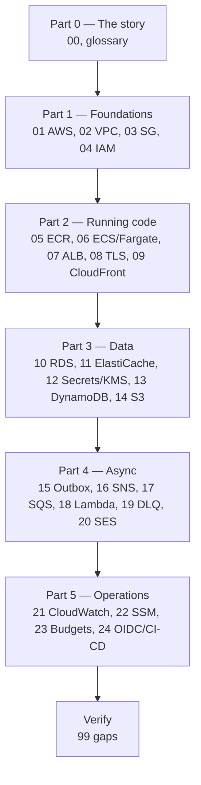

# MiniTickets, from zero AWS to production engineer

History: see [CHANGELOG.md](../CHANGELOG.md) or run `pnpm docs:history`

Welcome. This folder is a complete, self-contained AWS learning handbook built around **one real
application**: MiniTickets, the ticket-booking app in this repository.

You do not need to know anything about AWS to start. You do need basic programming knowledge
(variables, functions, a little SQL helps). By the end you will understand every AWS service
MiniTickets uses, how they connect, why each decision was made, and how to diagnose the problems a
real production team hits at 2 a.m.

> **How this differs from `../concepts/`.** The existing `concepts/` cards are short, dense reference
> cards designed for quick interview revision. They are excellent and we do not replace them. This
> `concepts-01/` handbook is the long-form teaching version: it assumes you know nothing, explains the
> problem before the service, shows the internals, walks the real code, and finishes with interview
> practice. Read this folder to *learn*; read `../concepts/` to *revise*.

The existing documentation is **read-only** and has not been modified. Nothing here overwrites it.

---

## 1. The promise

A person who has never opened the AWS console should be able to:

1. Read this handbook from top to bottom in a sensible order.
2. Understand what every AWS service MiniTickets uses actually does, internally.
3. Trace a real request and a real background job through the repository's own code.
4. Explain IAM permissions and networking for each service without hand-waving.
5. Diagnose realistic failures (a stuck queue, a throttled email provider, a bad deploy).
6. Answer senior/lead interview questions using a system they genuinely understand.

Simple English does **not** mean shallow content. Every chapter keeps the full technical depth; it
just explains it in the order a human brain can absorb it: **why → what → how → our code →
production → interview → revision.**

---

## 2. Four honesty labels (read this before anything else)

The single most common mistake when learning AWS from a project is assuming "there is code for it"
means "it is running in a real AWS account." Those are different things. Every chapter states which
of these four states applies.

| Label | Meaning |
| --- | --- |
| **✅ Built in repository** | The infrastructure code and/or application code exists and is tested here. This is the default for almost everything MiniTickets uses. |
| **⚙️ Configured for deployment** | The code defines the resource, but whether it exists in a live account depends on the switches in `infra/Pulumi.dev.yaml` and a deploy. |
| **☁️ Verified in live AWS** | Someone actually checked it in a real AWS account. We only claim this where the repository says so. Most chapters here are **not** in this state. |
| **💡 Conceptual / not built** | An idea, an alternative, or a "we could do this later" design. Clearly marked so you never mistake it for the real system. |

MiniTickets is deliberately built in layers that can be switched on and off for cost reasons. A
resource with code can be *off* in the current deployed configuration. This handbook always tells you
which it is. The authoritative statement for any resource is the code switch in
`infra/index.ts` and `infra/Pulumi.dev.yaml`.

> **Price, quota and console-label caveat.** AWS prices, limits and console wording change. Nothing in
> this handbook should be treated as a current price or a current screen layout. Verify against the
> AWS pricing page and the console at the time you read it. Where a number matters we name it as
> "at the time of writing" and link the official page.

---

## 3. What MiniTickets actually is

MiniTickets is a small ticket-booking website:

- A visitor browses **events** and books **tickets**.
- A booking produces a **confirmation email** and a **ticket** the user can show at the door.
- The app is a **Next.js** web front end, a **Fastify + tRPC** API, a **PostgreSQL** database, a
  **Redis/Valkey** session store, and a set of **background workers**.
- It runs on **AWS**: containers on ECS/Fargate behind an Application Load Balancer, background work on
  SQS + Lambda, and the supporting services (S3, DynamoDB, SES, CloudWatch, and more).

Everything else in this handbook hangs off that story. If you want the narrative first, read
[`00-the-minitickets-story.md`](00-the-minitickets-story.md) now and come back.

---

## 4. The services MiniTickets actually uses

Only these AWS services appear in the real infrastructure code. Nothing here is invented to fill a
chapter.

| AWS service | Used for in MiniTickets | Infra file | Chapter |
| --- | --- | --- | --- |
| Accounts, Regions, AZs, ARNs | The ground everything stands on | (concepts, not resources) | [01](01-what-is-aws.md) |
| VPC, subnets, route tables, internet gateway | Private network for the app | `infra/src/network.ts` | [02](02-vpc-and-networking.md) |
| Security groups | Firewalls between resources | `infra/src/security.ts` | [03](03-security-groups.md) |
| IAM (users, roles, policies, trust, STS) | Who may do what | many `iam.ts` files, `infra/src/cicd.ts` | [04](04-iam.md) |
| ECR | Stores the Docker images | `infra/src/registry.ts` | [05](05-ecr.md) |
| ECS + Fargate | Runs the web and api containers | `infra/src/compute/*` | [06](06-ecs-fargate.md) |
| Application Load Balancer | Routes traffic to containers | `infra/src/entry/alb.ts` | [07](07-alb.md) |
| ACM + DNS/TLS | The HTTPS certificate and domain | `infra/src/certificate.ts` | [08](08-tls-acm.md) |
| CloudFront | CDN, HTTPS, and origin protection | `infra/src/entry/cdn.ts` | [09](09-cloudfront.md) |
| RDS for PostgreSQL | The main relational database | `infra/src/data/postgres.ts` | [10](10-rds-postgres.md) |
| ElastiCache (Valkey) | Sessions and caching | `infra/src/data/cache.ts` | [11](11-elasticache.md) |
| Secrets Manager + KMS | Passwords and encryption keys | `infra/src/data/secrets.ts` | [12](12-secrets-kms.md) |
| DynamoDB | Worker idempotency + issued tickets | `infra/src/jobs/processed-jobs-table.ts`, `infra/src/tickets/storage.ts` | [13](13-dynamodb.md) |
| S3 | Ticket objects (the rendered ticket) | `infra/src/tickets/storage.ts` | [14](14-s3.md) |
| Transactional outbox (pattern, on Postgres) | Reliable publish after a commit | `apps/api/src/services/outbox.ts` | [15](15-transactional-outbox.md) |
| SNS | Fan-out of booking events | `infra/src/jobs/booking-events.ts` | [16](16-sns.md) |
| SQS | Work queues + dead-letter queues | `infra/src/jobs/queues.ts` | [17](17-sqs.md) |
| Lambda | Serverless background worker | `infra/src/jobs/worker-lambda.ts` | [18](18-lambda.md) |
| **SQS dead-letter queue** | **Flagship chapter — repair tray for failed work** | `infra/src/jobs/queues.ts` | [19](19-dead-letter-queue.md) |
| SES | Sends confirmation emails | `infra/src/jobs/email.ts` | [20](20-ses.md) |
| CloudWatch (logs, metrics, alarms, dashboards) | Seeing what the system is doing | `infra/src/observability/*` | [21](21-cloudwatch.md) |
| SSM Parameter Store | Records the deployed image tag | `infra/src/release.ts` | [22](22-ssm-release.md) |
| AWS Budgets | Cost alerts | `infra/src/budget.ts` | [23](23-budgets.md) |
| GitHub OIDC + IAM roles | Deploying without stored AWS keys | `infra/src/cicd.ts` | [24](24-oidc-cicd.md) |

Two extras round out the book:

- [`glossary.md`](glossary.md) — every acronym and term in plain English.
- [`99-verification-gaps.md`](99-verification-gaps.md) — what still needs checking in a live account.

---

## 5. Recommended reading order

Follow it top to bottom the first time. Each part assumes the one before it. The **DLQ chapter (19)
is the flagship deep example** — the task that created this folder asked for it to be written first as
the model for every other chapter — but in *reading* order it comes after SQS and Lambda, because you
cannot understand a dead-letter queue until you understand a queue, a message, a retry and a consumer.

**Part 0 — Orientation**
- [The MiniTickets story](00-the-minitickets-story.md) — the whole system as one continuous journey
- [Glossary](glossary.md) — keep this open in a second tab

**Part 1 — Foundations (the rules everything else obeys)**
- [01. What is AWS?](01-what-is-aws.md) — accounts, regions, AZs, ARNs, the shared responsibility model
- [02. Networking and the VPC](02-vpc-and-networking.md) — how anything reaches anything
- [03. Security groups](03-security-groups.md) — the firewalls between resources
- [04. IAM](04-iam.md) — identity, authentication, authorization, roles, trust, STS

**Part 2 — Running our code**
- [05. ECR](05-ecr.md) — where container images live
- [06. ECS and Fargate](06-ecs-fargate.md) — how containers run without servers
- [07. Application Load Balancer](07-alb.md) — routing the request
- [08. DNS, TLS and ACM](08-tls-acm.md) — names and the padlock
- [09. CloudFront](09-cloudfront.md) — the CDN and origin protection

**Part 3 — Data**
- [10. RDS for PostgreSQL](10-rds-postgres.md)
- [11. ElastiCache with Valkey](11-elasticache.md)
- [12. Secrets Manager and KMS](12-secrets-kms.md)
- [13. DynamoDB](13-dynamodb.md)
- [14. S3](14-s3.md)

**Part 4 — Asynchronous work (the heart of MiniTickets)**
- [15. The transactional outbox](15-transactional-outbox.md)
- [16. SNS](16-sns.md)
- [17. SQS](17-sqs.md)
- [18. Lambda](18-lambda.md)
- [19. **Dead-letter queues (flagship)**](19-dead-letter-queue.md)
- [20. SES](20-ses.md)

**Part 5 — Operating the system**
- [21. CloudWatch](21-cloudwatch.md)
- [22. SSM Parameter Store and the release record](22-ssm-release.md)
- [23. AWS Budgets](23-budgets.md)
- [24. GitHub OIDC and CI/CD](24-oidc-cicd.md)

**Finish**
- [99. Verification gaps](99-verification-gaps.md)

---

## 6. How every chapter is built

Each concept chapter uses the same ten sections, in this order. The letters match the task
specification so you can see nothing was skipped.

| Section | What it answers |
| --- | --- |
| **A. The problem first** | What breaks without this? Why is a simpler approach not enough? Where does it show up in MiniTickets? |
| **B. What it is** | Plain-English definition, then the real AWS terms, each explained. |
| **C. How it works internally** | What AWS manages versus what our code must do; step by step. |
| **D. Our MiniTickets implementation** | Exact files, functions, config and a traced flow through the code. |
| **E. Security and permissions** | REACH / ALLOWED / IDENTITY-CREDENTIALS, plus encryption where relevant. |
| **F. The AWS console walkthrough** | Where to look, what to read, what is safe to inspect versus what changes live state. |
| **G. Production scenarios** | Real failures: cause, impact, investigation, recovery. |
| **H. Decisions and alternatives** | Why this way, what else exists, trade-offs, limits. |
| **I. Interview preparation** | 30-second answer, follow-up questions, scenario questions. |
| **J. Quick revision** | Five things to remember, a small diagram, three mistakes, a link to the next chapter. |

## 7. How to use the diagrams

Every Mermaid diagram is explained in words underneath. We start with the smallest possible diagram
and grow it. If a diagram has more than about five boxes, the chapter builds it up in pieces first,
because a wall of boxes teaches nothing.

## 8. Conventions

- Example AWS account id is always AWS's documentation placeholder `123456789012`.
- Resource names are the real ones from the code (for example `minitickets-dev-jobs`).
- Code references point at the exact file path, for example `infra/src/jobs/queues.ts`.
- Anything not built in the repository is marked **💡 Conceptual**.
- Links are relative, so this folder works on its own.

## 9. Where to go next

New to all of this? Read the [story](00-the-minitickets-story.md), then
[Chapter 01](01-what-is-aws.md). Want the deep async pipeline immediately? The shortest honest path
is 15 → 16 → 17 → 18 → 19.
