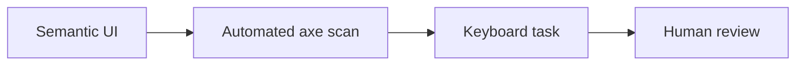

# Forms: shared-schema validation, accessible errors, focus

History: see [CHANGELOG.md](../CHANGELOG.md) or run `pnpm docs:history`

Area: Frontend · Status: ✅ built in repository; live AWS acceptance is separate

## 1. In one line

Native labels, semantic controls and visible focus support forms. P10 axe scans cover events/login/signup; keyboard and assistive-technology review are still needed, including pending/errors and virtualized lists.

## 2. Real-life comparison

A stopwatch on a real visitor’s journey answers different questions from a rehearsed practice lap.

## 3. Picture it

## 4. Where in our code

- Anchor: `apps/web/e2e/security.spec.ts` — `api`; follow the numbered comments at this boundary.
- Anchor: `apps/web/src/components/ui/input.tsx` — `Input`; follow the numbered comments at this boundary.
- Anchor: `apps/web/src/features/auth/components/signup-form.tsx` — `validate`; follow the numbered comments at this boundary.

`apps/web/e2e/security.spec.ts` runs axe WCAG 2A/AA/2.1AA on events, login and signup. `pnpm demo:security` passed these three scans. The offline learning pages also use native buttons, labels and keyboard navigation. Comprehensive assistive-technology review remains manual.

## 5. See it yourself

Run `pnpm demo:security` and inspect the asserted outcome described above.

Failure thought experiment: Does zero axe violations certify accessibility? No. Do not change a live stack to demonstrate it.

## 6. How it connects

Uses the [current system](../00-big-picture.md); gives a concrete decision to the [scenario](../guides/interview-scenarios.md#accessibility) and [explorer tour](../guides/infra-explorer.html?tour=security-layers).

## 7. Our settings and WHY

Native labels, semantic controls and visible focus support forms. P10 axe scans cover events/login/signup; keyboard and assistive-technology review are still needed, including pending/errors and virtualized lists. An accessible control must convey name, role and state, and remain usable under change.

## 8. Trade-offs

Automated gates are fast but incomplete. Virtualized lists need careful position/context; infinite scroll can make navigation harder.

## 9. Alternatives and when to choose them

10x: component-level semantic conventions. 100x: representative assistive-technology testing across critical journeys.

## 10. What breaks and how we notice

Does zero axe violations certify accessibility? No.

## 13. Interview answers at 3 levels

- **Simple:** Native labels, semantic controls and visible focus support forms.
- **Senior:** Automated checks catch many structural accessibility errors such as missing names and invalid contrast relationships. They cannot prove the whole experience works with a keyboard, screen reader or cognitive needs. Keep semantic controls and visible focus; test loading/error states and long lists manually too.
- **Lead:** 10x: component-level semantic conventions. 100x: representative assistive-technology testing across critical journeys.

## 14. Follow-up questions with answers

Does zero axe violations certify accessibility? No.

What remains necessary after a clean axe scan? **Human keyboard and assistive-technology review.**

## 15. Say it in 30 seconds

Automated checks catch many structural accessibility errors such as missing names and invalid contrast relationships. They cannot prove the whole experience works with a keyboard, screen reader or cognitive needs. Keep semantic controls and visible focus; test loading/error states and long lists manually too.

## 16. Status and production work

Repository implementation and local evidence are described above. Live AWS/CI execution remains owner acceptance. 10x: component-level semantic conventions. 100x: representative assistive-technology testing across critical journeys.

## Where it appears in the story

- [app-story: 1c. Side path: browser vitals and accessibility](../app-story.md#1c-side-path-browser-vitals-and-accessibility)
