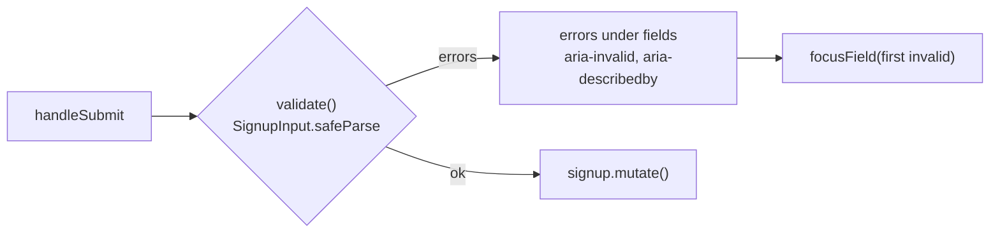

# Forms: shared-schema validation, accessible errors, focus

History: see [CHANGELOG.md](../CHANGELOG.md) or run `pnpm docs:history`

Area: Frontend · Status: ✅ built · Step doc: [04 signup form](../../04-signup-form.md)

## 1. In one line

Our forms check input with the **same Zod schema the api uses**, show each error under its field
in a way screen readers announce, and move keyboard focus to the first wrong field.

## 2. Real-life comparison

A clerk who checks your form in front of you with the same checklist the back office uses, points
at the first wrong box, and tells you out loud what is wrong, so you don't wait in the queue only
to be sent back.

## 3. Picture it

## 4. Where in our code

- Anchor: `apps/web/src/features/auth/components/signup-form.tsx` · `validate`, `focusField`, `handleBlur`: the client-side check and focus handling.
- Anchor: `apps/web/src/components/ui/input.tsx` · `Input`: label, input and error text wired together for assistive technology.

Step by step:

1. `validate(values)` runs `SignupInput.safeParse` from `packages/shared` and keeps the first
   message per field.
2. Quiet until the first submit (`submitted` is false); after that, each field is re-checked when
   you leave it (`handleBlur`).
3. On a failed submit, `focusField` focuses the first invalid field in `fieldOrder` (top to bottom).
4. `Input` connects everything: `<label htmlFor={id}>`, `aria-invalid` when there is an error,
   `aria-describedby` pointing at the `
-error">` message.
5. `noValidate` on the `<form>` turns off the browser's own popups, so our messages are the only
   ones.
6. Success text is in a `role="status"` element (polite announcement); form-level errors use
   `role="alert"` (announced at once).
7. The server runs the same schema again; its `fieldErrors` come back and land under the same fields
   ([ui-error-handling](ui-error-handling.md), [validation-at-boundaries](validation-at-boundaries.md)).

## 5. See it yourself

On `/signup`, press **Sign up** with empty fields using only the keyboard: focus jumps to Email and
a screen reader (VoiceOver: Cmd+F5 on macOS) reads "Email, invalid data, Enter a valid email
address" (exact wording depends on the screen reader).

DevTools → Elements on the email input: `aria-invalid="true"` and
`aria-describedby="email-error"`.

**Break it on purpose:** remove `aria-describedby` from `Input`. The red text still shows, but a
screen reader no longer reads it when the field gets focus.

## 6. How it connects

- **Uses ←** the shared schemas in `packages/shared` ([monorepo](monorepo.md)),
  [state-management](state-management.md) for values and errors.
- **Gives →** fewer bad requests to the api; accessible error display that
  [ui-error-handling](ui-error-handling.md) reuses for server errors.

## 7. Our settings and WHY

| Choice | Why |
| ------ | --- |
| Same Zod schema as the api | One source of truth; messages match the server's. |
| Validate on submit, then on blur | No red errors while someone is still typing their first value. |
| Focus first invalid field | Keyboard and screen reader users land where the problem is. |
| `noValidate` | Consistent messages across browsers. |

## 8. Trade-offs

- **Pros:** fast feedback; one schema; accessible by construction through `Input`.
- **Cons:** the schema ships to the browser (Zod adds bundle size); two forms repeat similar
  code.

## 9. Alternatives and when to choose them

- **Browser validation only** (`required`, `type="email"`): zero JavaScript, inconsistent messages.
- **React Hook Form + Zod resolver:** less code for many forms.
- **Server-only validation** (form actions): simplest, slower feedback.

## 10. What breaks, and how we'd notice

- Schema and form field names drift: an error has no field to land on. The e2e test for 409 checks
  `#email-error`.
- Missing labels or ARIA: no crash; an accessibility audit (Lighthouse) or a screen reader notices.

## 13. Interview answers at 3 levels

- **Simple:** The form tells you what's wrong before sending, right under each field.
- **Senior:** Forms run the shared Zod schema from `packages/shared`, show the first error per field
  through an `Input` component with `aria-invalid` and `aria-describedby`, and focus the first
  invalid field. The api runs the same schema, and its field errors map back to the same places.
- **Lead:** Client validation is UX; server validation is the rule. Sharing one schema keeps them
  in sync. Accessibility is built into the shared `Input`, so every new form gets it for free.

## 14. Follow-up questions interviewers ask

- *`role="alert"` vs `role="status"`?* Alert interrupts at once (errors); status waits politely
  (success).
- *Why not validate on every keystroke?* Errors for half-typed values are noise.

## 15. Say it in 30 seconds

"Our forms validate with the same Zod schema the api uses, from the shared package. Errors show
under each field through one Input component with aria-invalid and aria-describedby, focus moves to
the first wrong field, and the browser's popups are off so ours are the only messages."

## 16. Status

✅ built.
