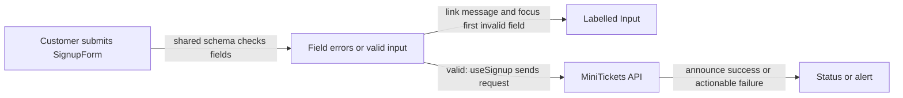

# Forms: shared-schema validation, accessible errors, focus

History: see [CHANGELOG.md](../CHANGELOG.md) or run `pnpm docs:history`

Area: Frontend · Status: ✅ built in repository; live AWS acceptance is separate
<!-- interview-card: v2 -->

## 1. What is it?

An accessible form lets people understand, operate and correct it using different input methods and assistive tools. Labels, control semantics, focus and clear feedback all contribute.

## 2. Why do we need it?

A MiniTickets customer who cannot use a mouse still needs to sign up. An error written only in red is not enough if they cannot locate the field or hear its message.

## 3. How does it work?

1. Give each control a name, role and understandable state.
2. Connect validation messages to fields and guide focus after failure.
3. Announce pending, success and general errors without relying on colour alone.

## 4. How do we use it in MiniTickets?

Signup uses the shared schema, labelled inputs and first-error focus. Automated axe checks cover events, login and signup. A clean scan does not replace keyboard or assistive-technology review, especially for changing content and long lists.

## 5. Interview-ready answer

“MiniTickets starts with native controls, explicit labels and visible focus. Validation associates useful messages with inputs and moves focus to the first invalid field. Automated axe scans catch structural problems on three pages, but accessibility is a whole interaction: loading, errors, keyboard navigation and screen-reader context still require representative human review.”

## 6. Important follow-up questions

- **Does zero axe violations certify accessibility?** No. Automated checks cannot prove a complete usable journey.
- **Why move focus after failed submission?** It helps keyboard and screen-reader users find where correction should start.
- **Why validate again on the server?** Browser checks improve usability but can be bypassed.
- **What changes with virtualized lists?** Off-screen items are absent from the DOM, so position, context and navigation need careful review.

## 7. Advanced details

Technical reference

### Current implementation

Current SignupForm uses noValidate, shared SignupInput.safeParse, first-message-per-field handling and refs for focus. Input exposes semantic labels/error association. Pending disables submit; success uses role=status and general failure uses role=alert. Historical P10 evidence is three axe WCAG 2A/AA/2.1AA page scans; it is not a comprehensive assistive-technology certification.

### Technical limits and diagnosis

SignupForm uses noValidate to avoid competing browser popups. It is quiet before first submit, revalidates after blur following submission, keeps the first error per field and focuses the first invalid field in screen order. Server field errors and duplicate email use the same correction path. Input provides labels, error association and invalid state; autocomplete helps the intended entry purpose.

Pending disables submit and changes text; success uses role=status and general failure uses role=alert. A control must convey name, role and state and remain operable as content changes. Native controls and visible focus support keyboard access; colour alone cannot carry a message.

Historical P10 evidence was three passing axe WCAG 2A/AA/2.1AA scans on events/login/signup, not certification and not rerun here. Keyboard and representative assistive-technology journeys still need human review, including pending/errors and virtualized/infinite list position and navigation. Offline learning pages also use native controls. Component conventions help scaling; automated gates remain incomplete.

### Source anchors

- Anchor: `apps/web/e2e/security.spec.ts` — `api`; follow the numbered comments at this boundary.
- Anchor: `apps/web/src/components/ui/input.tsx` — `Input`; follow the numbered comments at this boundary.
- Anchor: `apps/web/src/features/auth/components/signup-form.tsx` — `validate`; follow the numbered comments at this boundary.

### Related reading

- [current system](../00-big-picture.md)
- [scenario](../guides/interview-scenarios.md#accessibility)
- [explorer tour](../guides/infra-explorer.html?tour=security-layers)
- [app-story: 1c. Side path: browser vitals and accessibility](../app-story.md#1c-side-path-browser-vitals-and-accessibility)

[Open this piece in the city explorer](../guides/infra-explorer.html?concept=accessible-forms#chapter=0&piece=laptop-web).

## Where it appears in the story

- [app-story: 1c. Side path: browser vitals and accessibility](../app-story.md#1c-side-path-browser-vitals-and-accessibility)

