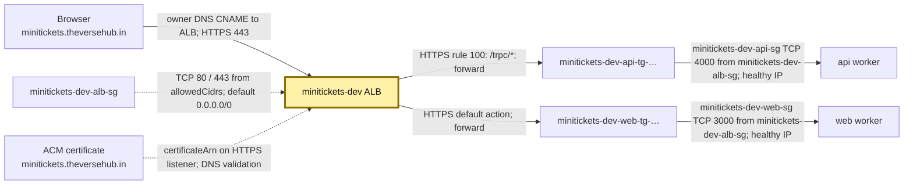
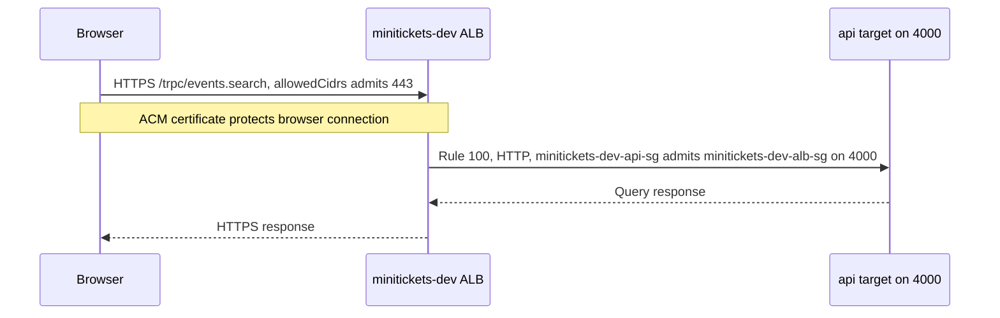

# ALB: the reception desk

History: see [CHANGELOG.md](../CHANGELOG.md) or run `pnpm docs:history`

Area: AWS Network · Status: ✅ built · Step docs: [18 ALB + web](../../18-infra-alb-web.md), [19 CloudFront](../../19-infra-cloudfront.md)
<!-- interview-card: v1 -->

## 1. In one line

Opening MiniTickets reaches an [ALB](../glossary.md#alb) (Application Load Balancer), the AWS reception desk that reads the path and chooses web or api workers.

## 2. Where it sits

[Open this piece in the city explorer](../guides/infra-explorer.html?concept=alb#chapter=24&piece=alb).

## 3. How it works

## 4. What happens in MiniTickets

1. The owner points the domain CNAME, a name record, at the ALB's generated DNS name.
2. Current `cdnEnabled=false` uses HTTPS `443`. ACM, AWS's certificate service, supplies the certificate.
3. Rule `100` sends `/trpc/*` to api `4000`. The default sends other paths to web `3000`.
4. Target groups supply current worker IPs and check their health.
5. HTTP `80` returns a `301` redirect to HTTPS; it forwards no app request.

## 5. Reach / Allowed / Password

**Reach:** public subnet routes, ALB ingress `80/443`, then source-group rules to workers.

**Allowed:** no IAM check per visitor request; ECS separately manages target registration.

**Password:** no origin password in current mode; app login still applies. Optional CDN mode checks `X-Origin-Verify`.

## 6. In our code

`infra/src/entry/alb.ts` → `createAlb`.

`infra/src/entry/https-listener.ts` → `createHttpsListener`.

`infra/src/entry/alb-public-ingress.ts` → `createAlbPublicIngress`.

## 7. In the AWS console

In `us-east-1`: EC2 → Load Balancers → `minitickets-dev` → **Resource map**. Follow listeners → rules → target groups → targets; switch to Unhealthy Target Map for failures. Listeners and rules shows `80/443`. [AWS map guide](https://docs.aws.amazon.com/elasticloadbalancing/latest/application/view-resource-map.html). Live ALB/DNS/certificate state was not checked.

## 8. Good / Bad

**Good:** one public address serves pages and api; health checks usually steer away from broken workers.

**Bad:** standing cost remains at low traffic; the encrypted connection ends here, so task hops use HTTP.

## 9. Other choices

- Pick NLB when forwarding TCP rather than reading HTTP paths.
- Pick API Gateway when a managed API front door and its API features fit.
- Pick optional CloudFront when edge caching or distribution is useful.

## 10. Connected to

| Neighbor | Direction | What allows it | Console check |
| --- | --- | --- | --- |
| [Security groups](security-groups.md) | Visitor → ALB | `allowedCidrs`, 443 | ALB → Security |
| [Target groups](target-groups.md) | ALB → workers | Rule 100 / default + healthy IPs | ALB → Resource map |
| [TLS](tls-termination.md) | Certificate guards ALB | `certificateArn`; issued certificate | ALB → Listeners and rules |
| [CloudFront](cloudfront.md) | Optional edge → ALB | Different ingress/header rules | CloudFront → Origins |

## 11. When it breaks

- Domain times out → DNS, network mapping and minitickets-dev-alb-sg → repair CNAME or route/rule.
- `503` → Resource map targets → restore healthy registered workers.
- TLS warning → listener certificate and domain → fix issuance or name.

## 12. Say it in 30 seconds

“Our current reception desk is an HTTPS ALB named minitickets-dev. It sends /trpc to api on 4000 and everything else to web on 3000. ECS keeps target IP lists current. ACM secures the public connection; door guards restrict the private HTTP hops.”

## 13. Likely follow-ups

- **Where do health checks enter?** ALB calls targets directly, outside listener rules.
- **Why two public subnets?** ALB spans two zones; that alone does not duplicate our single desired app task.

## 14. Remember it

The receptionist reads the path; the staff list chooses the worker.

## 15. More detail

Reference notes, source anchors and earlier useful detail

- Anchor: `infra/src/entry/alb.ts` · `createAlb`: the load balancer itself.
- Anchor: `infra/src/entry/listener.ts` · `listener`: the HTTP :80 listener with the fixed 403 default.

### Current mode and optional mode

The committed shape enables entry and sets `cdnEnabled=false`, domain `minitickets.theversehub.in`. `createHttpsListener` waits up to ten minutes for an issued certificate; it uses `ELBSecurityPolicy-TLS13-1-2-2021-06` (TLS 1.2/1.3). ACM and ALB must be in the same region. The owner's DNS provider is Cloudflare; the CNAME must be updated after ALB recreation. This is configured intent, not a live acceptance claim. Route 53 is not used for this DNS.

Optional `cdnEnabled=true` instead uses `listener.ts`: HTTP 80, default fixed 403, rule 100 requires `X-Origin-Verify` plus `/trpc/*`, and rule 200 requires that header for web. ALB ingress accepts only CloudFront's origin-facing managed prefix list. The header blocks other distributions that share those ranges. These are historical/optional settings, not today's direct-HTTPS path. Switch modes only while entry is off: both implementations own port 80 and create-before-delete can cause a listener conflict.

`createAlb` sets `loadBalancerType: "application"`, `internal: false`, public subnets, `dropInvalidHeaderFields: true`, and `enableDeletionProtection: false`. Dropping malformed fields reduces ambiguous-header/request-smuggling risk. Deletion protection is deliberately off for dev. Production access logging and deletion protection remain choices to add; symptom alarms now exist in `observability/`, so the earlier “no 5xx alarms” note was stale.

Target group ARNs return only after listeners/rules attach them, avoiding ECS's “target group does not have an associated load balancer” race. Listener rules run in ascending priority; first match wins. Same-origin `/trpc` avoids a second public API host. Service Connect server-to-server calls bypass the ALB and use separate proxy ports.

`albArnSuffix` names CloudWatch's LoadBalancer metric dimension, not the whole ARN. Inspect listener/rule configuration and target health with read-only `aws elbv2 describe-listeners`, `describe-rules` and `describe-target-health`, using actual ARNs. Common clues: 502 can mean a bad target response; 504 can mean a timed-out hop; 503 often means no usable target. Distinguish listener-generated errors from target errors in metrics/logs.

ALB bills standing time, capacity units and public IPv4 usage. The earlier roughly $0.035/hour entry estimate is a historical dev snapshot, not a current quote. An ALB understands HTTP paths/headers (layer 7); an NLB forwards network connections (layer 4). A normal API call does not assume an IAM role at the ALB.

The earlier estimate broke down as about $0.0225/hour fixed, capacity-unit usage, and two IPv4 addresses at $0.005/address-hour; the whole entry layer was roughly $0.04/hour. These historical figures are preserved for comparison, not capacity planning. An all-unhealthy target group can fail open to its registered targets; see [target groups](target-groups.md). A private ALB with CloudFront VPC origins is another design to investigate; direct CloudFront-to-Fargate-task routing was not established by the old card.

## Where it appears in the story

- [Infra story: 2. The ALB: security group, listener, rules, secret header](../infra-story.md#2-the-alb-security-group-listener-rules-secret-header)
- [Big picture: 4. Components](../00-big-picture.md#4-components)
