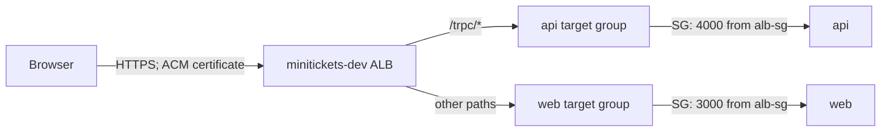

# ALB: the reception desk

History: see [CHANGELOG.md](../CHANGELOG.md) or run `pnpm docs:history`

Area: AWS Network · Status: ✅ built · Step docs: [18 ALB + web](../../18-infra-alb-web.md), [19 CloudFront](../../19-infra-cloudfront.md)
<!-- interview-card: v2 -->

## 1. What is it?

An [ALB](../glossary.md#alb), or Application Load Balancer, receives web requests and chooses an application to handle them. It is MiniTickets' public reception desk.

## 2. Why do we need it?

A visitor should use one website address while pages and API calls reach different applications. The ALB handles that choice and keeps the public address stable when tasks change.

## 3. How does it work?

1. The browser connects to the ALB over HTTPS.
2. A listener rule reads the request path and selects a target group.
3. That group supplies task addresses; the selected task handles the request.

## 4. How do we use it in MiniTickets?

The current design sends `/trpc/*` to api and other paths to web. HTTP redirects to HTTPS. ECS maintains changing task addresses. HTTPS ends at the ALB; task connections use HTTP inside the VPC. Live acceptance remains pending.

## 5. Interview-ready answer

“MiniTickets uses an ALB as one HTTPS entry point for pages and API calls. Path rules send requests to separate target groups, while ECS maintains task membership. This separates public routing from task lifetimes. Health checks help choose targets, but application monitoring is still needed because a live task can fail real work.”

## 6. Important follow-up questions

- **What if all targets are unhealthy?** ALB can route to those registered targets anyway; health checks are not an absolute safety barrier.
- **What if users see 503?** Check target registration and listener actions; an empty target group is a common cause.
- **Why not an NLB?** ALB understands HTTP paths; NLB fits lower-level network forwarding.
- **Does a two-zone ALB make us highly available?** No. Our single desired task per application can still leave a gap.

## 7. Advanced details

Technical reference

### Direct HTTPS: exact configuration and operations

`infra/src/entry/alb.ts` → `createAlb` creates internet-facing `minitickets-dev` in the public subnet pair. `infra/src/entry/https-listener.ts` → `createHttpsListener` configures HTTPS 443: priority 100 forwards `/trpc/*` to api HTTP 4000; default forwards web HTTP 3000. HTTP 80 returns 301 to HTTPS without forwarding application work.

`infra/src/entry/alb-public-ingress.ts` → `createAlbPublicIngress` allows TCP 80/443 from `allowedCidrs` (default `0.0.0.0/0`). Task groups allow traffic from `minitickets-dev-alb-sg`: api 4000/web 3000. The owner points the Cloudflare CNAME for `minitickets.theversehub.in` to the generated ALB DNS name. ACM provides the matching certificate. No per-visitor IAM check or origin password applies in direct mode; application login still applies.

In `us-east-1`: EC2 → Load Balancers → `minitickets-dev` → **Resource map** links listeners, rules, groups and targets; Unhealthy Target Map helps narrow failures. Listeners and rules shows 80/443. Live ALB/DNS/certificate state was not checked. A domain timeout requires checking CNAME, public subnet routes and ALB ingress. A TLS warning requires checking issuance, domain match and listener certificate. Target groups probe tasks directly, outside listener/header rules.

- Anchor: `infra/src/entry/alb.ts` · `createAlb`: the load balancer itself.
- Anchor: `infra/src/entry/listener.ts` · `listener`: the HTTP :80 listener with the fixed 403 default.

### Current mode and optional mode

The committed shape enables entry and sets `cdnEnabled=false`, domain `minitickets.theversehub.in`. `createHttpsListener` waits up to ten minutes for an issued certificate; it uses `ELBSecurityPolicy-TLS13-1-2-2021-06` (TLS 1.2/1.3). ACM and ALB must be in the same region. The owner's DNS provider is Cloudflare; the CNAME must be updated after ALB recreation. This is configured intent, not a live acceptance claim. Route 53 is not used for this DNS.

Optional `cdnEnabled=true` instead uses `listener.ts`: HTTP 80, default fixed 403, rule 100 requires `X-Origin-Verify` plus `/trpc/*`, and rule 200 requires that header for web. ALB ingress accepts only CloudFront's origin-facing managed prefix list. The header blocks other distributions that share those ranges. These are historical/optional settings, not today's direct-HTTPS path. Switch modes only while entry is off: both implementations own port 80 and create-before-delete can cause a listener conflict.

`createAlb` sets `loadBalancerType: "application"`, `internal: false`, public subnets, `dropInvalidHeaderFields: true`, and `enableDeletionProtection: false`. Dropping malformed fields reduces ambiguous-header/request-smuggling risk. Deletion protection is deliberately off for dev. Production access logging and deletion protection remain choices to add; symptom alarms now exist in `observability/`, so the earlier “no 5xx alarms” note was stale.

Target group ARNs return only after listeners/rules attach them, avoiding ECS's “target group does not have an associated load balancer” race. Listener rules run in ascending priority; first match wins. Same-origin `/trpc` avoids a second public API host. Service Connect server-to-server calls bypass the ALB and use separate proxy ports.

`albArnSuffix` names CloudWatch's LoadBalancer metric dimension, not the whole ARN. Inspect listener/rule configuration and target health with read-only `aws elbv2 describe-listeners`, `describe-rules` and `describe-target-health`, using actual ARNs. Common clues: 502 can mean a bad target response; 504 can mean a timed-out hop; 503 often means no usable target. Distinguish listener-generated errors from target errors in metrics/logs.

ALB bills standing time, capacity units and public IPv4 usage. The earlier roughly $0.035/hour entry estimate is a historical dev snapshot, not a current quote. An ALB understands HTTP paths/headers (layer 7); an NLB forwards network connections (layer 4). A normal API call does not assume an IAM role at the ALB.

The earlier estimate broke down as about $0.0225/hour fixed, capacity-unit usage, and two IPv4 addresses at $0.005/address-hour; the whole entry layer was roughly $0.04/hour. These historical figures are preserved for comparison, not capacity planning. [AWS documents fail-open](https://docs.aws.amazon.com/elasticloadbalancing/latest/application/target-group-health-checks.html): an all-unhealthy target group can route to its registered targets; see [target groups](target-groups.md). API Gateway is an alternative when its managed API features fit. A private ALB with CloudFront VPC origins is another design to investigate; direct CloudFront-to-Fargate-task routing was not established by the old card.

### Related reading

- [AWS map guide](https://docs.aws.amazon.com/elasticloadbalancing/latest/application/view-resource-map.html)
- [Security groups](security-groups.md)
- [TLS](tls-termination.md)
- [CloudFront](cloudfront.md)

[Open this piece in the city explorer](../guides/infra-explorer.html?concept=alb#chapter=24&piece=alb).

## Where it appears in the story

- [Infra story: 2. The ALB: security group, listener, rules, secret header](../infra-story.md#2-the-alb-security-group-listener-rules-secret-header)
- [Big picture: 4. Components](../00-big-picture.md#4-components)

