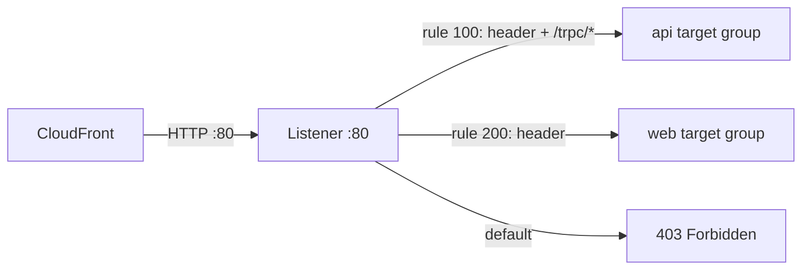

# Application Load Balancer, listener, default 403

History: see [CHANGELOG.md](../CHANGELOG.md) or run `pnpm docs:history`

Area: AWS Network · Status: ✅ built · Step docs: [18 ALB + web](../../18-infra-alb-web.md), [19 CloudFront](../../19-infra-cloudfront.md)

## 1. In one line

The **ALB** (Application Load Balancer) receives HTTP requests and forwards each one to a healthy
task; its **listener** on port 80 holds the rules, and when no rule matches it answers **403** by
itself.

## 2. Real-life comparison

The receptionist at the front door. They read what each visitor asks for, check the password, and
walk them to the right desk. Without the password: "Sorry, forbidden", and nobody inside is
bothered.

## 3. Picture it



## 4. Where in our code

- Anchor: `infra/src/entry/alb.ts` · `createAlb`: the load balancer itself.
- Anchor: `infra/src/entry/listener.ts` · `listener`: the HTTP :80 listener with the fixed 403 default.

Step by step:

1. `alb.ts`: `loadBalancerType: "application"`, `internal: false` (internet-facing),
   `subnets: publicSubnetIds` (one node per AZ), `securityGroups: [albSgId]`.
2. `dropInvalidHeaderFields: true`: requests with malformed headers are dropped, a cheap defence
   against request smuggling.
3. `enableDeletionProtection: false`: dev only, so the entry switch can delete it.
4. `listener.ts` → `listener`: `port: 80`, `protocol: "HTTP"`, `defaultActions` = `fixed-response`
   403 `Forbidden`.
5. Two rules, `trpcRule` (100) and `webRule` (200), forward to the target groups (see
   [same-origin-routing](same-origin-routing.md) and [origin-protection](origin-protection.md)).

## 5. See it yourself

```bash
cd infra
ALB=$(pulumi stack output albDnsName)
curl -sS -m 10 -o /dev/null -w '%{http_code}\n' "http://$ALB/"   # expect a timeout: only CloudFront may connect
aws elbv2 describe-rules --profile ticketlite \
  --listener-arn $(aws elbv2 describe-listeners --profile ticketlite \
    --load-balancer-arn $(aws elbv2 describe-load-balancers --profile ticketlite --names minitickets-dev \
      --query 'LoadBalancers[0].LoadBalancerArn' --output text) --query 'Listeners[0].ListenerArn' --output text) \
  --query 'Rules[].[Priority,Actions[0].Type]' --output table
```

Expect priorities `100`, `200`, `default` with `forward`, `forward`, `fixed-response`.

**Break it on purpose (scratch branch, owner runs `pulumi up`, undo after):** in `listener.ts`,
change `hasSecretHeader` to expect a different value. CloudFront still sends the old one, no rule
matches, and every page and api call through `appUrl` gets the listener's plain-text `Forbidden`.
You cannot see the 403 by calling the ALB directly: the security group drops you before the
listener (a timeout, not a 403).

## 6. How it connects

- **Uses ←** [public subnets](subnets.md), the alb [security group](security-groups.md),
  [target groups](target-groups.md), the origin secret.
- **Gives →** the origin for [CloudFront](cloudfront.md); traffic and health checks for the
  [ECS services](ecs-service.md); draining for [zero-downtime deploys](zero-downtime-deploys.md).

## 7. Our settings and WHY

| Setting | Value | Why |
| ------- | ----- | --- |
| Type | application | We route by path; an NLB cannot read URLs. |
| Listener | HTTP :80 only | CloudFront talks to the ALB over HTTP ([tls-termination](tls-termination.md)). |
| Default action | fixed 403 | Safe by default: a request reaches a task only if a rule says so. |
| `dropInvalidHeaderFields` | true | Malformed headers never reach our code. |
| Deletion protection | off | Dev switch; production turns it on. |

## 8. Trade-offs

- **Pros:** path routing, health checks, draining, managed and multi-AZ.
- **Cons:** a fixed hourly price even with zero visitors (the main reason for the entry switch); one
  more hop of latency.

## 9. Alternatives and when to choose them

- **NLB:** TCP/UDP, very high throughput, static IPs; no path routing.
- **API Gateway:** per-request pricing, auth and throttling built in; good for spiky, small APIs.
- **CloudFront straight to tasks (VPC origins):** possible for some setups; not explored here.

## 10. What breaks, and how we'd notice

| Symptom | Cause |
| ------- | ----- |
| Plain-text `Forbidden` | Secret header missing or wrong (default action) |
| `503 Service Temporarily Unavailable` | No registered (or no healthy) target in the group |
| `504` | Target too slow, or a security group blocks ALB → task |
| CloudFront `502` | CloudFront cannot connect to the ALB (security group, listener missing) |

## 11. Reach / Allowed / Password

- **Reach:** CloudFront → ALB on 80 (alb group, prefix list); ALB → tasks on 3000/4000 (web and api
  groups).
- **Allowed:** no IAM on the request path. ECS registers targets with its service-linked role.
- **Password:** the `X-Origin-Verify` header checked by the rules.

## 12. Cost

About $0.0225 an hour fixed, plus a tiny fraction of an LCU, plus two public IPv4 addresses
($0.010 an hour): roughly $0.035 of the entry layer's ~$0.04 an hour
([docs/18](../../18-infra-alb-web.md), section 3.13).

## 13. Interview answers at 3 levels

- **Simple:** The ALB spreads HTTP requests over healthy containers and routes by path.
- **Senior:** Ours is internet-facing in two public subnets with one HTTP :80 listener. Rule 100
  forwards `/trpc/*` with the secret header to the api target group, rule 200 forwards any other
  request with the header to web, and the default action is a fixed 403. Its security group only
  admits CloudFront.
- **Lead:** Making the default a 403 turns the ALB into deny-by-default, so a new path never leaks
  by accident. For production I'd add an HTTPS listener with an ACM certificate, deletion
  protection, access logs and alarms on 5xx and unhealthy hosts.

## 14. Follow-up questions interviewers ask

- *ALB vs NLB?* Layer 7 (HTTP, paths, headers) vs layer 4 (TCP connections).
- *Why do health checks still work with a 403 default?* They go from the ALB straight to the
  targets; they never pass through the listener.
- *Why two subnets?* An ALB needs at least two AZs so it survives one failing.

## 15. Say it in 30 seconds

"An internet-facing ALB in two public subnets, HTTP on 80, reachable only from CloudFront. Two rules
forward to the api and web target groups when the secret header is present, and the default is a
fixed 403, so nothing reaches a task unless a rule says so."

## 16. Status

✅ built. **To make it production-grade:** HTTPS listener with ACM, deletion protection, access
logs, 5xx alarms.

## Where it appears in the story

- [Infra story: 2. The ALB: security group, listener, rules, secret header](../infra-story.md#2-the-alb-security-group-listener-rules-secret-header)
- [Big picture: 4. Components](../00-big-picture.md#4-components)
