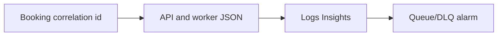

# Alerting

History: see [CHANGELOG.md](../CHANGELOG.md) or run `pnpm docs:history`

Area: Observability · Status: ✅ built in repository; live AWS acceptance is separate

## 1. In one line

API errors, worker failures, old queue work and DLQ messages drive four CloudWatch alarms with SNS email. Confirm the subscription and inspect missing-data behavior live; deployment code alone does not prove notifications work.

## 2. Real-life comparison

A receipt number follows one purchase through every desk; an alarm points at the desk where work is stuck.

## 3. Picture it

## 4. Where in our code

- Anchor: `infra/src/budget.ts` — `createBudget`; follow the numbered comments at this boundary.
- Anchor: `infra/src/observability/alarm-specs.ts` — `ALARM_PREFIX`; follow the numbered comments at this boundary.
- Anchor: `infra/src/observability/alert-topic.ts` — `prefix`; follow the numbered comments at this boundary.

`apps/api/src/http/correlation-id.ts`, worker correlation and JSON loggers preserve identity. `infra/src/observability` defines four alarms, dashboard and saved queries. P2 measured request-to-email 115 ms and retry recovery around 10 s locally. Runbook §3.12 supplies exact Logs Insights/console steps; SNS email confirmation/live alarms remain manual.

## 5. See it yourself

Use the linked scenario and tour to trace the existing integration point. This proposed extension has no runnable feature demo.

Failure thought experiment: Why validate client correlation ids? Prevent log injection and unbounded junk while preserving useful propagation. Do not change a live stack to demonstrate it.

## 6. How it connects

Uses the [current system](../00-big-picture.md); gives a concrete decision to the [scenario](../guides/interview-scenarios.md#observability) and [explorer tour](../guides/infra-explorer.html?tour=failing-email).

## 7. Our settings and WHY

API errors, worker failures, old queue work and DLQ messages drive four CloudWatch alarms with SNS email. Confirm the subscription and inspect missing-data behavior live; deployment code alone does not prove notifications work. A user symptom spans asynchronous boundaries, not one process log.

## 8. Trade-offs

Correlation is not a timed trace. Logging full messages leaks PII. Fixed thresholds are simple but need traffic-aware tuning and retention cost planning.

## 9. Alternatives and when to choose them

10x: error rates/p99 and sampling. 100x: SLO burn-rate alerting and trace sampling with explicit budgets.

## 10. What breaks and how we notice

Why validate client correlation ids? Prevent log injection and unbounded junk while preserving useful propagation.

## 13. Interview answers at 3 levels

- **Simple:** API errors, worker failures, old queue work and DLQ messages drive four CloudWatch alarms with SNS email.
- **Senior:** Use a validated correlation id across request, outbox and worker. Logs explain events, metrics show rates and traces time causal steps. Alarm on symptoms: API errors, old queue work, DLQ messages and worker failures. Missing data semantics matter; do not page on every idle CPU wobble.
- **Lead:** 10x: error rates/p99 and sampling. 100x: SLO burn-rate alerting and trace sampling with explicit budgets.

## 14. Follow-up questions with answers

Why validate client correlation ids? Prevent log injection and unbounded junk while preserving useful propagation.

Which signal explains a specific failed booking? **Correlated structured logs.**

## 15. Say it in 30 seconds

Use a validated correlation id across request, outbox and worker. Logs explain events, metrics show rates and traces time causal steps. Alarm on symptoms: API errors, old queue work, DLQ messages and worker failures. Missing data semantics matter; do not page on every idle CPU wobble.

## 16. Status and production work

Repository implementation and local evidence are described above. Live AWS/CI execution remains owner acceptance. 10x: error rates/p99 and sampling. 100x: SLO burn-rate alerting and trace sampling with explicit budgets.

## Where it appears in the story

- [infra-story: 9b. Follow a booking through symptoms](../infra-story.md#9b-follow-a-booking-through-symptoms)
