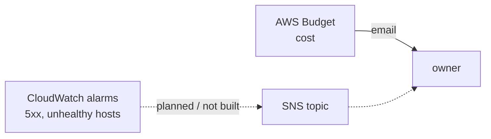

# Alerting

History: see [CHANGELOG.md](../CHANGELOG.md) or run `pnpm docs:history`

Area: Observability · Status: 🟡 partial (P2 added health alarms by email; the text below predates P2, see PENDING.md) · Step doc: [13 security groups + budget](../../13-infra-security-groups.md)

## 1. In one line

**Alerting** sends a person a message when a measurement crosses a limit; our only alert today is the
monthly budget email, so nobody is told when the app is down.

## 2. Real-life comparison

A house with a smoke alarm in the kitchen (the bill) but no burglar alarm (the app being down).

## 3. Picture it



## 4. Where in our code

- Anchor: `infra/src/budget.ts` · `createBudget`: the cost alert: email at 25/50/100% actual and 100% forecast of $20.
- Anchor: `infra/src/observability/alarm-specs.ts` · `alarmSpecs`: the health alarms (P2): DLQ not empty, oldest message age >= 5 min, worker Lambda errors, ALB 5xx >= 5 in 5 min.
- Anchor: `infra/src/observability/alert-topic.ts` · `createAlertTopic`: SNS topic `minitickets-dev-alerts` (only our CloudWatch alarms may publish) + an email subscription you confirm by hand (P2).

There are no CloudWatch alarms, SNS topics or on-call integrations in our code.

## 5. See it yourself

```bash
aws cloudwatch describe-alarms --profile ticketlite --query "MetricAlarms[].AlarmName"   # []
```

## 6. How it connects

- **Uses ←** [budget-alerts](budget-alerts.md); would use [metrics](metrics.md) and
  [CloudWatch Logs](cloudwatch-logs.md).
- **Gives →** cost safety only.

## 7. Our settings and WHY

Dev has no users to protect; a cost alert protects the owner's wallet, which is the real risk.

## 8. Trade-offs

- **Pros:** no alert noise, nothing to maintain.
- **Cons:** outages are invisible until someone looks.

## 9. Alternatives and when to choose them

What I'd add first in production, all CloudWatch alarms to an SNS topic:

1. ALB `HTTPCode_Target_5XX_Count` / 5xx rate above a threshold.
2. ALB `UnHealthyHostCount` > 0 or `HealthyHostCount` < 1.
3. ECS running task count below desired.
4. RDS CPU, free storage and connection count.
5. A synthetic check (CloudWatch Synthetics) on `appUrl` and a login.

Later: SLO-based burn-rate alerts instead of raw thresholds.

## 10. What breaks, and how we'd notice

Today we notice an outage only by using the app or reading logs.

## 11. Reach / Allowed / Password

Not a connection.

## 12. Cost

The budget: see [budget-alerts](budget-alerts.md). CloudWatch alarms are billed per alarm per month
(small; not measured).

## 13. Interview answers at 3 levels

- **Simple:** We only get an email about cost; there are no uptime alerts yet.
- **Senior:** The budget is our only alert. For production I'd alarm on ALB 5xx and unhealthy hosts,
  ECS running count and RDS saturation, sending to SNS.
- **Lead:** Alerts should be on symptoms users feel (errors, latency) and tied to SLOs, routed to an
  on-call rotation, with runbooks linked in each alert, and reviewed so noisy ones get fixed or removed.

## 14. Follow-up questions interviewers ask

- *Symptom vs cause alerts?* Alert on what users feel; use cause metrics for diagnosis.
- *How do you avoid alert fatigue?* Few, actionable alerts with clear owners and runbooks.

## 15. Say it in 30 seconds

"Today the only alert is the cost budget email. For production I'd add CloudWatch alarms on ALB 5xx
and unhealthy hosts, running task count and RDS saturation, plus a synthetic login check, all to an
on-call channel."

## 16. Status

🟡 partial. **To make it production-grade:** the alarm list in section 9.

## Where it appears in the story

- [Infra story: 9. CloudWatch Logs](../infra-story.md#9-cloudwatch-logs)
- [Infra story: 13. The budget](../infra-story.md#13-the-budget)
