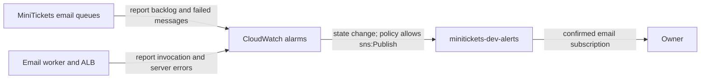

# CloudWatch alarms: the city’s warning bells

History: see [CHANGELOG.md](../CHANGELOG.md) or run `pnpm docs:history`
Area: Observability · Status: ✅ built in repository; live AWS acceptance is separate
<!-- interview-card: v2 -->

## 1. What is it?

An alarm watches a measurement and tells us when it crosses a warning level. MiniTickets uses alarms to flag stuck work and server errors.

## 2. Why do we need it?

A confirmation can remain undelivered while the website looks healthy. An alarm tells the owner to investigate before buyers start reporting missing emails.

## 3. How does it work?

1. Queues, worker and load balancer report measurements.
2. An alarm changes state when its rule is met.
3. The alert topic sends warning or recovery email to confirmed subscribers.

## 4. How do we use it in MiniTickets?

Four alarms watch dead letters, email backlog age, email-worker invocation errors and load-balancer server errors. They are designed to send warnings through AWS’s notification service, SNS. The owner must still confirm the subscription and verify live delivery. These alarms do not cover the ticket pipeline.

## 5. Interview-ready answer

“MiniTickets alerts on symptoms: stuck emails, dead letters, worker crashes and server errors. CloudWatch sends state changes through SNS to a confirmed email subscriber. For the dead-letter queue, missing measurements preserve the previous state: silence must not imply recovery. The alarms guide investigation; they do not prove every booking or email succeeded.”

## 6. Important follow-up questions

- **Why not watch CPU alone?** High CPU can be healthy; these signals are closer to failed user work.
- **Why no email after an alarm?** Check subscription confirmation and topic permissions, then delivery.
- **Does every failed email raise worker errors?** No. Handled record failures retry separately and may reach the dead-letter queue.
- **What changes at higher traffic?** Fixed error counts may need error-rate or reliability-budget alerts.

## 7. Advanced details

Technical reference

### Resources, thresholds and policies

A [CloudWatch alarm](../glossary.md#cloudwatch-alarm) is created from `infra/src/observability/alarm-specs.ts` → `alarmSpecs`, by `infra/src/observability/alarms.ts` → `createAlarms`; `infra/src/observability/alert-topic.ts` → `createAlertTopic` creates `minitickets-dev-alerts`. `infra/src/budget.ts` → `createBudget` is a separate spending warning.

All alarm names begin `minitickets-dev-`, allowing deployment policy and SNS source conditions to constrain them. Two queue alarms exist with compute off; `worker-errors` requires compute enabled, `alb-5xx` entry enabled.

| Alarm | Metric and evaluation | Missing data |
| --- | --- | --- |
| `jobs-dlq-not-empty` | SQS `ApproximateNumberOfMessagesVisible`, Maximum, 60 seconds, one period, >0 | `ignore`: preserve state |
| `jobs-oldest-message-age` | SQS `ApproximateAgeOfOldestMessage`, Maximum, 60 seconds, ≥300 seconds | `notBreaching` |
| `worker-errors` | Lambda `Errors`, Sum, 300 seconds, >0 | `notBreaching` |
| `alb-5xx` | `HTTPCode_Target_5XX_Count` + `HTTPCode_ELB_5XX_Count`, `FILL(...,0)`, Sum, 300 seconds, ≥5 | Filled missing series |

Inactive SQS queues can stop reporting; absence must not falsely clear a failed-message incident. Lambda Errors sees unhandled exceptions, timeouts and out-of-memory, not caught record failures returned in `batchItemFailures`.

The SNS resource policy permits `cloudwatch.amazonaws.com` to `sns:Publish`, limited by our source account and alarm ARN prefix. This managed path needs no application port or password. The topic intentionally has no encryption key because notices contain no application secrets; encryption would require a suitable KMS key policy. Both `alarmActions` and `okActions` publish; insufficient-data actions are omitted. Email requires confirmation.

### Operations and limits

Console: `us-east-1` → CloudWatch → Alarms → All alarms → `minitickets-dev-` → History / Details. SNS → Topics → `minitickets-dev-alerts` → Subscriptions should show a confirmed subscription ARN. An alarm with no email suggests subscription/delivery or topic-policy issues. A red DLQ alarm with no new data requires checking the queue before declaring recovery.

The dashboard and saved queries support investigation, not automatic tracing. Fixed counts are development settings; production may need error rates or SLO burn alerts after defining a reliability budget. No current live alarm/delivery/failure-drill result is claimed. Prior local latency figures do not verify deployed alarms. Ticket-queue coverage remains incomplete.

### Related boundaries

[DLQ](dead-letter-queue.md) provides visible-count measurements (SQS → jobs-dlq → Monitoring). [SNS](sns.md) carries notifications through the topic resource policy (SNS → alerts → Access policy). [Logs](cloudwatch-logs.md) explain the incident (CloudWatch → Logs Insights → Saved queries).

### Code anchors

- Anchor: `infra/src/budget.ts` — `createBudget`; follow the numbered comments at this boundary.
- Anchor: `infra/src/observability/alarm-specs.ts` — `ALARM_PREFIX`; follow the numbered comments at this boundary.
- Anchor: `infra/src/observability/alert-topic.ts` — `prefix`; follow the numbered comments at this boundary.

[Open this piece in the city explorer](../guides/infra-explorer.html?concept=alerting#chapter=19&piece=alarms).

## Where it appears in the story

- [infra-story: 9b. Follow a booking through symptoms](../infra-story.md#9b-follow-a-booking-through-symptoms)

