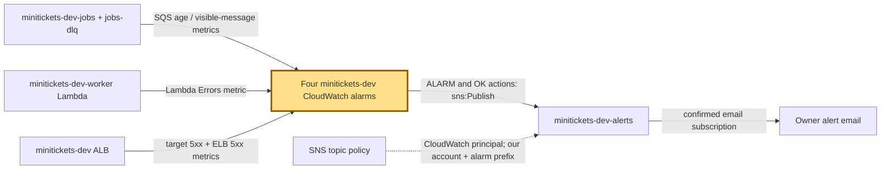
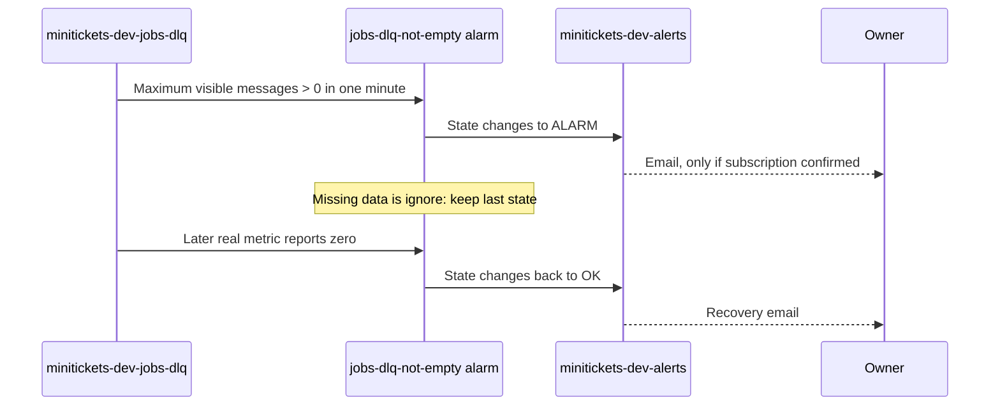

# CloudWatch alarms: the city’s warning bells

History: see [CHANGELOG.md](../CHANGELOG.md) or run `pnpm docs:history`
Area: Observability · Status: ✅ built in repository; live AWS acceptance is separate
<!-- interview-card: v1 -->

## 1. In one line

When MiniTickets work gets stuck or visitors see enough errors, a CloudWatch [alarm](../glossary.md#cloudwatch-alarm) rings through the `minitickets-dev-alerts` SNS topic.

## 2. Where it sits

[Open this piece in the city explorer](../guides/infra-explorer.html?concept=alerting#chapter=19&piece=alarms).

## 3. How it works

## 4. What happens in MiniTickets

1. `alarmSpecs` watches email DLQ count, oldest queued email, worker invocation errors and total ALB 5xx.
2. Thresholds are >0 DLQ messages, ≥300 s queue age, >0 worker errors/300 s, or ≥5 ALB errors/300 s.
3. Crossing a threshold changes alarm state and publishes to `minitickets-dev-alerts`.
4. A confirmed email subscription delivers ALARM and recovery notices; code alone cannot prove delivery.

## 5. Reach / Allowed / Password

**Reach:** managed metric-to-alarm-to-SNS path; no app port rule.

**Allowed:** topic policy permits CloudWatch `sns:Publish` for our account’s `minitickets-dev-*` alarms.

**Password:** not needed; owner confirms the email subscription.

## 6. In our code

`infra/src/observability/alarm-specs.ts` → `alarmSpecs`.

`infra/src/observability/alarms.ts` → `createAlarms`; `infra/src/observability/alert-topic.ts` → `createAlertTopic`.

`infra/src/budget.ts` → `createBudget` is a separate spending warning.

## 7. In the AWS console

`us-east-1` → CloudWatch → Alarms → All alarms → filter `minitickets-dev-` → alarm → History / Details. SNS → Topics → `minitickets-dev-alerts` → Subscriptions must show a confirmed subscription ARN. Live state/delivery not checked.

## 8. Good / Bad

**Good:** Bells match user symptoms. Recovery emails close the loop.

**Bad:** Counts need traffic-aware tuning. Ticket-queue failures are not covered by these four alarms.

## 9. Other choices

- Error-rate alarms: pick them when traffic makes fixed counts misleading.
- SLO burn alerts: pick them when a measured reliability budget exists.

## 10. Connected to

| Neighbor | Direction | What allows it | Console check |
| --- | --- | --- | --- |
| [DLQ](dead-letter-queue.md) | In ← | Visible-count metric >0 | SQS → jobs-dlq → Monitoring |
| [SNS](sns.md) | Out → | CloudWatch topic resource policy | SNS → alerts → Access policy |
| [Logs](cloudwatch-logs.md) | Out → | Owner investigation after email | CloudWatch → Logs Insights → Saved queries |

## 11. When it breaks

Alarm, no email → SNS subscription/confirmation → confirm or repair delivery.

Alarm stays red without new data → missing-data setting → inspect the actual DLQ before treating silence as recovery.

## 12. Say it in 30 seconds

“Our four warning bells watch stuck emails, dead letters, worker crashes and visitor server errors. CloudWatch sends state changes through a tightly allowed SNS topic to confirmed email. DLQ silence keeps the last state, because an unread failed message must not look fixed. Ticket-pipeline coverage still needs expansion.”

## 13. Likely follow-ups

- Why not CPU alone? Busy CPU may be healthy; these signals point at affected users.
- Does a handled message failure count as Lambda Errors? No; it returns a partial batch failure.

## 14. Remember it

A silent queue is not proof that the lost letter was delivered.

## 15. More detail

Settings, limits and deeper interview notes

- Anchor: `infra/src/budget.ts` — `createBudget`; follow the numbered comments at this boundary.
- Anchor: `infra/src/observability/alarm-specs.ts` — `ALARM_PREFIX`; follow the numbered comments at this boundary.
- Anchor: `infra/src/observability/alert-topic.ts` — `prefix`; follow the numbered comments at this boundary.

Two queue alarms exist even when compute is off. `worker-errors` exists with compute enabled; `alb-5xx` exists with entry enabled. All names begin `minitickets-dev-` so the deploy policy and SNS source condition can constrain them.

`jobs-dlq-not-empty`: SQS `ApproximateNumberOfMessagesVisible`, Maximum, 60-second period, one period, >0, missing data `ignore`. SQS can stop publishing metrics for inactive queues; treating silence as healthy could falsely clear a DLQ incident. `jobs-oldest-message-age`: `ApproximateAgeOfOldestMessage`, Maximum, 60-second period, ≥300, missing `notBreaching`.

`worker-errors`: Lambda `Errors`, Sum, 300-second period, >0, missing `notBreaching`. It sees unhandled exceptions/timeouts/out-of-memory, not caught record failures returned through `batchItemFailures`. Those retry and may reach the DLQ. `alb-5xx` adds `HTTPCode_Target_5XX_Count` and `HTTPCode_ELB_5XX_Count` with `FILL(...,0)`, Sum over 300 seconds, ≥5. A production workload likely needs an error rate rather than this dev count.

The alert topic’s resource policy trusts `cloudwatch.amazonaws.com`, source account and alarm ARN prefix. It intentionally has no SNS encryption key: these notices hold no app secrets; an encrypted design needs an appropriate KMS key policy. Email confirmation is required. `alarmActions` and `okActions` publish; insufficient-data actions are omitted.

A dashboard and saved log queries support investigation, but are not automatic tracing. Budget warnings are separate: they concern spend, not booking health. Prior local latency numbers do not prove these deployed bells work. Threshold tuning, notification delivery and live failure drills remain owner acceptance.

## Where it appears in the story

- [infra-story: 9b. Follow a booking through symptoms](../infra-story.md#9b-follow-a-booking-through-symptoms)
