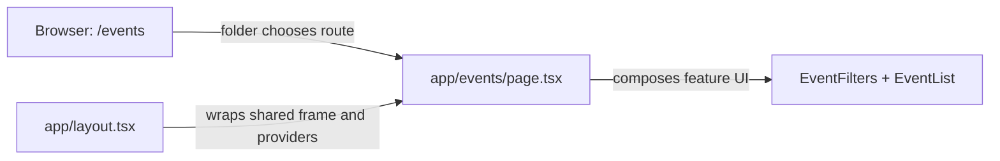

# App Router: file-based routing

History: see [CHANGELOG.md](../CHANGELOG.md) or run `pnpm docs:history`

Area: Frontend · Status: ✅ built · Step doc: [03 landing](../../03-landing.md)
<!-- interview-card: v2 -->

## 1. What is it?

The App Router maps Next.js folders to website routes. A page file supplies a route’s content, while layouts supply the shared frame around it.

## 2. Why do we need it?

MiniTickets needs separate login, events and ticket pages with a consistent header. File-based routes make the URL structure visible without maintaining a second routing table.

## 3. How does it work?



1. Match the requested URL to its route folder.
2. Apply the layouts above that page.
3. Render feature components and any route-specific loading or error boundary.

## 4. How do we use it in MiniTickets?

Our app directory owns routing and composition. Features own the UI and data hooks. Current routes include event detail, admin event creation and My tickets alongside auth and dashboard. The events route also owns its streaming boundary.

## 5. Interview-ready answer

“Next.js App Router makes the folder tree MiniTickets’ routing contract. Layouts provide shared structure, and pages compose feature components rather than hold business logic. Dynamic route segments handle event IDs. This improves navigation and ownership, but changing a folder can change a public URL, so route renames need a compatibility plan.”

## 6. Important follow-up questions

- **What if page.tsx is misspelled?** The intended route is absent and returns a not-found response.
- **What does a layout preserve?** Its shared frame can remain mounted during navigation beneath it.
- **Where does event detail get its ID?** The events/[id] folder supplies a dynamic route parameter; validate external values.
- **Where should feature logic live?** In feature code or the API, keeping route files focused on composition.

## 7. Advanced details

<details>
<summary>Technical reference</summary>

### Current reading notes

Current route inventory includes `/`, `/login`, `/signup`, `/dashboard`, `/events`, `/events/[id]`, `/admin/events/new`, `/tickets` and the revalidation route handler. Earlier “four pages” and “dynamic routes not needed yet” statements are historical. `searchParams` is awaited in the Next.js 16 events page.

### Implementation reference

- Anchor: `apps/web/src/app/page.tsx` · `HomePage`: the `/` route; it only picks the feature to show (`LandingPage`).
- Anchor: `apps/web/src/app/dashboard/page.tsx` · `DashboardPage`: the `/dashboard` route; a frame plus `ProfileCard`.
- Anchor: `apps/web/src/app/events/page.tsx` · `EventsPage`: the `/events` route; the heading plus a `<Suspense>` around the server-fetched `EventList` (Step 22). Its `error.tsx` sits in the same folder: route files are found by name.

Step by step:

1. The browser asks for `/dashboard`.
2. Before any page runs, `proxy` in `apps/web/src/proxy.ts` may redirect
   ([route-guard-proxy](route-guard-proxy.md)).
3. Next.js finds `app/dashboard/page.tsx` and renders its default export, `DashboardPage`.
4. It wraps the page in `RootLayout` from `app/layout.tsx` (header, footer, `QueryProvider`).
5. `export const metadata = { title: "Dashboard" }` plus the template in the layout gives the tab
   title "Dashboard | MiniTickets".

Our routes today: `/` (`HomePage`), `/login` (`LoginPage`), `/signup` (`SignupPage`), `/dashboard`
(`DashboardPage`). **Rule from `CLAUDE.md`:** `app/` is routing only. Pages are a few lines; the
real code lives in `features/<feature>/` ([feature-folders](feature-folders.md)).

### Inspection and historical evidence

```bash
ls apps/web/src/app/*/page.tsx apps/web/src/app/page.tsx   # inspect page routes
pnpm dev                                                   # then open http://localhost:3000/signup
```

**Break it on purpose:** rename `app/signup/` to `app/register/`. `/signup` now gives Next.js's 404
page and `/register` shows the form. No router config was touched. (Rename it back.)

### Settings and reasoning

| Choice | Why |
| ------ | --- |
| App Router, `src/app/` | The current Next.js default; layouts and Server Components come with it. |
| Pages contain no logic | One place to look for each feature; pages stay readable as a route list. |
| `metadata` with a title template | Every tab gets "Page | MiniTickets" without repeating the brand. |

### Trade-offs

- **Pros:** no route table to keep in sync; nested layouts; Server Components by default.
- **Cons:** the folder layout is a public contract (renaming a folder changes a URL); "magic" file
  names (`page.tsx`, `layout.tsx`, `proxy.ts`) must be learned.

### Alternatives and scaling

- **Next.js Pages Router (`pages/`):** older projects; no Server Components.
- **React Router / TanStack Router in a single-page app (Vite):** when there is no server rendering
  and routes are defined in code.
- **Remix / React Router framework mode:** similar file routing with a different data-loading model.

### Failure diagnosis

- A misspelled file (`Page.tsx`, `pages.tsx`): the route 404s. The e2e tests visit every route
  ([e2e-tests](e2e-tests.md)), so CI catches it.
- Logic creeping into `app/`: not a crash, a code review problem.

### Further questions

- *What is `layout.tsx` for?* Shared frame for all pages below it; it stays mounted when you
  navigate between them.
- *How do you add a 404 page?* `app/not-found.tsx` (we use the default).
- *Dynamic routes?* A folder named `[id]` gives the segment as a parameter; `/events/[id]` uses this today.

### Related reading

- [server-client-components](server-client-components.md)

[Open this piece in the city explorer](../guides/infra-explorer.html?concept=app-router#chapter=0&piece=laptop-web).

## Where it appears in the story

- [App story: 1. Browser → Next.js: layout, server vs client components, proxy guard](../app-story.md#1-browser--nextjs-layout-server-vs-client-components-proxy-guard)

</details>
