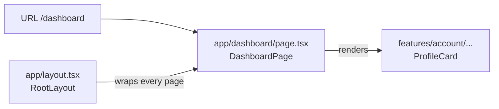

# App Router: file-based routing

History: see [CHANGELOG.md](../CHANGELOG.md) or run `pnpm docs:history`

Area: Frontend · Status: ✅ built · Step doc: [03 landing](../../03-landing.md)

## 1. In one line

In the Next.js **App Router**, the folder path under `apps/web/src/app/` *is* the URL: a
`page.tsx` file in `app/dashboard/` becomes the page at `/dashboard`.

## 2. Real-life comparison

A building directory where the room number is the floor plus the door: you never keep a separate
list saying "room 204 is on floor 2". The folder structure is the map.

## 3. Picture it



## 4. Where in our code

- Anchor: `apps/web/src/app/page.tsx` · `HomePage`: the `/` route; it only picks the feature to show (`LandingPage`).
- Anchor: `apps/web/src/app/dashboard/page.tsx` · `DashboardPage`: the `/dashboard` route; a frame plus `ProfileCard`.

Step by step:

1. The browser asks for `/dashboard`.
2. Before any page runs, `proxy` in `apps/web/src/proxy.ts` may redirect
   ([route-guard-proxy](route-guard-proxy.md)).
3. Next.js finds `app/dashboard/page.tsx` and renders its default export, `DashboardPage`.
4. It wraps the page in `RootLayout` from `app/layout.tsx` (header, footer, `QueryProvider`).
5. `export const metadata = { title: "Dashboard" }` plus the template in the layout gives the tab
   title "Dashboard | MiniTickets".

Our routes today: `/` (`HomePage`), `/login` (`LoginPage`), `/signup` (`SignupPage`), `/dashboard`
(`DashboardPage`). **Rule from `CLAUDE.md`:** `app/` is routing only. Pages are a few lines; the
real code lives in `features/<feature>/` ([feature-folders](feature-folders.md)).

## 5. See it yourself

```bash
ls apps/web/src/app/*/page.tsx apps/web/src/app/page.tsx   # every route is one file
pnpm dev                                                   # then open http://localhost:3000/signup
```

**Break it on purpose:** rename `app/signup/` to `app/register/`. `/signup` now gives Next.js's 404
page and `/register` shows the form. No router config was touched. (Rename it back.)

## 6. How it connects

- **Uses ←** Next.js 16 (`apps/web/package.json`).
- **Gives →** the place where [server-client-components](server-client-components.md) start (pages
  are Server Components), and where [feature-folders](feature-folders.md) plug in.

## 7. Our settings and WHY

| Choice | Why |
| ------ | --- |
| App Router, `src/app/` | The current Next.js default; layouts and Server Components come with it. |
| Pages contain no logic | One place to look for each feature; pages stay readable as a route list. |
| `metadata` with a title template | Every tab gets "Page | MiniTickets" without repeating the brand. |

## 8. Trade-offs

- **Pros:** no route table to keep in sync; nested layouts; Server Components by default.
- **Cons:** the folder layout is a public contract (renaming a folder changes a URL); "magic" file
  names (`page.tsx`, `layout.tsx`, `proxy.ts`) must be learned.

## 9. Alternatives and when to choose them

- **Next.js Pages Router (`pages/`):** older projects; no Server Components.
- **React Router / TanStack Router in a single-page app (Vite):** when there is no server rendering
  and routes are defined in code.
- **Remix / React Router framework mode:** similar file routing with a different data-loading model.

## 10. What breaks, and how we'd notice

- A misspelled file (`Page.tsx`, `pages.tsx`): the route 404s. The e2e tests visit every route
  ([e2e-tests](e2e-tests.md)), so CI catches it.
- Logic creeping into `app/`: not a crash, a code review problem.

## 13. Interview answers at 3 levels

- **Simple:** The folder is the URL: `app/dashboard/page.tsx` is `/dashboard`.
- **Senior:** We use the App Router with a root layout that adds the header, footer and the
  TanStack Query provider. Pages are Server Components that only choose a feature component, so
  `app/` reads like a route list and the logic lives in `features/`.
- **Lead:** File routing removes a whole class of "router config out of sync" bugs, but makes URLs
  part of the folder structure, so renames need redirects. Keeping pages thin lets a team move a
  feature without touching routing.

## 14. Follow-up questions interviewers ask

- *What is `layout.tsx` for?* Shared frame for all pages below it; it stays mounted when you
  navigate between them.
- *How do you add a 404 page?* `app/not-found.tsx` (we use the default).
- *Dynamic routes?* A folder named `[id]` gives the segment as a parameter (not needed yet).

## 15. Say it in 30 seconds

"Next.js App Router: the folder is the URL. Our `app/` folder only has four tiny pages and the root
layout; each page picks a feature component, and the real code lives in `features/`. The layout
adds the header and the TanStack Query provider for every page."

## 16. Status

✅ built.

## Where it appears in the story

- [App story: 1. Browser → Next.js: layout, server vs client components, proxy guard](../app-story.md#1-browser--nextjs-layout-server-vs-client-components-proxy-guard)
