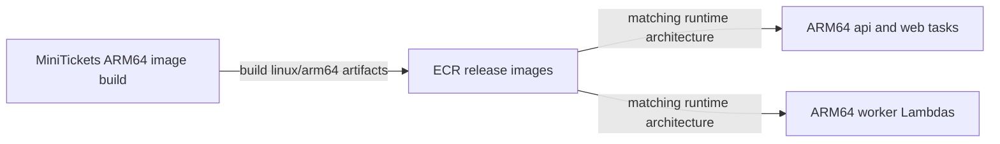

# ARM64 (Graviton) images and tasks

History: see [CHANGELOG.md](../CHANGELOG.md) or run `pnpm docs:history`

Area: AWS Compute · Status: ✅ built · Step doc: [16 ECR](../../16-infra-ecr.md) (section 3g)
<!-- interview-card: v2 -->

## 1. What is it?

ARM64 is a processor architecture; Graviton is AWS’s ARM processor family. A container’s executable files must match the architecture where it runs.

## 2. Why do we need it?

MiniTickets cannot safely build native dependencies for one processor and assume another can execute them. Choosing ARM infrastructure requires matching images and compatible libraries through the delivery path.

## 3. How does it work?



1. Choose the target operating system and processor architecture.
2. Build image contents and native dependencies for that target.
3. Run them only on a compatible configured runtime.

## 4. How do we use it in MiniTickets?

API/web tasks and worker Lambdas declare ARM64. RDS and Valkey use Graviton instance classes managed by AWS. CI test builds and release publishing are separate; prior local checks cover both architectures, not live deployment acceptance.

## 5. Interview-ready answer

“MiniTickets uses ARM64 runtimes, so image builds must produce compatible Linux ARM binaries, including native password hashing. Managed database and cache instance classes also use Graviton. The benefit can be price and performance, but it is workload-specific. I verify dependencies and benchmark the target rather than treating a processor name as a guaranteed saving.”

## 6. Important follow-up questions

- **What can cause exec format error?** An incompatible executable architecture or format; inspect the built image and runtime.
- **Why are native dependencies important?** They include OS/CPU-specific binaries, unlike ordinary JavaScript.
- **Can one tag support two architectures?** A multi-architecture manifest can select matching images; it is a deliberate publishing choice.
- **Are emulated builds equivalent in speed?** No. Cross-architecture emulation can make builds much slower.

## 7. Advanced details

<details>
<summary>Technical reference</summary>

### Source references

- Anchor: `scripts/push-images.sh` · step 9: `docker buildx build --platform linux/arm64`.
- Anchor: `infra/src/compute/task.ts` · `runtimePlatform: { cpuArchitecture: "ARM64" }`: api tasks.
- Anchor: `infra/src/compute/web-task.ts` · `runtimePlatform`: web tasks.
- Anchor: `infra/src/data/postgres.ts` · `instanceClass: "db.t4g.micro"`: the database (the `g` means Graviton).
- Anchor: `infra/src/data/cache.ts` · `nodeType: "cache.t4g.micro"`: the cache.
- Anchor: `infra/src/jobs/worker-lambda.ts` · `architectures: ["arm64"]`: the worker Lambda (S1c), historical roughly 20% per-GB-second comparison with x86, not a current regional quote.

Step by step:

1. `push-images.sh` warns if the laptop is not ARM (emulation would be slow) and builds with
   `--platform linux/arm64 --provenance=false`.
2. Both task definitions declare `operatingSystemFamily: "LINUX", cpuArchitecture: "ARM64"`.
3. The data services pick `t4g` sizes; for managed services AWS handles the architecture.

### Configuration and design

| Choice | Why |
| ------ | --- |
| ARM64 everywhere | Graviton is usually cheaper than x86 for the same work, and our laptops are ARM, so builds are native. |
| Explicit `--platform` | The image must match the task, whatever machine builds it. |
| `--provenance=false` | One plain image per tag, no extra attestation manifests. |

Not applicable: architecture changes neither networking nor permissions.

### Checks and troubleshooting

```bash
cd infra
docker buildx imagetools inspect "$(pulumi stack output apiRepoUrl):$(pulumi config get apiImageTag)" | grep -i platform
```

Expect `linux/arm64`. (You need `aws ecr get-login-password … | docker login …` first.)

**Break it on purpose (thought experiment):** build without `--platform` on an Intel machine and run
it on an ARM64 task: the container logs `exec format error` and the task stops.

- Mismatch: `exec format error` in the task's logs.
- Emulated builds on x86: very slow builds (a warning from the script).

- *What does `exec format error` mean?* The binary was built for another CPU.
- *Why does the base image matter?* Native modules (like argon2) need builds for that OS and CPU.

### Trade-offs and alternatives

- **Pros:** lower price, native builds on Apple Silicon.
- **Cons:** an x86-only dependency would break; CI runners are x86 by default (our CI only test-builds
  images, it doesn't push them).

- **x86_64:** a dependency has no ARM build.
- **Multi-arch images** (`--platform linux/amd64,linux/arm64`): images used on both kinds of machines.

### Further technical context

The push script uses buildx with `--platform linux/arm64`, both task definitions set
  `cpuArchitecture: ARM64`, and RDS and ElastiCache use `t4g` Graviton classes. A mismatch shows up
  as `exec format error`.

Historical cost notes (not a current quote):

The task prices in our docs are ARM prices. I have not measured an x86 comparison for our setup.

### Related reading

- **Uses ←** Docker buildx; the [ECR](ecr.md) repos.
- **Gives →** cheaper [Fargate](fargate.md) tasks; the `argon2` native package works because the
  base image is glibc `slim` with an ARM64 build (Phase 3 `docker-multi-stage` card).

[Open this piece in the city explorer](../guides/infra-explorer.html?concept=arm64-graviton#chapter=8&piece=api-task).

## Where it appears in the story

- [Infra story: 4. ECS: cluster, service, task definition, task, Spot](../infra-story.md#4-ecs-cluster-service-task-definition-task-spot)
- [Big picture: 4. Components](../00-big-picture.md#4-components)

</details>
