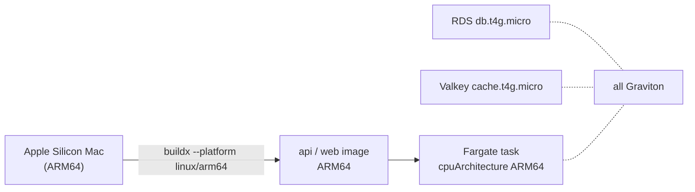

# ARM64 (Graviton) images and tasks

Area: AWS Compute · Status: ✅ built · Step doc: [16 ECR](../../16-infra-ecr.md) (section 3g)

## 1. In one line

Our tasks, database and cache run on AWS **Graviton** (ARM64) processors, so our images must be
built for `linux/arm64`.

## 2. Real-life comparison

A DVD region code. A disc made for region 2 does not play in a region 1 player. The image is the
disc; the task's CPU is the player. They must match.

## 3. Picture it



## 4. Where in our code

- Anchor: `scripts/push-images.sh` · step 9: `docker buildx build --platform linux/arm64`.
- Anchor: `infra/src/compute/task.ts` · `runtimePlatform: { cpuArchitecture: "ARM64" }`: api tasks.
- Anchor: `infra/src/compute/web-task.ts` · `runtimePlatform`: web tasks.
- Anchor: `infra/src/data/postgres.ts` · `instanceClass: "db.t4g.micro"`: the database (the `g` means Graviton).
- Anchor: `infra/src/data/cache.ts` · `nodeType: "cache.t4g.micro"`: the cache.

Step by step:

1. `push-images.sh` warns if the laptop is not ARM (emulation would be slow) and builds with
   `--platform linux/arm64 --provenance=false`.
2. Both task definitions declare `operatingSystemFamily: "LINUX", cpuArchitecture: "ARM64"`.
3. The data services pick `t4g` sizes; for managed services AWS handles the architecture.

## 5. See it yourself

```bash
cd infra
docker buildx imagetools inspect "$(pulumi stack output apiRepoUrl):$(pulumi config get apiImageTag)" | grep -i platform
```

Expect `linux/arm64`. (You need `aws ecr get-login-password … | docker login …` first.)

**Break it on purpose (thought experiment):** build without `--platform` on an Intel machine and run
it on an ARM64 task: the container logs `exec format error` and the task stops.

## 6. How it connects

- **Uses ←** Docker buildx; the [ECR](ecr.md) repos.
- **Gives →** cheaper [Fargate](fargate.md) tasks; the `argon2` native package works because the
  base image is glibc `slim` with an ARM64 build (Phase 3 `docker-multi-stage` card).

## 7. Our settings and WHY

| Choice | Why |
| ------ | --- |
| ARM64 everywhere | Graviton is usually cheaper than x86 for the same work, and our laptops are ARM, so builds are native. |
| Explicit `--platform` | The image must match the task, whatever machine builds it. |
| `--provenance=false` | One plain image per tag, no extra attestation manifests. |

## 8. Trade-offs

- **Pros:** lower price, native builds on Apple Silicon.
- **Cons:** an x86-only dependency would break; CI runners are x86 by default (our CI only test-builds
  images, it doesn't push them).

## 9. Alternatives and when to choose them

- **x86_64:** a dependency has no ARM build.
- **Multi-arch images** (`--platform linux/amd64,linux/arm64`): images used on both kinds of machines.

## 10. What breaks, and how we'd notice

- Mismatch: `exec format error` in the task's logs.
- Emulated builds on x86: very slow builds (a warning from the script).

## 11. Reach / Allowed / Password

Not applicable: architecture changes neither networking nor permissions.

## 12. Cost

The task prices in our docs are ARM prices. I have not measured an x86 comparison for our setup.

## 13. Interview answers at 3 levels

- **Simple:** We run on ARM processors because they are cheaper, so we build ARM images.
- **Senior:** The push script uses buildx with `--platform linux/arm64`, both task definitions set
  `cpuArchitecture: ARM64`, and RDS and ElastiCache use `t4g` Graviton classes. A mismatch shows up
  as `exec format error`.
- **Lead:** Moving to Graviton is mostly a build-pipeline question: native ARM CI runners or
  multi-arch builds, and checking every native dependency. Then it is a straightforward cost win.

## 14. Follow-up questions interviewers ask

- *What does `exec format error` mean?* The binary was built for another CPU.
- *Why does the base image matter?* Native modules (like argon2) need builds for that OS and CPU.

## 15. Say it in 30 seconds

"Everything runs on Graviton: tasks declare ARM64, and RDS and Valkey use `t4g` sizes. The push
script builds `linux/arm64` with buildx, because an image must match the task's CPU or it fails with
`exec format error`."

## 16. Status

✅ built.
