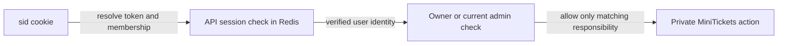

# Authentication vs authorization

History: see [CHANGELOG.md](../CHANGELOG.md) or run `pnpm docs:history`

Area: Auth & Security · Status: ✅ built in repository; live AWS acceptance is separate
<!-- interview-card: v2 -->

## 1. What is it?

Authentication checks who is calling. Authorization checks whether that caller may perform this particular action or access this particular record.

## 2. Why do we need it?

Being logged into MiniTickets should let Alice view her tickets, but never Bob’s. Knowing her identity is only the first check; the requested data still needs an ownership decision.

## 3. How does it work?

1. Verify the session, not merely cookie presence.
2. Check the owner or required current role.
3. Run the action only after both checks pass.

## 4. How do we use it in MiniTickets?

Protected procedures require a session. Admin procedures read the current Postgres role when needed; ordinary protected calls avoid that unrelated lookup. Ticket reads use the session owner rather than a caller-selected user.

## 5. Interview-ready answer

“Authentication tells MiniTickets which session is making a request; authorization decides whether that user may do the requested work. I enforce both at the API, even when the UI hides controls. Ownership protects personal tickets, while admin requests check the current role so a stale login does not become permanent permission.”

## 6. Important follow-up questions

- **Does a cookie prove identity?** Only a valid server-side session does; a fake cookie can pass a navigation guard.
- **Does every protected call need a role lookup?** No. Check only the authority that action requires.
- **What if the authorization store fails?** Do not grant access based on an unknown result.
- **Can revocation recall an authorized request already running?** No. In-flight work is an explicit limit of the current design.

## 7. Advanced details

Technical reference

### Source references

- Anchor: `apps/api/src/procedures/account.ts` — `module configuration`; follow the numbered comments at this boundary.
- Anchor: `apps/api/src/trpc/init.ts` — `isAuthed`; follow the numbered comments at this boundary.

`apps/api/src/queries/sessions.ts` implements indexed creation/read/revokeAll; `services/users.ts` revokes around makeAdmin. `pnpm demo:security` checks old-cookie, all-device and role revocation. Cookies are HttpOnly/SameSite with Secure in production. An in-flight authorized request cannot be recalled; two-store role/revocation is not a global transaction.

### Configuration and design

Authentication verifies the session; authorization checks owner or current admin role. Protected context does not require an unrelated role read; admin middleware does. A valid login alone does not authorize another owner's assets. A role embedded forever in a session becomes stale after a privilege change.

### Checks and troubleshooting

Run `pnpm demo:security` and inspect the asserted outcome described above.

Is the presence cookie authorization? No; it only avoids a predictable redirect flash; API verifies the real session. Do not change a live stack to demonstrate it.

What happens if session membership is missing? **Authentication fails closed.**

### Trade-offs and alternatives

Redis/index eviction fails closed and forces login. The 20-device bound makes revoke work bounded. Session-versioning/transactional role changes are proposed improvements for larger deployments.

10x: monitor auth-store failures and session churn. 100x: coordinated auth versioning, device management and key/credential rotation.

### Further technical context

Opaque session cookies keep revocation server-side; JWTs reduce lookup dependence but revocation/role changes need expiry or another authoritative version. MiniTickets hashes random tokens in Redis, rotates login sessions, indexes at most 20 devices and checks membership on every read. Admin authorization reads Postgres; role changes revoke sessions before and after the update.

### Related reading

Uses the [current system](../00-big-picture.md); gives a concrete decision to the [scenario](../guides/interview-scenarios.md#sessions-roles) and [explorer tour](../guides/infra-explorer.html?tour=security-layers).

[Open this piece in the city explorer](../guides/infra-explorer.html?concept=authn-vs-authz#chapter=8&piece=api-task).

## Where it appears in the story

- [app-story: 5b. Session identity, roles and revocation](../app-story.md#5b-session-identity-roles-and-revocation)

