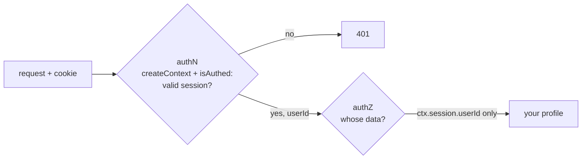

# Authentication vs authorization

History: see [CHANGELOG.md](../CHANGELOG.md) or run `pnpm docs:history`

Area: Auth & Security · Status: 🟡 partial (authentication built; authorization is "only your own data", no roles) · Step doc: [09 dashboard](../../09-dashboard.md)

## 1. In one line

**Authentication** (authN) answers "who are you?"; **authorization** (authZ) answers "may you do
this?". We authenticate with a session, and our only authorization rule is that you can read your
own profile.

## 2. Real-life comparison

At an airport, the passport check is authentication (you are Ana). The boarding pass is
authorization (Ana may board flight 12, not flight 14).

## 3. Picture it



## 4. Where in our code

- Anchor: `apps/api/src/trpc/init.ts` · `isAuthed`: authentication gate (401 without a session).
- Anchor: `apps/api/src/procedures/account.ts` · `profile`: authorization by construction; it reads `ctx.session.userId`, never an id from the input.

Step by step:

1. **AuthN:** `createContext` turns the cookie into `{ userId }` or `null`; `isAuthed` rejects
   `null` with 401 ([protected-procedure](protected-procedure.md)).
2. **AuthZ today:** `account.profile` has no input; it loads `getProfile(ctx.session.userId)`. There
   is no way to ask for someone else's profile, so there is nothing to forbid.
3. `ForbiddenError` (403) exists in `errors.ts` for later, unused.
4. No roles, no organisations, no ticket ownership checks yet: tickets aren't built.

## 5. See it yourself

```bash
curl -s localhost:4000/trpc/account.profile               # 401: not authenticated
curl -s -b "sid=$SID" localhost:4000/trpc/account.profile # 200: your own profile only
```

**Break it on purpose (thought experiment):** add `.input(z.object({ userId: z.string() }))` and use
`input.userId`. Any logged-in user can now read any profile: authenticated but not authorized, the
classic IDOR (insecure direct object reference).

## 6. How it connects

- **Uses ←** [trpc-context](trpc-context.md), [sessions-vs-jwt](sessions-vs-jwt.md).
- **Gives →** [protected-procedure](protected-procedure.md); later RBAC/ABAC (explain-only card
  `rbac-abac`).

## 7. Our settings and WHY

Derive "who" from the session, never from input. WHY: the simplest authorization rule that can't be
bypassed by changing a parameter.

## 8. Trade-offs

- **Pros:** no IDOR possible today; very little code.
- **Cons:** no roles or sharing; the first multi-user feature (tickets assigned to agents) needs a
  real model.

## 9. Alternatives and when to choose them

- **RBAC** (roles: agent, admin): simple, coarse.
- **ABAC / policies** (attributes: same organisation, ticket assignee): flexible.
- **Row-level security in Postgres:** the database enforces ownership per row.

## 10. What breaks, and how we'd notice

An endpoint that takes an id from the input without an ownership check: a data leak that tests won't
catch unless written for it. A test per protected resource ("user B can't read A's") is the guard.

## 13. Interview answers at 3 levels

- **Simple:** First we check who you are, then what you may see.
- **Senior:** AuthN is the Redis session checked in the context and enforced by `isAuthed` (401).
  AuthZ today is structural: `account.profile` takes no id and uses `ctx.session.userId`, so you can
  only read yourself. `ForbiddenError` (403) is ready for real rules.
- **Lead:** Authorization belongs next to the data, as close to the query as possible. For tickets
  I'd add an ownership/organisation check in services (or Postgres RLS) and tests for cross-tenant
  access on every endpoint.

## 14. Follow-up questions interviewers ask

- *401 or 403?* 401: not authenticated. 403: authenticated but not allowed.
- *What's IDOR?* Changing an id in a request to access someone else's data.

## 15. Say it in 30 seconds

"Authentication is the Redis session: no valid session, 401 from isAuthed. Authorization today is
structural: the profile endpoint takes no id and reads ctx.session.userId, so you can only see
yourself. Roles and ownership rules come with tickets."

## 16. Status

🟡 partial. **To make it production-grade:** a role/ownership model, checks in services, 403s, and
cross-user tests.
