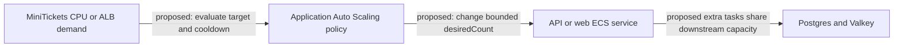

# Autoscaling

History: see [CHANGELOG.md](../CHANGELOG.md) or run `pnpm docs:history`

Area: Reliability · Status: 📖 explain-only

<!-- interview-card: v2 -->

## 1. What is it?

Autoscaling would adjust the number of running application copies as demand changes. A policy would decide when to add or remove capacity within explicit limits.

## 2. Why do we need it?

MiniTickets traffic may spike when a sale opens and drop later. A fixed fleet can be too small during the spike or wasteful afterward, but automatic growth must respect the database’s limits.

## 3. How does it work?

1. A proposed policy would watch a demand-related measurement.
2. It would change task count within minimum and maximum bounds.
3. Cooldowns and downstream budgets would limit unstable or excessive growth.

## 4. How do we use it in MiniTickets?

Autoscaling is explain-only. Current services have no scaling target or policy. Adding API copies could help independent work, but all buyers for one event would still compete for its row lock. API and web would need separate policies.

## 5. Interview-ready answer

“MiniTickets does not yet autoscale. A proposed target-tracking policy could change ECS task count from demand measurements, with minimums, maximums and cooldowns. I would choose bounds from latency, database connection capacity and cost. Scale-out takes time, and extra tasks still share data bottlenecks; autoscaling is not a substitute for admission control or reliable baseline capacity.”

## 6. Important follow-up questions

- **Why not set a very high maximum?** It can overload the database, exhaust quotas and increase cost.
- **Will scale-out absorb an instant spike?** Not immediately. Measurement, startup and health checks introduce delay.
- **Can it remove a hot-row bottleneck?** No. That row still serializes its writers.
- **Does a task maximum cap the AWS bill?** No. It bounds one resource count, not every service or traffic charge.

## 7. Advanced details

Technical reference

### Proposed source placement

Existing integration point: `infra/src/compute/service.ts`. A proposed `infra/src/compute/autoscaling.ts` would create Application Auto Scaling targets/policies after ECS services, using CPU or ALB requests per target. A controlled exercise could start at **minimum 1 / maximum 3**, with separate API/web policies, cooldowns and alarms. These are proposed exercise values, not deployed settings. No scaling resource or IAM policy is built, and no runnable feature demo exists.

### Capacity contract and future evidence

More API tasks mean more Postgres pools. Load-test cooldowns, startup/health timing and total connections under an owner-approved budget; inspect existing desiredCount before any change. Do not blindly scale beyond RDS/downstream capacity. Minimum tasks cost while idle; maximum task count does not fully cap spend. Scheduled on-sale capacity, downstream quotas and event/seat partitioning may complement target tracking at greater scale.

### Related reading

[current system](../00-big-picture.md) · [scenario](../guides/interview-scenarios.md#autoscaling) · [explorer tour](../guides/infra-explorer.html?tour=sale-day)

[Open this concept in the city explorer](../guides/infra-explorer.html?concept=autoscaling#chapter=22&piece=ecs-autoscaling).

## Where it appears in the story

- [app-story: 9b. A booking reaches its transaction](../app-story.md#9b-a-booking-reaches-its-transaction)

