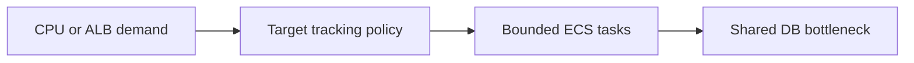

# Autoscaling

History: see [CHANGELOG.md](../CHANGELOG.md) or run `pnpm docs:history`

Area: Reliability · Status: 📖 explain-only

## 1. In one line

Explain-only: bounded Application Auto Scaling targets would adjust ECS desiredCount on CPU or ALB demand; current services have no autoscaling policy and a hot row still serializes buyers.

## 2. Real-life comparison

Two clerks cannot promise the same last seat: one holds the ledger until the reservation is recorded.

## 3. Picture it

## 4. Where in our code

Not in our app as an anchored feature. The proposed or observational location is explained below; it must not be mistaken for a deployed resource.

WHERE IN MINITICKETS: proposed Pulumi module infra/src/compute/autoscaling.ts after ECS service creation, using Application Auto Scaling target/policy for desiredCount. Start with explicit min 1/max 3 for a controlled exercise, account for API and web separately and set cooldowns/alarms. No scaling resource/IAM policy is built. Inspect existing service desiredCount; load test only under an owner budget.

Existing integration point: `infra/src/compute/service.ts`.

## 5. See it yourself

Use the linked scenario and tour to trace the existing integration point. This proposed extension has no runnable feature demo.

Failure thought experiment: Why not just set max 100? Cost, DB connection limits and downstream saturation. Do not change a live stack to demonstrate it.

## 6. How it connects

Uses the [current system](../00-big-picture.md); gives a concrete decision to the [scenario](../guides/interview-scenarios.md#autoscaling) and [explorer tour](../guides/infra-explorer.html?tour=sale-day).

## 7. Our settings and WHY

Explain-only: bounded Application Auto Scaling targets would adjust ECS desiredCount on CPU or ALB demand; current services have no autoscaling policy and a hot row still serializes buyers. Elastic compute reduces overprovisioning for variable independent load.

## 8. Trade-offs

Scale-out is delayed by metrics, image start and health checks. Min tasks cost while idle; max tasks bound but do not fully cap AWS spend. Never blindly scale past RDS pool capacity.

## 9. Alternatives and when to choose them

10x: load-test cooldowns and connection totals. 100x: scheduled on-sale capacity plus downstream quotas and event sharding.

## 10. What breaks and how we notice

Why not just set max 100? Cost, DB connection limits and downstream saturation.

## 13. Interview answers at 3 levels

- **Simple:** Explain-only: bounded Application Auto Scaling targets would adjust ECS desiredCount on CPU or ALB demand; current services have no autoscaling policy and a hot row still serializes buyers..
- **Senior:** Target tracking can add tasks on CPU or ALB requests per target, with min/max bounds and scale-in/out cooldowns. It helps independent request work; it cannot parallelize a single locked event row. More API tasks also create more database pools. Pick bounds from latency, DB connection budget and cost.
- **Lead:** 10x: load-test cooldowns and connection totals. 100x: scheduled on-sale capacity plus downstream quotas and event sharding.

## 14. Follow-up questions with answers

Why not just set max 100? Cost, DB connection limits and downstream saturation.

Can task scaling remove one row lock bottleneck? **No.**

## 15. Say it in 30 seconds

Target tracking can add tasks on CPU or ALB requests per target, with min/max bounds and scale-in/out cooldowns. It helps independent request work; it cannot parallelize a single locked event row. More API tasks also create more database pools. Pick bounds from latency, DB connection budget and cost.

## 16. Status and production work

Explain-only: no feature deployment exists. 10x: load-test cooldowns and connection totals. 100x: scheduled on-sale capacity plus downstream quotas and event sharding.

## Where it appears in the story

- [app-story: 9b. A booking reaches its transaction](../app-story.md#9b-a-booking-reaches-its-transaction)
