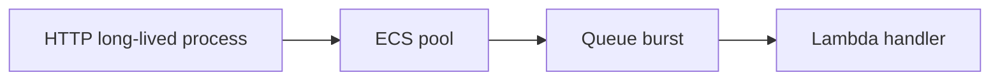

# AWS Lambda (serverless functions)

History: see [CHANGELOG.md](../CHANGELOG.md) or run `pnpm docs:history`

Area: AWS Compute · Status: ✅ built in repository; live AWS acceptance is separate

## 1. In one line

Lambda processes bounded queue batches from one arm64 worker image. Email is 256 MB/10 s, tickets 512 MB/30 s, outside the VPC; image cold starts and AWS quotas remain live acceptance.

## 2. Real-life comparison

A durable work tray keeps the task after the customer leaves; a completed stamp identifies a repeat.

## 3. Picture it

## 4. Where in our code

- Anchor: `apps/worker/Dockerfile` — `as`; follow the numbered comments at this boundary.
- Anchor: `apps/worker/src/lambda.ts` — `that`; follow the numbered comments at this boundary.
- Anchor: `infra/src/jobs/queue-trigger.ts` — `createQueueTrigger`; follow the numbered comments at this boundary.
- Anchor: `infra/src/jobs/worker-lambda.ts` — `createWorkerLambda`; follow the numbered comments at this boundary.
- Anchor: `infra/src/registry.ts` — `is`; follow the numbered comments at this boundary.

`infra/src/compute/service.ts` runs Fargate; `infra/src/jobs/worker-lambda.ts` has no vpcConfig and 10 s timeout; ticket Lambda has its own larger budget. Lambdas use container images already published by CI. `pnpm demo:tickets` validates handlers locally, not AWS cold starts. EKS/NAT gateways are not built.

## 5. See it yourself

Run `pnpm demo:tickets` and inspect the asserted outcome described above.

Failure thought experiment: Is a Lambda in a public subnet publicly addressed? No. Do not change a live stack to demonstrate it.

## 6. How it connects

Uses the [current system](../00-big-picture.md); gives a concrete decision to the [scenario](../guides/interview-scenarios.md#compute-choices) and [explorer tour](../guides/infra-explorer.html?tour=booking).

## 7. Our settings and WHY

Lambda processes bounded queue batches from one arm64 worker image. Email is 256 MB/10 s, tickets 512 MB/30 s, outside the VPC; image cold starts and AWS quotas remain live acceptance. Match runtime lifecycle and network needs to workload.

## 8. Trade-offs

VPC Lambda for RDS requires routing/endpoints or NAT for outside services. NAT has fixed and data charges; endpoints also cost. Container image cold start differs from zip, so measure.

## 9. Alternatives and when to choose them

10x: concurrency/quota and SES limits. 100x: provisioned concurrency only for measured latency needs, reserved concurrency for protection.

## 10. What breaks and how we notice

Is a Lambda in a public subnet publicly addressed? No.

## 11. Reach / Allowed / Password

Prove the network path separately from the scoped IAM action and the runtime credential. [Every IAM badge](../guides/infra-build-along.md#every-iam-badge-who--what--attached) shows trust, permissions and attachment. No AWS endpoint needs an inbound SG simply because a non-VPC Lambda calls it.

## 12. Cost

Existing resource/usage costs are detailed in the corresponding infra guide chapter. No new resources were deployed by this documentation change. Historical phase costs are illustrative snapshots, not a current quote; inspect billing and current regional pricing before a capacity decision.

## 13. Interview answers at 3 levels

- **Simple:** Lambda processes bounded queue batches from one arm64 worker image.
- **Senior:** ECS fits long-running API/web processes and predictable pools. Lambda fits bursty queue handlers with bounded work. EKS provides Kubernetes control at substantial operational cost. Our workers run outside the VPC because they only call managed public AWS APIs; putting a worker in a public subnet does not give it a public IP or automatic internet.
- **Lead:** 10x: concurrency/quota and SES limits. 100x: provisioned concurrency only for measured latency needs, reserved concurrency for protection.

## 14. Follow-up questions with answers

Is a Lambda in a public subnet publicly addressed? No.

Which runtime currently owns the HTTP API? **ECS Fargate.**

## 15. Say it in 30 seconds

ECS fits long-running API/web processes and predictable pools. Lambda fits bursty queue handlers with bounded work. EKS provides Kubernetes control at substantial operational cost. Our workers run outside the VPC because they only call managed public AWS APIs; putting a worker in a public subnet does not give it a public IP or automatic internet.

## 16. Status and production work

Repository implementation and local evidence are described above. Live AWS/CI execution remains owner acceptance. 10x: concurrency/quota and SES limits. 100x: provisioned concurrency only for measured latency needs, reserved concurrency for protection.

## Where it appears in the story

- [app-story: 9c. Side path: outbox, fan-out and recoverable work](../app-story.md#9c-side-path-outbox-fan-out-and-recoverable-work)
