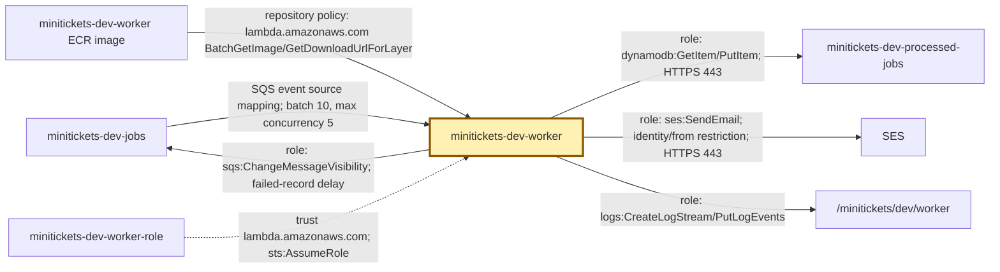
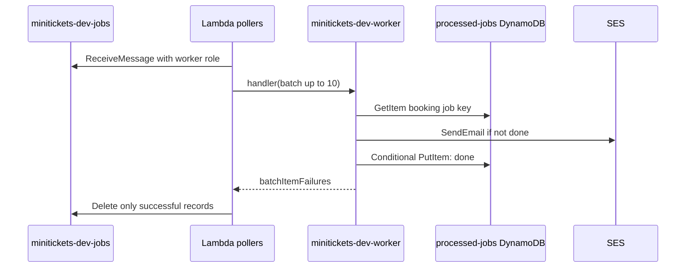

# Lambda: the city workers called when needed

History: see [CHANGELOG.md](../CHANGELOG.md) or run `pnpm docs:history`

Area: AWS Compute · Status: ✅ built in repository; live AWS acceptance is separate
<!-- interview-card: v1 -->

## 1. In one line

An SQS trigger calls MiniTickets' [Lambda](../glossary.md#lambda) worker for waiting jobs; AWS supplies the machine only while the function runs.

## 2. Where it sits

[Open this piece in the city explorer](../guides/infra-explorer.html?concept=aws-lambda#chapter=24&piece=email-lambda).

## 3. How it works

## 4. What happens in MiniTickets

1. AWS pollers read `minitickets-dev-jobs` and invoke `lambda.handler`.
2. The first invocation starts the arm64 container. Later batches may reuse it and its clients.
3. The email worker gets 256 MB and 10 seconds; it checks completion, sends, then records done.
4. It reports failed records and adjusts their retry delay.
5. A separate ticket function uses the same image, `ticket-lambda.handler`, 512 MB and 30 seconds.

## 5. Reach / Allowed / Password

**Reach:** both functions run outside our VPC and call AWS HTTPS APIs on 443.

**Allowed:** each function has one scoped Lambda role; its SQS mapping also uses that role.

**Password:** temporary role credentials; no server password.

## 6. In our code

`infra/src/jobs/worker-lambda.ts` → `createWorkerLambda`; `infra/src/tickets/lambda.ts` → `createTicketLambda`.

`apps/worker/src/lambda.ts` → `handler`; `apps/worker/src/batch.ts` → `handleBatch`.

## 7. In the AWS console

`us-east-1` → **Lambda → Functions → minitickets-dev-worker**. The function overview draws its SQS trigger. **Configuration → Triggers / Permissions / VPC** shows mapping, role and no VPC attachment. **Monitor → View CloudWatch logs** opens `/minitickets/dev/worker`.

## 8. Good / Bad

**Good:** no idle worker process; separate limits for email and tickets.

**Bad:** first runs can start slowly; timeouts and account/provider limits still matter.

## 9. Other choices

- Pick ECS for MiniTickets' always-running HTTP API and web.
- Pick Lambda for short queue jobs with no idle work.
- Pick EKS when Kubernetes control justifies operating it.

## 10. Connected to

| Neighbor | Direction | What allows it | Console check |
| --- | --- | --- | --- |
| [SQS](sqs.md) | in | Mapping + role receive/delete | Lambda → Configuration → Triggers |
| [DynamoDB](dynamodb.md) | out | Scoped table actions | IAM → worker-role → Permissions |
| [SES](ses-email.md) | out | `ses:SendEmail` + sender | IAM → worker-role → Permissions |
| [ECR](ecr.md) | in | Lambda repository policy | ECR → worker → Permissions |

## 11. When it breaks

- Timeout → logs' REPORT duration and AWS calls → bound work or calls before raising the budget.
- Throttled → mapping concurrency and account quota → match limits to actual capacity.

## 12. Say it in 30 seconds

“MiniTickets keeps web and API on ECS, but calls Lambda workers when queue work arrives. AWS reads SQS, invokes a bounded batch and deletes successful records. Our workers stay outside the VPC because their messages contain all required facts and they only call AWS APIs. Startup time, retries and quotas still need measurement.”

## 13. Likely follow-ups

**Does a public subnet give Lambda a public IP?** No.

**Are container clients rebuilt per job?** No; warm processes reuse them.

## 14. Remember it

Call in a worker for a shift; do not keep an empty workshop running.

## 15. More detail

Runtime, retry and deployment details

- Anchor: `apps/worker/Dockerfile` — `as`; follow the numbered comments at this boundary.
- Anchor: `apps/worker/src/lambda.ts` — `that`; follow the numbered comments at this boundary.
- Anchor: `infra/src/jobs/queue-trigger.ts` — `createQueueTrigger`; follow the numbered comments at this boundary.
- Anchor: `infra/src/jobs/worker-lambda.ts` — `createWorkerLambda`; follow the numbered comments at this boundary.
- Anchor: `infra/src/registry.ts` — `is`; follow the numbered comments at this boundary.

Both functions use the one worker ECR image built for `linux/arm64`; an architecture mismatch can fail startup. The email Docker image defaults to `lambda.handler`; the ticket function overrides its command. Email queue mapping uses batch size 10 and maximum concurrency 5; tickets use 1 and 2. Both enable `ReportBatchItemFailures`. Email has no reserved concurrency by default (`-1`); comments record a historical low account quota, not a current verified limit. Check Service Quotas before making reservations. Matching poller demand to available concurrency avoids consuming receives on throttled calls.

A cold start runs top-level code once; warm processes reuse SDK connections. The email clients set 1-second connect and 3-second request timeouts; Lambda's overall timeout still cuts off the batch. Logs are JSON stdout in our seven-day groups, not an unbounded default `/aws/lambda/*` group. Ticket logs use `/minitickets/dev/tickets`.

No `vpcConfig`, NAT gateway or paid interface endpoints are added. Moving a worker inside private networking would require deliberate routes/endpoints for the AWS APIs it calls. Provisioned concurrency is not built; consider it only after measuring startup latency. `pnpm demo:tickets` checks local handlers, not AWS cold starts or quotas. EKS is not built. [Compute-choice scenario](../guides/interview-scenarios.md#compute-choices). Usage/storage costs remain; old prices are snapshots. Live AWS acceptance is separate.

## Where it appears in the story

- [app-story: 9c. Side path: outbox, fan-out and recoverable work](../app-story.md#9c-side-path-outbox-fan-out-and-recoverable-work)
